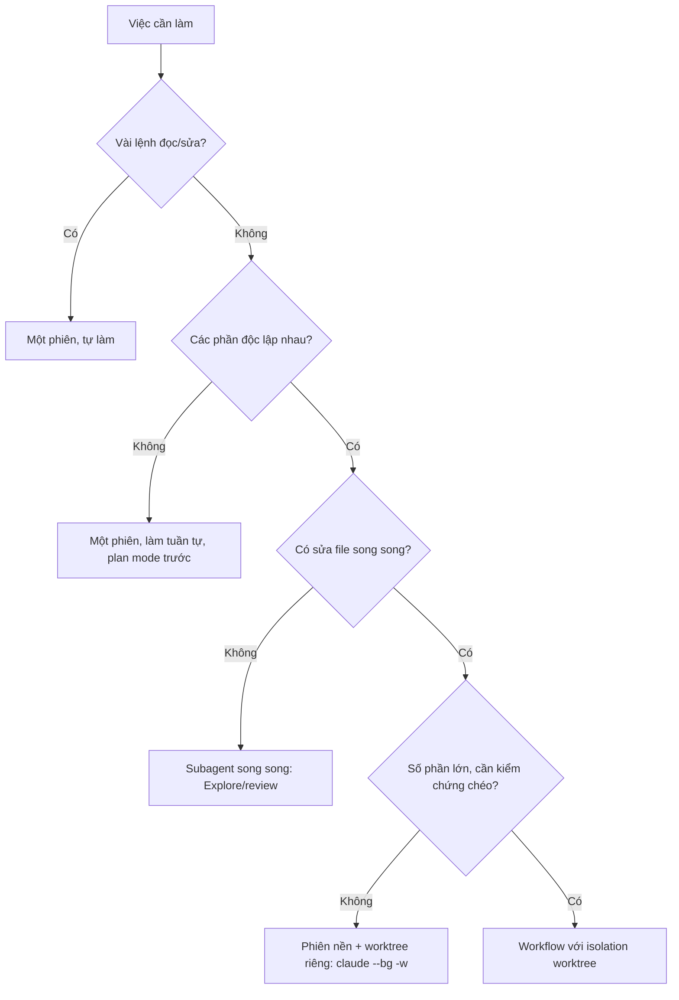

# Mô hình phối hợp nhiều agent và bảng lệnh tra nhanh

**Mục đích:** chọn mô hình phối hợp phù hợp cho từng loại việc, kèm lệnh cụ thể.
**Liên quan:** [02-worktree.md](02-worktree.md) · [03-subagent.md](03-subagent.md) · [04-workflow.md](04-workflow.md)

---

## 1. Chọn mô hình



## 2. Các mô hình

### A. Writer / Reviewer (2 phiên)
Phiên 1 viết code; phiên 2 (ngữ cảnh sạch, không bị "thiên vị" bởi quá trình viết) review.
```powershell
claude -w feat-x -n writer "Làm FR-07 theo @docs/srs.md"
# Sau khi xong, phiên mới trong cùng worktree:
claude -n reviewer --permission-mode plan "Review git diff main...HEAD so với FR-07. Không sửa, chỉ báo cáo."
```

### B. Song song theo module (N phiên nền)
Mỗi module một worktree, một nhánh, một PR. Chia ranh giới file rõ trước.

### C. Tester trước, Dev sau
Agent 1 viết test từ acceptance criteria (không nhìn code). Agent 2 viết code cho test pass, **không được sửa test**. Bạn duyệt test trước khi agent 2 bắt đầu.

### D. Khám phá song song → một người tổng hợp
"Dùng 3 agent Explore song song tìm hiểu auth, billing, notification; tổng hợp thành bản đồ hệ thống."

### E. Judge panel cho quyết định thiết kế
"dùng workflow: 3 agent đề xuất 3 phương án kiến trúc độc lập (đơn giản nhất / mở rộng tốt nhất / an toàn nhất), 2 agent chấm theo tiêu chí NFR, tổng hợp thành ADR."

## 3. Vai trò của bạn khi điều phối

- **Trước:** chia việc, viết brief, đặt phạm vi và tiêu chí hoàn thành.
- **Trong:** `claude agents` để xem phiên nào đang chờ duyệt; trả lời; dừng hướng sai sớm.
- **Sau:** duyệt từng kết quả theo checklist của giai đoạn tương ứng ([../02-quy-trinh-phan-mem/09-checklist-phe-duyet.md](../02-quy-trinh-phan-mem/09-checklist-phe-duyet.md)), merge tuần tự, chạy lại toàn bộ test sau mỗi lần merge.

Quy tắc ngón tay cái: **số agent song song ≤ số kết quả bạn duyệt kỹ được trong ngày.**

## 4. Bảng lệnh tra nhanh

| Mục đích | Lệnh |
|---|---|
| Mở phiên có tên | `claude -n <tên>` |
| Mở phiên trong worktree mới | `claude -w <tên>` |
| Chạy nền trong worktree | `claude --bg -w <tên> -n <tên> "<prompt>"` |
| Xem các phiên nền | `claude agents` |
| Vào phiên nền | `claude attach <id\|tên>` |
| Xem log phiên nền | `claude logs <id\|tên>` |
| Dừng / dọn | `claude stop <id>` / `claude rm <id>` |
| Tiếp tục phiên gần nhất | `claude -c` |
| Chọn phiên cũ | `claude -r` |
| Rẽ nhánh phiên | `claude -r <id> --fork-session` |
| Chỉ lập kế hoạch | `claude --permission-mode plan` |
| Headless + JSON | `claude -p "<prompt>" --output-format json` |
| Giới hạn chi phí headless | `claude -p "..." --max-budget-usd 2` |
| Chỉ cho đọc | `claude --tools "Read,Grep,Glob"` |
| Agent tùy chỉnh | `/agents`, `.claude/agents/<tên>.md`, `claude --agent <tên>` |
| Theo dõi workflow | `/workflows` |
| Review diff | `/code-review`, `/security-review`, `/simplify` |
| Review cloud đa agent | `/code-review ultra` (tính phí, người dùng tự chạy) |
| Worktree thủ công | `git worktree add ..\<dir> -b <branch>` / `git worktree list` / `git worktree remove <dir>` |
