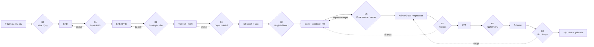
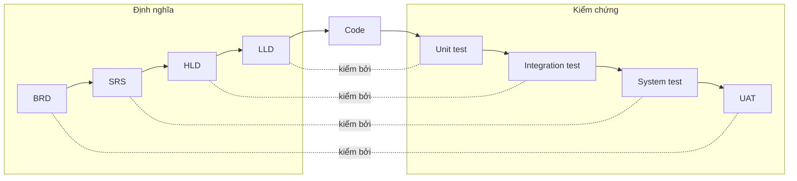
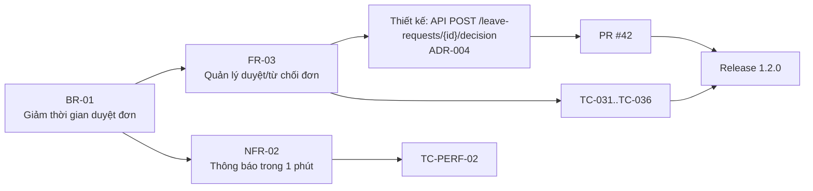

# Tổng quan vòng đời phần mềm: từ BRD tới Release

**Mục đích:** Cho người phê duyệt một bản đồ toàn cảnh: có những giai đoạn nào, mỗi giai đoạn sinh ra tài liệu gì, cổng phê duyệt (gate) nằm ở đâu, và ai chịu trách nhiệm khi agent AI làm phần lớn công việc soạn thảo.
Đọc file này trước, sau đó đọc từng file giai đoạn khi cần duyệt giai đoạn đó.

**Liên quan:** [01-brd.md](01-brd.md) · [02-yeu-cau-srs-prd.md](02-yeu-cau-srs-prd.md) · [03-thiet-ke.md](03-thiet-ke.md) · [04-lap-ke-hoach.md](04-lap-ke-hoach.md) · [05-phat-trien.md](05-phat-trien.md) · [06-code-review.md](06-code-review.md) · [07-kiem-thu.md](07-kiem-thu.md) · [08-release.md](08-release.md) · [09-checklist-phe-duyet.md](09-checklist-phe-duyet.md) · [10-thuat-ngu.md](10-thuat-ngu.md) · [Mẫu tài liệu](../04-mau/) · [Áp dụng với agent](../03-ap-dung-voi-agent/README.md)

---

## 1. Ví dụ xuyên suốt

Toàn bộ bộ tài liệu dùng một ví dụ: **hệ thống quản lý đơn nghỉ phép nội bộ** (gọi tắt: *Leave*).

- Nhân viên tạo đơn nghỉ phép (loại phép, ngày bắt đầu, ngày kết thúc, lý do).
- Quản lý trực tiếp duyệt hoặc từ chối.
- Hệ thống trừ số ngày phép còn lại, gửi thông báo, và cho bộ phận Nhân sự (HR) xuất báo cáo.
- Hiện tại công ty dùng email + file Excel, mất trung bình 3 ngày để duyệt một đơn và HR mất 2 ngày mỗi tháng để tổng hợp.

## 2. Các giai đoạn và cổng phê duyệt

| Gate | Tên | Câu hỏi cốt lõi | Tài liệu chính |
|------|-----|-----------------|----------------|
| G0 | Khởi động | Có đáng làm không? Ai tài trợ, ai quyết? | Đề xuất ngắn / business case |
| G1 | Duyệt BRD | Ta hiểu đúng vấn đề nghiệp vụ và mục tiêu chưa? | [BRD](01-brd.md) |
| G2 | Duyệt yêu cầu | Hệ thống phải làm gì, đo được, kiểm thử được chưa? | [SRS/PRD](02-yeu-cau-srs-prd.md) |
| G3 | Duyệt thiết kế | Cách xây có đáp ứng yêu cầu, an toàn, bảo trì được không? | [HLD/LLD, ADR](03-thiet-ke.md) |
| G4 | Duyệt kế hoạch | Việc đã chia đủ nhỏ, có thứ tự, có rủi ro rõ chưa? | [Kế hoạch, WBS](04-lap-ke-hoach.md) |
| G5 | Merge code | Thay đổi đúng phạm vi, có test, review đạt chưa? | [PR + review](05-phat-trien.md), [06](06-code-review.md) |
| G6 | Test exit | Chất lượng đủ để đưa người dùng nghiệm thu chưa? | [Báo cáo test](07-kiem-thu.md) |
| G7 | UAT | Người dùng nghiệp vụ chấp nhận chưa? | Biên bản UAT |
| G8 | Go/No-go | Phát hành bây giờ có an toàn, có đường lui không? | [Release checklist](08-release.md) |

Chi tiết từng cổng (đầu vào, đầu ra, câu hỏi bắt buộc, red flags): [09-checklist-phe-duyet.md](09-checklist-phe-duyet.md).

**Nguyên tắc:** Không bỏ qua cổng. Với thay đổi nhỏ (sửa lỗi một dòng) có thể gộp nhiều cổng vào một lần duyệt, nhưng phải ghi rõ đã gộp những cổng nào trong biên bản ([mẫu](../04-mau/approval-record-template.md)).

## 3. Mô hình quy trình và khi nào dùng

| Mô hình | Cách chạy | Phù hợp khi | Không phù hợp khi |
|---------|-----------|-------------|-------------------|
| **Waterfall** (thác nước) | Làm tuần tự từng giai đoạn, xong giai đoạn này mới sang giai đoạn sau | Yêu cầu ổn định, hợp đồng giá cố định, có ràng buộc pháp lý / kiểm định | Yêu cầu còn mơ hồ, cần phản hồi người dùng sớm |
| **V-model** | Waterfall nhưng mỗi giai đoạn bên trái có một cấp kiểm thử tương ứng bên phải | Phần mềm nhúng, an toàn, ô tô (MISRA), y tế: cần truy vết chặt yêu cầu ↔ test | Sản phẩm thử nghiệm, thay đổi liên tục |
| **Agile / Scrum** | Chu kỳ ngắn (sprint 1–4 tuần), mỗi sprint giao một phần chạy được | Sản phẩm nội bộ, web, yêu cầu thay đổi | Khi khách hàng bắt buộc duyệt toàn bộ đặc tả trước khi làm |
| **Kanban** | Luồng liên tục, giới hạn số việc đang làm (WIP) | Bảo trì, vận hành, sửa lỗi | Dự án lớn cần mốc cố định |

**Trong thực tế với agent:** Dùng "Agile có cổng". Mỗi sprint vẫn đi qua G2→G6 cho phần việc của sprint đó; G1 (BRD) duyệt một lần cho cả dự án và cập nhật khi phạm vi đổi; G8 mỗi lần phát hành. Lý do: agent làm nhanh, nên rủi ro lớn nhất không phải là chậm mà là **làm nhanh sai hướng**. Cổng phê duyệt giữ hướng đi.

## 4. Truy vết (traceability)

Truy vết là khả năng đi từ một nhu cầu nghiệp vụ tới dòng code và test chứng minh nó, và ngược lại. Không có truy vết thì người duyệt không thể trả lời "yêu cầu này đã được làm và kiểm thử chưa?".

Quy ước ID dùng trong bộ tài liệu:

| Tiền tố | Ý nghĩa | Ví dụ |
|---------|---------|-------|
| `BR-xx` | Yêu cầu nghiệp vụ (trong BRD) | BR-01 Giảm thời gian duyệt đơn |
| `FR-xx` | Yêu cầu chức năng (trong SRS) | FR-03 Quản lý duyệt/từ chối đơn |
| `NFR-xx` | Yêu cầu phi chức năng | NFR-02 Thông báo gửi trong ≤ 1 phút |
| `US-xx` | User story | US-07 Là quản lý, tôi muốn… |
| `AC-xx.y` | Tiêu chí chấp nhận của story | AC-07.2 |
| `ADR-xxx` | Quyết định kiến trúc | ADR-004 Dùng hàng đợi cho thông báo |
| `TC-xxx` | Test case | TC-031 |
| `BUG-xxx` | Lỗi | BUG-112 |

**Quy tắc:** Mỗi `FR` phải trỏ về ít nhất một `BR`. Mỗi `FR`/`NFR` có mức ưu tiên Must phải có ít nhất một `TC`. Một `FR` không trỏ về `BR` nào là dấu hiệu **mở rộng phạm vi** (scope creep) — agent rất hay tự thêm tính năng.

## 5. Vai trò

| Vai trò | Việc chính | Trong mô hình có agent |
|---------|-----------|------------------------|
| **Sponsor** (nhà tài trợ) | Quyết định có làm không, cấp ngân sách | Luôn là người |
| **PO** (Product Owner) | Sở hữu backlog, ưu tiên, chấp nhận story | Người; agent hỗ trợ viết story |
| **BA** (Business Analyst) | Thu thập, phân tích, viết BRD/SRS | Agent soạn nháp từ ghi chú phỏng vấn; BA kiểm tra và hỏi lại người dùng |
| **Architect** | Thiết kế, quyết định công nghệ, ADR | Agent đề xuất phương án và trade-off; Architect chọn và ký |
| **Dev** | Viết code, unit test, PR | Agent viết; Dev giám sát, review, chịu trách nhiệm code đã merge |
| **QA** | Test plan, test case, chạy test, báo lỗi | Agent sinh test case và test tự động; QA kiểm tra độ phủ và chạy UAT cùng người dùng |
| **Release manager** | Lên lịch, điều phối, go/no-go, rollback | Người; agent soạn release note và checklist |
| **Người phê duyệt** | Ký tại từng gate | **Luôn là người.** Agent không bao giờ tự phê duyệt |

## 6. RACI giữa người và agent

R = Responsible (người/agent làm), A = Accountable (chịu trách nhiệm cuối, chỉ **một** người), C = Consulted (được hỏi ý kiến), I = Informed (được thông báo).

| Hoạt động | Agent | BA/PO | Architect | Dev | QA | Release mgr | Người phê duyệt |
|-----------|:----:|:----:|:----:|:----:|:----:|:----:|:----:|
| Soạn BRD | R | R | C | I | I | I | **A** |
| Soạn SRS / user story | R | R | C | C | C | I | **A** |
| Thiết kế, ADR | R | C | R | C | C | I | **A** |
| Kế hoạch, chia task | R | C | C | R | C | I | **A** |
| Viết code + unit test | R | I | C | R | I | I | **A** (Dev lead) |
| Code review | R (review vòng 1) | I | C | R | I | I | **A** (reviewer người) |
| Test case, test tự động | R | C | I | C | R | I | **A** (QA lead) |
| UAT | — | R | I | I | R | I | **A** (PO / người dùng nghiệp vụ) |
| Release note, checklist | R | C | I | C | C | R | **A** |
| Quyết định go/no-go | — | C | C | C | C | R | **A** |

**Điểm mấu chốt:** Agent có thể là **R** ở hầu hết việc soạn thảo, nhưng **không bao giờ là A**. Khi bạn ký duyệt, bạn nhận trách nhiệm như thể chính bạn viết ra. Vì vậy hãy duyệt theo bằng chứng, không theo lời agent tự đánh giá.

## 7. Cách đọc bộ tài liệu này

1. Đọc file này để hiểu bản đồ.
2. Đọc [09-checklist-phe-duyet.md](09-checklist-phe-duyet.md) — đây là tài liệu bạn sẽ mở nhiều nhất khi đi duyệt.
3. Khi tới một gate cụ thể, mở file giai đoạn tương ứng (01…08). Mỗi file có cùng cấu trúc:
   - Mục đích, khái niệm, cấu trúc tài liệu, ví dụ *Leave*.
   - Lỗi thường gặp (đặc biệt lỗi agent hay mắc).
   - **Checklist phê duyệt** — trả lời có/không.
   - **Dấu hiệu phải từ chối** — gặp một dấu hiệu là đủ lý do trả lại.
4. Dùng mẫu trong [../04-mau/](../04-mau/) khi giao việc cho agent: đưa mẫu vào prompt để agent điền đúng cấu trúc.
5. Ghi quyết định bằng [biên bản phê duyệt](../04-mau/approval-record-template.md).
6. Gặp từ lạ: [10-thuat-ngu.md](10-thuat-ngu.md).
