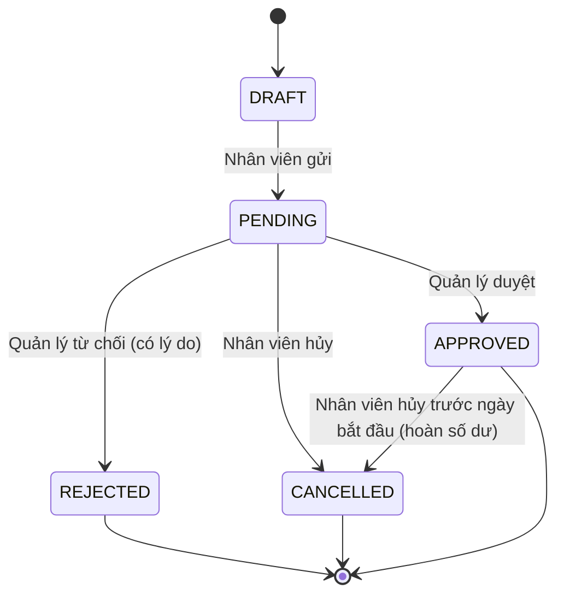

# SRS / PRD — Đặc tả yêu cầu phần mềm

**Mục đích:** SRS (Software Requirements Specification) hoặc PRD (Product Requirements Document) trả lời **"Hệ thống phải làm gì và tốt tới mức nào?"** ở mức đủ cụ thể để thiết kế, ước lượng và kiểm thử. Đây là cổng G2.
Quy tắc vàng: **một yêu cầu không kiểm thử được là một yêu cầu chưa xong.**

**Liên quan:** [00-tong-quan.md](00-tong-quan.md) · [01-brd.md](01-brd.md) · [03-thiet-ke.md](03-thiet-ke.md) · [07-kiem-thu.md](07-kiem-thu.md) · [09-checklist-phe-duyet.md](09-checklist-phe-duyet.md) · [Mẫu SRS](../04-mau/srs-template.md) · [Áp dụng với agent](../03-ap-dung-voi-agent/README.md)

---

## 1. SRS hay PRD?

| | PRD | SRS |
|--|-----|-----|
| Người viết | PO / Product Manager | BA / System Analyst |
| Trọng tâm | Người dùng, giá trị, user story | Hành vi hệ thống, chi tiết, ràng buộc |
| Hình thức | Ngắn, sống, cập nhật theo sprint | Đầy đủ, có phiên bản, đôi khi là phụ lục hợp đồng |
| Hay dùng trong | Agile, sản phẩm nội bộ | Dự án outsource, V-model, ngành có kiểm định |

Trong thực tế hai tài liệu thường gộp. Bộ tài liệu này gọi chung là **SRS**. Điều quan trọng không phải tên mà là có đủ: FR, NFR, story + AC, truy vết, ưu tiên.

## 2. Yêu cầu chức năng (FR — Functional Requirement)

FR mô tả **hành vi**: hệ thống làm gì khi nhận đầu vào gì. Viết dạng "Hệ thống phải …" (shall), mỗi FR một hành vi.

| ID | Yêu cầu | Truy vết BR | Ưu tiên |
|----|---------|-------------|---------|
| FR-01 | Hệ thống phải cho nhân viên đã đăng nhập tạo đơn nghỉ với: loại phép, ngày bắt đầu, ngày kết thúc, nửa ngày (sáng/chiều/không), lý do (tối đa 500 ký tự) | BR-01 | Must |
| FR-02 | Hệ thống phải tính số ngày nghỉ theo ngày làm việc, loại trừ thứ Bảy, Chủ nhật và ngày lễ trong bảng `holidays` | BR-02 | Must |
| FR-03 | Hệ thống phải cho quản lý trực tiếp duyệt hoặc từ chối đơn đang ở trạng thái `PENDING`; từ chối bắt buộc nhập lý do | BR-01 | Must |
| FR-04 | Khi đơn được duyệt, hệ thống phải trừ số dư phép tương ứng trong cùng một giao dịch | BR-02 | Must |
| FR-05 | Hệ thống phải từ chối tạo đơn nếu số ngày yêu cầu lớn hơn số dư còn lại (với loại phép năm) | BR-02 | Must |
| FR-06 | Hệ thống phải cho HR xuất báo cáo tháng theo phòng ban ra file `.xlsx` | BR-03 | Must |
| FR-07 | Hệ thống phải hiển thị lịch nghỉ của nhóm cho quản lý | BR-04 | Should |

**FR tốt:** một hành vi, có điều kiện rõ, có giới hạn (500 ký tự), có trạng thái (`PENDING`), kiểm thử được.
**FR xấu:** "Hệ thống phải xử lý đơn nghỉ phép một cách hiệu quả." — không biết test gì.

### Mô hình trạng thái
Với nghiệp vụ có vòng đời, luôn yêu cầu sơ đồ trạng thái. Đây là chỗ hay sót trường hợp nhất.

Câu hỏi người duyệt phải đặt: *Hủy đơn đã duyệt sau ngày bắt đầu thì sao? Quản lý nghỉ thì ai duyệt thay? Đơn `PENDING` quá 5 ngày thì sao?* Nếu SRS không trả lời, đó là lỗ hổng.

## 3. Yêu cầu phi chức năng (NFR)

NFR mô tả **chất lượng**: nhanh tới đâu, an toàn tới đâu, chạy liên tục tới đâu. **Mỗi NFR phải có con số và cách đo.**

| ID | Loại | Yêu cầu (đo được) | Cách kiểm chứng |
|----|------|-------------------|-----------------|
| NFR-01 | Hiệu năng | 95% request API trả về trong ≤ 500 ms với 100 người dùng đồng thời | Test tải bằng k6, báo cáo p95 |
| NFR-02 | Hiệu năng | Email thông báo được gửi trong ≤ 1 phút sau khi đơn đổi trạng thái | Log `sent_at - event_at` |
| NFR-03 | Bảo mật | Đăng nhập chỉ qua SSO Azure AD; không lưu mật khẩu | Review thiết kế + test |
| NFR-04 | Bảo mật | Nhân viên chỉ xem được đơn của mình; quản lý chỉ xem đơn của nhân viên trực thuộc; lý do nghỉ ốm chỉ HR và quản lý trực tiếp xem | Test phân quyền tự động cho mọi API |
| NFR-05 | Khả dụng | Uptime ≥ 99,5% trong giờ hành chính (8:00–18:00, thứ Hai–Sáu) | Giám sát hằng tháng |
| NFR-06 | Khả năng phục hồi | RPO ≤ 24 giờ, RTO ≤ 4 giờ | Diễn tập khôi phục backup |
| NFR-07 | Bảo trì | Độ phủ unit test ≥ 80% cho tầng nghiệp vụ; không lỗi lint mức error | Báo cáo CI |
| NFR-08 | Tuân thủ | Lưu nhật ký (audit log) mọi thao tác duyệt/từ chối/hủy trong 5 năm | Test + review |
| NFR-09 | Khả năng sử dụng | Hỗ trợ tiếng Việt và tiếng Anh; Chrome, Edge 2 phiên bản mới nhất | Test thủ công |

| NFR xấu | Vì sao xấu | Sửa |
|---------|-----------|-----|
| "Hệ thống phải nhanh" | Không đo được | NFR-01 |
| "Hệ thống phải bảo mật" | Không biết test gì | NFR-03, NFR-04 |
| "Hệ thống phải luôn hoạt động" | 100% uptime là không thể và rất đắt | NFR-05 |

## 4. User story và tiêu chí chấp nhận (AC)

Mẫu: **Là** <vai trò>, **tôi muốn** <hành động>, **để** <giá trị>.
AC viết theo **Given / When / Then** (Cho trước / Khi / Thì) — mỗi AC biến thẳng được thành một test case.

> **US-07** — Là quản lý trực tiếp, tôi muốn từ chối đơn kèm lý do, để nhân viên biết cần điều chỉnh gì. *(FR-03, BR-01)*
>
> **AC-07.1** — *Given* đơn `LR-100` ở trạng thái `PENDING` và tôi là quản lý trực tiếp của người gửi, *When* tôi chọn Từ chối và nhập lý do "Trùng lịch release", *Then* đơn chuyển `REJECTED`, lý do được lưu, nhân viên nhận email trong ≤ 1 phút.
>
> **AC-07.2** — *Given* đơn ở `PENDING`, *When* tôi chọn Từ chối mà không nhập lý do, *Then* hệ thống không đổi trạng thái và báo "Vui lòng nhập lý do từ chối".
>
> **AC-07.3** — *Given* tôi **không** phải quản lý trực tiếp của người gửi, *When* tôi gọi API từ chối đơn, *Then* hệ thống trả 403 và không đổi trạng thái.
>
> **AC-07.4** — *Given* đơn đã `APPROVED`, *When* tôi cố từ chối, *Then* hệ thống trả 409 "Đơn đã được xử lý".

Lưu ý: AC tốt luôn có **trường hợp sai** (AC-07.2, 07.3, 07.4), không chỉ đường đi vui vẻ (happy path). Agent rất hay chỉ viết happy path.

Tiêu chí INVEST cho story tốt: **I**ndependent (độc lập), **N**egotiable (thương lượng được), **V**aluable (có giá trị), **E**stimable (ước lượng được), **S**mall (nhỏ, vừa một sprint), **T**estable (kiểm thử được).

## 5. Use case (khi cần chi tiết hơn story)

| Mục | Nội dung (UC-03 Duyệt đơn) |
|-----|-----------------------------|
| Tác nhân | Quản lý trực tiếp |
| Tiền điều kiện | Đã đăng nhập; có ít nhất một đơn `PENDING` của nhân viên trực thuộc |
| Luồng chính | 1. Mở danh sách chờ duyệt → 2. Chọn đơn → 3. Xem chi tiết và số dư → 4. Chọn Duyệt → 5. Hệ thống trừ số dư, đổi trạng thái, gửi email |
| Luồng thay thế | 4a. Chọn Từ chối → nhập lý do → … |
| Luồng ngoại lệ | 5a. Số dư không đủ (do đơn khác vừa được duyệt) → báo lỗi, đơn giữ `PENDING` |
| Hậu điều kiện | Đơn ở `APPROVED`; số dư giảm đúng số ngày; audit log có bản ghi |

## 6. Ưu tiên MoSCoW

| Mức | Ý nghĩa | Quy tắc |
|-----|---------|---------|
| **Must** | Thiếu thì không release | Thường ≤ 60% công sức |
| **Should** | Quan trọng nhưng có cách tạm | Làm nếu đủ thời gian |
| **Could** | Có thì tốt | Bỏ đầu tiên khi trễ |
| **Won't (this time)** | Đồng ý là không làm đợt này | Ghi rõ để khỏi tranh cãi sau |

Nếu mọi thứ đều Must → chưa ưu tiên thật. Trả lại.

## 7. Ma trận truy vết (Traceability matrix)

| BR | FR/NFR | Story | Thiết kế | Test case | Trạng thái |
|----|--------|-------|----------|-----------|-----------|
| BR-01 | FR-01 | US-03 | API `POST /leave-requests` | TC-001..TC-008 | — |
| BR-01 | FR-03 | US-07 | API `POST /leave-requests/{id}/decision` | TC-031..TC-036 | — |
| BR-02 | FR-04, FR-05 | US-09 | ADR-003 transaction | TC-040..TC-047 | — |
| BR-05 | NFR-04 | US-12 | Module phân quyền | TC-SEC-01..05 | — |

Ở G2, cột Thiết kế và Test case có thể trống; nhưng cột BR → FR phải đầy đủ. Ma trận được cập nhật ở các cổng sau.

## 8. Definition of Ready (DoR)

Một story/FR chỉ được đưa vào làm (giao cho agent code) khi:

- [ ] Có ID, truy vết về BR.
- [ ] Có AC Given/When/Then, có trường hợp lỗi và phân quyền.
- [ ] Không còn câu hỏi mở chặn việc làm.
- [ ] Đã ước lượng và đủ nhỏ để làm trong ≤ 2 ngày (với agent: một phiên làm việc, một PR).
- [ ] Phụ thuộc (API, dữ liệu, thiết kế) đã sẵn sàng.
- [ ] PO đồng ý ưu tiên.

## 9. Lỗi agent hay mắc ở SRS

- Thêm FR không trỏ về BR nào ("tiện thì thêm export PDF").
- NFR sao chép chung chung, không có số.
- AC chỉ có happy path; thiếu phân quyền, thiếu đồng thời (hai quản lý duyệt cùng lúc), thiếu biên (nghỉ qua năm mới, nghỉ nửa ngày, ngày lễ).
- Tự quyết định quy tắc nghiệp vụ (ví dụ "phép năm được chuyển sang năm sau tối đa 5 ngày") mà không ai nói — đây là **quy tắc nghiệp vụ bịa**, rất nguy hiểm vì trông hợp lý.
- Mâu thuẫn nội bộ (FR-05 chặn khi thiếu số dư, nhưng US-09 lại cho phép "nghỉ âm").

## Checklist phê duyệt

| # | Câu hỏi | Có/Không |
|---|---------|:-------:|
| 1 | Mỗi FR/NFR có ID duy nhất và truy vết về ít nhất một BR? | |
| 2 | Mọi BR mức Must đều được bao phủ bởi ít nhất một FR? | |
| 3 | Mỗi FR mô tả một hành vi, kiểm thử được, không mơ hồ ("nhanh", "dễ", "phù hợp")? | |
| 4 | Mỗi NFR có con số và cách đo? | |
| 5 | Có NFR cho bảo mật/phân quyền, dữ liệu cá nhân, audit, backup khi phù hợp? | |
| 6 | Mỗi story có AC Given/When/Then, gồm cả trường hợp lỗi, phân quyền, biên? | |
| 7 | Có sơ đồ trạng thái cho đối tượng có vòng đời và mọi chuyển trạng thái đều có quy tắc? | |
| 8 | Mọi quy tắc nghiệp vụ (cách tính ngày, ngày lễ, nửa ngày, hủy) đều có nguồn xác nhận từ người nghiệp vụ? | |
| 9 | Ưu tiên MoSCoW thực sự (không phải tất cả là Must) và có danh sách Won't? | |
| 10 | Không có mâu thuẫn giữa các FR, story, NFR? | |
| 11 | Các story đợt tới đạt Definition of Ready? | |
| 12 | Người dùng nghiệp vụ / PO đã đọc phần AC và xác nhận? | |

## Dấu hiệu phải từ chối (red flags)

- Có FR không truy vết về BR (mở rộng phạm vi), hoặc BR Must không có FR nào.
- Có từ không đo được trong yêu cầu: "nhanh", "thân thiện", "hiệu quả", "an toàn", "linh hoạt", "v.v.".
- Quy tắc nghiệp vụ xuất hiện mà không ai trong nhóm nghiệp vụ nói ra.
- AC chỉ có happy path; không có một AC nào về quyền truy cập.
- Không có NFR bảo mật cho hệ thống có dữ liệu cá nhân.
- Tài liệu dài nhưng không có bảng truy vết.
- "TBD" / "sẽ bổ sung sau" ở yêu cầu Must.
