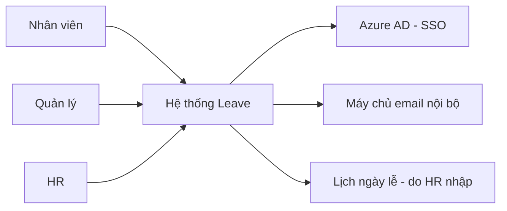
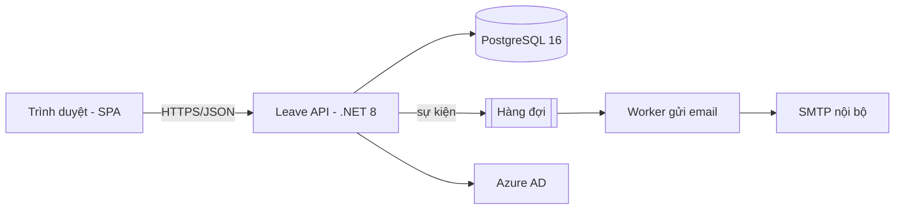

# Thiết kế và kiến trúc

**Mục đích:** Tài liệu thiết kế trả lời **"Xây hệ thống như thế nào để đáp ứng SRS?"** và ghi lại **vì sao chọn cách đó**. Đây là cổng G3.
Người duyệt không cần tự thiết kế lại; cần kiểm tra thiết kế bao phủ yêu cầu, có cân nhắc phương án, xử lý lỗi và bảo mật, và không phức tạp quá mức.

**Liên quan:** [00-tong-quan.md](00-tong-quan.md) · [02-yeu-cau-srs-prd.md](02-yeu-cau-srs-prd.md) · [04-lap-ke-hoach.md](04-lap-ke-hoach.md) · [09-checklist-phe-duyet.md](09-checklist-phe-duyet.md) · [Mẫu ADR](../04-mau/adr-template.md) · [Áp dụng với agent](../03-ap-dung-voi-agent/README.md)

---

## 1. HLD và LLD

| | HLD — High-Level Design (thiết kế tổng thể) | LLD — Low-Level Design (thiết kế chi tiết) |
|--|---------------------------------------------|---------------------------------------------|
| Câu hỏi | Gồm những khối nào, nói chuyện với nhau ra sao, chạy ở đâu | Bên trong mỗi khối: lớp, hàm, bảng, thuật toán |
| Đọc giả | Architect, PO, IT vận hành, bảo mật | Dev, reviewer |
| Nội dung | Sơ đồ C4 mức 1–2, công nghệ, triển khai, tích hợp, NFR được đáp ứng thế nào | Sơ đồ mức 3, schema DB, API contract, sequence diagram, xử lý lỗi |
| Khi duyệt | Một lần cho dự án, cập nhật khi kiến trúc đổi | Theo từng tính năng lớn, trước khi giao agent code |

## 2. Các view theo mô hình C4

C4 = Context → Container → Component → Code. Thường chỉ cần 3 mức đầu.

**Mức 1 — Context:** hệ thống và thế giới bên ngoài.



**Mức 2 — Container:** các đơn vị chạy/triển khai riêng.



**Mức 3 — Component:** bên trong `Leave API`: `RequestController`, `ApprovalService`, `BalanceService`, `WorkingDayCalculator`, `AuthorizationPolicy`, `AuditLogger`, `LeaveRepository`.

Người duyệt kiểm tra: mỗi FR/NFR "rơi" vào component nào? Có component nào không phục vụ yêu cầu nào không (thừa)?

## 3. Thiết kế dữ liệu

| Bảng | Cột chính | Ghi chú |
|------|-----------|---------|
| `employees` | `id`, `aad_object_id`, `manager_id`, `department_id` | Đồng bộ từ AAD |
| `leave_requests` | `id`, `employee_id`, `type`, `start_date`, `end_date`, `half_day`, `days`, `status`, `reason`, `decided_by`, `decided_at`, `version` | `version` cho optimistic locking |
| `leave_balances` | `employee_id`, `year`, `type`, `entitled`, `used` | Khóa chính (`employee_id`, `year`, `type`) |
| `holidays` | `date`, `name` | HR quản lý |
| `audit_log` | `id`, `actor_id`, `action`, `entity`, `entity_id`, `at`, `payload` | Chỉ thêm, không sửa/xóa; lưu 5 năm (NFR-08) |

Câu hỏi bắt buộc: Dữ liệu nhạy cảm (lý do nghỉ ốm) được lưu và che như thế nào? Có migration và đường lùi (down migration) không? Có index cho truy vấn chính (danh sách chờ duyệt theo `manager_id`, `status`)?

## 4. API contract

Viết contract **trước** khi code (OpenAPI hoặc bảng). Contract là thỏa thuận giữa frontend, backend và test.

| Method + Path | Quyền | Body / Query | Thành công | Lỗi |
|---------------|-------|--------------|-----------|-----|
| `POST /leave-requests` | Nhân viên | `type, startDate, endDate, halfDay, reason` | 201 + đơn | 400 dữ liệu sai, 422 thiếu số dư |
| `POST /leave-requests/{id}/decision` | Quản lý trực tiếp | `decision: APPROVE\|REJECT, reason?, version` | 200 + đơn | 403 không có quyền, 409 đã xử lý hoặc `version` cũ, 422 thiếu lý do khi REJECT |
| `GET /reports/monthly?month=2026-11&dept=…` | HR | — | 200 file `.xlsx` | 403 |

Quy ước lỗi thống nhất: `{"code": "LEAVE_ALREADY_DECIDED", "message": "...", "traceId": "..."}`.

## 5. Luồng xử lý và xử lý lỗi

```mermaid
sequenceDiagram
    participant QL as Quản lý
    participant API
    participant DB
    participant Q as Hàng đợi
    QL->>API: POST /decision (APPROVE, version=3)
    API->>API: Kiểm tra quyền (manager_id)
    API->>DB: BEGIN; SELECT ... FOR UPDATE (balance)
    alt số dư đủ và version khớp
      API->>DB: UPDATE request, UPDATE balance, INSERT audit; COMMIT
      API->>Q: publish LeaveDecided
      API-->>QL: 200
    else version không khớp
      API->>DB: ROLLBACK
      API-->>QL: 409
    end
```

Thiết kế phải trả lời cho **mọi** lời gọi ra ngoài (DB, email, AAD): nếu nó chậm, lỗi, hoặc trả dữ liệu lạ thì sao?

| Tình huống | Xử lý |
|-----------|-------|
| Email lỗi | Worker thử lại 3 lần, lùi dần (backoff); sau đó ghi `notification_failed` và cảnh báo; **không** rollback quyết định duyệt |
| Hai quản lý duyệt cùng lúc (ủy quyền) | Optimistic locking bằng `version` → người thứ hai nhận 409 |
| AAD không phản hồi | Trả 503, không cho đăng nhập bằng cách khác |

## 6. Bảo mật — threat model STRIDE ngắn

| Mối đe dọa | Ví dụ trong *Leave* | Biện pháp |
|-----------|----------------------|-----------|
| **S**poofing (giả mạo danh tính) | Gọi API bằng token giả | Xác thực JWT từ AAD, kiểm tra `aud`, `iss`, chữ ký |
| **T**ampering (sửa dữ liệu) | Sửa `days` trong request để trừ ít phép | Server tự tính `days`, bỏ qua giá trị client gửi |
| **R**epudiation (chối bỏ) | Quản lý nói "tôi không duyệt" | Audit log không sửa được |
| **I**nformation disclosure (lộ thông tin) | Nhân viên xem lý do nghỉ ốm của người khác (IDOR) | Kiểm tra quyền theo từng bản ghi, không chỉ theo vai trò |
| **D**enial of service (từ chối dịch vụ) | Xuất báo cáo cả năm làm treo API | Giới hạn khoảng thời gian, chạy nền |
| **E**levation of privilege (leo quyền) | Nhân viên tự duyệt đơn của mình | Cấm `decided_by == employee_id`, test riêng |

## 7. ADR — Architecture Decision Record

**Khi nào cần ADR:** quyết định khó đảo ngược hoặc tốn kém nếu sai — chọn DB, chọn framework, cách xác thực, đồng bộ hay bất đồng bộ, cấu trúc module, thêm dịch vụ mới. Không cần ADR cho chọn tên biến.

**Cấu trúc** (xem [mẫu](../04-mau/adr-template.md)): Tiêu đề · Trạng thái (Proposed/Accepted/Superseded) · Bối cảnh · Các phương án · Quyết định · Hệ quả (tốt và xấu) · Ngày, người quyết.

> **ADR-004 Gửi thông báo qua hàng đợi** — *Bối cảnh:* NFR-02 yêu cầu ≤ 1 phút; SMTP nội bộ đôi khi chậm 30 giây. *Phương án:* (A) gửi đồng bộ trong request, (B) hàng đợi + worker, (C) bảng outbox + job định kỳ. *Quyết định:* (C) — không cần thêm hạ tầng hàng đợi, vẫn đảm bảo không mất thông báo khi API lỗi giữa chừng. *Hệ quả:* + đơn giản để vận hành; − độ trễ phụ thuộc chu kỳ job (đặt 15 giây).

## 8. Đánh giá phương án và trade-off

Một thiết kế tốt **luôn** có ít nhất 2 phương án được so sánh cho mỗi quyết định lớn. Bảng so sánh:

| Tiêu chí (trọng số) | A: Đồng bộ | B: Hàng đợi | C: Outbox |
|---------------------|:---:|:---:|:---:|
| Đáp ứng NFR-02 (3) | 2 | 3 | 3 |
| Không mất thông báo (3) | 1 | 3 | 3 |
| Chi phí vận hành (2) | 3 | 1 | 3 |
| Độ phức tạp code (1) | 3 | 2 | 2 |
| **Tổng** | 17 | 22 | **26** |

Người duyệt hỏi: *Phương án bị loại có thật sự được cân nhắc, hay chỉ để cho có?* Một dấu hiệu là phương án bị loại được mô tả yếu một cách vô lý.

## 9. Lỗi agent hay mắc ở thiết kế

- **Over-engineering:** đề xuất microservices, Kafka, Kubernetes cho hệ thống 420 người dùng.
- Dùng thư viện/API không tồn tại hoặc sai phiên bản (ví dụ hàm không có trong phiên bản framework được chỉ định).
- Không có phần xử lý lỗi; chỉ vẽ đường đi thành công.
- Phân quyền chỉ theo vai trò, quên kiểm tra quyền trên từng bản ghi (IDOR).
- Tin dữ liệu từ client (số ngày, `employee_id`).
- Không nhắc tới migration dữ liệu từ Excel cũ.
- Không truy vết thiết kế về FR/NFR.

## Checklist phê duyệt

| # | Câu hỏi | Có/Không |
|---|---------|:-------:|
| 1 | Mỗi FR/NFR Must được ánh xạ tới component/API/bảng cụ thể? | |
| 2 | Có sơ đồ Context và Container; với tính năng phức tạp có sequence diagram? | |
| 3 | Mỗi quyết định lớn có ADR với ≥ 2 phương án và lý do chọn? | |
| 4 | Công nghệ chọn nằm trong danh sách được phép / phù hợp năng lực đội vận hành? | |
| 5 | API contract có đủ mã lỗi, quyền, quy ước lỗi thống nhất? | |
| 6 | Mọi lời gọi ra ngoài (DB, mạng, dịch vụ khác) đều có xử lý khi lỗi/chậm? | |
| 7 | Có xử lý đồng thời (concurrency) cho dữ liệu bị nhiều người sửa? | |
| 8 | Có threat model; phân quyền được kiểm tra trên từng bản ghi; không tin dữ liệu client? | |
| 9 | Dữ liệu nhạy cảm được xác định, mã hóa/che, có thời hạn lưu? | |
| 10 | Có chiến lược migration dữ liệu và rollback schema? | |
| 11 | Thiết kế đáp ứng NFR hiệu năng/khả dụng có lập luận (không chỉ "sẽ nhanh")? | |
| 12 | Độ phức tạp tương xứng quy mô (không thêm thành phần không cần)? | |
| 13 | Các thư viện/API được nhắc tới đã được kiểm tra là tồn tại ở đúng phiên bản? | |

## Dấu hiệu phải từ chối (red flags)

- Không có phương án thay thế nào được xem xét — chỉ có "giải pháp".
- Thêm hạ tầng mới (hàng đợi, cache, dịch vụ) mà không có NFR nào đòi hỏi.
- Không nhắc tới xử lý lỗi, concurrency, hoặc phân quyền trên bản ghi.
- Tên thư viện, hàm, tham số cấu hình mà bạn tìm không thấy trong tài liệu chính thức.
- Có FR Must không gắn với phần thiết kế nào.
- Bảo mật chỉ có một dòng "sử dụng HTTPS và JWT".
- Sơ đồ đẹp nhưng không khớp với nội dung chữ (agent vẽ và viết ở hai thời điểm khác nhau).
