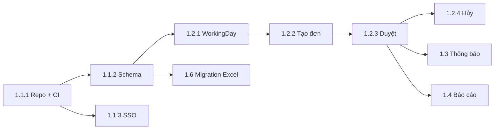

# Lập kế hoạch và chia việc

**Mục đích:** Biến thiết kế đã duyệt thành danh sách việc có thứ tự, có ước lượng, có người/agent làm, có cách kiểm chứng. Đây là cổng G4.
Với agent, chất lượng kế hoạch quyết định chất lượng code: task mơ hồ → agent đoán → code sai hướng.

**Liên quan:** [00-tong-quan.md](00-tong-quan.md) · [03-thiet-ke.md](03-thiet-ke.md) · [05-phat-trien.md](05-phat-trien.md) · [09-checklist-phe-duyet.md](09-checklist-phe-duyet.md) · [Áp dụng với agent](../03-ap-dung-voi-agent/README.md) · [Claude CLI nhiều agent](../01-claude-cli-multi-agent/)

---

## 1. WBS — Work Breakdown Structure

WBS chia dự án thành cây công việc, tới mức lá là **gói việc làm được trong ≤ 1–2 ngày** (với agent: 1 phiên, 1 PR).

```
1. Leave v1.0
 ├─ 1.1 Nền tảng
 │   ├─ 1.1.1 Khởi tạo repo, CI, lint, test runner
 │   ├─ 1.1.2 Schema DB + migration (employees, leave_requests, leave_balances, holidays, audit_log)
 │   └─ 1.1.3 Xác thực SSO Azure AD
 ├─ 1.2 Nghiệp vụ đơn
 │   ├─ 1.2.1 WorkingDayCalculator (FR-02)
 │   ├─ 1.2.2 Tạo đơn + kiểm tra số dư (FR-01, FR-05)
 │   ├─ 1.2.3 Duyệt/từ chối + trừ số dư + optimistic lock (FR-03, FR-04)
 │   └─ 1.2.4 Hủy đơn + hoàn số dư
 ├─ 1.3 Thông báo (outbox + job email) (NFR-02, ADR-004)
 ├─ 1.4 Báo cáo HR xuất Excel (FR-06)
 ├─ 1.5 Giao diện (danh sách, form, màn duyệt)
 ├─ 1.6 Migration dữ liệu từ Excel
 └─ 1.7 Kiểm thử hệ thống, test tải, UAT, release
```

## 2. Ước lượng

### Story point
Đơn vị tương đối (dãy 1, 2, 3, 5, 8, 13) đo **độ lớn + độ phức tạp + độ bất định**, không phải giờ. Task ≥ 8 điểm → chia nhỏ tiếp.

### Ước lượng 3 điểm (PERT)
Cho mỗi task, hỏi 3 con số: Lạc quan (O), Khả dĩ nhất (M), Bi quan (P).

**E = (O + 4M + P) / 6**, độ lệch chuẩn **σ = (P − O) / 6**.

| Task | O | M | P | E (ngày) | σ |
|------|:-:|:-:|:-:|:-:|:-:|
| 1.2.1 WorkingDayCalculator | 0,5 | 1 | 2 | 1,08 | 0,25 |
| 1.2.3 Duyệt + trừ số dư | 1 | 2 | 5 | 2,33 | 0,67 |
| 1.6 Migration Excel | 1 | 3 | 8 | 3,50 | 1,17 |

σ lớn (như 1.6) = bất định cao → cần spike (thử nghiệm ngắn) hoặc dự phòng thời gian.

### Ước lượng khi có agent
- Agent viết code nhanh, nhưng **thời gian review, test và sửa** của người không giảm tương ứng. Ước lượng phải gồm thời gian người duyệt.
- Phần bất định nhất thường là: dữ liệu thật, tích hợp hệ thống khác, quy tắc nghiệp vụ chưa rõ — agent không làm những phần này nhanh hơn.

## 3. Chia task để giao cho agent

Một task tốt cho agent đạt các điều kiện sau:

| Tiêu chí | Tốt | Xấu |
|----------|-----|-----|
| **Nhỏ** | Một hành vi, một PR, < ~400 dòng thay đổi | "Làm module duyệt đơn" |
| **Kiểm chứng được** | Có AC và lệnh test cụ thể chạy ra pass/fail | "Làm cho tốt" |
| **Độc lập** | Không sửa cùng file với task chạy song song | Hai task cùng sửa `LeaveService.cs` |
| **Có phạm vi rõ** | Liệt kê file/thư mục được sửa và **không** được sửa | Không nói gì |
| **Có ngữ cảnh** | Link FR, AC, ADR, API contract | Agent tự đoán từ tên task |

**Mẫu mô tả task giao agent:**

```markdown
## T-1.2.3 Duyệt / từ chối đơn
Truy vết: FR-03, FR-04, US-07 (AC-07.1..07.4), ADR-003, API contract mục 4.
Được sửa: src/Leave.Api/Approval/**, tests/Leave.Api.Tests/Approval/**
Không được sửa: migrations, AuthorizationPolicy, CI config.
Làm:
1. Viết test cho AC-07.1..07.4 trước (phải fail).
2. Cài đặt ApprovalService + endpoint POST /leave-requests/{id}/decision.
3. Optimistic lock bằng cột version; trả 409 khi lệch.
Hoàn thành khi: `dotnet test` pass toàn bộ; lint không lỗi; PR mô tả liệt kê AC nào được test bởi test nào.
Không chắc chỗ nào: dừng lại và hỏi, không tự quyết quy tắc nghiệp vụ.
```

## 4. Phụ thuộc và thứ tự



- Đường găng (critical path): chuỗi dài nhất quyết định ngày xong: A → B → D → E → F → G.
- Các nhánh không phụ thuộc (ví dụ 1.1.3 SSO và 1.2.1 WorkingDay) có thể giao **nhiều agent song song**, mỗi agent một worktree riêng (xem [../01-claude-cli-multi-agent/](../01-claude-cli-multi-agent/)).

## 5. Rủi ro của kế hoạch

| Rủi ro | Dấu hiệu sớm | Kế hoạch ứng phó |
|--------|-------------|------------------|
| Dữ liệu Excel bẩn | Spike nhập thử 50 dòng lỗi > 10% | HR làm sạch trước; thêm 3 ngày dự phòng |
| AAD cấp quyền trễ | Chưa có app registration ở tuần 2 | Dùng mock auth cho dev; không chặn task nghiệp vụ |
| Agent sinh code khó review | PR > 600 dòng | Bắt buộc chia nhỏ, từ chối PR lớn |

## 6. Kế hoạch triển khai sơ bộ

Ngay ở G4 cần biết: môi trường nào (dev, staging, production), ai cấp, dữ liệu test lấy từ đâu (không dùng dữ liệu thật chưa ẩn danh), mốc UAT, mốc release, khung giờ được phép deploy. Chi tiết ở [08-release.md](08-release.md).

## Checklist phê duyệt

| # | Câu hỏi | Có/Không |
|---|---------|:-------:|
| 1 | Mọi FR/NFR Must đều có ít nhất một task? | |
| 2 | Mỗi task lá nhỏ (≤ 2 ngày / 1 PR) và có truy vết FR/AC/ADR? | |
| 3 | Mỗi task có tiêu chí hoàn thành kiểm chứng được (lệnh test, AC)? | |
| 4 | Mỗi task giao agent có phạm vi file được sửa / không được sửa? | |
| 5 | Phụ thuộc giữa task được vẽ ra; task chạy song song không sửa cùng file? | |
| 6 | Ước lượng có tính thời gian review và test của người? | |
| 7 | Task bất định cao có spike hoặc dự phòng? | |
| 8 | Rủi ro có dấu hiệu sớm và kế hoạch ứng phó? | |
| 9 | Có task cho migration dữ liệu, test tải, tài liệu vận hành (không chỉ code)? | |
| 10 | Có môi trường, dữ liệu test, mốc UAT và release? | |

## Dấu hiệu phải từ chối (red flags)

- Task kiểu "Implement backend", "Làm frontend" — quá to để review.
- Không có task kiểm thử, migration, hoặc tài liệu; chỉ có task code.
- Ước lượng chỉ tính thời gian agent sinh code.
- Nhiều agent được lên lịch sửa cùng một file cùng lúc.
- Task không có tiêu chí hoàn thành, hoặc tiêu chí là "agent báo xong".
- Kế hoạch giả định quyền truy cập, dữ liệu, hệ thống mà chưa ai xác nhận có.
