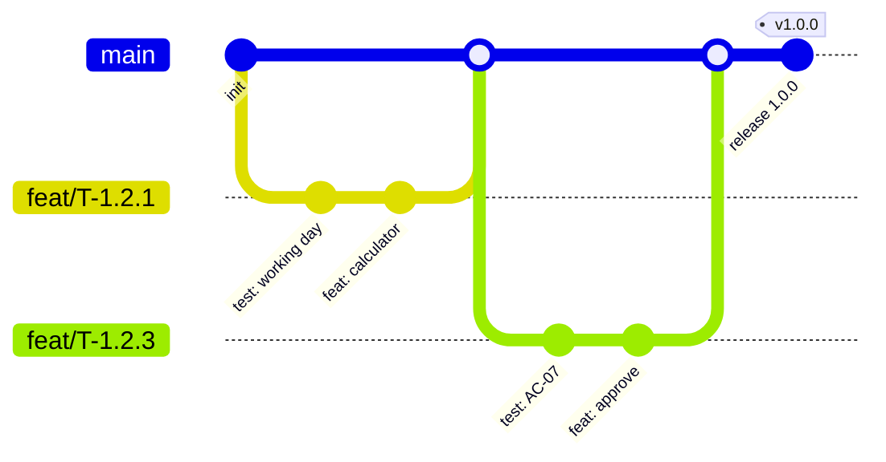

# Phát triển: nhánh, commit, test, Definition of Done

**Mục đích:** Quy định cách viết code và đưa code vào nhánh chính sao cho mỗi thay đổi nhỏ, có test, truy vết được và an toàn để merge. Đây là phần chuẩn bị cho cổng G5 (merge).
File này tập trung vào **người duyệt kiểm tra gì khi agent nộp code**; cách review chi tiết ở [06-code-review.md](06-code-review.md).

**Liên quan:** [04-lap-ke-hoach.md](04-lap-ke-hoach.md) · [06-code-review.md](06-code-review.md) · [07-kiem-thu.md](07-kiem-thu.md) · [09-checklist-phe-duyet.md](09-checklist-phe-duyet.md) · [Claude CLI nhiều agent](../01-claude-cli-multi-agent/) · [Áp dụng với agent](../03-ap-dung-voi-agent/README.md)

---

## 1. Chiến lược nhánh

| Chiến lược | Cách làm | Ưu | Nhược | Dùng khi |
|-----------|----------|----|-------|----------|
| **Trunk-based** | Nhánh ngắn (≤ 1–2 ngày) merge thẳng vào `main`; tính năng chưa xong ẩn sau feature flag | Ít xung đột, tích hợp liên tục | Cần CI mạnh, feature flag | Đội nhỏ–vừa, deploy thường xuyên |
| **GitFlow** | `main` (đã release), `develop` (tích hợp), `feature/*`, `release/*`, `hotfix/*` | Rõ ràng cho release theo đợt, nhiều phiên bản song song | Nhiều nhánh, merge phức tạp | Sản phẩm cài đặt tại khách hàng, release định kỳ |
| **Feature branch + PR** | Mỗi việc một nhánh `feat/...`, merge vào `main` qua PR | Đơn giản, dễ review | Nhánh để lâu sẽ xung đột | Mặc định cho hầu hết dự án |

**Với agent:** mỗi task = một nhánh = một worktree = một PR. Tên nhánh: `feat/T-1.2.3-approve-leave`, `fix/BUG-112-half-day-calc`. Không bao giờ để agent commit thẳng lên `main` hay nhánh release; bảo vệ nhánh bằng branch protection.



## 2. Conventional Commits

Định dạng: `<type>(<scope>): <mô tả ngắn>` + thân (tùy chọn) + footer.

| type | Khi nào | Ảnh hưởng SemVer |
|------|---------|------------------|
| `feat` | Thêm tính năng | MINOR |
| `fix` | Sửa lỗi | PATCH |
| `docs` | Chỉ tài liệu | — |
| `test` | Chỉ test | — |
| `refactor` | Đổi cấu trúc, không đổi hành vi | — |
| `perf` | Tăng hiệu năng | PATCH |
| `build` / `ci` / `chore` | Build, CI, việc vặt | — |
| `feat!` hoặc footer `BREAKING CHANGE:` | Thay đổi phá vỡ tương thích | MAJOR |

Ví dụ:
```
feat(approval): approve or reject leave request with optimistic lock

Implements FR-03, FR-04 (AC-07.1..07.4). Returns 409 when version differs.

Refs: T-1.2.3
```

Lợi ích: sinh changelog tự động, tính phiên bản tự động, truy vết commit → task.

## 3. Coding standard

- Có tài liệu coding standard của dự án và **linter/formatter tự động** áp dụng nó; tiêu chuẩn không được kiểm tự động sẽ bị bỏ qua.
- Với C/C++ an toàn: MISRA, với Qt: quy ước Qt — xem các plugin pack tương ứng của toolkit.
- Đặt standard vào `CLAUDE.md` / skill để agent đọc mỗi phiên, thay vì nhắc lại trong prompt.

## 4. Unit test và TDD

**TDD (Test-Driven Development):** Đỏ → Xanh → Tái cấu trúc.
1. Viết test cho một hành vi → chạy → **phải fail** (chứng minh test thực sự kiểm tra cái gì đó).
2. Viết code tối thiểu cho test pass.
3. Dọn code, test vẫn pass.

Vì sao TDD đặc biệt hữu ích với agent: test viết **trước** từ AC là bằng chứng độc lập; test viết **sau** bởi chính agent viết code thường chỉ xác nhận lại những gì code đang làm (kể cả cái sai).

Ví dụ test cho `WorkingDayCalculator` (FR-02):

| Test | Đầu vào | Kỳ vọng |
|------|--------|---------|
| Ngày thường | T2 17/11/2026 → T6 21/11/2026 | 5 |
| Qua cuối tuần | T5 20/11 → T3 25/11 | 4 |
| Có ngày lễ | 31/12/2026 → 02/01/2027 (01/01 lễ) | 2 |
| Nửa ngày | 17/11 sáng | 0,5 |
| Ngày kết thúc trước ngày bắt đầu | 21/11 → 17/11 | Lỗi |
| Chỉ cuối tuần | T7 → CN | 0 → từ chối tạo đơn |

## 5. Definition of Done (DoD)

Một task chỉ "xong" khi **tất cả** đều đúng:

- [ ] Code đáp ứng toàn bộ AC của task; mỗi AC có ít nhất một test tự động.
- [ ] Toàn bộ test pass trên CI (không chỉ trên máy agent).
- [ ] Lint/format/phân tích tĩnh không có lỗi mới.
- [ ] Không giảm độ phủ test của phần đã đổi dưới ngưỡng NFR.
- [ ] Không có bí mật (mật khẩu, token, chuỗi kết nối) trong code hoặc lịch sử commit.
- [ ] Tài liệu liên quan (README, API contract, changelog) được cập nhật.
- [ ] PR được người review và approve.
- [ ] Ma trận truy vết được cập nhật (FR → test).

## 6. PR nhỏ

- Mục tiêu < 400 dòng thay đổi (không tính file sinh tự động). Nghiên cứu thực tế cho thấy chất lượng review giảm mạnh khi PR lớn.
- Một PR một mục đích: không trộn refactor với tính năng; không trộn đổi format toàn file với sửa logic.
- Mô tả PR gồm: task/FR liên quan, thay đổi gì, vì sao, cách test (lệnh + kết quả), rủi ro, ảnh chụp màn hình (nếu UI).

## 7. Agent hay làm gì sai trong giai đoạn code

| Hành vi | Cách phát hiện |
|---------|----------------|
| Sửa file ngoài phạm vi được giao | `git diff --stat main...HEAD` — so với danh sách file được phép |
| Sửa hoặc xóa test để test pass | Diff trên thư mục `tests/` có dòng bị xóa, `assert` bị đổi kỳ vọng, test bị `skip` |
| Tắt lint, hook, kiểm tra | Tìm `--no-verify`, `eslint-disable`, `# noqa`, `#pragma warning disable`, đổi CI config |
| Bắt lỗi rồi bỏ qua | `catch { }` rỗng, `except: pass` |
| Hard-code giá trị để qua test | `if (input == "2026-11-17") return 5;` |
| Thêm dependency không cần | Diff `package.json`, `*.csproj`, `requirements.txt` |
| Báo "đã chạy test, pass" nhưng không có output | Đòi log CI hoặc output lệnh thật |
| Commit bí mật | gitleaks / pre-commit hook (toolkit `aiic-astec` có sẵn) |

## Checklist phê duyệt

Dùng khi duyệt PR do agent viết (cổng G5, phần "đúng quy trình"; phần "đúng logic" ở [06](06-code-review.md)).

| # | Câu hỏi | Có/Không |
|---|---------|:-------:|
| 1 | PR liên kết đúng một task và các FR/AC của task đó? | |
| 2 | Mọi file thay đổi nằm trong phạm vi được giao (`git diff --stat`)? | |
| 3 | Mỗi AC có test tương ứng, và mô tả PR chỉ rõ test nào cho AC nào? | |
| 4 | CI chạy và pass trên chính commit cuối của PR (không phải commit cũ)? | |
| 5 | Không có test bị xóa, bị skip, hoặc bị đổi kỳ vọng mà không giải thích? | |
| 6 | Không có lệnh tắt lint/hook/kiểm tra nào được thêm? | |
| 7 | Không có bí mật, dữ liệu cá nhân thật, URL nội bộ nhạy cảm trong diff? | |
| 8 | Không có dependency mới, hoặc dependency mới được giải thích và đã kiểm tra giấy phép? | |
| 9 | PR đủ nhỏ để đọc hết (< ~400 dòng logic)? | |
| 10 | Commit message theo Conventional Commits và có tham chiếu task? | |
| 11 | Tài liệu/contract/changelog được cập nhật khi hành vi thay đổi? | |

## Dấu hiệu phải từ chối (red flags)

- PR sửa file ngoài phạm vi được giao mà không có lý do được chấp thuận trước.
- Test bị xóa, bị đánh dấu skip, hoặc assertion bị nới lỏng.
- Có `--no-verify`, tắt hook, tắt lint, sửa CI cho "xanh".
- Agent khẳng định "đã chạy toàn bộ test" nhưng CI chưa chạy hoặc không có log.
- PR > 1000 dòng hoặc trộn nhiều mục đích.
- Có chuỗi giống mật khẩu/token/khóa trong diff, kể cả trong test.
- Dependency mới không ai yêu cầu.
- Commit trực tiếp lên `main` / nhánh release.
