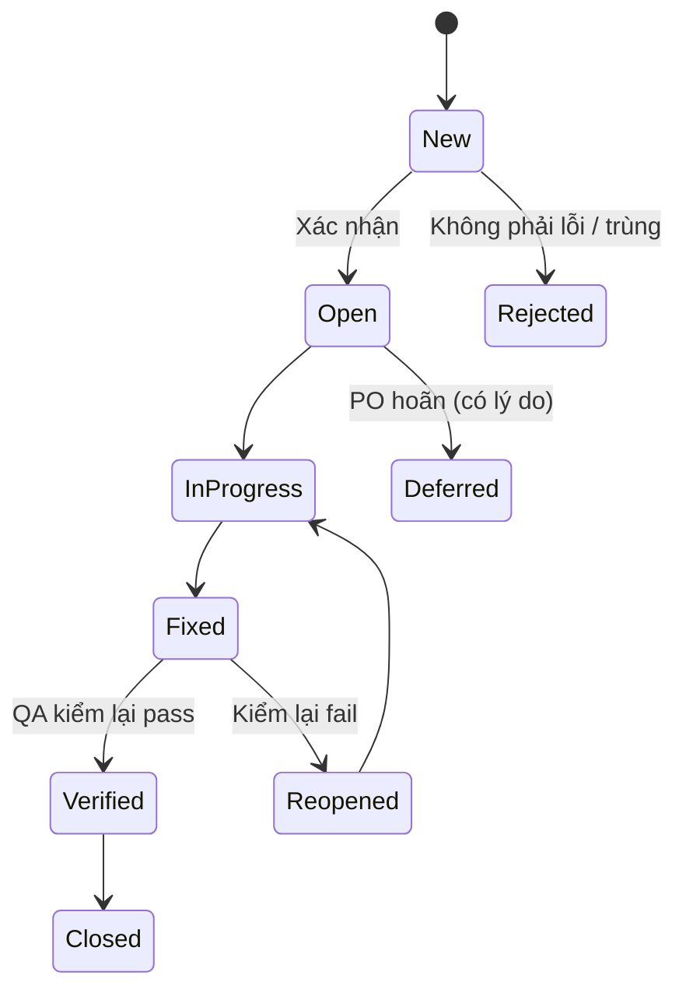

# Kiểm thử

**Mục đích:** Xác định cần kiểm thử gì, ở cấp nào, khi nào là đủ, và bằng chứng nào phải có để qua cổng G6 (test exit) và G7 (UAT).
Kiểm thử không chứng minh phần mềm không có lỗi; nó cung cấp **bằng chứng đủ tin cậy** để quyết định phát hành.

**Liên quan:** [02-yeu-cau-srs-prd.md](02-yeu-cau-srs-prd.md) · [05-phat-trien.md](05-phat-trien.md) · [06-code-review.md](06-code-review.md) · [08-release.md](08-release.md) · [09-checklist-phe-duyet.md](09-checklist-phe-duyet.md) · [Mẫu test plan](../04-mau/test-plan-template.md) · [Áp dụng với agent](../03-ap-dung-voi-agent/README.md)

---

## 1. Các cấp độ kiểm thử

| Cấp | Kiểm cái gì | Ai làm | Ví dụ *Leave* | Công cụ thường dùng |
|-----|-------------|--------|---------------|---------------------|
| **Unit** | Một hàm/lớp, cô lập | Dev/agent | `WorkingDayCalculator` với ngày lễ | xUnit, pytest, Jest, GoogleTest |
| **Integration** | Các thành phần nói chuyện với nhau thật (DB, hàng đợi) | Dev/agent, QA | `ApprovalService` + PostgreSQL thật: trừ số dư trong transaction | Testcontainers |
| **System / SIT** | Toàn hệ thống trên môi trường giống thật, kể cả tích hợp ngoài | QA | Gửi đơn → duyệt → email tới hộp thư test | Postman, Playwright |
| **E2E** | Hành trình người dùng qua giao diện | QA, agent | Nhân viên đăng nhập SSO, tạo đơn, quản lý duyệt trên trình duyệt | Playwright, Cypress |
| **Regression** | Cái cũ còn chạy sau thay đổi | Tự động trong CI | Toàn bộ suite sau mỗi PR | CI |
| **Performance** | Tốc độ, tải, sức chịu | QA/DevOps | 100 người dùng đồng thời, p95 ≤ 500 ms (NFR-01) | k6, JMeter |
| **Security** | Lỗ hổng | Security/QA | IDOR, leo quyền, SAST, quét dependency | OWASP ZAP, SAST, `npm audit` |
| **UAT** | Người dùng nghiệp vụ chấp nhận | Người dùng thật + PO | HR chạy báo cáo tháng 10 với dữ liệu ẩn danh và so với Excel | Kịch bản UAT |

**Kim tự tháp test:** nhiều unit (nhanh, rẻ) → ít hơn integration → ít E2E (chậm, dễ vỡ). Agent có xu hướng viết rất nhiều unit test với mock — số lượng lớn nhưng có thể không kiểm được tích hợp thật.

## 2. V-model: mỗi tài liệu có một cấp test tương ứng

| Bên trái (định nghĩa) | Bên phải (kiểm chứng) | Câu hỏi |
|-----------------------|-----------------------|---------|
| BRD | UAT | Có giải quyết vấn đề nghiệp vụ không? |
| SRS (FR/NFR) | System test, performance, security | Hệ thống có làm đúng đặc tả không? |
| HLD | Integration test | Các khối có nối với nhau đúng không? |
| LLD | Unit test | Từng phần có làm đúng thiết kế không? |

Hệ quả: test case cho system test nên được viết **ngay khi SRS được duyệt**, không đợi code xong.

## 3. Test plan

Test plan trả lời: kiểm cái gì, không kiểm cái gì, cách kiểm, môi trường, dữ liệu, ai, khi nào, khi nào dừng. Xem [mẫu](../04-mau/test-plan-template.md).

Mục quan trọng nhất cho người duyệt: **phạm vi không kiểm** và **tiêu chí ra**. Ví dụ: "Không kiểm trên Safari (NFR-09 chỉ yêu cầu Chrome, Edge)".

## 4. Test case

| Trường | Ví dụ |
|--------|-------|
| ID | TC-034 |
| Truy vết | FR-03, AC-07.3 |
| Tiêu đề | Quản lý không trực tiếp không thể từ chối đơn |
| Tiền điều kiện | Đơn LR-100 của nhân viên A (quản lý: M1) ở `PENDING`; đăng nhập với M2 (quản lý phòng khác) |
| Bước | Gọi `POST /leave-requests/LR-100/decision` với `REJECT`, lý do "x" |
| Kết quả mong đợi | HTTP 403; trạng thái vẫn `PENDING`; audit log ghi lần thử bị từ chối |
| Loại | Security, tự động |
| Ưu tiên | Cao |

Kỹ thuật thiết kế test cần đòi hỏi:
- **Phân vùng tương đương:** một đại diện cho mỗi nhóm đầu vào (ngày thường, cuối tuần, ngày lễ).
- **Giá trị biên:** 0, 1, max, max+1 (lý do 500 và 501 ký tự; số dư đúng bằng số ngày yêu cầu).
- **Bảng quyết định:** kết hợp điều kiện (loại phép × nửa ngày × qua năm).
- **Chuyển trạng thái:** mọi mũi tên trong sơ đồ trạng thái + mọi mũi tên **không được phép** (từ `REJECTED` sang `APPROVED`).

## 5. Tiêu chí vào / ra (entry / exit criteria)

| | Ví dụ cho System test của *Leave* |
|--|-----------------------------------|
| **Entry** (bắt đầu được khi) | Code đã merge và deploy lên staging; smoke test pass; dữ liệu test đã nạp; test case đã được duyệt |
| **Exit** (kết thúc được khi) | 100% test case ưu tiên Cao đã chạy; ≥ 95% pass; **0 lỗi Critical/High mở**; lỗi Medium mở có kế hoạch và PO chấp nhận; NFR-01 đạt trong test tải; báo cáo test đã nộp |

Tiêu chí ra phải được thống nhất **trước** khi test, không phải sau khi thấy kết quả.

## 6. Quản lý lỗi

### Severity (mức nghiêm trọng) và Priority (mức ưu tiên) khác nhau

| | Định nghĩa | Ai quyết |
|--|-----------|----------|
| **Severity** | Lỗi ảnh hưởng hệ thống nặng tới đâu | QA (kỹ thuật) |
| **Priority** | Cần sửa gấp tới đâu | PO (nghiệp vụ) |

| Severity | Ví dụ *Leave* |
|----------|----------------|
| Critical | Số dư bị trừ sai cho mọi đơn; lộ lý do nghỉ ốm cho người không có quyền; không đăng nhập được |
| High | Không hủy được đơn đã duyệt; email không gửi |
| Medium | Báo cáo Excel sai định dạng ngày; nửa ngày qua ngày lễ tính sai |
| Low | Lỗi chính tả, căn lề |

Ví dụ lệch nhau: lỗi chính tả trong tên công ty trên trang đăng nhập — Severity Low, Priority High.

### Vòng đời lỗi

Mỗi lỗi được sửa nên có **test hồi quy** chứng minh nó không quay lại.

## 7. Coverage và giới hạn của nó

- **Line/branch coverage** đo phần code được *chạy qua* khi test, không đo phần code được *kiểm đúng*. Test không có assert vẫn tăng coverage.
- 80% coverage có thể vẫn bỏ sót toàn bộ trường hợp phân quyền.
- **Requirement coverage** (mọi FR/AC có test) quan trọng hơn line coverage cho người duyệt.
- Cách kiểm nhanh chất lượng test: **mutation testing** (cố ý làm hỏng code, xem test có bắt được không) hoặc làm thủ công với 1–2 test quan trọng.

## 8. Bằng chứng test cần đòi agent

Không chấp nhận câu "tất cả test đã pass". Đòi:

| Bằng chứng | Vì sao |
|-----------|--------|
| Link CI run trên commit cụ thể (SHA) | Chứng minh chạy trên môi trường sạch, đúng code |
| Output lệnh test: số test chạy, pass, fail, skip | Phát hiện test bị skip |
| Bảng truy vết AC → test case → kết quả | Chứng minh mọi yêu cầu được kiểm |
| Báo cáo coverage của phần thay đổi | Phát hiện phần không được chạm tới |
| Với test tải: báo cáo công cụ (p50/p95/p99, lỗi, số người dùng, thời gian) | Con số tự báo cáo là không đủ |
| Danh sách điều **chưa** kiểm và lý do | Agent hay im lặng bỏ qua |
| Với bug fix: test tái hiện lỗi fail trước khi sửa, pass sau khi sửa | Chứng minh đúng lỗi được sửa |

## Checklist phê duyệt

**G6 — Test exit**

| # | Câu hỏi | Có/Không |
|---|---------|:-------:|
| 1 | Test plan đã duyệt, có phạm vi không kiểm và tiêu chí ra thống nhất trước? | |
| 2 | Mọi FR/NFR Must có test case, và tất cả đã chạy? | |
| 3 | Kết quả đến từ CI/môi trường test với commit/build xác định? | |
| 4 | Không còn lỗi Critical/High mở? | |
| 5 | Lỗi Medium/Low mở được PO chấp nhận bằng văn bản? | |
| 6 | Test phân quyền và dữ liệu nhạy cảm đã chạy và pass? | |
| 7 | NFR hiệu năng có báo cáo test tải thật? | |
| 8 | Có test hồi quy cho mọi lỗi đã sửa? | |
| 9 | Số test bị skip được liệt kê và có lý do? | |

**G7 — UAT**

| # | Câu hỏi | Có/Không |
|---|---------|:-------:|
| 1 | Người dùng nghiệp vụ thật (không phải dev/agent) chạy kịch bản UAT? | |
| 2 | Kịch bản UAT bao phủ các BR Must trong BRD? | |
| 3 | Dữ liệu UAT giống thật nhưng đã ẩn danh? | |
| 4 | Có biên bản UAT ký bởi người đại diện nghiệp vụ? | |

## Dấu hiệu phải từ chối (red flags)

- "Đã test, tất cả pass" không kèm log/CI/SHA.
- Số test skip tăng so với lần trước mà không giải thích.
- Test chỉ có happy path; không có test phân quyền.
- Coverage cao nhưng nhiều test không có assert hoặc mock toàn bộ.
- Tiêu chí ra bị nới lỏng sau khi có kết quả.
- UAT do chính đội phát triển hoặc agent làm thay người dùng.
- Test tải chạy trên máy dev với dữ liệu 10 dòng.
- Lỗi Critical bị hạ mức xuống Medium ngay trước release.
