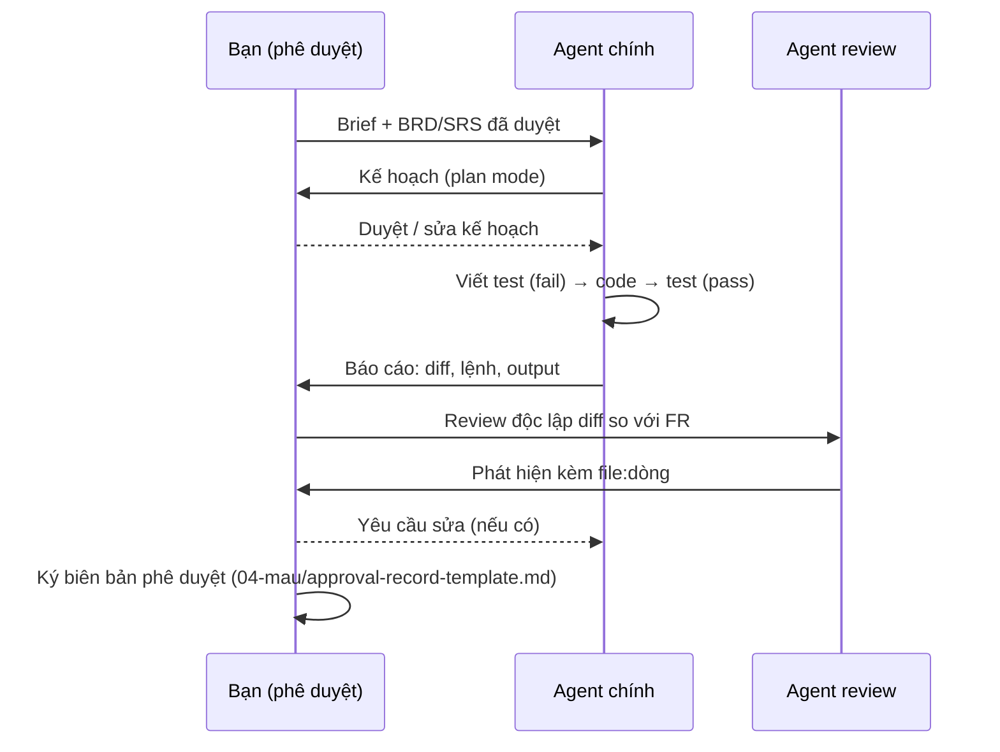

# Áp dụng agent vào từng giai đoạn BRD → Release

**Mục đích:** nối phần 1 (công cụ) với phần 2 (quy trình): ở mỗi giai đoạn, agent làm gì, bạn giao việc thế nào, và bạn duyệt gì trước khi cho đi tiếp.
**Liên quan:** [../02-quy-trinh-phan-mem/00-tong-quan.md](../02-quy-trinh-phan-mem/00-tong-quan.md) · [../02-quy-trinh-phan-mem/09-checklist-phe-duyet.md](../02-quy-trinh-phan-mem/09-checklist-phe-duyet.md) · [../01-claude-cli-multi-agent/05-prompt.md](../01-claude-cli-multi-agent/05-prompt.md)

---

## 1. Nguyên tắc phân vai

| Agent làm | Bạn (người phê duyệt) làm |
|---|---|
| Soạn bản nháp, phân tích, đề xuất phương án | Quyết định chọn phương án, chấp nhận rủi ro |
| Viết code, test, tài liệu | Duyệt theo checklist, đòi bằng chứng |
| Chạy lệnh kiểm tra, báo cáo output | Xác nhận output là thật và đủ |
| Đánh dấu chỗ mơ hồ `[CẦN XÁC NHẬN]` | Trả lời với stakeholder |
| — | **Ký phê duyệt và chịu trách nhiệm** |

Agent **không** tự phê duyệt sản phẩm của chính nó. Repo này đã thể hiện điều đó: skill `aiic-astec:okf-docs` để chữ ký (sign-off) là việc của người.

## 2. Bảng theo giai đoạn

| Gate | Giai đoạn | Agent hỗ trợ | Prompt khởi đầu | Mô hình phối hợp | Bạn duyệt |
|---|---|---|---|---|---|
| G0 | Ý tưởng / yêu cầu thô | Phỏng vấn làm rõ, tóm tắt | "Hỏi tôi từng câu để làm rõ nhu cầu <X>, sau đó tóm tắt vấn đề, mục tiêu, phạm vi" | 1 phiên | Vấn đề có đáng giải quyết không |
| G1 | BRD | Soạn BRD theo mẫu | "Viết BRD theo @knowledege/04-mau/brd-template.md từ ghi chú @notes.md. Không bịa số liệu; chỗ thiếu ghi [CẦN XÁC NHẬN]" | 1 phiên + 1 subagent phản biện | [01-brd.md](../02-quy-trinh-phan-mem/01-brd.md) checklist |
| G2 | SRS/PRD | Tách BR → FR/NFR, viết AC | "Từ BRD đã duyệt, viết SRS; mỗi FR truy vết về BR-ID; AC dạng Given/When/Then" | 1 phiên; subagent kiểm tra truy vết | [02-yeu-cau-srs-prd.md](../02-quy-trinh-phan-mem/02-yeu-cau-srs-prd.md) |
| G3 | Thiết kế | Đề xuất phương án, ADR | "dùng workflow: 3 phương án kiến trúc độc lập, chấm theo NFR, viết ADR" | Judge panel (workflow) | [03-thiet-ke.md](../02-quy-trinh-phan-mem/03-thiet-ke.md) |
| G4 | Kế hoạch | WBS, chia task giao agent | "Chia SRS thành task ≤ 1 ngày, mỗi task có phạm vi file, AC, lệnh kiểm tra, phụ thuộc" | Plan mode | [04-lap-ke-hoach.md](../02-quy-trinh-phan-mem/04-lap-ke-hoach.md) |
| G5 | Phát triển | Code + unit test | Brief theo mẫu ở [05-prompt.md](../01-claude-cli-multi-agent/05-prompt.md) | `claude --bg -w` mỗi task; Tester trước Dev sau | [05-phat-trien.md](../02-quy-trinh-phan-mem/05-phat-trien.md) |
| G6 | Code review | Review độc lập | `/code-review high`; phiên reviewer ngữ cảnh sạch | Writer/Reviewer | [06-code-review.md](../02-quy-trinh-phan-mem/06-code-review.md) |
| G7 | Kiểm thử | Viết test plan, test case, chạy, báo cáo | "Từ AC trong SRS, viết test plan + test case; chạy; báo cáo pass/fail kèm output" | Subagent theo cấp test | [07-kiem-thu.md](../02-quy-trinh-phan-mem/07-kiem-thu.md) |
| G8 | Release | Changelog, release note, checklist go/no-go | "Từ git log <tag>..HEAD viết CHANGELOG và release note; điền @knowledege/04-mau/release-checklist-template.md" | 1 phiên | [08-release.md](../02-quy-trinh-phan-mem/08-release.md) |

## 3. Luồng làm việc mẫu cho một tính năng

## 4. Công cụ có sẵn trong repo này

| Công cụ | Dùng ở giai đoạn |
|---|---|
| `/aiic-astec:okf-docs` | Soạn và kiểm tra tài liệu có ID ổn định: plan, spec, ADR, unittest, verify, review, changelog — sign-off do người làm |
| `prepare-pr` (plugin `aiic-astec`) | Chuẩn bị PR, kiểm tra trailer commit |
| `/code-review`, `/security-review` | G6 |
| Git hook gitleaks + PII của `aiic-astec` | Mọi commit/push — chặn lộ bí mật |

## 5. Năm câu hỏi trước khi bấm "Approve"

1. Sản phẩm này có khớp **yêu cầu gốc** (BR/FR-ID) không — tôi đã tự so chưa?
2. Bằng chứng (lệnh + output, test, trích dẫn) có thật và tôi đã xem chưa?
3. Có gì **ngoài phạm vi** bị thay đổi không?
4. Chỗ nào agent đánh dấu chưa chắc, và tôi đã giải quyết chưa?
5. Nếu sai, hậu quả là gì và có đường lui (rollback) không?

Không trả lời được câu nào → chưa duyệt, hoặc duyệt có điều kiện và ghi rõ điều kiện vào biên bản.
