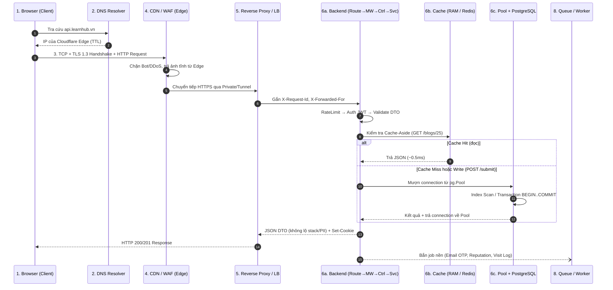

# Vòng đời một Request: Từ trình duyệt đến Database và quay về

**Mục đích:** Nhìn thấy bức tranh toàn cảnh (end-to-end) đường đi của một request trong hệ thống web hiện đại (lấy cảm hứng từ mô hình trực quan của *Designed to Scale* áp dụng cho LearnHub/QuestionHub) — để biết chính xác **chậm ở đâu**, **lỗi ở tầng nào**, và **trách nhiệm của từng lớp code**.

**Liên quan:** [08-thiet-ke-api.md](08-thiet-ke-api.md) · [09-scale-trieu-user.md](09-scale-trieu-user.md) · [11-bao-mat.md](11-bao-mat.md) · [../07-he-thong-server/02-mang-network.md](../07-he-thong-server/02-mang-network.md) · [../07-he-thong-server/03-load-balancer-reverse-proxy.md](../07-he-thong-server/03-load-balancer-reverse-proxy.md)

---

## 1. Sơ đồ tổng thể 8 chặng của một Request

Ví dụ thực tế trên LearnHub/QuestionHub: học sinh mở bài viết `GET /api/blogs/25` hoặc bấm nộp bài thi `POST /api/exams/12/submit`.

---

## 2. Chi tiết 8 chặng (Từ trình duyệt tới Database)

### Chặng 1: Trình duyệt đóng gói Request (Client Initiation)
- Khi người dùng bấm xem bài hoặc nộp bài, trình duyệt (hoặc Axios/Fetch) tạo gói HTTP Request gồm: `Method` (`GET`/`POST`), `URL`, `Headers` (`Authorization: Bearer <accessToken>`, `Content-Type: application/json`), `Cookie` (`refreshToken` dạng `HttpOnly` tự động đính kèm nếu cùng site), và `Body` JSON.

### Chặng 2: Phân giải tên miền (DNS Resolution)
- Trình duyệt kiểm tra theo thứ tự: **Browser DNS Cache → OS Cache → Router → Recursive Resolver (ISP/1.1.1.1) → Root → TLD (`.vn`/`.com`) → Authoritative NS**.
- Kết quả trả về địa chỉ IP của Edge/Load Balancer kèm **TTL** (ví dụ `300s`). Nếu hết hạn domain hoặc trỏ sai bản ghi `A/CNAME` → lỗi ngay ở bước này trước khi chạm tới server.

### Chặng 3: Thiết lập kết nối bảo mật (TCP + TLS 1.3 Handshake)
- **TCP 3-way handshake** (`SYN → SYN-ACK → ACK`): tốn **1 RTT** (~30–50ms từ Việt Nam sang Singapore).
- **TLS 1.3 handshake**: tốn thêm **1 RTT** để thỏa thuận khóa mã hóa và xác minh chứng chỉ SSL.
- **Tối ưu:** Nhờ **HTTP Keep-Alive** và **HTTP/2 multiplexing**, các request tiếp theo tái sử dụng kết nối đã mở → tiết kiệm ~60–100ms mỗi request.

### Chặng 4: Edge CDN / WAF (Cloudflare)
- Đóng vai trò "lá chắn" ngoài cùng:
  - **Ẩn IP thật** của server gốc (Origin IP).
  - **Chặn DDoS / Bot** ở tầng mạng & tầng ứng dụng (WAF).
  - **Trả trực tiếp file tĩnh / ảnh** từ Edge gần người dùng nhất (giảm 80–95% băng thông về server gốc).

### Chặng 5: Load Balancer / Reverse Proxy (Nginx / ALB)
- Nhận request từ Edge, thực hiện **TLS Termination** (hoặc Re-encrypt), nén `gzip/brotli`, giới hạn `client_max_body_size` (ví dụ `1m`–`10m`), gắn header theo vết `X-Request-Id` và IP thật `X-Forwarded-For`, rồi chọn 1 instance Backend đang khỏe (theo thuật toán **Least Connections** / **Round Robin**) qua **Readiness Check**.

### Chặng 6: Backend Server Compute & Data Access (Trọng tâm)
Đây là chặng quan trọng nhất nơi code Backend quyết định tính **đúng đắn**, **bảo mật** và **hiệu năng**:

1. **Router (`src/routes/`)**: Khớp URL & HTTP method, đặt **static routes** (`/user-attempts/:userId`, `/exercise-topics`) trước **dynamic routes** (`/:examId`, `/:topicId`).
2. **Middleware (`src/middleware/`)**:
   - `rateLimit`: Chặn brute-force (`/login`, `/verify-otp`).
   - `authenticateToken`: Verify chữ ký JWT + `exp` bằng thuật toán cố định, gán `req.user = { userId, username, role }`. Tuyệt đối không tin `userId` từ `req.body`.
3. **Controller (`src/controllers/`)**:
   - Chỉ làm nhiệm vụ HTTP: đọc `req.body` / `req.params` / `req.cookies`, validate kiểu dữ liệu & độ dài (ví dụ `fullName <= 255`, `limit <= 50`), gọi Service, set/clear cookie và trả `ResponseFactory`.
4. **Service (`src/services/`)**:
   - Chứa nghiệp vụ thuần túy (chấm điểm bài thi ở server, kiểm tra `refresh_tokens_used`, kiểm tra quyền sở hữu `user_id = $2`).
   - **Cache-Aside (L1 RAM / L2 Redis):** Với dữ liệu đọc nhiều ít đổi (cây chương trình học, câu hỏi đề thi cố định), kiểm tra Cache trước (`~0.5ms`); nếu Cache Miss mới đi xuống Pool/DB và nạp lại cache kèm **TTL + Jitter** (tránh *Cache Stampede*).
5. **Connection Pool (`pg.Pool` / PgBouncer):**
   - Mượn 1 kết nối TCP đã mở sẵn tới PostgreSQL (thay vì bắt tay TCP lại mất 30ms). Cấu hình fail-fast `connectionTimeoutMillis: 3000` và `statement_timeout: 5000`.
6. **PostgreSQL Execution:**
   - Lệnh `SELECT`: dùng **B-Tree / GIN / Partial Index** (`Index Scan` ~1–5ms thay vì `Seq Scan` hàng giây).
   - Lệnh `WRITE` nhiều bước (như `submitAttempt`, `toggleLike`): bọc `BEGIN ... COMMIT / ROLLBACK`, dùng câu SQL nguyên tử (`rowCount > 0`, `FOR UPDATE` khi phụ thuộc trạng thái cũ) để chống **Lost Update**.

### Chặng 7: Đóng gói Response & Quay về Client
- Service trả kết quả → Controller map sang **DTO tối thiểu** (tuyệt đối không trả `password_hash`, `secret_key`, hay `error.stack` làm lộ đường dẫn thư mục server).
- Nếu là `login` / `refresh`, gắn cookie `HttpOnly; SameSite=Strict; Secure`.
- Trình duyệt nhận JSON `200 OK` / `201 Created` và render giao diện.

### Chặng 8: Xử lý bất đồng bộ hậu trường (Async / Message Queue)
- Những việc chậm hoặc gọi bên thứ 3 (**gửi Email OTP qua SMTP**, **tính lại `reputation_score`**, **ghi log lượt truy cập `visit_log` theo lô**) **không** nên chặn luồng trả response ở Chặng 7 — đẩy sang **Queue (BullMQ / Worker)** để chạy ngầm và tự retry khi lỗi.

---

## 3. Bảng phân tách vai trò các tầng trong Backend

| Tầng | Nên làm | Tuyệt đối tránh |
| :--- | :--- | :--- |
| **Route** | Khai báo endpoint, gắn middleware (`authenticateToken`, `rateLimit`), bind controller | Viết SQL trực tiếp, validate dài dòng |
| **Middleware** | Auth JWT, Rate limit, CORS allowlist, Helmet, giới hạn body | Chứa logic nghiệp vụ CRUD |
| **Controller** | Validate `req.body/params`, lấy `req.user.userId`, set cookie, trả DTO/status code | Viết câu query DB hay `BEGIN/COMMIT` |
| **Service** | Logic nghiệp vụ, Transaction (`BEGIN/COMMIT`), gọi Cache/Queue/Service phụ | Đọc trực tiếp `req`/`res` của Express |
| **Utils / Constants** | Tập trung `ENV`, hằng số (`SALT_ROUNDS`, `OTP_EXPIRY_MS`, cookie options) | Hardcode `process.env.*` rải rác |

---

## 4. Ngân sách độ trễ (Latency Budget) & Lỗi đặc trưng từng chặng

Mục tiêu chuẩn cho một API đọc/ghi thông thường: **p95 < 200ms** (tại server).

| Chặng | Độ trễ điển hình | Lỗi đặc trưng khi chặng này hỏng | Cách xử lý |
| :--- | :---: | :--- | :--- |
| **DNS** | `0ms` (cached) – `50ms` | `NXDOMAIN`, `SERVFAIL` | Bật auto-renew domain, giữ TTL hợp lý |
| **TCP + TLS** | `0ms` (Keep-Alive) – `80ms` | `ETIMEDOUT`, `CERT_HAS_EXPIRED` | Keep-Alive, tự gia hạn SSL (ACME/Cloudflare) |
| **CDN / WAF** | `5 – 20ms` | `403 Blocked`, `429 Too Many Requests` | Whitelist rule hợp lệ, phân tầng rate-limit |
| **Reverse Proxy / LB** | `1 – 5ms` | `502 Bad Gateway`, `504 Gateway Timeout` | Readiness check, Connection Draining khi deploy |
| **Middleware + Ctrl** | `0.5 – 2ms` | `400 Bad Request`, `401`, `403` | Schema validation, fail-closed auth |
| **Cache (RAM / Redis)** | `0.05 – 1ms` | Stale data, Stampede, Penetration | Xóa cache khi update, TTL + Jitter, cache `null` ngắn |
| **pg.Pool + PostgreSQL** | `1 – 15ms` (có index) | `40P01` Deadlock, `40001` Serialization, `statement_timeout` | Index chuẩn, Transaction ngắn, Retry `40P01/40001` |
