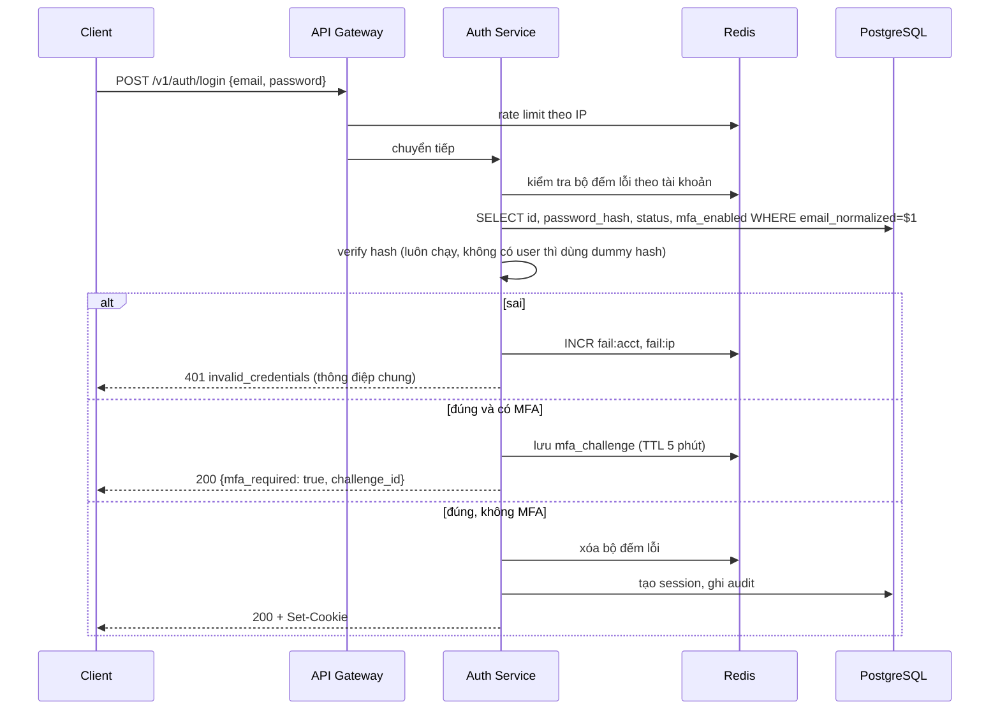

# Authentication (xác thực) – cấp senior

**Mục đích:** hiểu sâu cách xác minh "người này là ai": lưu mật khẩu, luồng đăng nhập, chống brute-force, MFA, đăng nhập mạng xã hội (OAuth2/OIDC), SSO, xác thực giữa các service và API key. Đủ để thiết kế, review và phê duyệt code do agent viết.
**Liên quan:** [02-session-token.md](02-session-token.md) · [03-phan-quyen.md](03-phan-quyen.md) · [04-module-tai-khoan.md](04-module-tai-khoan.md) · [09-scale-trieu-user.md](09-scale-trieu-user.md) · [11-bao-mat.md](11-bao-mat.md) · [12-observability-reliability.md](12-observability-reliability.md) · [13-checklist-review-backend.md](13-checklist-review-backend.md)

> Ví dụ dùng TypeScript (Node) + PostgreSQL + Redis cho LearnHub (5 triệu user, 200k đồng thời giờ cao điểm). Khái niệm không phụ thuộc ngôn ngữ — Java/Spring, Go, .NET, Python đều áp dụng y hệt.

---

## 1. Ba câu hỏi phải tách bạch

| Khái niệm | Câu hỏi | Ví dụ LearnHub | File |
|---|---|---|---|
| **Authentication** (xác thực) | Bạn là ai? | Kiểm tra email + mật khẩu + mã TOTP | file này |
| **Session/Token** (duy trì) | Sau khi đã xác thực, các request tiếp theo chứng minh danh tính thế nào? | Cookie session, access/refresh token | [02](02-session-token.md) |
| **Authorization** (phân quyền) | Bạn được làm gì? | Giáo viên được chấm bài lớp mình | [03](03-phan-quyen.md) |

Lỗi kinh điển: trộn ba thứ — ví dụ "có JWT hợp lệ là được sửa bài viết" (thiếu authorization), hoặc "đã login rồi nên đổi mật khẩu không cần mật khẩu cũ" (thiếu re-authentication).

---

## 2. Lưu mật khẩu

### 2.1 Nguyên tắc

- **Không bao giờ** lưu plaintext, không mã hóa hai chiều (AES), không dùng hash nhanh (MD5, SHA-1, SHA-256 thuần). Hash nhanh cho phép GPU thử hàng tỷ mật khẩu/giây khi DB bị lộ.
- Dùng **hàm băm mật khẩu chậm, có salt, tốn bộ nhớ**: Argon2id (ưu tiên), scrypt, bcrypt; PBKDF2-HMAC-SHA256 chỉ khi bắt buộc FIPS.
- Salt ngẫu nhiên riêng cho mỗi mật khẩu — thư viện chuẩn tự sinh và nhúng vào chuỗi hash (định dạng PHC: `$argon2id$v=19$m=19456,t=2,p=1$<salt>$<hash>`). Không tự chế salt.

### 2.2 Tham số (theo OWASP Password Storage Cheat Sheet)

| Thuật toán | Tham số tối thiểu khuyến nghị | Ghi chú |
|---|---|---|
| **Argon2id** | m = 19 MiB (19456 KiB), t = 2, p = 1 — hoặc m = 46 MiB, t = 1, p = 1 | Tăng m nếu server đủ RAM. Mục tiêu ~100–300 ms/lần trên máy production |
| scrypt | N = 2^17, r = 8, p = 1 | |
| bcrypt | cost ≥ 10 (thường 12) | **Giới hạn 72 byte** đầu vào — dài hơn bị cắt im lặng. Không pre-hash rồi đưa raw bytes vào bcrypt (byte 0x00 cắt chuỗi) |
| PBKDF2-HMAC-SHA256 | 600 000 vòng | Chỉ khi cần FIPS-140 |

**Chọn tham số = bài toán dung lượng.** Ở LearnHub giả sử đỉnh 2 000 login/giây × 200 ms CPU = **400 lõi CPU** chỉ để hash. Hệ quả thiết kế:

- Tách **auth service** để scale riêng, không để hash làm chậm API khác.
- Giới hạn đồng thời (semaphore/queue) — quá tải thì trả 503 nhanh thay vì để mọi request cùng chậm.
- Node: thư viện `argon2` native chạy trong threadpool libuv; tăng `UV_THREADPOOL_SIZE` cho phù hợp số lõi. Không dùng bản JS thuần.

### 2.3 Pepper

Pepper = bí mật chung **không** nằm trong DB (ở KMS/HSM hoặc secret manager). Nếu chỉ DB bị lộ, kẻ tấn công không bẻ được hash.

```ts
import { createHmac } from "node:crypto";
import argon2 from "argon2";

const PEPPER = await secrets.get("auth/pepper/v2"); // từ secret manager, không hard-code
const PEPPER_VERSION = 2;

export async function hashPassword(plain: string): Promise<string> {
  const peppered = createHmac("sha256", PEPPER).update(plain.normalize("NFKC")).digest("base64");
  const hash = await argon2.hash(peppered, {
    type: argon2.argon2id, memoryCost: 19456, timeCost: 2, parallelism: 1,
  });
  return `${PEPPER_VERSION}:${hash}`;
}
```

Đánh đổi: mất pepper = mọi user phải reset mật khẩu. Phải có **phiên bản pepper** để xoay vòng và backup an toàn.

### 2.4 Nâng cấp hash dần (rehash on login)

Khi đổi tham số/thuật toán: lúc user login thành công, `argon2.needsRehash(hash, params)` → hash lại và lưu. Không nâng cấp hàng loạt được vì không có plaintext. Có thể "bọc" hash cũ yếu: `argon2(md5_cũ)` để bảo vệ ngay những user lâu không đăng nhập.

### 2.5 Chính sách mật khẩu (NIST SP 800-63B)

| Nên | Không nên |
|---|---|
| Tối thiểu 8 ký tự (12+ nếu không có MFA), cho phép tối đa ≥ 64 | Bắt "1 hoa, 1 số, 1 ký tự đặc biệt" |
| Cho phép mọi ký tự Unicode, khoảng trắng; chuẩn hóa NFKC | Bắt đổi mật khẩu định kỳ không lý do |
| **Chặn mật khẩu đã lộ** (Have I Been Pwned k-anonymity: chỉ gửi 5 ký tự đầu SHA-1) | Câu hỏi bảo mật ("tên thú cưng") |
| Cho phép paste, password manager | Cắt mật khẩu im lặng |
| Giới hạn trên (128–256 ký tự) để chống DoS hash | |

---

## 3. Luồng đăng nhập

### 3.1 Sơ đồ



### 3.2 API

```http
POST /v1/auth/login
Content-Type: application/json

{ "email": "<email>", "password": "<password>" }
```

| Kết quả | Status | Body |
|---|---|---|
| Thành công | 200 | `{ "user": { "id": "u_123", "display_name": "..." } }` + `Set-Cookie` |
| Cần MFA | 200 | `{ "mfa_required": true, "challenge_id": "mfc_..." , "methods": ["totp","webauthn"] }` |
| Sai thông tin | 401 | `{ "error": "invalid_credentials" }` |
| Vượt giới hạn | 429 | `{ "error": "too_many_attempts" }` + `Retry-After` |
| Cần CAPTCHA | 401 | `{ "error": "captcha_required" }` |
| Dữ liệu sai định dạng | 400 | `{ "error": "validation_error", "fields": {...} }` |

### 3.3 Code mẫu (rút gọn)

```ts
const DUMMY_HASH = await hashPassword(randomBytes(16).toString("hex")); // tính sẵn lúc khởi động

app.post("/v1/auth/login", async (req, res) => {
  const { email, password } = LoginSchema.parse(req.body); // email ≤ 254, password 1..256
  const emailNorm = normalizeEmail(email);

  if (await limiter.isAccountThrottled(emailNorm, req.ip)) {
    return res.status(429).set("Retry-After", "60").json({ error: "too_many_attempts" });
  }

  const user = await db.oneOrNone(
    `SELECT id, password_hash, status, mfa_enabled
       FROM users WHERE email_normalized = $1 AND deleted_at IS NULL`, [emailNorm]);

  // Luôn verify để thời gian phản hồi như nhau dù user có tồn tại hay không
  const ok = await verifyPassword(user?.password_hash ?? DUMMY_HASH, password);

  if (!user || !ok || user.status !== "active") {
    await limiter.recordFailure(emailNorm, req.ip);
    audit.log("login_failed", { emailHash: sha256(emailNorm), ip: req.ip, ua: req.get("user-agent") });
    return res.status(401).json({ error: "invalid_credentials" });
  }

  await limiter.reset(emailNorm);
  if (needsRehash(user.password_hash)) await rehashAndSave(user.id, password);

  if (user.mfa_enabled) {
    const challengeId = await mfa.createChallenge(user.id, { ip: req.ip }); // Redis, TTL 300s, tối đa 5 lần thử
    return res.json({ mfa_required: true, challenge_id: challengeId });
  }
  return issueSession(req, res, user.id, { amr: ["pwd"] }); // xem 02-session-token.md
});
```

Điểm bắt buộc:

1. **Thông điệp lỗi chung** — không phân biệt "email không tồn tại" và "sai mật khẩu" (chống *account enumeration*).
2. **Thời gian phản hồi đồng đều** — luôn chạy hash. Nếu không: user không tồn tại phản hồi 2 ms, tồn tại 200 ms → lộ danh sách email.
3. Tài khoản chưa xác minh/bị khóa: chỉ báo lý do cụ thể khi mật khẩu **đúng** (người đó đã chứng minh sở hữu).
4. **Tạo session mới** sau đăng nhập (chống session fixation).
5. Audit: thành công/thất bại, IP, user-agent, phương thức (`amr`). Không log mật khẩu; hạn chế log email thô (dữ liệu cá nhân).

### 3.4 Account enumeration – không chỉ ở login

| Điểm lộ | Cách sửa |
|---|---|
| Login báo "email không tồn tại" | Thông điệp chung |
| Forgot password báo "email không tồn tại" | Luôn trả 202 "Nếu email tồn tại, bạn sẽ nhận được thư" |
| Đăng ký báo "email đã được dùng" | Trả thông điệp chung + gửi email cho chủ tài khoản; hoặc chấp nhận rủi ro nhưng rate limit chặt — là quyết định nghiệp vụ, ghi vào ADR |
| Thời gian phản hồi khác nhau | Dummy hash; gửi email bất đồng bộ qua queue |
| API kiểm tra email/username tồn tại | Rate limit thấp + CAPTCHA, hoặc bỏ |

### 3.5 Timing attack khi so sánh bí mật

`a === b` dừng ở byte khác đầu tiên → lộ thông tin qua thời gian. Dùng `crypto.timingSafeEqual` trên hai buffer **cùng độ dài** — cách gọn nhất: so sánh hash, `timingSafeEqual(sha256(input), storedHash)`.

---

## 4. Chống brute-force và credential stuffing

### 4.1 Các kiểu tấn công

| Tấn công | Mô tả | Phòng thủ chính |
|---|---|---|
| Brute-force một tài khoản | Thử nhiều mật khẩu cho 1 email | Giới hạn theo tài khoản, MFA |
| Password spraying | 1 mật khẩu phổ biến cho nhiều email | Giới hạn theo IP/ASN, chặn mật khẩu phổ biến |
| **Credential stuffing** | Cặp email/mật khẩu lộ từ site khác, chạy từ botnet hàng nghìn IP | Phát hiện bất thường, CAPTCHA thích ứng, chặn mật khẩu đã lộ, MFA, thông báo thiết bị mới |

### 4.2 Rate limit nhiều lớp

| Lớp | Khóa | Ngưỡng ví dụ | Hành động |
|---|---|---|---|
| Edge/WAF | IP | 100 req/phút vào `/auth/*` | 429 |
| Theo IP | `fail:ip:{ip}` | 20 lần sai/15 phút | CAPTCHA, rồi 429 |
| Theo tài khoản | `fail:acct:{emailNorm}` | 5 sai → delay tăng dần; 10 sai/giờ → CAPTCHA + email cảnh báo | Không khóa cứng |
| Toàn cục | tỷ lệ thất bại toàn hệ thống | > 3× baseline | Báo động, bật CAPTCHA toàn cục |

```ts
// Redis: đếm lỗi theo cửa sổ (atomic qua MULTI)
async function recordFailure(acct: string, ip: string) {
  await redis.multi()
    .incr(`fail:acct:${acct}`).expire(`fail:acct:${acct}`, 3600, "NX")
    .incr(`fail:ip:${ip}`).expire(`fail:ip:${ip}`, 900, "NX")
    .exec();
}
```

### 4.3 Khóa tài khoản (lockout) – đánh đổi

| Cách | Ưu | Nhược |
|---|---|---|
| Khóa cứng sau N lần sai | Đơn giản | **Kẻ tấn công khóa được tài khoản của bất kỳ ai** (DoS), tăng chi phí hỗ trợ |
| Delay tăng dần (1, 2, 4… tối đa 30 s) | Không DoS được người thật | Tấn công phân tán vẫn thử chậm |
| CAPTCHA thích ứng sau N lần | Cân bằng tốt | Ảnh hưởng UX; CAPTCHA có thể bị giải thuê |
| Khóa mềm + mở qua email | Người thật tự mở được | Phụ thuộc email |

Khuyến nghị LearnHub: delay tăng dần + CAPTCHA sau 5 lần sai theo tài khoản hoặc 20 theo IP; không khóa cứng; email cảnh báo khi đăng nhập thành công từ thiết bị mới.

### 4.4 IP thật sau proxy

Sau load balancer, IP kết nối là của LB. Chỉ tin `X-Forwarded-For` **từ proxy tin cậy** (Express: `app.set("trust proxy", <số hop hoặc dải IP>)`, rồi dùng `req.ip`). Agent hay đọc `req.headers["x-forwarded-for"]` trực tiếp → kẻ tấn công giả header để vượt rate limit.

---

## 5. MFA (xác thực đa yếu tố)

### 5.1 So sánh

| Phương thức | Chống phishing | UX | Ghi chú |
|---|---|---|---|
| SMS OTP | Kém (SIM swap) | Tốt | Chỉ làm dự phòng; tốn phí SMS |
| Email OTP | Kém | Tốt | Mất email = mất cả hai yếu tố |
| **TOTP** (RFC 6238) | Trung bình (vẫn bị phishing thời gian thực) | Khá | Rẻ, phổ biến |
| **WebAuthn / Passkeys** | **Tốt** (gắn với origin) | Tốt nhất | Khuyến nghị 2026 |
| Push approve | Trung bình (MFA fatigue) | Tốt | Phải có number matching |

### 5.2 TOTP – điểm phải đúng

- Secret ≥ 160 bit từ CSPRNG, **mã hóa khi lưu** (envelope encryption bằng KMS) — không hash được vì server cần secret để tính mã.
- Chu kỳ 30 s, chấp nhận lệch ±1 bước.
- **Chống dùng lại:** lưu `last_used_step`, từ chối mã có step ≤ giá trị đó.
- Giới hạn số lần nhập (6 chữ số = 10^6 khả năng; không giới hạn thì brute-force được trong vài phút).
- Kích hoạt: hiển thị QR → user nhập đúng 1 mã → mới bật `mfa_enabled`.

### 5.3 Passkeys / WebAuthn

- Server sinh `challenge` ngẫu nhiên (Redis, TTL ngắn); thiết bị ký bằng khóa riêng; server kiểm tra chữ ký bằng public key đã đăng ký, cùng `origin`, `rpId`, `challenge`, signature counter.
- Dùng thư viện đã kiểm chứng (ví dụ SimpleWebAuthn cho Node) — **không tự cài đặt CBOR/COSE**.
- Một user nhiều credential → bảng `webauthn_credentials(user_id, credential_id UNIQUE, public_key, sign_count, transports, created_at, last_used_at)`.

### 5.4 Mã khôi phục

10 mã, mỗi mã dùng một lần, **lưu hash**, chỉ hiển thị một lần; dùng xong gửi email báo; tạo lại thì vô hiệu bộ cũ.

### 5.5 Bước MFA sau mật khẩu

`challenge_id` phải: ngẫu nhiên, TTL 5 phút, gắn với user và yếu tố đã qua, **tối đa 5 lần thử**, xóa sau khi thành công. Lỗi agent hay mắc: phát token đầy đủ sau bước mật khẩu kèm cờ `mfa_pending`, nhưng các API khác không kiểm tra cờ đó → MFA bị bỏ qua hoàn toàn. Đúng: trước khi qua MFA **không có session nào** cả.

### 5.6 Step-up authentication

Hành động nhạy cảm (đổi email, đổi mật khẩu, tắt MFA, xóa tài khoản, admin xuất dữ liệu) cần xác thực lại gần đây: lưu `auth_time` trong session; nếu quá 10 phút → `401 {"error":"reauth_required"}`.

---

## 6. OAuth 2.0 / OpenID Connect – đăng nhập bằng Google, Microsoft…

### 6.1 Khái niệm

- **OAuth 2.0** = ủy quyền truy cập tài nguyên. **OIDC** = lớp xác thực trên OAuth, thêm `id_token` (JWT chứa danh tính).
- Đăng nhập bằng Google là OIDC — **không** phải "lấy access token Google rồi gọi API profile".
- Theo **RFC 9700 (OAuth 2.0 Security BCP)**: dùng **Authorization Code + PKCE** cho mọi client (kể cả confidential); **không** dùng Implicit và Resource Owner Password Credentials; redirect URI khớp **chính xác**; refresh token của public client phải sender-constrained hoặc rotation.

### 6.2 Luồng Authorization Code + PKCE

```mermaid
sequenceDiagram
    participant B as Trình duyệt
    participant L as LearnHub backend
    participant P as IdP (Google)
    B->>L: GET /v1/auth/oauth/google/start?returnTo=/courses
    L->>L: sinh state, nonce, code_verifier; code_challenge = BASE64URL(SHA256(verifier))
    L->>L: lưu {state, nonce, verifier, returnTo} (cookie __Host- đã mã hóa hoặc Redis, TTL 10 phút)
    L-->>B: 302 tới /authorize?response_type=code&client_id&redirect_uri&scope=openid email profile&state&nonce&code_challenge&code_challenge_method=S256
    B->>P: đăng nhập, đồng ý
    P-->>B: 302 redirect_uri?code&state
    B->>L: GET /v1/auth/oauth/google/callback?code&state
    L->>L: so khớp state
    L->>P: POST /token {code, code_verifier, client credentials, redirect_uri}
    P-->>L: {id_token, access_token}
    L->>L: verify id_token: chữ ký (JWKS), iss, aud, exp, nonce, email_verified
    L->>L: tìm user theo (provider, sub)
    L-->>B: Set-Cookie session, 302 tới returnTo (chỉ đường dẫn nội bộ)
```

### 6.3 Kiểm tra bắt buộc

| Tham số | Chống gì | Hậu quả khi thiếu |
|---|---|---|
| `state` | CSRF trên callback (login CSRF) | Nạn nhân bị đăng nhập vào tài khoản kẻ tấn công, nộp bài/thông tin vào đó |
| `nonce` | Replay id_token | |
| PKCE | Đánh cắp authorization code | |
| `iss`, `aud`, `exp`, chữ ký | Token giả, token cấp cho app khác | Chấp nhận id_token của app khác |
| `returnTo` chỉ đường dẫn nội bộ | Open redirect | Phishing |

### 6.4 Liên kết tài khoản – bẫy lớn nhất

**Khóa định danh là `(provider, sub)`**, không phải email. Email có thể đổi, chưa xác minh, hoặc được cấp lại cho người khác.

Kịch bản tấn công: kẻ tấn công tạo tài khoản ở một IdP cho phép email chưa xác minh, đặt email trùng email nạn nhân → đăng nhập LearnHub → hệ thống "tự động gộp theo email" → chiếm tài khoản nạn nhân.

Quy tắc:

1. Tìm theo `(provider, sub)` trong `user_identities`. Có → đăng nhập.
2. Không có nhưng email trùng user hiện có → **không tự gộp**. Bắt user đăng nhập bằng phương thức cũ (hoặc xác minh qua link email) rồi mới liên kết.
3. Chỉ tin `email` khi `email_verified = true` **và** IdP có thẩm quyền với domain đó.
4. Cho xem/gỡ liên kết; không cho gỡ phương thức đăng nhập cuối cùng.

```sql
CREATE TABLE user_identities (
  id            BIGSERIAL PRIMARY KEY,
  user_id       BIGINT NOT NULL REFERENCES users(id),
  provider      TEXT   NOT NULL,          -- 'google', 'microsoft', 'saml:<tenant>'
  subject       TEXT   NOT NULL,          -- claim 'sub', ổn định, duy nhất trong provider
  email_at_link TEXT,
  created_at    TIMESTAMPTZ NOT NULL DEFAULT now(),
  UNIQUE (provider, subject)
);
```

---

## 7. SSO doanh nghiệp / trường học

| Giao thức | Khi dùng | Ghi chú |
|---|---|---|
| OIDC | Mặc định cho tích hợp mới | JSON/JWT, dễ |
| SAML 2.0 | Khách hàng yêu cầu (ADFS, Shibboleth) | XML signature — **chỉ dùng thư viện đã kiểm chứng**; lỗi XML signature wrapping rất phổ biến |
| SCIM | Đồng bộ tạo/khóa user từ IdP khách hàng | Nhân viên nghỉ việc → tài khoản bị khóa tự động |

LearnHub B2B: bảng cấu hình `tenant → IdP`; xác định tenant theo domain email hoặc subdomain trước khi redirect; **JIT provisioning** tạo user lần đầu với role thấp nhất. Logout khỏi LearnHub không logout khỏi IdP — nếu cần, dùng OIDC RP-Initiated Logout / Back-Channel Logout.

---

## 8. Xác thực giữa các service

| Cách | Khi dùng | Ưu | Nhược |
|---|---|---|---|
| **mTLS** (service mesh Istio/Linkerd) | Trong cụm Kubernetes | Danh tính theo chứng chỉ, tự xoay vòng, mã hóa đường truyền | Cần mesh |
| **OAuth2 Client Credentials** | Gọi API có scope, qua nhiều mạng | Có scope, hết hạn | Cần auth server |
| Workload identity (SPIFFE, cloud IAM) | Đa cloud | Không có secret tĩnh | Phức tạp |
| Shared secret tĩnh | Tránh | Đơn giản | Khó xoay vòng, lộ một là lộ hết |

**Zero trust:** không tin request chỉ vì đến từ mạng nội bộ. Truyền danh tính người dùng gốc bằng token đã ký (hoặc token exchange RFC 8693) — service nội bộ **không** tin header `X-User-Id` trần.

---

## 9. API key (tích hợp bên thứ ba, LMS)

```sql
CREATE TABLE api_keys (
  id           BIGSERIAL PRIMARY KEY,
  owner_id     BIGINT NOT NULL REFERENCES users(id),
  prefix       TEXT   NOT NULL UNIQUE,     -- phần hiển thị, dùng để tra cứu
  key_hash     BYTEA  NOT NULL,            -- SHA-256 của phần bí mật
  scopes       TEXT[] NOT NULL,            -- {'courses:read'}
  last_used_at TIMESTAMPTZ,
  expires_at   TIMESTAMPTZ,
  revoked_at   TIMESTAMPTZ,
  created_at   TIMESTAMPTZ NOT NULL DEFAULT now()
);
```

- Định dạng `lh_live_<prefix>_<bí mật 32 byte>`: prefix giúp tra cứu và giúp công cụ quét bí mật (gitleaks, GitHub secret scanning) nhận diện.
- Lưu **hash** (SHA-256 đủ vì key entropy cao, không cần Argon2). Chỉ hiển thị một lần.
- Có scope, hết hạn, thu hồi, `last_used_at`; rate limit theo key.
- Chỉ nhận qua header `Authorization`, không qua query string (bị ghi vào log proxy).

---

## 10. Lỗi agent AI hay mắc

| Lỗi | Hậu quả | Cách phát hiện khi review |
|---|---|---|
| Hash bằng SHA-256/MD5 "cho nhanh"; bcrypt không xử lý 72 byte | Hash yếu / cắt mật khẩu | Grep `createHash` gần chữ password |
| Lỗi khác nhau cho email sai và mật khẩu sai | Enumeration | Đọc nhánh lỗi login, forgot, register |
| Return sớm khi không thấy user | Timing enumeration | Có dummy hash không |
| Đọc `x-forwarded-for` trực tiếp | Vượt rate limit | Kiểm tra cấu hình `trust proxy` |
| Log `req.body` trong route auth | Mật khẩu vào log | Grep logger |
| So sánh token bằng `===` | Timing attack | Grep `timingSafeEqual` |
| Gộp tài khoản OAuth theo email | Chiếm tài khoản | Đọc callback OAuth |
| Thiếu `state`/PKCE, không verify `aud` | Login CSRF, token app khác | Đọc callback |
| MFA bằng cờ `mfa_pending` trong token chung | Bỏ qua MFA | Gọi API khác bằng token sau bước 1 |
| Hard-code pepper/client secret | Lộ bí mật | gitleaks, grep |
| Tự cài đặt TOTP/JWT/WebAuthn/SAML | Lỗi crypto tinh vi | Có dùng thư viện chuẩn không |

## Checklist review

- [ ] Mật khẩu hash bằng Argon2id (hoặc bcrypt cost ≥ 12 có xử lý giới hạn 72 byte); tham số đo trên production; có rehash khi đổi tham số.
- [ ] Pepper (nếu có) từ secret manager, có phiên bản.
- [ ] Độ dài mật khẩu có min và max; chặn mật khẩu đã lộ; không có quy tắc phức tạp vô lý.
- [ ] Login: lỗi chung, dummy hash, tạo session mới, audit không chứa mật khẩu.
- [ ] Rate limit theo IP **và** tài khoản; IP lấy đúng qua `trust proxy`; không khóa cứng.
- [ ] Forgot password và đăng ký không lộ email tồn tại (hoặc có quyết định ghi rõ).
- [ ] MFA: secret TOTP mã hóa; chống dùng lại; giới hạn số lần; recovery code lưu hash; không có session trước khi qua MFA.
- [ ] Hành động nhạy cảm yêu cầu step-up.
- [ ] OAuth/OIDC: Code + PKCE, `state`, `nonce`, verify `iss`/`aud`/`exp`/chữ ký; redirect URI khớp chính xác; `returnTo` nội bộ.
- [ ] Liên kết theo `(provider, sub)`, không tự gộp theo email.
- [ ] Service-to-service có xác thực; không tin header danh tính chưa ký.
- [ ] API key lưu hash, có prefix, scope, hết hạn, thu hồi; không qua query string.
- [ ] So sánh bí mật bằng `timingSafeEqual`.
- [ ] Có test: sai mật khẩu, user không tồn tại, user bị khóa, vượt rate limit, MFA sai/đúng/dùng lại, OAuth `state` sai, id_token sai `aud`.
