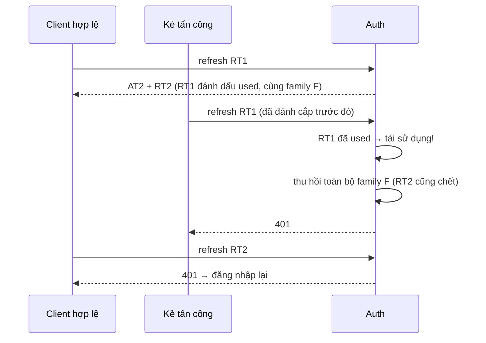

# Session và Token – duy trì đăng nhập

**Mục đích:** chọn và thiết kế đúng cơ chế duy trì đăng nhập (session phía server hay JWT), cookie, CSRF, access/refresh token, thu hồi, logout một/mọi thiết bị, timeout, và vận hành ở quy mô 200k user đồng thời.
**Liên quan:** [01-authentication.md](01-authentication.md) · [03-phan-quyen.md](03-phan-quyen.md) · [04-module-tai-khoan.md](04-module-tai-khoan.md) · [08-thiet-ke-api.md](08-thiet-ke-api.md) · [09-scale-trieu-user.md](09-scale-trieu-user.md) · [11-bao-mat.md](11-bao-mat.md) · [13-checklist-review-backend.md](13-checklist-review-backend.md)

> Ví dụ TypeScript + PostgreSQL + Redis; khái niệm áp dụng cho mọi stack.

---

## 1. Hai mô hình

| | **Session phía server (opaque)** | **Token tự chứa (JWT)** |
|---|---|---|
| Client giữ gì | ID ngẫu nhiên vô nghĩa (cookie) | Token chứa claim, có chữ ký |
| Server kiểm tra | Tra Redis/DB theo ID | Kiểm tra chữ ký + `exp`, không cần tra |
| Thu hồi tức thì | **Dễ** — xóa bản ghi | **Khó** — token còn hạn vẫn hợp lệ, phải có denylist hoặc TTL ngắn |
| Chi phí mỗi request | 1 lượt Redis (~0.2–1 ms) | CPU kiểm chữ ký (~0.05 ms với ES256/EdDSA) |
| Đổi quyền có hiệu lực | Ngay | Khi token hết hạn |
| Kích thước | ~32 byte | 300 B – vài KB, gửi mỗi request |
| Phù hợp | Web app first-party (LearnHub web) | API phân tán nhiều service, bên thứ ba, mobile với access token ngắn |

### Quy tắc quyết định

- **Web first-party (cùng domain/site) → session opaque trong cookie.** Đơn giản, thu hồi được, không có bí mật ở JavaScript.
- **Nhiều service nội bộ cần danh tính mà không gọi về auth** → gateway đổi session thành **JWT ngắn hạn (1–5 phút)** chuyển vào trong (pattern "phantom token"/token exchange). Client không giữ JWT dài hạn.
- **Mobile / bên thứ ba** → access token ngắn (5–15 phút) + refresh token xoay vòng.
- **Không dùng** JWT dài hạn (vài ngày) lưu `localStorage` "cho stateless" — mất khả năng logout, bị XSS là mất token.

"Stateless" là lý do sai phổ biến: ở 200k người đồng thời, 1 lượt Redis/request là việc nhỏ (một cụm Redis xử lý hàng trăm nghìn ops/giây). Khả năng thu hồi quan trọng hơn.

---

## 2. Cookie đúng chuẩn

```http
Set-Cookie: __Host-lh_sid=<32 byte ngẫu nhiên base64url>; Path=/; Secure; HttpOnly; SameSite=Lax; Max-Age=1209600
```

| Thuộc tính | Tác dụng | Bỏ đi thì |
|---|---|---|
| `HttpOnly` | JS không đọc được | XSS lấy cắp session |
| `Secure` | Chỉ gửi qua HTTPS | Lộ trên mạng không mã hóa |
| `SameSite=Lax` | Không gửi trong request POST cross-site | CSRF dễ hơn |
| `SameSite=Strict` | Không gửi cả khi bấm link từ site khác | Người dùng bấm link email vào bị "chưa đăng nhập" — thường dùng cho cookie phụ của thao tác nhạy cảm |
| `__Host-` prefix | Bắt buộc `Secure`, `Path=/`, không `Domain` → subdomain khác không ghi đè được | Subdomain bị chiếm (ví dụ blog) có thể cài cookie fixation |
| Không đặt `Domain` | Cookie chỉ cho đúng host | Gửi sang mọi subdomain |

Session ID: ≥ 128 bit entropy từ CSPRNG (`crypto.randomBytes(32)`). **Lưu hash của ID** trong Redis/DB (SHA-256) — dump Redis bị lộ cũng không dùng được.

---

## 3. CSRF

Cookie tự gửi theo request → site độc có thể khiến trình duyệt nạn nhân gửi request thay đổi trạng thái.

| Lớp phòng thủ | Ghi chú |
|---|---|
| `SameSite=Lax` | Chặn phần lớn, nhưng không chặn GET thay đổi trạng thái và request từ subdomain cùng site |
| **Không thay đổi trạng thái bằng GET** | Bắt buộc |
| Kiểm tra `Origin` / `Sec-Fetch-Site` với request ghi | Rẻ, hiệu quả: từ chối nếu `Origin` không nằm trong allowlist |
| CSRF token (synchronizer hoặc double-submit có ký) | Bắt buộc khi phải hỗ trợ trình duyệt cũ, hoặc form đăng nhập/đăng xuất |
| API thuần dùng header `Authorization: Bearer` (không cookie) | Không bị CSRF, nhưng token phải nằm ở nơi JS đọc được → rủi ro XSS |

```ts
// Middleware: kiểm tra Origin cho mọi phương thức ghi
const ALLOWED = new Set(["https://learnhub.example"]);
app.use((req, res, next) => {
  if (["GET", "HEAD", "OPTIONS"].includes(req.method)) return next();
  const origin = req.get("origin") ?? "";
  const site = req.get("sec-fetch-site");
  if (ALLOWED.has(origin) || site === "same-origin") return next();
  return res.status(403).json({ error: "csrf_rejected" });
});
```

CORS **không** phải chống CSRF: CORS chỉ chặn đọc phản hồi, request vẫn được gửi. Không bao giờ cấu hình `Access-Control-Allow-Origin` phản chiếu theo `Origin` kèm `Allow-Credentials: true`.

---

## 4. Thiết kế lưu session

### 4.1 Redis (đường nóng) + PostgreSQL (danh sách thiết bị, audit)

```sql
CREATE TABLE sessions (
  id              UUID PRIMARY KEY,                 -- id nội bộ, hiển thị trong "thiết bị của tôi"
  user_id         BIGINT NOT NULL REFERENCES users(id),
  token_hash      BYTEA  NOT NULL UNIQUE,           -- SHA-256(session token)
  created_at      TIMESTAMPTZ NOT NULL DEFAULT now(),
  last_seen_at    TIMESTAMPTZ NOT NULL DEFAULT now(),
  absolute_expiry TIMESTAMPTZ NOT NULL,
  auth_time       TIMESTAMPTZ NOT NULL,             -- cho step-up
  amr             TEXT[] NOT NULL,                  -- {'pwd','totp'}
  ip              INET,
  user_agent      TEXT,
  revoked_at      TIMESTAMPTZ,
  revoke_reason   TEXT
);
CREATE INDEX ON sessions (user_id) WHERE revoked_at IS NULL;
```

Redis:

```
sess:{token_hash}        HASH  {sid, uid, auth_time, amr, ver}   TTL = idle timeout
user_sess:{uid}          SET   {token_hash,...}                    -- để logout tất cả
user_ver:{uid}           STRING  số phiên bản quyền/bảo mật      -- tăng khi đổi mật khẩu, đổi role
```

### 4.2 Xác thực mỗi request

```ts
async function authenticate(req, res, next) {
  const raw = req.cookies["__Host-lh_sid"];
  if (!raw) return res.status(401).json({ error: "unauthenticated" });
  const key = `sess:${sha256hex(raw)}`;
  const s = await redis.hgetall(key);
  if (!s.uid) return res.status(401).json({ error: "unauthenticated" });

  // Absolute timeout
  if (Date.now() > Number(s.abs_exp)) { await revoke(raw, "absolute_timeout"); return res.status(401).json({ error: "session_expired" }); }

  // Gia hạn idle timeout (sliding), nhưng không quá thường xuyên để giảm ghi
  if (Date.now() - Number(s.touched) > 60_000) {
    await redis.multi().expire(key, IDLE_SECONDS).hset(key, "touched", Date.now()).exec();
    queue.publish("session.touched", { sid: s.sid }); // cập nhật last_seen_at bất đồng bộ, không ghi DB mỗi request
  }
  req.auth = { userId: s.uid, sessionId: s.sid, authTime: Number(s.auth_time), amr: s.amr.split(",") };
  next();
}
```

### 4.3 Timeout

| Loại | LearnHub (học viên) | LearnHub (admin) | Ý nghĩa |
|---|---|---|---|
| Idle timeout | 7 ngày ("ghi nhớ") / 2 giờ (không ghi nhớ) | 30 phút | Không hoạt động quá lâu → hết hạn |
| Absolute timeout | 30 ngày | 8 giờ | Hết hạn dù đang hoạt động — giới hạn thiệt hại nếu bị đánh cắp |
| Step-up window | 10 phút | 5 phút | Hành động nhạy cảm cần xác thực lại |

---

## 5. Access token + Refresh token (mobile, API)

### 5.1 Thiết kế

| Token | Dạng | Thời hạn | Lưu ở client |
|---|---|---|---|
| Access token | JWT ký ES256/EdDSA, ngắn | 5–15 phút | Bộ nhớ (web) / Keychain-Keystore (mobile) |
| Refresh token | Opaque ngẫu nhiên, lưu hash ở server | 30 ngày, xoay vòng | Cookie `HttpOnly` (web, path `/v1/auth/refresh`) / Keychain-Keystore (mobile) |

### 5.2 Rotation + phát hiện tái sử dụng (token family)

Mỗi lần dùng refresh token → cấp **cặp mới**, đánh dấu token cũ đã dùng. Nếu một token **đã dùng** lại được trình lên → có kẻ đánh cắp → **thu hồi cả family**.



```sql
CREATE TABLE refresh_tokens (
  id          UUID PRIMARY KEY,
  family_id   UUID   NOT NULL,
  session_id  UUID   NOT NULL REFERENCES sessions(id),
  token_hash  BYTEA  NOT NULL UNIQUE,
  parent_id   UUID,
  used_at     TIMESTAMPTZ,
  expires_at  TIMESTAMPTZ NOT NULL,
  revoked_at  TIMESTAMPTZ
);
CREATE INDEX ON refresh_tokens (family_id);
```

```ts
async function refresh(rawToken: string) {
  return db.tx(async (t) => {
    const rt = await t.oneOrNone(
      "SELECT * FROM refresh_tokens WHERE token_hash = $1 FOR UPDATE", [sha256(rawToken)]);
    if (!rt || rt.revoked_at || rt.expires_at < new Date()) throw new Unauthorized();

    if (rt.used_at) {
      // Cho phép "grace" vài giây khi client gửi 2 request refresh đồng thời (mạng chập chờn) — tùy chọn, có ghi log
      if (Date.now() - rt.used_at.getTime() > 10_000) {
        await t.none("UPDATE refresh_tokens SET revoked_at = now() WHERE family_id = $1", [rt.family_id]);
        await revokeSession(t, rt.session_id, "refresh_reuse");
        audit.log("refresh_token_reuse", { family: rt.family_id });
        throw new Unauthorized();
      }
    }
    await t.none("UPDATE refresh_tokens SET used_at = now() WHERE id = $1", [rt.id]);
    const next = newOpaqueToken();
    await t.none(`INSERT INTO refresh_tokens (id, family_id, session_id, token_hash, parent_id, expires_at)
                  VALUES ($1,$2,$3,$4,$5, now() + interval '30 days')`,
      [uuid(), rt.family_id, rt.session_id, sha256(next), rt.id]);
    return { accessToken: signAccessToken(rt.session_id), refreshToken: next };
  });
}
```

`FOR UPDATE` là bắt buộc: không có nó, hai request refresh đồng thời đều thấy `used_at IS NULL` và cùng nhận token mới (race condition).

---

## 6. JWT – những bẫy phải biết

| Bẫy | Đúng |
|---|---|
| Chấp nhận `alg: none` hoặc để token tự chọn thuật toán | **Cố định** thuật toán cho phép khi verify: `jwt.verify(t, key, { algorithms: ["ES256"] })` |
| Nhầm HS256/RS256 (dùng public key làm HMAC secret) | Như trên — allowlist thuật toán |
| Không kiểm `iss`, `aud`, `exp`, `nbf` | Kiểm đủ; cho phép lệch giờ ≤ 60 s |
| Đưa email, số điện thoại, quyền chi tiết vào payload | JWT chỉ **ký**, không mã hóa — ai cũng đọc được. Chỉ để `sub`, `sid`, `scope`, `exp`, `iat`, `jti` |
| Token quá to (nhét cả danh sách quyền) | Header vượt giới hạn 8 KB của proxy; tra quyền ở server |
| Một khóa ký mãi mãi | Xoay khóa: header `kid`, công bố **JWKS** (`/.well-known/jwks.json`) chứa khóa hiện tại + khóa trước; ký bằng khóa mới, giữ khóa cũ đến khi token cũ hết hạn |
| Tự viết code parse/verify | Dùng thư viện chuẩn (`jose`) |
| Dùng JWT làm session dài hạn + "logout" chỉ xóa phía client | Token vẫn dùng được; cần TTL ngắn + kiểm `sid` còn sống hoặc denylist `jti` |

Thu hồi JWT: (1) TTL ngắn; (2) mỗi token có `sid` → service kiểm `sid` trong Redis khi thao tác nhạy cảm; (3) `user_ver` — token mang `ver`, nếu `ver` < `user_ver:{uid}` trong Redis thì từ chối (đổi mật khẩu → tăng ver → mọi token cũ chết).

---

## 7. Logout

| Thao tác | Việc phải làm |
|---|---|
| Logout thiết bị này | Xóa `sess:{hash}` trong Redis, `revoked_at` trong DB, thu hồi refresh family của session, `Set-Cookie` với `Max-Age=0` |
| Logout thiết bị khác (từ danh sách) | Kiểm tra session đó **thuộc user hiện tại** (không thì IDOR), rồi thu hồi như trên |
| Logout tất cả | Thu hồi mọi session của user (`user_sess:{uid}`), tăng `user_ver` |
| Tự động logout tất cả | Khi đổi mật khẩu, reset mật khẩu, tắt MFA, phát hiện refresh reuse, admin khóa tài khoản |

```http
POST /v1/auth/logout                 → 204
POST /v1/auth/logout-all             → 204   (cần step-up)
GET  /v1/me/sessions                 → 200 [{ "id": "...", "current": true, "device": "Chrome trên Windows", "ip_city": "Hà Nội", "last_seen_at": "..." }]
DELETE /v1/me/sessions/{sessionId}   → 204 | 404 (không thuộc user cũng trả 404)
```

Logout dùng `POST` (không `GET` — tránh bị kích hoạt bởi ``) và có kiểm tra CSRF.

---

## 8. Session ở quy mô lớn

| Vấn đề | Giải pháp |
|---|---|
| 200k user đồng thời, ~5–10 triệu session còn hạn | Mỗi session ~300 B trong Redis → vài GB: Redis Cluster hoặc dịch vụ quản lý (ElastiCache, Memorystore); bật persistence AOF hoặc chấp nhận mất session khi sự cố (user đăng nhập lại) — quyết định có ý thức |
| **Sticky session** (gắn user vào 1 server) | **Anti-pattern**: server chết là mất session, phân tải lệch, khó autoscale. Session phải ở store dùng chung, server stateless |
| Redis chết | Fail closed (từ chối) với thao tác ghi; cân nhắc cho phép đọc nội dung công khai. Có replica + failover tự động |
| Ghi `last_seen_at` mỗi request | Gom/throttle (1 lần/phút), cập nhật bất đồng bộ |
| Nhiều region | Session store theo region của user hoặc replicate; JWT ngắn hạn giúp service ở region khác verify không cần gọi về |
| Hot key | Không có key dùng chung cho mọi user trong đường nóng |

---

## 9. Web vs Mobile vs SPA

| Client | Khuyến nghị |
|---|---|
| Web server-rendered / SPA cùng site | Session cookie `__Host-`, `HttpOnly`, `SameSite=Lax`, kiểm tra Origin |
| SPA khác domain với API | **BFF (Backend-for-Frontend)**: BFF cùng site giữ token, trình duyệt chỉ có cookie session với BFF. Tránh lưu token trong `localStorage` |
| Mobile native | OAuth Authorization Code + PKCE qua system browser; access token ngắn trong bộ nhớ, refresh token trong Keychain/Keystore; rotation; có thể DPoP để gắn token với thiết bị |
| CLI / thiết bị TV | Device Authorization Grant (RFC 8628) |

---

## 10. Lỗi agent AI hay mắc

| Lỗi | Hậu quả |
|---|---|
| JWT 7–30 ngày trong `localStorage`, "logout" chỉ xóa phía client | XSS lấy token; không thu hồi được |
| `jwt.verify` không truyền `algorithms` | Tấn công đổi thuật toán |
| Không tạo session mới sau login | Session fixation |
| Session ID là `userId` + timestamp, hoặc UUIDv1/v4 từ thư viện không phải CSPRNG | Đoán được |
| Lưu session token thô trong DB | DB lộ = chiếm mọi phiên |
| Refresh không xoay vòng hoặc không `FOR UPDATE` | Token bị đánh cắp dùng mãi; race condition |
| Logout bằng `GET` | CSRF đăng xuất |
| `DELETE /sessions/{id}` không kiểm tra chủ sở hữu | Đăng xuất người khác |
| Đổi mật khẩu không thu hồi session khác | Kẻ đã chiếm phiên vẫn ở lại |
| CORS `origin: true, credentials: true` | Mọi site đọc được dữ liệu người dùng |

## Checklist review

- [ ] Có ghi rõ (ADR) lý do chọn session opaque hay JWT; web first-party dùng cookie session.
- [ ] Cookie: `__Host-` (hoặc `Secure`), `HttpOnly`, `SameSite=Lax/Strict`, không `Domain`.
- [ ] Session ID ≥ 128 bit CSPRNG; lưu hash; tạo mới sau login và sau tăng quyền.
- [ ] CSRF: không GET thay đổi trạng thái; kiểm Origin/`Sec-Fetch-Site` hoặc CSRF token; CORS không phản chiếu origin với credentials.
- [ ] Có idle timeout và absolute timeout; `auth_time` cho step-up.
- [ ] Refresh token opaque, lưu hash, xoay vòng, phát hiện reuse → thu hồi family, có khóa hàng (`FOR UPDATE`).
- [ ] JWT: allowlist thuật toán, kiểm `iss`/`aud`/`exp`, payload không chứa dữ liệu nhạy cảm, có `kid` + JWKS để xoay khóa, TTL ngắn.
- [ ] Logout một/tất cả thiết bị hoạt động; kiểm chủ sở hữu khi xóa session; đổi/reset mật khẩu thu hồi các phiên khác.
- [ ] Không sticky session; session store có HA; hành vi khi Redis lỗi được định nghĩa.
- [ ] Không ghi DB mỗi request cho `last_seen_at`.
- [ ] Test: hết hạn idle/absolute, refresh reuse, refresh đồng thời, logout-all, cookie flags, CSRF bị từ chối.
