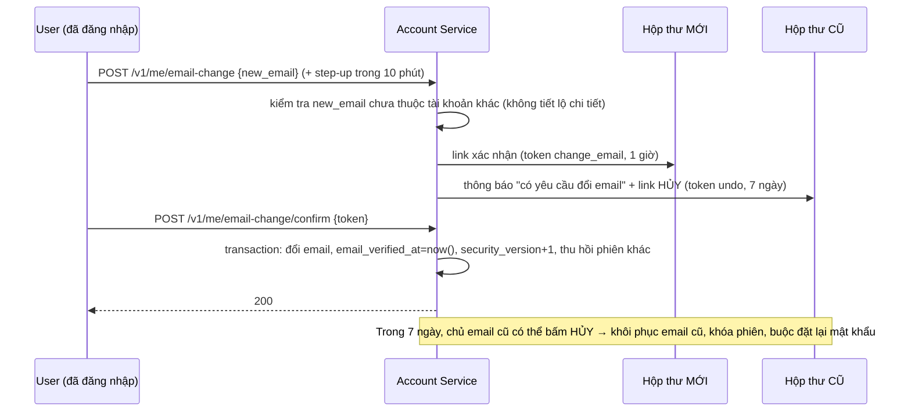
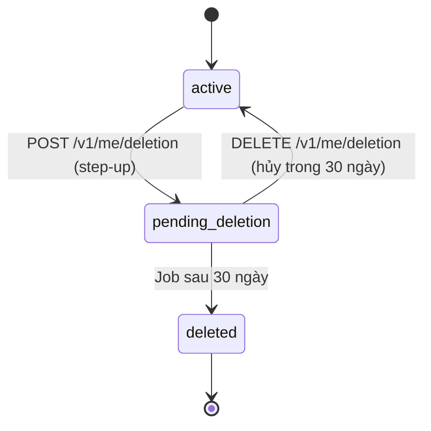

# Module tài khoản: đăng ký, đăng nhập/đăng xuất, mật khẩu, email, hồ sơ, xóa tài khoản

**Mục đích:** thiết kế đầy đủ module tài khoản của LearnHub ở mức có thể giao cho agent làm và review được: endpoint, bảng dữ liệu, luồng, trường hợp biên, lỗi hay gặp.
**Liên quan:** [01-authentication.md](01-authentication.md) · [02-session-token.md](02-session-token.md) · [03-phan-quyen.md](03-phan-quyen.md) · [07-thiet-ke-database.md](07-thiet-ke-database.md) · [08-thiet-ke-api.md](08-thiet-ke-api.md) · [10-messaging-kafka.md](10-messaging-kafka.md) · [11-bao-mat.md](11-bao-mat.md) · [12-observability-reliability.md](12-observability-reliability.md) · [13-checklist-review-backend.md](13-checklist-review-backend.md)

> Ví dụ TypeScript + PostgreSQL + Redis; luồng và quy tắc áp dụng cho mọi stack. Email/địa chỉ trong ví dụ là placeholder.

---

## 0. Tổng quan endpoint

| Nhóm | Method + Path | Auth | Ghi chú |
|---|---|---|---|
| Đăng ký | `POST /v1/auth/register` | — | Rate limit, CAPTCHA khi nghi ngờ |
| | `POST /v1/auth/verify-email` | — | Token trong body |
| | `POST /v1/auth/resend-verification` | — | Luôn 202 |
| Đăng nhập/xuất | `POST /v1/auth/login`, `/login/mfa` | — | [01](01-authentication.md) |
| | `POST /v1/auth/logout`, `/logout-all` | session | [02](02-session-token.md) |
| Mật khẩu | `POST /v1/auth/password/forgot` | — | Luôn 202 |
| | `POST /v1/auth/password/reset` | — | Token một lần |
| | `POST /v1/me/password` | session + mật khẩu cũ | Thu hồi phiên khác |
| Email | `POST /v1/me/email-change` | session + step-up | Gửi xác minh tới email mới |
| | `POST /v1/me/email-change/confirm` | — | Token |
| Hồ sơ | `GET /v1/me`, `PATCH /v1/me/profile` | session | `If-Match` / version |
| | `POST /v1/me/avatar/upload-url`, `POST /v1/me/avatar/complete` | session | Presigned URL |
| | `GET /v1/users/{id}` | tùy | Hồ sơ công khai, DTO rút gọn |
| Phiên | `GET /v1/me/sessions`, `DELETE /v1/me/sessions/{id}` | session | |
| Xóa/dữ liệu | `POST /v1/me/deletion`, `DELETE /v1/me/deletion` | session + step-up | Grace period 30 ngày |
| | `POST /v1/me/data-export` | session + step-up | Bất đồng bộ |

---

## 1. Bảng dữ liệu

```sql
CREATE EXTENSION IF NOT EXISTS citext;

CREATE TABLE users (
  id                 BIGSERIAL PRIMARY KEY,
  public_id          UUID NOT NULL UNIQUE DEFAULT gen_random_uuid(),  -- dùng ngoài API thay vì id tuần tự
  tenant_id          BIGINT NOT NULL,
  email              TEXT   NOT NULL,                -- như người dùng nhập (hiển thị, gửi thư)
  email_normalized   CITEXT NOT NULL,                -- lowercase, trim, NFKC: dùng cho unique và tra cứu
  email_verified_at  TIMESTAMPTZ,
  password_hash      TEXT,                           -- NULL nếu chỉ đăng nhập OAuth
  password_changed_at TIMESTAMPTZ,
  status             TEXT NOT NULL DEFAULT 'pending'
                     CHECK (status IN ('pending','active','suspended','pending_deletion','deleted')),
  mfa_enabled        BOOLEAN NOT NULL DEFAULT false,
  security_version   INT NOT NULL DEFAULT 1,         -- tăng khi đổi mật khẩu/email/MFA → vô hiệu token cũ
  version            INT NOT NULL DEFAULT 1,         -- optimistic locking cho hồ sơ
  created_at         TIMESTAMPTZ NOT NULL DEFAULT now(),
  updated_at         TIMESTAMPTZ NOT NULL DEFAULT now(),
  deletion_requested_at TIMESTAMPTZ,
  deleted_at         TIMESTAMPTZ
);
-- Duy nhất trong tenant, chỉ với tài khoản chưa bị xóa hẳn
CREATE UNIQUE INDEX users_email_uq ON users (tenant_id, email_normalized) WHERE status <> 'deleted';

CREATE TABLE user_profiles (
  user_id       BIGINT PRIMARY KEY REFERENCES users(id),
  display_name  TEXT NOT NULL CHECK (char_length(display_name) BETWEEN 2 AND 50),
  bio           TEXT CHECK (char_length(bio) <= 500),
  avatar_key    TEXT,                                -- key object storage, không phải URL công khai tùy ý
  locale        TEXT NOT NULL DEFAULT 'vi-VN',
  timezone      TEXT NOT NULL DEFAULT 'Asia/Ho_Chi_Minh',
  updated_at    TIMESTAMPTZ NOT NULL DEFAULT now()
);

-- Token một lần dùng chung cho: xác minh email, reset mật khẩu, đổi email
CREATE TABLE account_tokens (
  id          BIGSERIAL PRIMARY KEY,
  user_id     BIGINT NOT NULL REFERENCES users(id),
  purpose     TEXT NOT NULL CHECK (purpose IN ('verify_email','reset_password','change_email','undo_email_change')),
  token_hash  BYTEA NOT NULL UNIQUE,                 -- SHA-256(token) — không lưu token thô
  payload     JSONB,                                 -- ví dụ {"new_email": "..."}
  expires_at  TIMESTAMPTZ NOT NULL,
  used_at     TIMESTAMPTZ,
  created_at  TIMESTAMPTZ NOT NULL DEFAULT now()
);
CREATE INDEX ON account_tokens (user_id, purpose) WHERE used_at IS NULL;

CREATE TABLE audit_events (
  id          BIGSERIAL PRIMARY KEY,
  occurred_at TIMESTAMPTZ NOT NULL DEFAULT now(),
  tenant_id   BIGINT NOT NULL,
  actor_id    BIGINT,                                -- người thực hiện (có thể là admin)
  subject_id  BIGINT,                                -- tài khoản bị tác động
  action      TEXT NOT NULL,                         -- 'user.password_changed'
  ip          INET,
  user_agent  TEXT,
  metadata    JSONB NOT NULL DEFAULT '{}'            -- KHÔNG chứa mật khẩu, token, dữ liệu nhạy cảm
);
CREATE INDEX ON audit_events (subject_id, occurred_at DESC);
```

Ngoài ra: `sessions`, `refresh_tokens` ([02](02-session-token.md)), `user_identities`, `webauthn_credentials` ([01](01-authentication.md)), `outbox` (gửi email/sự kiện, [10](10-messaging-kafka.md)).

---

## 2. Đăng ký

### 2.1 Luồng

```mermaid
sequenceDiagram
    participant C as Client
    participant A as Account Service
    participant D as PostgreSQL
    participant Q as Outbox → Queue
    participant M as Mail worker
    C->>A: POST /v1/auth/register {email, password, display_name, captcha?}
    A->>A: validate, chuẩn hóa email, kiểm tra mật khẩu đã lộ
    A->>A: hash mật khẩu (Argon2id) — trước transaction
    A->>D: BEGIN; INSERT users; INSERT user_profiles; INSERT account_tokens(verify_email); INSERT outbox(email.verify); COMMIT
    alt trùng email (unique violation 23505)
        A->>D: INSERT outbox(email.already_registered) cho chủ email
    end
    A-->>C: 202 {"message":"Kiểm tra email để hoàn tất đăng ký"}
    Q->>M: email.verify
    M->>C: Thư chứa link /verify-email?token=...
```

### 2.2 Điểm kỹ thuật

| Vấn đề | Cách làm đúng |
|---|---|
| **Chuẩn hóa email** | `trim`, lowercase, NFKC. **Không** bỏ dấu chấm hay phần `+tag` cho mọi domain (quy tắc đó chỉ đúng với một số nhà cung cấp; làm bừa sẽ gộp nhầm tài khoản). Lưu cả bản gốc để gửi thư |
| **Trùng email khi đồng thời** | "SELECT rồi INSERT" có race: hai request cùng thấy chưa tồn tại. Dựa vào **unique index** và bắt lỗi `23505` |
| Enumeration | Cùng phản hồi 202 cho cả hai trường hợp; trường hợp trùng gửi thư "đã có tài khoản, bạn quên mật khẩu?" cho chủ email |
| Gửi email trong request | **Không** gọi SMTP trong transaction/request: chậm, lỗi SMTP làm hỏng đăng ký, lộ timing. Dùng **outbox** cùng transaction → worker gửi |
| Hash trong transaction | Hash trước khi mở transaction (giữ transaction ngắn) |
| Bot đăng ký hàng loạt | Rate limit IP, CAPTCHA thích ứng, chặn email dùng một lần nếu nghiệp vụ yêu cầu |
| Tài khoản `pending` không xác minh | Cho đăng nhập giới hạn hoặc không (quyết định nghiệp vụ); job dọn tài khoản pending sau 7 ngày |

```ts
try {
  await db.tx(async (t) => {
    const u = await t.one(`INSERT INTO users (tenant_id, email, email_normalized, password_hash, status)
                           VALUES ($1,$2,$3,$4,'pending') RETURNING id`, [tenantId, email, emailNorm, hash]);
    await t.none("INSERT INTO user_profiles (user_id, display_name) VALUES ($1,$2)", [u.id, displayName]);
    const token = randomToken(32);
    await t.none(`INSERT INTO account_tokens (user_id, purpose, token_hash, expires_at)
                  VALUES ($1,'verify_email',$2, now() + interval '24 hours')`, [u.id, sha256(token)]);
    await outbox.add(t, "email.verify", { userId: u.id, token });   // worker đọc token rồi xóa khỏi payload sau khi gửi
  });
} catch (e) {
  if (isUniqueViolation(e, "users_email_uq")) await outbox.addStandalone("email.already_registered", { emailNorm });
  else throw e;
}
return res.status(202).json({ message: "check_email" });
```

### 2.3 Xác minh email

```http
POST /v1/auth/verify-email   { "token": "<token>" }
→ 200 { "status": "verified" } | 400 { "error": "invalid_or_expired_token" }
```

- Token ≥ 128 bit, lưu hash, hết hạn 24 giờ, **dùng một lần** (`UPDATE ... SET used_at = now() WHERE token_hash = $1 AND used_at IS NULL AND expires_at > now() RETURNING user_id` — atomic, không race).
- Link dẫn tới **trang frontend**, trang đó gọi `POST`. Không xác minh bằng `GET` trực tiếp: trình quét link của hộp thư (Outlook Safe Links…) tự mở link, làm token bị dùng.
- Gửi lại: luôn 202, giới hạn 3 lần/giờ, vô hiệu token cũ.

---

## 3. Đăng nhập và đăng xuất

Chi tiết ở [01-authentication.md](01-authentication.md) mục 3 và [02-session-token.md](02-session-token.md) mục 7. Tóm tắt quy tắc module:

- Đăng nhập: lỗi chung, dummy hash, rate limit IP + tài khoản, MFA, tạo session mới, audit `user.login_succeeded`/`user.login_failed`, email cảnh báo khi thiết bị mới.
- Đăng xuất: `POST`, thu hồi session + refresh family, xóa cookie; "đăng xuất tất cả" cần step-up.

---

## 4. Quên mật khẩu / đặt lại mật khẩu

```mermaid
sequenceDiagram
    participant C as Client
    participant A as Account Service
    participant D as DB
    participant M as Mail worker
    C->>A: POST /v1/auth/password/forgot {email}
    A->>A: rate limit (IP + email)
    A->>D: tìm user active theo email_normalized
    opt có user
        A->>D: vô hiệu token reset cũ; INSERT token mới (hash, 30 phút); outbox
    end
    A-->>C: 202 (luôn giống nhau)
    M->>C: thư chứa link /reset-password?token=...
    C->>A: POST /v1/auth/password/reset {token, new_password}
    A->>D: tiêu thụ token atomically (used_at IS NULL AND expires_at > now())
    A->>D: cập nhật password_hash, password_changed_at, security_version+1
    A->>D: thu hồi MỌI session và refresh token của user
    A->>M: thư thông báo "mật khẩu đã được đổi"
    A-->>C: 200 → yêu cầu đăng nhập lại
```

| Quy tắc | Lý do |
|---|---|
| Token ngẫu nhiên ≥ 128 bit, **lưu hash**, hết hạn 15–60 phút, dùng một lần | DB lộ không dùng được token; giới hạn cửa sổ tấn công |
| Mỗi lần yêu cầu mới → vô hiệu token cũ | Tránh nhiều token còn sống |
| Phản hồi 202 giống nhau, thời gian giống nhau (gửi thư qua outbox) | Chống enumeration |
| Link chứa token trong **path/fragment của trang frontend**, trang có `Referrer-Policy: no-referrer` | Token không rò qua header Referer tới tài nguyên bên thứ ba |
| Host trong link lấy từ **cấu hình**, không từ header `Host` của request | Chống *host header injection*: kẻ tấn công khiến link reset trỏ về domain của họ |
| Sau reset: thu hồi mọi phiên, tăng `security_version`, gửi thư thông báo | Kẻ chiếm tài khoản bị đá ra |
| Nếu user có MFA: reset mật khẩu **không** tắt MFA | Nếu không, chiếm email = chiếm tài khoản |
| Không tự động đăng nhập sau reset nếu có MFA | Tránh bỏ qua MFA |

---

## 5. Đổi mật khẩu (đã đăng nhập)

```http
POST /v1/me/password
{ "current_password": "<...>", "new_password": "<...>" }
→ 204 | 400 validation_error | 401 invalid_current_password | 429
```

- Bắt buộc **mật khẩu hiện tại** (hoặc step-up bằng passkey với tài khoản không mật khẩu). Rate limit như login.
- Kiểm tra mật khẩu mới: độ dài, đã lộ, khác mật khẩu cũ.
- Sau khi đổi: tăng `security_version`, thu hồi **các phiên khác** (giữ phiên hiện tại, xoay ID phiên), gửi thư thông báo, audit.

---

## 6. Đổi email

Email là kênh khôi phục tài khoản → đổi email là thao tác **nguy hiểm nhất** của module.



Quy tắc: email chỉ đổi **sau khi xác minh email mới**; thông báo email cũ với đường hoàn tác; unique index vẫn bảo vệ khi hai người cùng đổi sang một email (bắt `23505` lúc confirm); audit đầy đủ.

---

## 7. Chỉnh sửa hồ sơ

### 7.1 API

```http
PATCH /v1/me/profile
If-Match: "7"                      ← version hiện tại (ETag)
Content-Type: application/merge-patch+json

{ "display_name": "Nguyễn Văn A", "bio": null }
```

| Kết quả | Status |
|---|---|
| Thành công | 200 + `ETag: "8"` + hồ sơ mới |
| Thiếu `If-Match` (khi bắt buộc) | 428 Precondition Required |
| Version cũ (người khác/tab khác vừa sửa) | 412 Precondition Failed |
| Trường không hợp lệ / không được phép | 400 / 422 với chi tiết từng trường |

### 7.2 Partial update an toàn

- **JSON Merge Patch (RFC 7396)**: trường vắng mặt = giữ nguyên; `null` = xóa giá trị. Phân biệt "không gửi" với "gửi null" — agent hay dùng `body.bio || existing.bio`, khiến không xóa được bio và coi chuỗi rỗng là "không gửi".
- **Allowlist** trường sửa được (`display_name`, `bio`, `locale`, `timezone`). Từ chối (400) trường lạ như `role`, `status`, `email`, `tenant_id` thay vì lặng lẽ bỏ qua — giúp phát hiện client lỗi và tấn công.
- Validation phía server: độ dài, ký tự điều khiển, chuẩn hóa Unicode, `timezone` thuộc danh sách IANA, `locale` thuộc danh sách hỗ trợ.
- Nội dung do user nhập (bio) được **escape khi hiển thị** (chống XSS) — lưu nguyên văn, không "làm sạch" bằng regex tự chế.
- Tên hiển thị: chặn giả mạo (giống tên admin/moderator, ký tự homoglyph) nếu là yêu cầu nghiệp vụ.

### 7.3 Optimistic locking

```sql
UPDATE users u SET version = version + 1, updated_at = now()
FROM user_profiles p
WHERE u.id = $1 AND u.version = $2 AND p.user_id = u.id
RETURNING u.version;
-- 0 dòng → 412. Cập nhật user_profiles trong cùng transaction.
```

Dùng optimistic (version) thay vì `SELECT ... FOR UPDATE` vì xung đột hiếm và request không giữ khóa lâu.

### 7.4 Ảnh đại diện (avatar)

```mermaid
sequenceDiagram
    participant C as Client
    participant A as Account Service
    participant S as Object Storage (S3/GCS/MinIO)
    participant W as Worker xử lý ảnh
    C->>A: POST /v1/me/avatar/upload-url {content_type, size}
    A->>A: kiểm tra loại (jpeg/png/webp), size ≤ 5 MB
    A-->>C: presigned PUT URL (key: uploads/tmp/{uid}/{uuid}, hết hạn 5 phút, ràng buộc content-type và content-length)
    C->>S: PUT ảnh trực tiếp (không qua API server)
    C->>A: POST /v1/me/avatar/complete {upload_key}
    A->>A: kiểm tra key thuộc đúng user (prefix uploads/tmp/{uid}/)
    A->>W: sự kiện avatar.uploaded
    W->>S: tải về, kiểm tra magic bytes, quét malware, decode lại ảnh (xóa EXIF/GPS), resize 64/256/512, lưu avatars/{uid}/{hash}.webp
    W->>A: cập nhật avatar_key; xóa file tạm
```

Lý do: upload trực tiếp lên storage giảm tải API server ở quy mô lớn; **không tin** `Content-Type` client gửi; decode-encode lại ảnh loại bỏ payload ẩn và metadata vị trí; tên file do server sinh (chống path traversal); phục vụ qua CDN với `Content-Type` cố định và `Content-Disposition` phù hợp; bucket tạm có lifecycle rule xóa sau 24 giờ.

### 7.5 Đọc hồ sơ

- `GET /v1/me` → DTO đầy đủ cho chủ tài khoản.
- `GET /v1/users/{public_id}` → DTO công khai (tên, avatar, bio) — **không** email, trạng thái, ngày tạo chính xác nếu không cần.
- Cache hồ sơ công khai (Redis/CDN, TTL ngắn), xóa cache khi cập nhật (sự kiện `user.profile_updated`).

---

## 8. Xóa tài khoản và quyền dữ liệu

### 8.1 Bối cảnh pháp lý

- **Nghị định 13/2023/NĐ-CP** (Việt Nam) về bảo vệ dữ liệu cá nhân: chủ thể dữ liệu có quyền được biết, đồng ý, truy cập, rút lại đồng ý, **xóa**, hạn chế xử lý, cung cấp dữ liệu, phản đối. Doanh nghiệp phải có cơ chế đáp ứng yêu cầu trong thời hạn luật định. (Luật Bảo vệ dữ liệu cá nhân 2025 có hiệu lực từ 2026-01-01 — kiểm tra quy định hiện hành với bộ phận pháp chế.)
- **GDPR** nếu có người dùng EU: quyền xóa (Art. 17), quyền di chuyển dữ liệu (Art. 20), phản hồi trong 1 tháng.

Kỹ sư không quyết định chính sách pháp lý — nhưng phải thiết kế để **thực hiện được**: biết dữ liệu cá nhân nằm ở đâu (DB, search index, cache, log, backup, data warehouse, bên thứ ba).

### 8.2 Luồng xóa



1. Yêu cầu: step-up, xác nhận; trạng thái `pending_deletion`; thu hồi mọi phiên; ẩn hồ sơ công khai; gửi thư có link hủy.
2. Grace period 30 ngày: đăng nhập lại → hỏi "khôi phục tài khoản?".
3. Job xóa (idempotent, chạy lại an toàn):
   - **Xóa hoặc ẩn danh hóa** dữ liệu cá nhân: email → `deleted+{id}@invalid`, `email_normalized` đổi tương ứng (giải phóng email cho đăng ký mới), `password_hash = NULL`, tên → "Người dùng đã xóa", avatar xóa khỏi storage, identities/MFA/API key xóa.
   - Nội dung cộng đồng (bài viết, bình luận): theo chính sách — xóa, hoặc giữ nội dung và gỡ liên kết tác giả.
   - Dữ liệu phải giữ theo luật/hợp đồng (điểm thi, hóa đơn): giữ tối thiểu, gắn với ID ẩn danh, ghi căn cứ lưu giữ.
   - Phát sự kiện `user.deleted` → các service khác (search, analytics, notification, CRM) tự xóa phần của mình.
   - Backup: không sửa được backup; ghi danh sách ID đã xóa để áp dụng lại khi khôi phục từ backup; backup hết hạn theo vòng đời.
4. Audit: ghi sự kiện xóa với `subject_id`, không ghi lại dữ liệu cá nhân đã xóa.

### 8.3 Soft delete hay hard delete

| | Soft delete (`deleted_at`) | Hard delete / ẩn danh hóa |
|---|---|---|
| Khôi phục | Dễ | Không |
| Đáp ứng quyền xóa | **Không** (dữ liệu còn đó) | Có |
| Rủi ro | Quên `WHERE deleted_at IS NULL` → lộ dữ liệu "đã xóa"; unique index bị chặn | Mất dữ liệu nếu lỗi |

Kết hợp: soft delete trong grace period → ẩn danh hóa/xóa thật khi hết hạn.

### 8.4 Xuất dữ liệu

`POST /v1/me/data-export` → 202 + job; worker gom dữ liệu thành ZIP (JSON), lưu storage, gửi link tải presigned có hạn 7 ngày, yêu cầu đăng nhập khi tải; rate limit 1 lần/ngày.

---

## 9. Audit log của module

| Sự kiện | Metadata |
|---|---|
| `user.registered`, `user.email_verified` | phương thức |
| `user.login_succeeded` / `user.login_failed` | amr, thiết bị mới?, lý do (không tiết lộ ra API) |
| `user.password_changed`, `user.password_reset` | số phiên bị thu hồi |
| `user.email_change_requested` / `_confirmed` / `_reverted` | domain email (không cần toàn bộ địa chỉ) |
| `user.mfa_enabled` / `_disabled`, `user.recovery_code_used` | |
| `user.profile_updated` | danh sách tên trường đã đổi (không giá trị) |
| `user.deletion_requested` / `_cancelled` / `_completed` | |
| `admin.user_suspended`, `admin.role_changed`, `admin.impersonation_started` | actor, lý do, ticket |

Audit chỉ ghi thêm, lưu tối thiểu 1 năm (theo chính sách), tách quyền đọc, không chứa bí mật.

---

## 10. Trường hợp biên phải có test

| Tình huống | Kết quả mong đợi |
|---|---|
| Hai request đăng ký cùng email đồng thời | Một tài khoản; request kia 202 như thường |
| Email khác hoa/thường, có khoảng trắng | Cùng một tài khoản |
| Token xác minh dùng hai lần / hết hạn / của mục đích khác | Lần 2 bị từ chối; token `reset_password` không dùng được cho `verify_email` |
| Reset mật khẩu khi đang có 3 phiên | Cả 3 bị thu hồi |
| Yêu cầu reset 2 lần, dùng link cũ | Link cũ không hợp lệ |
| PATCH hồ sơ với `{"role":"admin"}` | 400, không đổi gì |
| PATCH với version cũ | 412 |
| `bio: null` vs không gửi `bio` | Xóa vs giữ nguyên |
| Upload avatar là file `.exe` đổi đuôi `.png` | Worker từ chối, không gán |
| `complete` avatar với key của user khác | 403/404 |
| Đổi email sang email của tài khoản khác | Từ chối lúc confirm, thông điệp không lộ chi tiết |
| Xóa tài khoản rồi đăng ký lại cùng email sau khi hoàn tất | Được |
| Đăng nhập trong grace period | Đề nghị khôi phục |
| Mail worker lỗi | Outbox giữ, gửi lại sau; đăng ký vẫn thành công |

---

## 11. Lỗi agent AI hay mắc trong module này

- SELECT-rồi-INSERT để kiểm tra trùng email (race) thay vì unique index.
- Gửi email đồng bộ trong request/transaction.
- Lưu token reset/verify thô, không hết hạn, dùng nhiều lần, không vô hiệu token cũ.
- Lấy domain cho link từ header `Host`.
- Reset/đổi mật khẩu không thu hồi phiên khác; reset mật khẩu tắt luôn MFA.
- Đổi email ngay không xác minh, không báo email cũ.
- `UPDATE ... SET` theo `Object.keys(req.body)` (mass assignment, SQL ghép chuỗi tên cột).
- `||` thay cho kiểm tra `undefined` trong PATCH.
- Upload ảnh qua API server, tin `Content-Type`, lưu bằng tên file người dùng gửi, không xóa EXIF.
- "Xóa tài khoản" chỉ đặt `deleted_at` mà không có job ẩn danh hóa; quên lọc `deleted_at` ở các truy vấn khác.
- Log toàn bộ body (mật khẩu, token) hoặc email đầy đủ vào log ứng dụng.

## Checklist review

- [ ] Email chuẩn hóa nhất quán; unique index theo `(tenant_id, email_normalized)`; bắt lỗi unique thay vì SELECT trước.
- [ ] Đăng ký/quên mật khẩu/gửi lại xác minh trả phản hồi giống nhau; gửi email qua outbox.
- [ ] Mọi token một lần: ≥ 128 bit, lưu hash, có `purpose`, hết hạn, tiêu thụ atomic, vô hiệu token cũ.
- [ ] Link trong email dùng base URL từ cấu hình; trang reset có `Referrer-Policy: no-referrer`.
- [ ] Reset/đổi mật khẩu: tăng `security_version`, thu hồi phiên, gửi thư thông báo, không tắt MFA.
- [ ] Đổi email: step-up, xác minh email mới, báo email cũ kèm hoàn tác, audit.
- [ ] PATCH: merge-patch đúng ngữ nghĩa null/vắng mặt, allowlist trường, từ chối trường lạ, `If-Match`/version → 412.
- [ ] Avatar: presigned URL ràng buộc loại/kích thước, kiểm tra key thuộc user, worker kiểm magic bytes, quét, re-encode, xóa EXIF, tên do server sinh.
- [ ] Xóa tài khoản: step-up, grace period, job ẩn danh hóa idempotent, sự kiện `user.deleted` cho service khác, chính sách cho nội dung và dữ liệu phải lưu giữ, xử lý backup.
- [ ] Có xuất dữ liệu theo yêu cầu.
- [ ] Audit đủ sự kiện, không chứa bí mật/dữ liệu nhạy cảm thừa.
- [ ] Test đủ các trường hợp biên ở mục 10.
