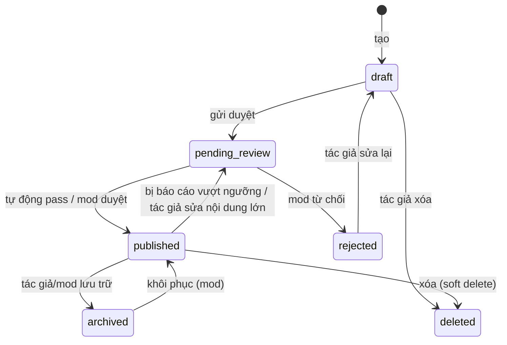
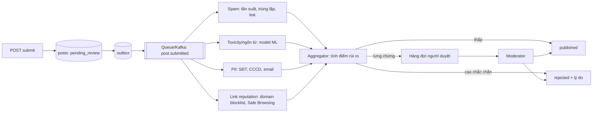

# Module bài viết, bình luận và kiểm duyệt nội dung

**Mục đích:** thiết kế module đăng bài – sửa – xóa – kiểm duyệt – feed – tìm kiếm – bình luận ở quy mô hàng triệu user, và biết phải kiểm tra gì khi agent viết code cho module này.
Ví dụ xuyên suốt: **LearnHub** (5 triệu user, 200k đồng thời giờ cao điểm). Code minh họa bằng TypeScript + PostgreSQL + Redis, nhưng khái niệm áp dụng cho mọi stack (Java/Spring, Go, .NET, Python…).

**Liên quan:** [03-phan-quyen.md](03-phan-quyen.md) · [04-module-tai-khoan.md](04-module-tai-khoan.md) · [07-thiet-ke-database.md](07-thiet-ke-database.md) · [08-thiet-ke-api.md](08-thiet-ke-api.md) · [09-scale-trieu-user.md](09-scale-trieu-user.md) · [10-messaging-kafka.md](10-messaging-kafka.md) · [11-bao-mat.md](11-bao-mat.md) · [12-observability-reliability.md](12-observability-reliability.md) · [13-checklist-review-backend.md](13-checklist-review-backend.md)

---

## 1. Đặc điểm tải của module bài viết

| Đặc điểm | Hệ quả thiết kế |
|---|---|
| Đọc nhiều hơn ghi ~100–1000 lần | Tối ưu đường đọc: cache, read replica, CDN, phi chuẩn hóa counter |
| Bài "hot" nhận lưu lượng dồn | Cache theo key bài, chống thundering herd (request coalescing) |
| Nội dung do người dùng tạo (UGC) | Phải sanitize, kiểm duyệt, chống spam, rate limit |
| Counter (view, like) cập nhật liên tục | Không `UPDATE posts SET views = views + 1` mỗi request → gom trong Redis, flush định kỳ |
| Cần tìm kiếm full-text | Postgres FTS hoặc search engine riêng (mục 9) |

## 2. Vòng đời bài viết – máy trạng thái



**Quy tắc:** chuyển trạng thái chỉ qua **một hàm duy nhất** kiểm tra bảng chuyển hợp lệ, trong transaction, ghi audit. Không để controller nào cũng `UPDATE posts SET status = ...`.

```ts
const TRANSITIONS: Record<PostStatus, PostStatus[]> = {
  draft: ['pending_review', 'deleted'],
  pending_review: ['published', 'rejected'],
  rejected: ['draft'],
  published: ['pending_review', 'archived', 'deleted'],
  archived: ['published'],
  deleted: [],
};

async function transition(tx: Tx, postId: string, to: PostStatus, actor: Actor, reason?: string) {
  // Khóa hàng để 2 mod không cùng duyệt/từ chối một bài
  const post = await tx.one(`SELECT id, status, version FROM posts WHERE id = $1 FOR UPDATE`, [postId]);
  if (!TRANSITIONS[post.status].includes(to)) throw new ConflictError(`Không thể chuyển ${post.status} → ${to}`);
  await tx.none(`UPDATE posts SET status = $2, version = version + 1, updated_at = now(),
                 published_at = CASE WHEN $2 = 'published' AND published_at IS NULL THEN now() ELSE published_at END
                 WHERE id = $1`, [postId, to]);
  await tx.none(`INSERT INTO post_status_log(post_id, from_status, to_status, actor_id, reason) VALUES ($1,$2,$3,$4,$5)`,
    [postId, post.status, to, actor.id, reason ?? null]);
  await outbox(tx, 'post.status_changed', { postId, from: post.status, to }); // xem 10-messaging-kafka.md
}
```

## 3. Lược đồ dữ liệu

```sql
CREATE TYPE post_status AS ENUM ('draft','pending_review','published','rejected','archived','deleted');

CREATE TABLE posts (
  id            uuid PRIMARY KEY,               -- UUIDv7: sắp theo thời gian, xem 07-thiet-ke-database.md
  author_id     uuid NOT NULL REFERENCES users(id),
  title         text NOT NULL CHECK (char_length(title) BETWEEN 5 AND 200),
  slug          text NOT NULL,
  body_source   text NOT NULL,                  -- Markdown/JSON gốc người dùng nhập
  body_html     text NOT NULL,                  -- HTML ĐÃ sanitize, render sẵn
  status        post_status NOT NULL DEFAULT 'draft',
  version       int NOT NULL DEFAULT 1,         -- optimistic locking
  like_count    int NOT NULL DEFAULT 0,         -- phi chuẩn hóa, flush từ Redis
  comment_count int NOT NULL DEFAULT 0,
  view_count    bigint NOT NULL DEFAULT 0,
  published_at  timestamptz,
  created_at    timestamptz NOT NULL DEFAULT now(),
  updated_at    timestamptz NOT NULL DEFAULT now(),
  deleted_at    timestamptz,
  search_tsv    tsvector GENERATED ALWAYS AS (
                  setweight(to_tsvector('simple', coalesce(title,'')), 'A') ||
                  setweight(to_tsvector('simple', coalesce(body_source,'')), 'B')) STORED
);
CREATE UNIQUE INDEX ux_posts_slug ON posts(slug);
-- Feed công khai: chỉ bài published, sắp mới nhất → partial index
CREATE INDEX ix_posts_feed ON posts (published_at DESC, id DESC) WHERE status = 'published';
CREATE INDEX ix_posts_author ON posts (author_id, created_at DESC);
CREATE INDEX ix_posts_search ON posts USING gin (search_tsv);

CREATE TABLE post_revisions (
  post_id     uuid NOT NULL REFERENCES posts(id),
  version     int  NOT NULL,
  title       text NOT NULL,
  body_source text NOT NULL,
  edited_by   uuid NOT NULL,
  created_at  timestamptz NOT NULL DEFAULT now(),
  PRIMARY KEY (post_id, version)
);

CREATE TABLE post_status_log (
  id bigserial PRIMARY KEY, post_id uuid NOT NULL, from_status post_status, to_status post_status NOT NULL,
  actor_id uuid NOT NULL, reason text, created_at timestamptz NOT NULL DEFAULT now()
);

CREATE TABLE tags (id serial PRIMARY KEY, name citext UNIQUE NOT NULL);
CREATE TABLE post_tags (post_id uuid REFERENCES posts(id), tag_id int REFERENCES tags(id), PRIMARY KEY (post_id, tag_id));
CREATE INDEX ix_post_tags_tag ON post_tags(tag_id, post_id);

CREATE TABLE post_likes (
  post_id uuid NOT NULL, user_id uuid NOT NULL, created_at timestamptz NOT NULL DEFAULT now(),
  PRIMARY KEY (post_id, user_id)               -- chặn like trùng ở tầng DB
);
```

Vì sao lưu cả `body_source` và `body_html`: sanitize + render một lần khi ghi (ghi ít), đọc chỉ trả HTML sẵn (đọc nhiều). Khi đổi chính sách sanitize → chạy job render lại từ `body_source`.

## 4. API

| Method | Path | Ai được gọi | Thành công | Lỗi chính |
|---|---|---|---|---|
| POST | `/v1/posts` | user đã đăng nhập | 201 + `Location` | 400/422 validate, 429 rate limit, 409 trùng Idempotency-Key khác payload |
| GET | `/v1/posts/{id}` | ai cũng được nếu published; tác giả/mod nếu khác | 200 + `ETag` | 404 (cả khi không có quyền xem draft — tránh lộ tồn tại) |
| PATCH | `/v1/posts/{id}` | tác giả (hoặc mod) | 200 | 403, 412 nếu `If-Match` sai version, 409 trạng thái không cho sửa |
| POST | `/v1/posts/{id}/submit` | tác giả | 202 (đang kiểm duyệt) | 409 |
| POST | `/v1/posts/{id}/moderation` `{decision, reason}` | moderator | 200 | 403, 409 |
| DELETE | `/v1/posts/{id}` | tác giả/mod | 204 | 403, 404 |
| GET | `/v1/posts?cursor=&limit=&tag=` | công khai | 200 `{items, next_cursor}` | 400 cursor sai |
| POST/DELETE | `/v1/posts/{id}/like` | user | 204 (idempotent) | 404 |
| POST | `/v1/posts/{id}/reports` | user | 202 | 409 đã báo cáo rồi, 429 |

Ví dụ tạo bài:

```http
POST /v1/posts
Authorization: Bearer <access_token>
Idempotency-Key: 6f1c2c1e-...-a1
Content-Type: application/json

{ "title": "Mẹo học SQL", "body": "## Index\n...", "format": "markdown", "tags": ["sql","database"] }
```
```http
HTTP/1.1 201 Created
Location: /v1/posts/01933b6e-...
ETag: "1"

{ "id": "01933b6e-...", "slug": "meo-hoc-sql-x7k2", "status": "draft", "version": 1 }
```

## 5. Tạo / sửa / xóa và quyền sở hữu

**Kiểm tra quyền ở tầng service, theo tài nguyên** — không chỉ "đã đăng nhập":

```ts
function canEdit(actor: Actor, post: Post) {
  if (actor.roles.includes('moderator')) return true;
  return post.authorId === actor.id && ['draft', 'rejected', 'published'].includes(post.status);
}
```

Lỗi kinh điển (IDOR): `PATCH /posts/:id` cập nhật `WHERE id = $1` mà không kiểm tra tác giả → ai cũng sửa được bài người khác. Cách an toàn: kiểm tra quyền sau khi tải bản ghi, hoặc đưa điều kiện vào câu lệnh `WHERE id = $1 AND author_id = $2` và xử lý 0 hàng bị ảnh hưởng. Chi tiết: [03-phan-quyen.md](03-phan-quyen.md).

**Sửa với optimistic locking** (hai tab cùng sửa không ghi đè nhau):

```ts
const r = await tx.result(
  `UPDATE posts SET title=$3, body_source=$4, body_html=$5, version=version+1, updated_at=now()
   WHERE id=$1 AND version=$2 AND deleted_at IS NULL`,
  [id, expectedVersion /* từ If-Match */, title, src, sanitizedHtml]);
if (r.rowCount === 0) throw new PreconditionFailed(); // 412: người khác đã sửa trước
await tx.none(`INSERT INTO post_revisions(post_id, version, title, body_source, edited_by) VALUES ($1,$2+1,$3,$4,$5)`, [...]);
```

**Xóa:** soft delete (`deleted_at`, status `deleted`) để còn khiếu nại/audit; job định kỳ xóa cứng sau N ngày (và xóa file đính kèm) để đáp ứng yêu cầu "quyền được xóa" (GDPR/Nghị định 13/2023 về dữ liệu cá nhân). Mọi query đọc phải lọc `deleted_at IS NULL` — đặt vào repository/view chung để không quên.

**Sửa bài đã published:** sửa nhỏ (typo) giữ published; sửa lớn (tỷ lệ thay đổi > ngưỡng, hoặc thêm link) → về `pending_review`. Quy tắc này là quyết định nghiệp vụ — agent không được tự đặt.

## 6. Nội dung giàu định dạng và chống XSS

Nguyên tắc: **không bao giờ tin HTML người dùng gửi**. Sanitize ở server, theo **allowlist** (danh sách cho phép), không theo blocklist.

| Cách | Ưu | Nhược |
|---|---|---|
| Markdown → HTML → sanitize | Đơn giản, người dùng quen | Vẫn phải sanitize vì Markdown cho phép HTML thô |
| Editor JSON (ProseMirror/TipTap/Lexical) → render server | Cấu trúc chặt, không có HTML thô | Phải viết renderer, migrate schema |
| HTML từ WYSIWYG | Dễ tích hợp | Rủi ro cao nhất |

```ts
import { marked } from 'marked';
import sanitizeHtml from 'sanitize-html';

const html = sanitizeHtml(await marked.parse(src), {
  allowedTags: ['p','h2','h3','ul','ol','li','strong','em','code','pre','blockquote','a','img','table','thead','tbody','tr','th','td'],
  allowedAttributes: { a: ['href','title'], img: ['src','alt'] },
  allowedSchemes: ['https'],                    // chặn javascript:, data:
  allowedSchemesByTag: { img: ['https'] },
  transformTags: { a: sanitizeHtml.simpleTransform('a', { rel: 'nofollow ugc noopener', target: '_blank' }) },
});
```

Thêm lớp phòng thủ: header `Content-Security-Policy` không cho inline script; ảnh chỉ từ domain CDN của mình (`img-src https://cdn.learnhub.vn`); link ngoài có `rel="nofollow ugc"` (giảm động cơ spam SEO). Xem [11-bao-mat.md](11-bao-mat.md).

## 7. Slug, tag, ảnh và file đính kèm

**Slug:** `slugify(title)` (bỏ dấu tiếng Việt: "Mẹo học SQL" → `meo-hoc-sql`) + hậu tố ngắn ngẫu nhiên → không cần vòng lặp kiểm tra trùng, tránh race. Unique index là chốt chặn cuối. Đổi tiêu đề không đổi slug (giữ link cũ), hoặc lưu slug cũ để redirect 301.

**Tag:** chuẩn hóa (lowercase, trim, `citext`), giới hạn số tag/bài (ví dụ ≤ 5), `INSERT ... ON CONFLICT (name) DO NOTHING` rồi lấy id.

**Ảnh/file – upload trực tiếp lên object storage bằng presigned URL**, không đi qua API server (tiết kiệm băng thông, không chặn worker):

```mermaid
sequenceDiagram
    participant C as Client
    participant API
    participant S3 as Object storage (S3/MinIO)
    participant W as Worker
    C->>API: POST /v1/uploads {filename, contentType, size}
    API->>API: kiểm tra quota, loại file, kích thước
    API-->>C: 201 {uploadId, presignedPutUrl (hết hạn 5 phút), key=tmp/...}
    C->>S3: PUT file
    C->>API: POST /v1/uploads/{id}/complete
    API->>W: job: quét virus, kiểm tra magic bytes, strip EXIF (GPS!), resize, tạo thumbnail
    W->>S3: lưu public/... ; xóa tmp/
    W-->>API: upload.status = ready
```

Bắt buộc: kiểm tra loại file bằng **nội dung** (magic bytes), không tin `Content-Type`/đuôi file; bỏ metadata EXIF (lộ vị trí); không phục vụ file người dùng từ domain chính (dùng domain CDN riêng để cookie không bị dùng chung); lifecycle rule xóa `tmp/` sau 24h; ảnh không gắn với bài nào sau N ngày → dọn.

## 8. Pipeline kiểm duyệt

### 8.1 Kiến trúc



Vì sao **bất đồng bộ**: các bước kiểm tra gọi model/dịch vụ ngoài chậm (100ms–vài giây) và có thể lỗi; không được làm request đăng bài chậm hoặc thất bại theo. API trả `202 Accepted`, client hiển thị "đang kiểm duyệt".

Quy tắc thiết kế:
- Mỗi checker **idempotent** (cùng `postId + version` → cùng kết quả, ghi bằng upsert), vì queue giao "ít nhất một lần".
- Kết quả checker lưu bảng `moderation_checks(post_id, version, checker, score, labels, created_at)`; aggregator chỉ quyết khi đủ checker hoặc hết timeout (checker chết → đưa người duyệt, **không** tự publish).
- Kết quả gắn với `version`: nếu tác giả sửa bài trong lúc đang kiểm, kết quả của version cũ bị bỏ.
- Ngưỡng (threshold) là cấu hình, không hard-code; theo dõi tỷ lệ false positive/negative.
- Người dùng tin cậy (reputation cao) có thể bỏ qua hàng đợi người duyệt nhưng **vẫn** qua check tự động.

### 8.2 Hàng đợi người duyệt

```sql
CREATE TABLE moderation_queue (
  id bigserial PRIMARY KEY, post_id uuid NOT NULL, post_version int NOT NULL,
  priority int NOT NULL, reason text NOT NULL, status text NOT NULL DEFAULT 'open', -- open|claimed|done
  claimed_by uuid, claimed_at timestamptz, created_at timestamptz NOT NULL DEFAULT now()
);
CREATE INDEX ix_modq_open ON moderation_queue (priority DESC, created_at) WHERE status = 'open';
```

Nhiều moderator lấy việc đồng thời không trùng nhau → `FOR UPDATE SKIP LOCKED`:

```sql
UPDATE moderation_queue SET status='claimed', claimed_by=$1, claimed_at=now()
WHERE id = (SELECT id FROM moderation_queue WHERE status='open'
            ORDER BY priority DESC, created_at LIMIT 1 FOR UPDATE SKIP LOCKED)
RETURNING *;
```

Job định kỳ trả lại các mục `claimed` quá 15 phút (moderator bỏ dở).

### 8.3 Báo cáo (report/flag) và kháng nghị (appeal)

- `post_reports(post_id, reporter_id, reason, created_at, UNIQUE(post_id, reporter_id))` — mỗi người báo cáo một lần.
- Trọng số theo uy tín người báo cáo; vượt ngưỡng → ẩn tạm (`pending_review`) và vào hàng đợi ưu tiên cao. Chống "brigading" (nhóm người cùng báo cáo để hạ bài): giới hạn tốc độ, phát hiện tài khoản mới tạo hàng loạt.
- Kháng nghị: tác giả gửi lý do → vào hàng đợi, **moderator khác** người đã từ chối xử lý.
- Mọi quyết định có `reason` và ghi `post_status_log` → minh bạch, đáp ứng yêu cầu pháp lý về gỡ nội dung.

## 9. Feed, danh sách và tìm kiếm

### 9.1 Phân trang bằng cursor (keyset)

`OFFSET 100000` buộc DB đọc rồi bỏ 100k hàng, và bị lệch khi có bài mới chèn vào. Dùng cursor:

```sql
SELECT id, title, slug, author_id, published_at, like_count, comment_count
FROM posts
WHERE status = 'published'
  AND (published_at, id) < ($1, $2)          -- giá trị từ cursor
ORDER BY published_at DESC, id DESC
LIMIT 21;                                     -- lấy dư 1 để biết còn trang sau
```

Cursor = base64url của `{published_at, id}` (có thể ký HMAC để client không chế tác). Dùng `id` làm tie-breaker vì nhiều bài có thể trùng `published_at`. Index `ix_posts_feed` phục vụ trực tiếp truy vấn này.

### 9.2 Feed cá nhân hóa: fan-out on write vs on read

| | Fan-out on write (push) | Fan-out on read (pull) |
|---|---|---|
| Cách làm | Khi A đăng bài, đẩy id vào feed (Redis list/ZSET) của mọi follower | Khi B mở feed, query bài mới của những người B theo dõi rồi merge |
| Đọc | Rất nhanh (O(1) lấy sẵn) | Chậm khi theo dõi nhiều người |
| Ghi | Rất tốn với tác giả nhiều follower (1 bài × 1 triệu follower) | Rẻ |
| Phù hợp | Đa số user có ít follower | Tài khoản "người nổi tiếng" |

**Thực tế dùng lai (hybrid):** push cho tác giả < ~10k follower; pull cho tác giả lớn rồi merge lúc đọc. Feed chỉ giữ N id gần nhất (`ZADD` + `ZREMRANGEBYRANK`), chi tiết bài lấy qua cache theo id. Với LearnHub giai đoạn đầu: feed theo khóa học/tag → pull + cache là đủ; chỉ làm fan-out khi số liệu chứng minh cần.

### 9.3 Counter (view, like) ở tải cao

`UPDATE posts SET view_count = view_count + 1` mỗi lượt xem → khóa hàng của bài hot, tranh chấp ghi, sinh WAL lớn.

```ts
// Ghi: chỉ tăng trong Redis
await redis.hincrby('post:views:pending', postId, 1);

// Job mỗi 30s: lấy và xóa nguyên tử, flush theo lô
const pending = await redis.eval(`
  local v = redis.call('HGETALL', KEYS[1]); redis.call('DEL', KEYS[1]); return v`, 1, 'post:views:pending');
// UPDATE posts p SET view_count = p.view_count + v.n FROM (VALUES ...) v(id, n) WHERE p.id = v.id
```

- Like: bảng `post_likes` là **nguồn sự thật** (PK chống trùng); `like_count` chỉ là bản sao để hiển thị, đối soát định kỳ bằng `COUNT(*)`.
- View: chống tăng ảo bằng dedupe theo `(user/ip, post)` trong cửa sổ thời gian (`SET view:{post}:{viewer} 1 NX EX 1800`). Chấp nhận sai số nhỏ — ghi rõ trong yêu cầu là "xấp xỉ".
- Mất Redis → mất tối đa 30s view: chấp nhận được với view, **không** chấp nhận với dữ liệu tiền/điểm.

### 9.4 Cache và invalidation

- Cache chi tiết bài: `post:{id}:v{version}` (key gắn version → sửa bài tự sinh key mới, không cần xóa) hoặc `post:{id}` + xóa khi ghi.
- Mẫu cache-aside: đọc cache → miss thì đọc DB → set với TTL + jitter (tránh hàng loạt key hết hạn cùng lúc).
- Bài hot hết hạn → nghìn request cùng đọc DB (cache stampede): dùng **single-flight** (một request nạp, số còn lại chờ) hoặc làm mới sớm khi TTL còn ít.
- Xóa cache **sau khi commit** (hoặc qua sự kiện outbox), không phải trước — nếu không, request đọc chen giữa sẽ nạp lại dữ liệu cũ.
- Trang danh sách công khai: cache ngắn (10–30s) ở CDN với `Cache-Control: public, s-maxage=30, stale-while-revalidate=60`. Không bao giờ cache ở CDN response có dữ liệu riêng của user.

### 9.5 Tìm kiếm: Postgres FTS hay Elasticsearch/OpenSearch

| Tiêu chí | Postgres FTS (`tsvector` + GIN) | Elasticsearch / OpenSearch |
|---|---|---|
| Vận hành | Không thêm hệ thống | Cụm riêng, đồng bộ dữ liệu, giám sát |
| Nhất quán | Cùng transaction | Trễ (eventual), cần pipeline đồng bộ |
| Tiếng Việt | Không có từ điển chuẩn; dùng `simple` + `unaccent`, `pg_trgm` cho tìm gần đúng | Có analyzer (ICU, plugin tiếng Việt), xử lý dấu tốt hơn |
| Xếp hạng, typo, gợi ý, facet | Cơ bản | Mạnh |
| Quy mô | Tốt tới vài triệu bài, truy vấn đơn giản | Hàng trăm triệu tài liệu, truy vấn phức tạp |

**Quy tắc:** bắt đầu với Postgres FTS; chuyển sang search engine khi cần typo-tolerance, facet, xếp hạng tùy chỉnh, hoặc tải tìm kiếm ảnh hưởng DB chính. Khi chuyển: đồng bộ qua outbox → Kafka → indexer (hoặc CDC Debezium), index chỉ chứa bài `published`, và có job **reindex toàn bộ** (dùng alias để đổi index không downtime).

## 10. Chống lạm dụng khi đăng bài

- **Rate limit** theo user và theo IP: ví dụ 5 bài/giờ, 30 bình luận/10 phút; user mới thấp hơn. Token bucket trong Redis; trả `429` + `Retry-After`. Chi tiết: [08-thiet-ke-api.md](08-thiet-ke-api.md).
- **Idempotent create:** client gửi `Idempotency-Key`; server lưu `(user_id, key) → response` 24h. Bấm "Đăng" hai lần hoặc mạng retry → chỉ một bài. Khóa trùng nhưng payload khác → `409`/`422`.
- Phát hiện nội dung trùng: hash nội dung chuẩn hóa (`sha256(lower(trim(body)))`) trong cửa sổ thời gian.
- Tài khoản chưa xác minh email: không cho đăng link / ảnh.

## 11. Bình luận lồng nhau

| Mô hình | Cách lưu | Đọc cả cây | Ghi | Ghi chú |
|---|---|---|---|---|
| Adjacency list | `parent_id` | Cần `WITH RECURSIVE` | Rẻ | Đơn giản nhất |
| Materialized path | `path = '0001.0005.0012'` | `WHERE path LIKE '0001.%' ORDER BY path` | Rẻ | Sắp xếp theo cây tự nhiên; Postgres có kiểu `ltree` |
| Closure table | Bảng (ancestor, descendant, depth) | Rất nhanh | Tốn (N hàng/bình luận) | Khi cần truy vấn tổ tiên phức tạp |

Thực tế: **giới hạn độ sâu** (ví dụ 2–3 cấp như hầu hết mạng xã hội; trả lời sâu hơn gắn vào cấp 2) → adjacency list + `root_id` là đủ:

```sql
CREATE TABLE comments (
  id uuid PRIMARY KEY, post_id uuid NOT NULL REFERENCES posts(id),
  root_id uuid,            -- bình luận gốc của luồng (NULL nếu chính là gốc)
  parent_id uuid,          -- bình luận được trả lời
  author_id uuid NOT NULL, body_html text NOT NULL, status text NOT NULL DEFAULT 'visible',
  reply_count int NOT NULL DEFAULT 0, created_at timestamptz NOT NULL DEFAULT now(), deleted_at timestamptz
);
CREATE INDEX ix_comments_roots ON comments (post_id, created_at DESC, id DESC) WHERE root_id IS NULL;
CREATE INDEX ix_comments_replies ON comments (root_id, created_at, id);
```

Tải bình luận gốc theo trang (cursor), mỗi gốc kèm 2–3 trả lời đầu, nút "xem thêm" tải tiếp theo `root_id`. Xóa bình luận có trả lời → hiển thị "[đã xóa]" thay vì xóa cả nhánh. `comment_count` của bài cập nhật qua counter như mục 9.3.

## 12. Sự cố và trường hợp biên

| Tình huống | Hậu quả nếu bỏ qua | Xử lý |
|---|---|---|
| Hai moderator cùng duyệt một bài | Trạng thái ghi đè, log mâu thuẫn | `FOR UPDATE` + kiểm tra chuyển trạng thái |
| Tác giả sửa bài khi đang kiểm duyệt | Bài nội dung mới được publish nhờ kết quả của bản cũ | Gắn kết quả với `version` |
| Checker ML sập | Bài kẹt pending mãi, hoặc tệ hơn: tự publish | Timeout → hàng đợi người duyệt; cảnh báo |
| Tác giả bị khóa tài khoản | Bài vẫn hiển thị | Sự kiện `user.suspended` → ẩn bài hàng loạt (job, theo lô) |
| Bài bị xóa nhưng còn trong cache/search/feed | Nội dung vi phạm vẫn hiện | Sự kiện `post.deleted` → xóa cache, xóa khỏi index, lọc khi đọc feed |
| Ảnh vẫn truy cập được sau khi xóa bài | Lộ nội dung | Xóa object + purge CDN |
| Tiêu đề toàn emoji/ký tự đặc biệt | Slug rỗng | Fallback slug = id rút gọn |

## 13. Lỗi agent AI hay mắc trong module này

1. Chỉ kiểm tra "đã đăng nhập", không kiểm tra **chủ sở hữu** → IDOR.
2. Lưu HTML từ client không sanitize, hoặc sanitize bằng regex tự viết.
3. Dùng `OFFSET` cho feed vô hạn.
4. `UPDATE ... view_count + 1` trong request GET.
5. Gọi model kiểm duyệt **đồng bộ** trong request đăng bài; khi model lỗi thì bỏ qua và publish.
6. Gửi sự kiện lên queue **trước khi** transaction commit (hoặc ngoài transaction) → sự kiện về bài không tồn tại / mất sự kiện. Dùng outbox ([10-messaging-kafka.md](10-messaging-kafka.md)).
7. Quên lọc `deleted_at IS NULL` / `status = 'published'` ở một endpoint (thường là search hoặc API của tác giả khác).
8. Trả `403` cho bài nháp của người khác → lộ rằng bài tồn tại; nên `404`.
9. Upload file qua API server, tin `Content-Type`, không bỏ EXIF.
10. Tự đặt quy tắc nghiệp vụ (ngưỡng báo cáo, sửa bao nhiêu thì duyệt lại) mà không hỏi.

## Checklist review

- [ ] Mọi thao tác ghi kiểm tra quyền **theo tài nguyên** (tác giả/moderator), có test cho trường hợp user khác gọi.
- [ ] Chuyển trạng thái qua một hàm duy nhất, có bảng chuyển hợp lệ, khóa hàng, ghi audit log, có test cho chuyển trạng thái **không hợp lệ**.
- [ ] Sửa bài dùng optimistic locking (`version`/`If-Match`), trả 412 khi xung đột.
- [ ] HTML được sanitize bằng thư viện allowlist ở server; có test với payload XSS (`<script>`, `onerror=`, `javascript:` URL, SVG).
- [ ] Upload qua presigned URL, giới hạn kích thước/loại, kiểm tra magic bytes, bỏ EXIF, domain phục vụ file tách riêng.
- [ ] Kiểm duyệt chạy bất đồng bộ, idempotent, gắn version, có timeout → người duyệt; lỗi checker **không** dẫn tới publish.
- [ ] Sự kiện phát qua outbox trong cùng transaction.
- [ ] Danh sách dùng cursor + index phù hợp; đã xem `EXPLAIN ANALYZE` với dữ liệu cỡ thật.
- [ ] Counter không ghi DB mỗi request; có nguồn sự thật và đối soát.
- [ ] Cache có TTL + jitter, invalidation sau commit, không cache dữ liệu riêng tư ở CDN.
- [ ] Rate limit và Idempotency-Key cho tạo bài/bình luận.
- [ ] Soft delete được lọc ở **mọi** đường đọc (API, search, feed, cache) và có job xóa cứng.
- [ ] Ngưỡng và quy tắc nghiệp vụ là cấu hình và đã được người phụ trách xác nhận.
