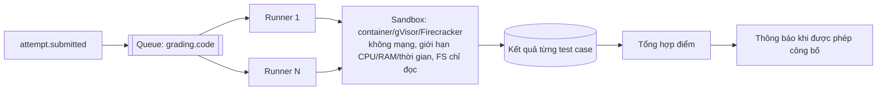

# Module bài kiểm tra, nộp bài và chấm bài

**Mục đích:** thiết kế module thi/bài tập sao cho **công bằng, không mất bài, không nộp trùng, chịu được đỉnh tải lúc bắt đầu thi**, và biết phải kiểm tra gì trong code agent viết.
Ví dụ: **LearnHub** (5 triệu user; một kỳ thi cuối khóa có thể có 50.000 thí sinh bấm "Bắt đầu" trong cùng một phút). Code TypeScript + PostgreSQL + Redis; khái niệm áp dụng cho mọi stack.

**Liên quan:** [03-phan-quyen.md](03-phan-quyen.md) · [07-thiet-ke-database.md](07-thiet-ke-database.md) · [08-thiet-ke-api.md](08-thiet-ke-api.md) · [09-scale-trieu-user.md](09-scale-trieu-user.md) · [10-messaging-kafka.md](10-messaging-kafka.md) · [11-bao-mat.md](11-bao-mat.md) · [12-observability-reliability.md](12-observability-reliability.md) · [13-checklist-review-backend.md](13-checklist-review-backend.md)

---

## 1. Yêu cầu cốt lõi (khác hẳn module bài viết)

| Yêu cầu | Vì sao quan trọng | Hệ quả kỹ thuật |
|---|---|---|
| **Không mất câu trả lời** | Mất bài = khiếu nại, kiện tụng | Autosave liên tục, ghi bền vững (DB), không chỉ giữ trên client/Redis |
| **Đồng hồ do server quyết định** | Client có thể sửa giờ máy, tạm dừng JS | Lưu `deadline_at` trong DB khi bắt đầu; mọi kiểm tra dùng giờ server |
| **Nộp đúng một lần** | Nộp trùng → chấm hai lần, điểm sai | Ràng buộc trạng thái + idempotency |
| **Công bằng** | Thí sinh khác nhau phải cùng điều kiện | Cùng thời lượng, gia hạn có ghi nhận, không lộ đề trước giờ |
| **Có thể kiểm toán** | Phúc khảo, tranh chấp | Lưu lịch sử lưu bài, sự kiện, ai chấm, chấm lúc nào |
| **Đỉnh tải cực nhọn** | Mọi người bắt đầu cùng phút | Chuẩn bị trước, giảm việc trên đường nóng, hàng đợi |

## 2. Mô hình dữ liệu

```sql
-- Ngân hàng câu hỏi: có version, không sửa đè câu đã dùng trong kỳ thi
CREATE TABLE questions (
  id uuid PRIMARY KEY, bank_id uuid NOT NULL, type text NOT NULL,   -- mcq_single|mcq_multi|numeric|short_text|essay|code
  version int NOT NULL DEFAULT 1, content jsonb NOT NULL,            -- đề, lựa chọn, ảnh (URL CDN)
  answer_key jsonb,                                                  -- KHÔNG BAO GIỜ gửi về client
  points numeric(6,2) NOT NULL, tags text[], created_by uuid NOT NULL,
  created_at timestamptz NOT NULL DEFAULT now()
);

CREATE TABLE exams (
  id uuid PRIMARY KEY, course_id uuid NOT NULL, title text NOT NULL,
  opens_at timestamptz NOT NULL, closes_at timestamptz NOT NULL,    -- cửa sổ được bắt đầu
  duration_seconds int NOT NULL,                                    -- thời lượng mỗi lượt
  max_attempts int NOT NULL DEFAULT 1,
  shuffle_questions bool NOT NULL DEFAULT true, shuffle_options bool NOT NULL DEFAULT true,
  late_policy text NOT NULL DEFAULT 'reject',                       -- reject|accept_with_penalty
  grace_seconds int NOT NULL DEFAULT 30,                            -- bù trễ mạng khi nộp
  result_release text NOT NULL DEFAULT 'after_close',               -- immediate|after_close|manual
  status text NOT NULL DEFAULT 'draft',                             -- draft|scheduled|open|closed|graded|published
  CHECK (closes_at > opens_at)
);

-- Đề "đóng băng" cho kỳ thi: trỏ tới đúng version câu hỏi
CREATE TABLE exam_questions (
  exam_id uuid REFERENCES exams(id), question_id uuid, question_version int NOT NULL,
  position int NOT NULL, points numeric(6,2) NOT NULL, PRIMARY KEY (exam_id, question_id)
);

CREATE TABLE attempts (
  id uuid PRIMARY KEY, exam_id uuid NOT NULL REFERENCES exams(id), user_id uuid NOT NULL,
  attempt_no int NOT NULL,
  status text NOT NULL DEFAULT 'in_progress',                        -- in_progress|submitted|auto_submitted|grading|graded
  started_at timestamptz NOT NULL DEFAULT now(),
  deadline_at timestamptz NOT NULL,                                  -- min(started_at + duration + extension, closes_at)
  extension_seconds int NOT NULL DEFAULT 0,                          -- gia hạn cho người khuyết tật, sự cố (có lý do)
  question_order uuid[] NOT NULL, option_seed bigint NOT NULL,       -- thứ tự xáo trộn, cố định cho lượt này
  submitted_at timestamptz, submit_source text,                      -- user|auto_expiry|proctor
  score numeric(7,2), max_score numeric(7,2),
  UNIQUE (exam_id, user_id, attempt_no)                              -- chặn tạo trùng lượt
);
CREATE INDEX ix_attempts_due ON attempts (deadline_at) WHERE status = 'in_progress';

CREATE TABLE answers (
  attempt_id uuid REFERENCES attempts(id), question_id uuid NOT NULL,
  response jsonb NOT NULL, client_seq bigint NOT NULL,               -- số thứ tự tăng dần từ client
  saved_at timestamptz NOT NULL DEFAULT now(),
  auto_score numeric(6,2), manual_score numeric(6,2), grader_id uuid, feedback text,
  PRIMARY KEY (attempt_id, question_id)
);

CREATE TABLE attempt_events (   -- nhật ký kiểm toán, append-only
  id bigserial PRIMARY KEY, attempt_id uuid NOT NULL, type text NOT NULL, -- started|saved|focus_lost|submitted|regraded...
  payload jsonb, ip inet, user_agent text, created_at timestamptz NOT NULL DEFAULT now()
);
```

Điểm thiết kế quan trọng:
- **`answer_key` tách khỏi nội dung gửi client.** Lỗi rất phổ biến: serialize nguyên đối tượng `question` ra JSON → lộ đáp án trong tab Network.
- **Câu hỏi có version.** Giáo viên sửa câu hỏi sau khi thi không làm thay đổi đề/đáp án của kỳ thi đã diễn ra.
- **Thứ tự xáo trộn lưu trong lượt thi** → tải lại trang thấy đúng thứ tự cũ; phúc khảo tái hiện được đề thí sinh đã thấy.

## 3. Bắt đầu lượt thi

```mermaid
sequenceDiagram
    participant C as Client
    participant API
    participant DB
    C->>API: POST /v1/exams/{id}/attempts (Idempotency-Key)
    API->>API: kiểm tra quyền: ghi danh khóa học, now ∈ [opens_at, closes_at)
    API->>DB: BEGIN; đếm lượt đã dùng < max_attempts; còn lượt in_progress?
    alt đã có lượt in_progress
        API-->>C: 200 trả lại lượt đó (tiếp tục, không tạo mới)
    else
        API->>DB: INSERT attempts(deadline_at = least(now()+duration, closes_at), question_order, option_seed)
        API->>DB: INSERT attempt_events(started); COMMIT
        API-->>C: 201 {attemptId, deadlineAt, serverNow, questions (không có đáp án)}
    end
```

```ts
async function startAttempt(userId: string, examId: string) {
  return db.tx(async tx => {
    const exam = await tx.one(`SELECT * FROM exams WHERE id=$1`, [examId]);
    const now = await tx.one(`SELECT now() AS t`);                      // dùng giờ DB, không phải giờ app server/client
    if (now.t < exam.opens_at || now.t >= exam.closes_at) throw new ConflictError('EXAM_NOT_OPEN');

    // Khóa theo (user, exam) để hai request song song không cùng tạo lượt
    await tx.none(`SELECT pg_advisory_xact_lock(hashtextextended($1, 0))`, [`${userId}:${examId}`]);

    const open = await tx.oneOrNone(`SELECT * FROM attempts WHERE exam_id=$1 AND user_id=$2 AND status='in_progress'`, [examId, userId]);
    if (open) return { attempt: open, created: false };

    const used = await tx.one(`SELECT count(*)::int n FROM attempts WHERE exam_id=$1 AND user_id=$2`, [examId, userId]);
    if (used.n >= exam.max_attempts) throw new ConflictError('NO_ATTEMPTS_LEFT');

    const order = exam.shuffle_questions ? shuffle(await questionIds(tx, examId)) : await questionIds(tx, examId);
    const attempt = await tx.one(`
      INSERT INTO attempts(id, exam_id, user_id, attempt_no, deadline_at, question_order, option_seed)
      VALUES ($1,$2,$3,$4, least(now() + make_interval(secs => $5), $6), $7, $8) RETURNING *`,
      [uuidv7(), examId, userId, used.n + 1, exam.duration_seconds, exam.closes_at, order, randomSeed()]);
    return { attempt, created: true };
  });
}
```

**Đồng hồ:** server trả `deadlineAt` và `serverNow`; client tính độ lệch `offset = serverNow - Date.now()` để hiển thị đếm ngược. Client chỉ **hiển thị**; quyết định hết giờ luôn ở server.

**Quyết định cần phê duyệt (không để agent tự chọn):** bắt đầu muộn có được đủ thời lượng không (`least(..., closes_at)` nghĩa là **không**); có cho làm lại nếu mất kết nối không; chính sách gia hạn.

## 4. Lưu tự động (autosave)

Client lưu khi đổi câu trả lời (debounce 1–2s) và định kỳ 15–30s. Yêu cầu: idempotent, chịu được request đến **sai thứ tự** (mạng chậm, retry).

```http
PUT /v1/attempts/{attemptId}/answers/{questionId}
Content-Type: application/json

{ "response": {"selected": ["B"]}, "clientSeq": 42 }
```

```sql
INSERT INTO answers(attempt_id, question_id, response, client_seq)
SELECT $1, $2, $3, $4
FROM attempts a
WHERE a.id = $1 AND a.user_id = $5 AND a.status = 'in_progress'
  AND now() <= a.deadline_at + make_interval(secs => $6)      -- grace
ON CONFLICT (attempt_id, question_id) DO UPDATE
  SET response = EXCLUDED.response, client_seq = EXCLUDED.client_seq, saved_at = now()
  WHERE answers.client_seq < EXCLUDED.client_seq;              -- request cũ đến muộn không ghi đè mới
```

- 0 hàng bị ảnh hưởng → phân biệt nguyên nhân: hết giờ/đã nộp (`409 ATTEMPT_CLOSED`) hay chỉ là request cũ (`200`, bỏ qua).
- Trả `{savedAt, clientSeq}` để client hiện "Đã lưu lúc 10:32:05".
- Client giữ bản sao trong IndexedDB và **gửi lại khi có mạng**; hiển thị cảnh báo rõ ràng khi mất kết nối.
- Có thể batch: `PUT /answers` với nhiều câu, cùng logic.
- **Không** dùng Redis làm nơi lưu duy nhất câu trả lời. Nếu cần giảm tải ghi, Redis Streams/Kafka làm bộ đệm **bền vững** + consumer ghi DB, nhưng phải chấp nhận độ phức tạp và kiểm chứng không mất dữ liệu khi node chết. Với 50k thí sinh × 1 lần lưu/15s ≈ 3.300 write/s — PostgreSQL được tinh chỉnh tốt xử lý được; đo trước khi thêm hệ thống.

## 5. Nộp bài – đúng một lần

```sql
UPDATE attempts
SET status = 'submitted', submitted_at = now(), submit_source = $3
WHERE id = $1 AND user_id = $2 AND status = 'in_progress'
RETURNING *;
```

- Điều kiện `status = 'in_progress'` là chốt chặn: request nộp thứ hai (bấm 2 lần, retry, tab khác, job tự nộp chạy cùng lúc) cập nhật 0 hàng → trả về **kết quả nộp trước đó** (200, idempotent), không lỗi, không chấm lại.
- Nộp sau `deadline_at + grace`: theo `late_policy` → từ chối (đã auto-submit) hoặc nhận và gắn cờ `late`, áp điểm phạt **lúc chấm**, không xóa dữ liệu.
- Cùng transaction: ghi `attempt_events(submitted)` và outbox `attempt.submitted` → kích hoạt chấm.

### Tự nộp khi hết giờ

Thí sinh đóng trình duyệt → không bao giờ bấm nộp. Job định kỳ (mỗi 30s) quét lượt quá hạn:

```sql
WITH due AS (
  SELECT id FROM attempts
  WHERE status = 'in_progress' AND deadline_at + make_interval(secs => $1) < now()
  ORDER BY deadline_at LIMIT 500 FOR UPDATE SKIP LOCKED      -- nhiều instance job chạy song song không trùng
)
UPDATE attempts a SET status='auto_submitted', submitted_at = a.deadline_at, submit_source='auto_expiry'
FROM due WHERE a.id = due.id RETURNING a.id;
```

Partial index `ix_attempts_due` làm truy vấn này rẻ dù bảng có hàng chục triệu lượt. Các câu trả lời đã autosave chính là bài nộp. Khi đóng kỳ thi (`closes_at`) cũng tự nộp mọi lượt còn mở.

## 6. Chấm bài

### 6.1 Phân loại

| Loại câu | Cách chấm | Lưu ý |
|---|---|---|
| Trắc nghiệm một đáp án | Tự động, đồng bộ hoặc ngay sau nộp | So khóa **theo id lựa chọn**, không theo vị trí (vì đã xáo trộn) |
| Nhiều đáp án | Tự động; chính sách: tất cả-hoặc-không / điểm từng phần / trừ điểm chọn sai | Chính sách phải ghi trong cấu hình đề |
| Số | Tự động với dung sai | `abs(x - key) <= max(abs_tol, rel_tol*abs(key))`; dùng `numeric`/decimal, không float khi so điểm |
| Điền ngắn | Tự động: chuẩn hóa (trim, lowercase, bỏ dấu?) + danh sách đáp án chấp nhận | Bỏ dấu tiếng Việt có thể đổi nghĩa — quyết định nghiệp vụ |
| Tự luận | Người chấm theo rubric | Chấm mù (ẩn tên), phân công, chấm chéo |
| Lập trình | Bất đồng bộ trong sandbox | Mục 6.3 |

### 6.2 Chấm tay theo rubric

- Rubric = danh sách tiêu chí, mỗi tiêu chí các mức điểm. Lưu điểm **theo tiêu chí** để giải thích được.
- Phân công qua hàng đợi (`FOR UPDATE SKIP LOCKED`, như hàng đợi kiểm duyệt).
- Chấm hai vòng cho kỳ thi quan trọng: chênh lệch > ngưỡng → người chấm thứ ba.
- Mọi lần đổi điểm ghi lịch sử (ai, lúc nào, cũ → mới, lý do). **Không** `UPDATE` đè mà không lưu vết.

### 6.3 Chấm code bất đồng bộ



- Code thí sinh là **mã độc tiềm năng**: chạy trong sandbox cô lập — không mạng, user không đặc quyền, seccomp, giới hạn CPU/bộ nhớ/số tiến trình/dung lượng đầu ra, timeout cứng (ví dụ 2s/test). Không bao giờ chạy trên máy chủ API.
- Runner lấy job, đánh dấu `grading`, có **visibility timeout**: runner chết → job quay lại hàng đợi. Kết quả ghi idempotent theo `(attempt_id, question_id, test_case_id)`.
- Số lần thử lại giới hạn; quá → dead-letter queue + cảnh báo, chấm tay.
- Scale runner theo độ dài hàng đợi (KEDA/autoscaling). Đỉnh nộp cuối giờ → chấp nhận trễ vài phút, không cần chấm tức thì.
- Test case ẩn không gửi về client; chỉ trả "pass x/y" theo chính sách.

### 6.4 Case study thực chiến: Thi một mình (Solo) vs Thi cộng đồng (Community Exam & Leaderboard)

Từ các lỗi thực tế khi vận hành module bài thi trên LearnHub/QuestionHub, có 4 điểm bắt buộc kiểm tra khi review code:

1. **Chống client tự chấm điểm & lỗi `Boolean(selectedAnswerId)`:**
   - Lỗi kinh điển: endpoint `POST /exams/:id/submit` nhận `score` từ `req.body`, hoặc kiểm tra đáp án bằng `Boolean(answers[questionId])` khiến mọi câu có chọn đáp án (ví dụ `answer_id = 102`) đều bị đánh thành `is_correct = true`!
   - **Cách đúng:** Trong cùng 1 Transaction `BEGIN ... COMMIT`, backend truy vấn `Question_Exams` + `Answer_Option (IsCorrect = TRUE)` để tự đối chiếu `selected_answer_id`, tự tính `finalScore`, và lưu **cả `selected_answer_id` lẫn `is_correct`** vào `exam_attempt_questions`.
2. **Lỗi Cartesian Fan-out khi `JOIN Subject`:**
   - Viết `LEFT JOIN Subject s ON s.GradeId = g.GradeId` sẽ làm **1 đề thi bị nhân bản** thành nhiều dòng theo tất cả môn học của khối lớp đó; hoặc lấy `e.ChapterId = s.SubjectId` là sai khóa ngoại.
   - **Cách đúng:** Join đúng chuỗi khóa ngoại `Exam -> Chapter (e.ChapterId = c.ChapterId) -> Subject (c.SubjectId = s.SubjectId)`.
3. **Chống Double-Submit & Farm thưởng:**
   - Chặn nộp trùng trong cửa sổ 10 giây (`completed_at > NOW() - INTERVAL '10 seconds'`) kết hợp chuyển trạng thái nguyên tử `WHERE attempt_id = $1 AND user_id = $2 AND status = 'IN_PROGRESS'`.
   - Nếu có thưởng điểm/nước khi hoàn thành đề thi, chỉ thưởng ở **lần hoàn thành đầu tiên trong ngày** cho đề đó.
4. **Bảng xếp hạng Thi cộng đồng (`Leaderboard`) & Zero Hard Delete:**
   - **Không lưu cứng cột `rank`** trong bảng (gây *Lost Update* & nghẽn khóa khi hàng trăm thí sinh cùng nộp phút cuối). Tính động bằng Window Function kết hợp Partial Composite Index `(exam_id, score DESC, completed_at ASC) WHERE status = 'COMPLETED'`:
     ```sql
     WITH best_attempts AS (
       SELECT ea.user_id,
              MAX(ea.score) AS best_score,
              MIN(EXTRACT(EPOCH FROM (ea.completed_at - ea.started_at)))::int AS best_duration_seconds
       FROM exam_attempts ea
       WHERE ea.exam_id = $1 AND ea.status = 'COMPLETED'
       GROUP BY ea.user_id
     )
     SELECT RANK() OVER (ORDER BY best_score DESC, best_duration_seconds ASC) AS rank, *
     FROM best_attempts
     ORDER BY rank ASC
     LIMIT $2;
     ```
   - **Zero Hard Delete:** Khi chủ đề thi bấm xóa đề cộng đồng, chỉ ẩn bằng `UPDATE Exam SET ExamSource = 'HIDDEN' WHERE ExamId = $1 AND CreatedByUserId = $2`. Tương tự khi học sinh bấm "Làm lại bài tập" (Reset), bọc Transaction chuyển phiên cũ sang `status = 'ARCHIVED'` và tạo phiên mới `IN_PROGRESS` — vừa giữ trọn lịch sử tổng (`user-history`), vừa không gây deadlock xóa cascade.

## 7. Công bố kết quả và phúc khảo

- `result_release`: `immediate` (chỉ khi toàn bộ chấm tự động), `after_close`, `manual` (giáo viên bấm công bố). API xem điểm phải kiểm tra điều kiện này — lỗi hay gặp: endpoint chi tiết bài làm trả điểm/đáp án trước khi công bố.
- Thống kê lớp (trung bình, phân phối) tính bằng job sau khi đóng, không tính trên mỗi request.
- Phúc khảo: `regrade_requests(attempt_id, question_id, reason, status, resolved_by, old_score, new_score)`; người xử lý khác người chấm ban đầu; điểm thay đổi → ghi lịch sử và thông báo.
- Sửa đáp án sai sau kỳ thi (đề lỗi): job chấm lại hàng loạt, idempotent, báo cáo danh sách thay đổi điểm cho giáo viên duyệt **trước** khi công bố.

## 8. Chống gian lận – làm được gì và giới hạn

| Biện pháp | Làm được | Không làm được |
|---|---|---|
| Xáo trộn câu và lựa chọn | Giảm chép bài ngồi cạnh | Chống chia sẻ đáp án theo nội dung |
| Ngân hàng câu lớn, rút ngẫu nhiên | Mỗi người đề khác | Đảm bảo độ khó đồng đều (cần gắn độ khó) |
| Không gửi đáp án/test ẩn về client | Chặn đọc đáp án từ DevTools | — |
| Không lộ đề trước giờ: API chỉ trả câu hỏi khi có lượt hợp lệ; ảnh qua URL ký có hạn | Chặn lấy đề sớm | Thí sinh chụp màn hình chia sẻ cho người thi sau → dùng cửa sổ thi ngắn |
| Ghi sự kiện mất focus/đổi tab | **Tín hiệu** để xem xét | Không phải bằng chứng; đừng tự động đánh trượt |
| Giới hạn một phiên đang làm bài/lượt | Phát hiện làm hộ từ máy khác | Người ngồi cạnh nhắc |
| Phát hiện bài giống nhau (code: MOSS/AST) sau thi | Phát hiện chép code | Cần người kết luận |
| Proctoring camera | Răn đe | Chi phí, quyền riêng tư (cần đồng ý, tuân thủ luật dữ liệu cá nhân) |

Nguyên tắc: hệ thống **ghi nhận tín hiệu**, con người **ra quyết định**. Mọi tính năng thu thập dữ liệu thí sinh cần phê duyệt pháp lý/quyền riêng tư.

## 9. Đỉnh tải lúc bắt đầu thi (thundering herd)

50.000 người bấm "Bắt đầu" trong 60 giây ≈ 830 req/s chỉ cho endpoint start, cộng tải tải đề, cộng autosave.

| Kỹ thuật | Cách làm |
|---|---|
| **Chuẩn bị trước** | Trước giờ thi 10 phút: nạp đề (không đáp án) vào Redis/cache bộ nhớ; scale-out API, DB pool, runner theo lịch (scheduled scaling) |
| **Tài nguyên tĩnh qua CDN** | Ảnh, file đính kèm của câu hỏi: object storage + CDN, URL ký có hạn, nạp sẵn (cache warm) |
| **Làm nhẹ đường nóng** | `start` chỉ: kiểm tra quyền (cache), INSERT 1 hàng, trả về; đề lấy từ cache |
| **Phòng chờ ảo / hàng đợi** | Khi vượt ngưỡng, trả `202 + vị trí hàng đợi`, client polling; phát token vào thi theo tốc độ DB chịu được. Thời lượng tính **từ lúc thực sự bắt đầu** nên không thiệt thí sinh |
| **Giãn nhịp phía client** | Jitter ngẫu nhiên 0–3s trước khi gọi; retry với exponential backoff + jitter; tránh mọi client retry cùng lúc |
| **Read replica** | Đọc danh sách kỳ thi, hồ sơ; nhưng **kiểm tra số lượt và tạo lượt phải trên primary** (replica trễ → tạo vượt số lượt) |
| **Rate limit** | Theo user (1 start/2s), chặn bot |
| **Kiểm thử tải** | Chạy k6/Gatling mô phỏng 1,5× đỉnh dự kiến trên môi trường giống production trước kỳ thi lớn — đây là điều kiện go/no-go |

Xem thêm [09-scale-trieu-user.md](09-scale-trieu-user.md).

## 10. Tính toàn vẹn và kiểm toán

- `attempt_events` append-only; không cấp quyền `UPDATE/DELETE` cho tài khoản DB của ứng dụng trên bảng này (hoặc chuyển sang kho log bất biến).
- Điểm số và thay đổi điểm có lịch sử đầy đủ.
- Đồng bộ thời gian máy chủ (NTP); mọi so sánh thời gian dùng một nguồn (DB `now()`).
- Sao lưu + PITR trước kỳ thi lớn; kiểm tra khôi phục được ([07-thiet-ke-database.md](07-thiet-ke-database.md)).
- Sự cố giữa kỳ thi (DB sập 5 phút): cần quy trình gia hạn hàng loạt có ghi nhận (`extension_seconds` + lý do), không sửa tay `deadline_at`.

## 11. Lỗi agent AI hay mắc

1. Gửi `answer_key`/`isCorrect` trong JSON câu hỏi.
2. Đếm ngược và quyết định hết giờ ở client; server tin `submittedAt` client gửi.
3. Kiểm tra `max_attempts` bằng `SELECT count` rồi `INSERT` không khóa → race tạo vượt lượt.
4. Nộp bài không có điều kiện `status = 'in_progress'` → nộp trùng, chấm hai lần.
5. Không có job tự nộp → bài của người đóng trình duyệt treo mãi.
6. So đáp án theo vị trí sau khi đã xáo trộn lựa chọn.
7. So điểm số thực bằng `===` với float.
8. Chạy code thí sinh bằng `child_process.exec` trên máy chủ.
9. Endpoint xem bài làm trả điểm trước thời điểm công bố.
10. Kiểm tra số lượt trên read replica.

## Checklist review

- [ ] Payload câu hỏi gửi client **không** chứa đáp án, giải thích, test ẩn — có test kiểm tra JSON trả về.
- [ ] `deadline_at` tính ở server, lưu DB; mọi thao tác ghi kiểm tra giờ bằng nguồn thời gian của server.
- [ ] Tạo lượt thi chống race (khóa/unique), tôn trọng `max_attempts`, idempotent khi gọi lại.
- [ ] Autosave idempotent, chống ghi đè sai thứ tự (`client_seq`), từ chối sau khi đóng; client có lưu tạm offline.
- [ ] Nộp bài là chuyển trạng thái có điều kiện, idempotent; có test bấm nộp đồng thời 2 lần.
- [ ] Có job tự nộp dùng `SKIP LOCKED`, có index, chạy nhiều instance an toàn.
- [ ] Chấm tự động so theo id lựa chọn, dùng decimal, có test cho dung sai và xáo trộn.
- [ ] Chấm code trong sandbox cô lập, có timeout/giới hạn tài nguyên, DLQ, idempotent.
- [ ] Kết quả chỉ trả khi đủ điều kiện công bố; phúc khảo và đổi điểm có lịch sử.
- [ ] Có kế hoạch đỉnh tải: cache đề, CDN, scale theo lịch, hàng đợi/phòng chờ, kết quả load test.
- [ ] Nhật ký kiểm toán append-only; chính sách nghiệp vụ (trễ, gia hạn, xáo trộn, công bố) đã được người phụ trách phê duyệt.
