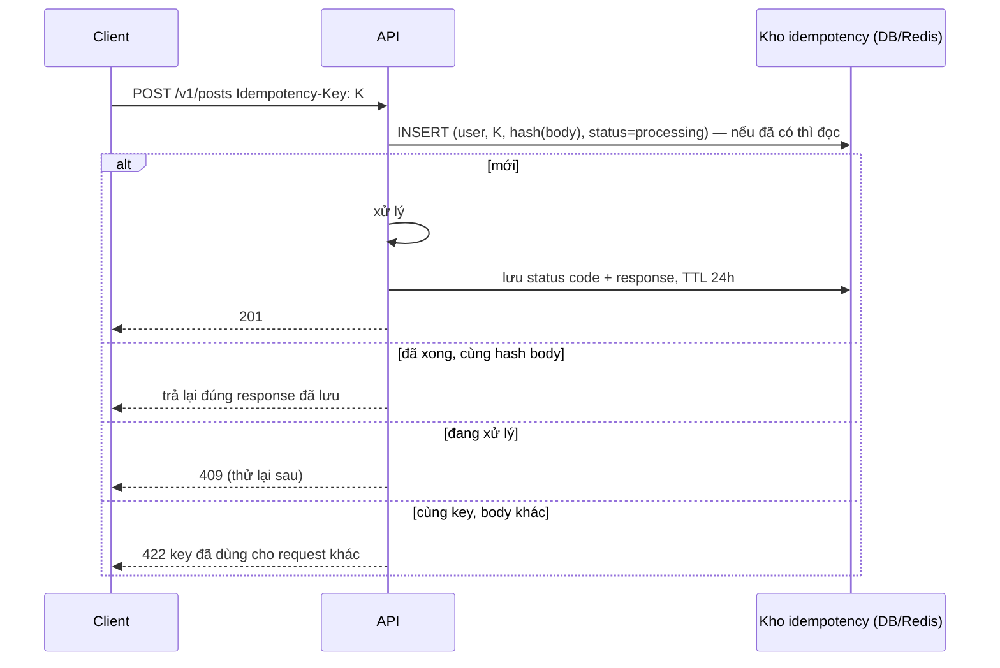

# Thiết kế API

**Mục đích:** thiết kế API dễ dùng, an toàn khi retry, tương thích ngược khi phát triển, và review được API do agent viết.
Ví dụ: **LearnHub**. Minh họa bằng HTTP/JSON và TypeScript (Express/NestJS); nguyên tắc áp dụng cho mọi framework.

**Liên quan:** [01-authentication.md](01-authentication.md) · [03-phan-quyen.md](03-phan-quyen.md) · [05-module-bai-viet-kiem-duyet.md](05-module-bai-viet-kiem-duyet.md) · [06-module-bai-kiem-tra-cham-bai.md](06-module-bai-kiem-tra-cham-bai.md) · [07-thiet-ke-database.md](07-thiet-ke-database.md) · [09-scale-trieu-user.md](09-scale-trieu-user.md) · [11-bao-mat.md](11-bao-mat.md) · [13-checklist-review-backend.md](13-checklist-review-backend.md)

---

## 1. Thiết kế tài nguyên REST

- **Danh từ, số nhiều**: `/v1/posts`, `/v1/posts/{id}/comments`. Hành động là method HTTP, không phải động từ trong URL (`/getPosts` ✗).
- Lồng tối đa 1–2 cấp; tài nguyên có id toàn cục thì truy cập trực tiếp: `/v1/comments/{id}` thay vì `/v1/posts/{p}/comments/{c}`.
- Hành động không khớp CRUD → **tài nguyên con** hoặc sub-resource động từ có chủ đích: `POST /v1/posts/{id}/submit`, `POST /v1/attempts/{id}/submission`. Chấp nhận được và rõ ràng hơn ép vào `PATCH status`.
- Tài nguyên "của tôi": `/v1/me`, `/v1/me/attempts` — tránh client truyền `userId` của chính mình (dễ dẫn tới IDOR).
- Tên trường thống nhất một kiểu (`camelCase` hoặc `snake_case`) cho toàn bộ API; thời gian ISO 8601 có múi giờ (`2026-11-20T08:00:00Z`); tiền/điểm dạng chuỗi hoặc số nguyên đơn vị nhỏ nhất để tránh sai số float.

## 2. Method và mã trạng thái

| Method | Ngữ nghĩa | Safe | Idempotent |
|---|---|---|---|
| GET | Đọc | ✓ | ✓ |
| POST | Tạo / hành động | ✗ | ✗ (làm idempotent bằng `Idempotency-Key`) |
| PUT | Thay thế toàn bộ / upsert tại URL biết trước | ✗ | ✓ |
| PATCH | Sửa một phần | ✗ | Không đảm bảo |
| DELETE | Xóa | ✗ | ✓ (xóa lần 2 → 204 hoặc 404, trạng thái cuối như nhau) |

GET **không bao giờ** thay đổi dữ liệu (crawler, prefetch, CDN có thể gọi tùy ý).

| Mã | Khi nào |
|---|---|
| 200 OK | Đọc/sửa thành công, có body |
| 201 Created | Tạo xong; kèm header `Location` |
| 202 Accepted | Đã nhận, xử lý bất đồng bộ (kiểm duyệt, chấm code, xuất báo cáo) |
| 204 No Content | Thành công, không body (DELETE, like) |
| 400 Bad Request | Request sai cú pháp (JSON hỏng, tham số sai kiểu) |
| 401 Unauthorized | Chưa xác thực / token hết hạn (kèm `WWW-Authenticate`) |
| 403 Forbidden | Đã xác thực nhưng không có quyền |
| 404 Not Found | Không tồn tại **hoặc** không được phép biết nó tồn tại |
| 405 / 406 / 415 | Method / định dạng response / Content-Type không hỗ trợ |
| 409 Conflict | Xung đột trạng thái (nộp bài đã đóng, trùng username) |
| 412 Precondition Failed | `If-Match` không khớp (người khác đã sửa) |
| 413 Content Too Large | Body quá lớn |
| 422 Unprocessable Content | Cú pháp đúng nhưng vi phạm quy tắc nghiệp vụ/validate |
| 428 Precondition Required | Bắt buộc gửi `If-Match` mà thiếu |
| 429 Too Many Requests | Vượt rate limit; kèm `Retry-After` |
| 500 | Lỗi không lường trước (không lộ stack trace) |
| 502 / 503 / 504 | Upstream lỗi / tạm quá tải hoặc bảo trì (kèm `Retry-After`) / upstream timeout |

Lỗi hay gặp: trả 200 với `{ "success": false }`; dùng 500 cho lỗi validate; dùng 401 thay cho 403.

## 3. Định dạng lỗi thống nhất: RFC 9457 (Problem Details)

```http
HTTP/1.1 422 Unprocessable Content
Content-Type: application/problem+json

{
  "type": "https://api.learnhub.vn/problems/validation-error",
  "title": "Dữ liệu không hợp lệ",
  "status": 422,
  "detail": "Có 2 trường không hợp lệ.",
  "instance": "/v1/posts",
  "traceId": "4bf92f3577b34da6a3ce929d0e0e4736",
  "errors": [
    { "field": "title", "code": "too_short", "message": "Tiêu đề tối thiểu 5 ký tự" },
    { "field": "tags", "code": "too_many", "message": "Tối đa 5 tag" }
  ]
}
```

- `type`/`code` ổn định, máy đọc được — client rẽ nhánh theo `code`, **không** theo `message` (message có thể dịch, đổi).
- `traceId` để tra log ([12-observability-reliability.md](12-observability-reliability.md)).
- Không lộ: stack trace, câu SQL, tên bảng, đường dẫn file, phiên bản thư viện.
- Thông báo đăng nhập/quên mật khẩu không phân biệt "email không tồn tại" và "sai mật khẩu" ([01-authentication.md](01-authentication.md)).

## 4. Validate đầu vào

- Validate ở **biên** (controller) bằng schema (zod, class-validator, Joi; Java Bean Validation; Pydantic) — kiểu, độ dài, định dạng, enum, giới hạn mảng.
- Từ chối trường lạ (`strict`) để chặn **mass assignment**: client gửi `{"role":"admin"}` hoặc `{"authorId":"..."}` không được lọt vào `UPDATE`.
- Quy tắc nghiệp vụ (trạng thái, quyền, số lượt) kiểm tra ở tầng service, không chỉ ở schema.
- Giới hạn kích thước body ở reverse proxy và framework (ví dụ 1 MB cho JSON); giới hạn độ sâu JSON, số phần tử mảng, độ dài chuỗi.

```ts
const CreatePost = z.object({
  title: z.string().trim().min(5).max(200),
  body: z.string().max(100_000),
  format: z.enum(['markdown']),
  tags: z.array(z.string().trim().toLowerCase().max(30)).max(5).default([]),
}).strict();
```

## 5. Phân trang, lọc, sắp xếp

| | Offset (`?page=3&size=20`) | Cursor (`?cursor=...&limit=20`) |
|---|---|---|
| Nhảy tới trang N | Có | Không |
| Hiệu năng trang sâu | Kém (DB đọc rồi bỏ) | Ổn định |
| Dữ liệu thay đổi khi đang xem | Trùng/sót bản ghi | Ổn định |
| Tổng số | Dễ có (nhưng `COUNT(*)` đắt) | Thường không trả |
| Dùng khi | Bảng quản trị nhỏ, cần số trang | Feed, danh sách lớn, API công khai |

```json
{ "items": [ ... ], "nextCursor": "eyJwIjoiMjAyNi0xMS0yMFQwODowMDowMFoiLCJpIjoiMDE5MyJ9", "hasMore": true }
```

- Cursor là chuỗi **mờ** (opaque) với client; server có thể đổi cấu trúc bên trong.
- `limit` có giá trị mặc định và tối đa (ví dụ mặc định 20, tối đa 100).
- Lọc/sắp xếp: `?status=published&tag=sql&sort=-publishedAt`. Chỉ cho phép trường trong **allowlist**; không ghép thẳng tên cột vào SQL (`ORDER BY ${sort}` → SQL injection).
- Mỗi tổ hợp lọc/sắp xếp được hỗ trợ cần index tương ứng — giới hạn tổ hợp thay vì cho lọc tự do mọi trường.

## 6. Versioning và tương thích ngược

| Cách | Ví dụ | Ghi chú |
|---|---|---|
| Trong URL | `/v1/posts` | Rõ ràng, dễ route, dễ cache — phổ biến nhất |
| Header | `Accept: application/vnd.learnhub.v2+json` | URL sạch, khó thử bằng trình duyệt |
| Theo ngày (kiểu Stripe) | `API-Version: 2026-11-01` | Linh hoạt, cần hạ tầng chuyển đổi |

**Thay đổi tương thích (không cần version mới):** thêm endpoint; thêm trường **tùy chọn** vào request; thêm trường vào response; thêm giá trị enum **nếu** client đã được dặn xử lý giá trị lạ.

**Thay đổi phá vỡ (cần version mới hoặc lộ trình):** xóa/đổi tên trường; đổi kiểu; trường tùy chọn thành bắt buộc; đổi ngữ nghĩa; đổi mã lỗi; đổi định dạng id; siết validate.

Quy trình ngưng hỗ trợ: thông báo, header `Deprecation` và `Sunset` (RFC 8594) với ngày cụ thể, theo dõi lượng gọi version cũ, chỉ tắt khi gần về 0. Client phải bỏ qua trường không biết (tolerant reader).

## 7. Idempotency key

Mạng có thể mất response sau khi server đã xử lý; client retry → tạo trùng (2 bài viết, 2 lần thanh toán).



- Phạm vi khóa theo **user + key** (không cho user A dùng key của B để đọc response).
- Lưu cùng transaction với thao tác nghiệp vụ khi có thể (bảng `idempotency_keys` trong cùng DB) → không có khoảng hở.
- Bắt buộc cho thao tác có hậu quả: thanh toán, tạo đơn, nộp bài, tạo bài viết.

## 8. Đồng thời: ETag và If-Match

```http
GET /v1/posts/0193...        →  200, ETag: "7"
PATCH /v1/posts/0193...
If-Match: "7"
{ "title": "Tiêu đề mới" }
→ 200, ETag: "8"     (hoặc 412 nếu đã có ai sửa thành "8" trước)
```

- ETag ánh xạ tới cột `version` ([07-thiet-ke-database.md](07-thiet-ke-database.md), khóa lạc quan).
- Với tài nguyên sửa cộng tác, có thể bắt buộc `If-Match` (thiếu → 428).
- GET dùng `If-None-Match` → `304 Not Modified`, tiết kiệm băng thông.

## 9. Rate limit

- Thuật toán: token bucket hoặc sliding window trong Redis (script Lua nguyên tử). Fixed window đơn giản nhưng cho phép dồn gấp đôi ở biên cửa sổ.
- Khóa theo: user (đã đăng nhập), IP/ASN (chưa đăng nhập), API key; và theo **endpoint** — đăng nhập, quên mật khẩu, gửi OTP chặt hơn nhiều.
- Header (chuẩn IETF đang dần thống nhất; nhiều API dùng dạng `X-RateLimit-*`):

```http
HTTP/1.1 429 Too Many Requests
Retry-After: 30
RateLimit-Policy: "default";q=100;w=60
RateLimit: "default";r=0;t=30
```

- Tầng: gateway/WAF chặn thô (chống flood), ứng dụng chặn tinh (theo nghiệp vụ).
- Khi Redis lỗi: **fail-open** cho endpoint thường (không làm sập dịch vụ), **fail-closed** cho endpoint nhạy cảm (đăng nhập, OTP) — đây là quyết định cần ghi rõ.

## 10. Upload file

| Cách | Dùng khi |
|---|---|
| Presigned URL lên object storage | Mặc định; file lớn; giảm tải API ([05-module-bai-viet-kiem-duyet.md](05-module-bai-viet-kiem-duyet.md) mục 7) |
| `multipart/form-data` qua API | File nhỏ (avatar < 2MB), cần xử lý ngay |
| Upload chia khối có thể tiếp tục (tus, S3 multipart) | Video, file hàng trăm MB, mạng yếu |

Luôn: giới hạn kích thước, kiểm tra loại bằng nội dung, quét virus, tên file do server sinh (chống path traversal), không phục vụ file người dùng từ domain chính.

## 11. Thao tác dài: 202 + tài nguyên trạng thái

```http
POST /v1/courses/{id}/exports        → 202 Accepted
Location: /v1/jobs/01936f...
{ "jobId": "01936f...", "status": "queued" }

GET /v1/jobs/01936f...               → 200
{ "status": "succeeded", "result": { "downloadUrl": "https://...signed...", "expiresAt": "..." } }
```

- Trạng thái: `queued → running → succeeded | failed | cancelled`, kèm `progress`, `error` (problem details).
- Client polling với backoff, hoặc nhận thông báo qua webhook/WebSocket/SSE.
- Không giữ request HTTP mở hàng phút — proxy/load balancer sẽ cắt (thường 30–60s).

## 12. Webhook (gửi sự kiện cho hệ thống khác)

- **Ký** mỗi request: `HMAC-SHA256(secret, timestamp + "." + body)` trong header; bên nhận kiểm tra chữ ký **và** timestamp (từ chối > 5 phút) để chống phát lại; so sánh hằng thời gian.
- Gửi từ worker qua hàng đợi, không từ request người dùng. Retry với exponential backoff + jitter trong nhiều giờ; sau đó đánh dấu thất bại, cho phép gửi lại thủ công; tự tắt endpoint lỗi liên tục và báo chủ.
- Giao **ít nhất một lần** → mỗi sự kiện có `id` duy nhất để bên nhận khử trùng; không đảm bảo thứ tự → kèm `occurredAt`/version.
- Payload chứa id + loại sự kiện, tối thiểu dữ liệu nhạy cảm; bên nhận gọi API để lấy chi tiết nếu cần.
- Khi **nhận** webhook từ bên ngoài: kiểm chữ ký trước khi parse, trả 2xx nhanh rồi xử lý bất đồng bộ, chống SSRF khi URL do người dùng cấu hình (chặn IP nội bộ, metadata cloud `169.254.169.254`).

## 13. REST, GraphQL hay gRPC

| | REST/JSON | GraphQL | gRPC |
|---|---|---|---|
| Mạnh ở | Đơn giản, cache HTTP/CDN, công cụ phổ biến | Client chọn đúng trường cần, gộp nhiều nguồn trong 1 request | Hiệu năng, hợp đồng chặt (protobuf), streaming hai chiều |
| Yếu ở | Over/under-fetching, nhiều round-trip | Khó cache, N+1 ở resolver, kiểm soát chi phí truy vấn (depth/complexity limit), phân quyền theo trường | Trình duyệt cần gRPC-Web/proxy; khó debug bằng tay |
| Dùng khi | API công khai, CRUD, mobile/web thông thường | Nhiều loại client với nhu cầu dữ liệu khác nhau; BFF | Giao tiếp nội bộ giữa các service, độ trễ thấp, đa ngôn ngữ |

LearnHub: REST cho client web/mobile và đối tác; gRPC (hoặc REST nội bộ) giữa service; sự kiện qua Kafka ([10-messaging-kafka.md](10-messaging-kafka.md)). Chỉ thêm GraphQL khi có nhu cầu thật từ nhiều client.

## 14. Contract-first với OpenAPI

1. Viết/duyệt đặc tả OpenAPI 3.1 **trước** khi code (con người duyệt hợp đồng, không phải đọc code để đoán API).
2. Sinh: kiểu dữ liệu cho server/client, tài liệu, mock server để frontend làm song song.
3. CI: lint đặc tả (Spectral), kiểm tra **breaking change** so với nhánh chính (oasdiff, openapi-diff), contract test để đảm bảo implementation khớp đặc tả.

Đây là điểm phê duyệt rất hiệu quả khi làm với agent: duyệt file OpenAPI ngắn gọn thay vì hàng nghìn dòng code.

## 15. Lỗi agent AI hay mắc

1. Endpoint nhận `userId` từ body/query thay vì lấy từ token → IDOR.
2. Không chặn trường lạ → mass assignment (`role`, `authorId`, `status`).
3. Mã trạng thái sai (200 cho lỗi, 500 cho validate, 401 thay 403), format lỗi mỗi endpoint một kiểu.
4. Không giới hạn `limit`, không phân trang danh sách.
5. `ORDER BY`/tên cột lấy thẳng từ query string.
6. POST tạo tài nguyên không có idempotency; GET có side effect.
7. Thay đổi phá vỡ (đổi tên trường) trong cùng version.
8. Trả nguyên entity DB ra JSON (lộ `password_hash`, `answer_key`, trường nội bộ) — luôn dùng DTO/serializer tường minh.
9. Lộ stack trace trong response lỗi ở production.
10. Webhook không ký, không chống phát lại; gửi đồng bộ trong request.

## Checklist review

- [ ] Đặc tả OpenAPI được cập nhật và đã duyệt; CI không báo breaking change (hoặc có version mới + lộ trình deprecate).
- [ ] Danh tính người gọi lấy từ token, không từ input; có test gọi tài nguyên của người khác → 403/404.
- [ ] Validate bằng schema, chặn trường lạ, giới hạn kích thước; quy tắc nghiệp vụ ở service.
- [ ] Response dùng DTO tường minh, không lộ trường nội bộ/nhạy cảm.
- [ ] Mã trạng thái đúng ngữ nghĩa; lỗi theo `application/problem+json` có `code` ổn định và `traceId`; không lộ chi tiết nội bộ.
- [ ] Danh sách có phân trang (cursor cho dữ liệu lớn), `limit` tối đa, lọc/sắp xếp theo allowlist có index.
- [ ] Thao tác tạo có hậu quả hỗ trợ `Idempotency-Key`; sửa cộng tác dùng `If-Match`/ETag.
- [ ] Rate limit cho endpoint nhạy cảm, trả 429 + `Retry-After`; chính sách fail-open/closed được ghi rõ.
- [ ] Thao tác dài trả 202 + tài nguyên trạng thái; không giữ request mở lâu.
- [ ] Webhook ký HMAC + timestamp, gửi qua hàng đợi có retry, có id sự kiện để khử trùng.
