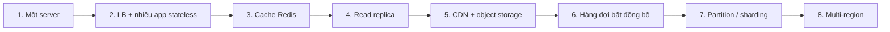

# Scale cho hàng triệu user

**Mục đích:** biết cách ước lượng tải, biết hệ thống cần scale bước nào và **khi nào** (dựa trên tín hiệu đo được, không theo cảm tính), nắm các kỹ thuật cache, rate limit, backpressure, và chọn kiến trúc monolith/microservices đúng lúc.
**Phạm vi công nghệ:** ví dụ dùng TypeScript/Node, PostgreSQL, Redis, nhưng nguyên lý áp dụng cho mọi stack (Java/Spring, Go, .NET, Python…).
**Liên quan:** [07-thiet-ke-database.md](07-thiet-ke-database.md) · [08-thiet-ke-api.md](08-thiet-ke-api.md) · [10-messaging-kafka.md](10-messaging-kafka.md) · [12-observability-reliability.md](12-observability-reliability.md) · [13-checklist-review-backend.md](13-checklist-review-backend.md)

---

## 1. Ước lượng tải (back-of-envelope) cho LearnHub

Mục tiêu của ước lượng: biết **bậc độ lớn** (10 rps hay 10.000 rps?) để chọn kiến trúc. Sai ±50% không sao; sai 100 lần mới là vấn đề.

### 1.1 Giả định (ghi rõ để người duyệt có thể phản biện)

| Thông số | Giá trị | Lý do |
|---|---|---|
| Tổng user đăng ký | 5.000.000 | Mục tiêu sản phẩm |
| DAU (user hoạt động/ngày) | 1.000.000 (20%) | Nền tảng học tập: 10–30% là điển hình |
| Đồng thời giờ cao điểm | 200.000 | Yêu cầu BRD |
| Request đọc/user/ngày | 40 (xem feed, bài, comment, điểm) | Ước lượng từ hành vi |
| Bài viết mới/ngày | 100.000 (10% DAU đăng 1 bài) | |
| Comment mới/ngày | 1.000.000 | |
| Kỳ thi lớn | 50.000 thí sinh nộp trong 5 phút cuối, autosave mỗi 30 giây | Trường hợp xấu nhất |

### 1.2 QPS (query per second)

1 ngày ≈ 86.400 giây ≈ **10⁵ giây** (làm tròn cho dễ tính).

| Loại | Trung bình | Cao điểm | Cách tính |
|---|---|---|---|
| Đọc | 1M × 40 / 10⁵ ≈ **400 rps** | **~10.000 rps** | 200k user đồng thời, mỗi user 1 request/20 giây |
| Ghi (bài + comment) | 1,1M / 10⁵ ≈ **11 wps** | ~110 wps | hệ số cao điểm ×10 |
| Ghi khi thi | — | 50k/30s autosave ≈ **1.700 wps**; nộp bài 50k/300s ≈ **170 wps** | sự kiện đột biến |

**Kết luận đọc ra:** hệ thống **nặng đọc** (tỷ lệ ~100:1) → đầu tư vào cache, read replica, CDN. Ghi bình thường rất nhẹ (1 PostgreSQL chịu vài nghìn wps đơn giản), nhưng **kỳ thi tạo đỉnh ghi đột biến** → cần thiết kế riêng (xem [06-module-bai-kiem-tra-cham-bai.md](06-module-bai-kiem-tra-cham-bai.md)): autosave vào Redis, ghi gộp vào DB, chấm bài qua hàng đợi.

### 1.3 Lưu trữ

| Dữ liệu | Mỗi ngày | Mỗi năm | Ghi chú |
|---|---|---|---|
| Bài viết (2 KB text) | 100k × 2 KB = 200 MB | ~73 GB | |
| Comment (0,5 KB) | 1M × 0,5 KB = 500 MB | ~180 GB | |
| Index + overhead (×2) | | ~500 GB/năm | Một PostgreSQL vẫn chứa được nhiều năm |
| Ảnh/file (10% bài có 1 MB) | 10 GB | ~3,6 TB | **Object storage (S3/MinIO)**, không lưu trong DB |
| Log/analytics event | 40M event × 300 B = 12 GB | ~4 TB | Kho riêng (ClickHouse/BigQuery/S3), không phải DB nghiệp vụ |

### 1.4 Băng thông

10.000 rps × 20 KB trung bình (JSON + ảnh nhỏ) ≈ 200 MB/s ≈ **1,6 Gbps** ra ngoài. Phần lớn là ảnh/static → **CDN** giảm 80–95% tải này.

### 1.5 Số con số nên thuộc

| Thao tác | Độ trễ cỡ |
|---|---|
| Đọc RAM | ~100 ns |
| Redis GET trong cùng datacenter | ~0,2–1 ms |
| PostgreSQL query theo index | ~1–5 ms |
| Query không index trên bảng 10M dòng | 100 ms – vài giây |
| Gọi HTTP sang service khác cùng DC | 1–10 ms |
| Round-trip VN ↔ Singapore | ~30–50 ms |
| VN ↔ Mỹ | ~150–250 ms |

Một instance Node.js xử lý API JSON đơn giản: **~1.000–5.000 rps** tùy logic. Một PostgreSQL tốt (16 vCPU, SSD): **vài chục nghìn query đơn giản/giây**, nhưng giới hạn kết nối (thường vài trăm) mới hay là nút thắt → dùng **connection pool / PgBouncer**.

---

## 2. Lộ trình scale từng bước — và tín hiệu kích hoạt

**Nguyên tắc vàng:** chỉ chuyển bước khi **đo được** tín hiệu. Mỗi bước thêm chi phí vận hành và độ phức tạp.



| Bước | Làm gì | Tín hiệu kích hoạt (đo được) | Chi phí/rủi ro mới |
|---|---|---|---|
| 1. Một server (app + DB) | Đủ cho MVP, < vài trăm rps | — | Một điểm chết |
| 2. Load balancer + N app stateless | Tách DB ra máy riêng; app không giữ state trong RAM (session → Redis) | CPU app > 60–70% kéo dài; cần deploy không downtime; cần HA | Phải làm app stateless; health check |
| 3. Cache (Redis) | Cache-aside cho dữ liệu đọc nhiều, ít đổi (profile, bài hot, feed) | DB CPU cao do **cùng một số query đọc lặp lại**; p95 đọc tăng | Dữ liệu cũ (stale), invalidation, stampede |
| 4. Read replica | Đọc không cần mới tuyệt đối → replica | DB primary CPU > 60% do đọc, dù đã cache | **Replication lag**: user vừa sửa xong đọc lại thấy dữ liệu cũ → cần "read-your-writes" |
| 5. CDN + object storage | Ảnh/video/static ra S3 + CDN | Băng thông app lớn, upload/download chiếm worker | Cache CDN cần purge; URL có chữ ký cho file riêng tư |
| 6. Hàng đợi (queue) | Việc chậm/không cần ngay → worker: email, kiểm duyệt AI, chấm bài, thông báo | Request p95 cao vì làm việc phụ đồng bộ; đỉnh ghi đột biến | Eventual consistency, idempotency, DLQ ([10-messaging-kafka.md](10-messaging-kafka.md)) |
| 7. Partition / sharding | Partition bảng lớn theo thời gian; shard theo `user_id`/`tenant_id` khi 1 primary không chịu nổi **ghi** | Primary chạm giới hạn ghi/IO sau khi đã tối ưu query, index, tách đọc; bảng > vài TB | Rất đắt: query xuyên shard, rebalance, transaction phân tán. **Làm cuối cùng** |
| 8. Multi-region | Chạy ở nhiều vùng | Yêu cầu DR vùng, độ trễ người dùng toàn cầu, luật lưu trữ dữ liệu | Đồng bộ dữ liệu, xung đột ghi, chi phí ×2 |

**LearnHub cần tới đâu?** Với ~10k rps đọc, ~100 wps ghi thường và đỉnh thi 1.700 wps (đã đẩy vào Redis), bước 1–6 là đủ. **Chưa cần sharding** — một PostgreSQL primary mạnh + 2 replica + Redis + queue chịu được. Agent đề xuất sharding/microservices cho quy mô này là dấu hiệu over-engineering.

### 2.1 Read-your-writes khi có replica

```ts
// Sau khi user ghi, đánh dấu 5 giây đọc từ primary cho user đó
async function updateProfile(userId: string, data: ProfileInput) {
  await primary.query('UPDATE users SET display_name=$1 WHERE id=$2', [data.name, userId]);
  await redis.set(`rw:${userId}`, '1', { EX: 5 });   // 5s > replication lag p99
}

async function dbForRead(userId: string) {
  return (await redis.exists(`rw:${userId}`)) ? primary : replica;
}
```

Theo dõi `replication lag`; nếu lag vượt ngưỡng (ví dụ > 2s), chuyển đọc về primary hoặc cảnh báo.

---

## 3. Stateless, scale ngang, autoscaling

**Stateless** = bất kỳ instance nào cũng xử lý được bất kỳ request nào. Không lưu trong RAM process: session, file upload tạm, cache dùng chung, lock, bộ đếm rate limit.

| State | Đặt ở đâu |
|---|---|
| Session/refresh token | Redis hoặc DB ([02-session-token.md](02-session-token.md)) |
| File upload | Upload thẳng lên S3 bằng presigned URL |
| Cache dùng chung | Redis (cache cục bộ trong RAM chỉ cho dữ liệu gần như bất biến, TTL ngắn) |
| Job định kỳ (cron) | Scheduler riêng hoặc lock phân tán — nếu không, N instance chạy cron N lần |
| WebSocket | Sticky ở tầng kết nối được, nhưng phát tin qua Redis Pub/Sub/NATS để mọi instance nhận |

**Autoscaling:**
- Scale theo **CPU** (60–70%) hoặc tốt hơn theo **RPS/instance** hoặc **độ dài hàng đợi** (cho worker).
- Thời gian khởi động instance (image pull, warm-up) có thể 30s–2 phút → với sự kiện biết trước (giờ thi), **scale trước theo lịch** (scheduled scaling), đừng đợi autoscale phản ứng.
- Giới hạn trên (max replicas) phải tính theo **số kết nối DB**: 50 pod × pool 20 = 1.000 kết nối → vượt `max_connections` → sập DB. Dùng PgBouncer (transaction pooling).

---

## 4. Cache

### 4.1 Các tầng cache

| Tầng | Ví dụ | Thời gian sống | Dùng cho |
|---|---|---|---|
| Trình duyệt/HTTP | `Cache-Control`, `ETag` | phút–năm | Static, response công khai |
| CDN | CloudFront, Cloudflare | phút–ngày | Ảnh, JS, response công khai |
| Cache trong process | LRU map | giây | Config, dữ liệu gần bất biến |
| Cache phân tán | Redis | giây–giờ | Profile, bài hot, feed, đếm |
| Cache của DB | buffer pool | tự quản lý | — |

### 4.2 Chiến lược

| Chiến lược | Cách làm | Ưu | Nhược | Dùng khi |
|---|---|---|---|---|
| **Cache-aside** (lazy) | Đọc cache → miss → đọc DB → set cache | Đơn giản, cache chỉ chứa thứ được đọc | Miss đầu chậm; dễ stale | **Mặc định** |
| Write-through | Ghi DB rồi ghi cache cùng lúc | Cache luôn mới | Ghi chậm hơn, cache chứa cả thứ không ai đọc | Dữ liệu đọc ngay sau ghi |
| Write-behind | Ghi cache, đồng bộ DB sau | Ghi cực nhanh | **Mất dữ liệu nếu cache chết** | Đếm view/like, autosave bài thi (có cơ chế flush + AOF) |
| Refresh-ahead | Làm mới trước khi hết hạn | Không có miss cho key hot | Phức tạp | Key cực hot (trang chủ) |

**Invalidation:** khi ghi, **xóa** key (`DEL`) thay vì cập nhật giá trị mới — tránh race hai request ghi đè giá trị cũ lên mới. Luôn đặt TTL làm lưới an toàn.

```ts
async function getPost(id: string): Promise<Post | null> {
  const key = `post:v1:${id}`;                       // version trong key: đổi schema → đổi v
  const hit = await redis.get(key);
  if (hit) return hit === 'null' ? null : JSON.parse(hit);
  const post = await db.posts.findById(id);
  const ttl = 300 + Math.floor(Math.random() * 60);  // jitter tránh hết hạn đồng loạt
  await redis.set(key, post ? JSON.stringify(post) : 'null', { EX: post ? ttl : 30 }); // cache cả "không tồn tại" (negative cache)
  return post;
}

async function updatePost(id: string, input: PostInput) {
  await db.posts.update(id, input);
  await redis.del(`post:v1:${id}`);                  // xóa SAU khi commit DB
}
```

### 4.3 Cache stampede (thundering herd)

Key hot hết hạn → 5.000 request cùng miss → cùng đập DB → DB sập.

| Kỹ thuật | Cách |
|---|---|
| **TTL có jitter** | Tránh nhiều key hết hạn cùng giây |
| **Lock/single-flight** | Chỉ 1 request được rebuild (`SET lock NX EX 5`), các request khác chờ ngắn hoặc trả giá trị cũ |
| **Stale-while-revalidate / early refresh** | Lưu kèm thời điểm hết hạn mềm; khi gần hết hạn, 1 request làm mới nền, các request khác vẫn nhận bản cũ |
| **Negative cache** | Cache cả kết quả "không có" (TTL ngắn) để chặn tấn công đọc id không tồn tại |

### 4.4 Hot key

Một bài viral → 1 key nhận 50k rps → dồn vào **một** node Redis Cluster (key chỉ thuộc 1 slot). Giải pháp: cache cục bộ trong process 1–5 giây cho key đó; nhân bản key (`post:123#0..#9`, đọc ngẫu nhiên); bộ đếm like/view dùng counter phân mảnh rồi gộp định kỳ.

### 4.5 Redis Cluster – điều cần biết

- 16.384 hash slot chia cho các master; mỗi master có replica.
- Lệnh nhiều key (`MGET`, transaction, Lua) chỉ chạy khi các key **cùng slot** → dùng hash tag `{user:42}:profile`, `{user:42}:settings`.
- Redis là bộ nhớ: đặt `maxmemory` + `maxmemory-policy allkeys-lru` cho cache; dữ liệu **không được mất** (hàng đợi, autosave) phải bật AOF và **tách instance** khỏi cache (cache có thể bị evict!).
- Tránh `KEYS *`, value > 100 KB, `HGETALL` trên hash khổng lồ — chặn event loop đơn luồng.

---

## 5. Scale database (tóm tắt — chi tiết ở [07-thiet-ke-database.md](07-thiet-ke-database.md))

Thứ tự làm, từ rẻ đến đắt:
1. **Tối ưu query + index** (`EXPLAIN ANALYZE`), bỏ N+1, phân trang keyset thay vì `OFFSET` lớn.
2. **Connection pooling** (PgBouncer).
3. Scale dọc (máy to hơn) — thường rẻ hơn bạn nghĩ so với công sức sharding.
4. Cache + read replica.
5. **Partition** bảng lớn theo thời gian (`comments` theo tháng, `events` theo ngày) — xóa dữ liệu cũ bằng `DROP PARTITION` thay vì `DELETE` hàng tỷ dòng.
6. Tách DB theo domain (DB của analytics khác DB nghiệp vụ).
7. Sharding theo khóa (user_id/tenant_id) — hoặc dùng DB phân tán (Citus, CockroachDB, Vitess cho MySQL).

---

## 6. Rate limiting

**Tại sao:** chặn lạm dụng (brute force login, spam bài), bảo vệ hệ thống khi đỉnh tải, công bằng giữa user.

| Thuật toán | Cách | Ưu | Nhược |
|---|---|---|---|
| Fixed window | Đếm theo phút cố định | Đơn giản | Burst gấp đôi ở ranh giới phút |
| Sliding window log | Lưu timestamp từng request | Chính xác | Tốn bộ nhớ |
| **Sliding window counter** | Nội suy 2 cửa sổ | Chính xác vừa đủ, rẻ | Xấp xỉ |
| **Token bucket** | Xô nạp token tốc độ r, dung lượng b | Cho phép burst có kiểm soát | Cần atomic |
| Leaky bucket | Hàng đợi chảy đều | Làm phẳng tải | Thêm độ trễ |

**Phân tán:** bộ đếm phải ở Redis (không phải RAM từng instance), thao tác **atomic** bằng Lua:

```ts
// Token bucket atomic trong Redis
const TOKEN_BUCKET = `
local key, rate, cap, now = KEYS[1], tonumber(ARGV[1]), tonumber(ARGV[2]), tonumber(ARGV[3])
local s = redis.call('HMGET', key, 'tokens', 'ts')
local tokens = tonumber(s[1]) or cap
local ts = tonumber(s[2]) or now
tokens = math.min(cap, tokens + (now - ts) / 1000 * rate)
local allowed = 0
if tokens >= 1 then tokens = tokens - 1; allowed = 1 end
redis.call('HSET', key, 'tokens', tokens, 'ts', now)
redis.call('PEXPIRE', key, math.ceil(cap / rate * 1000) + 1000)
return allowed`;

const ok = await redis.eval(TOKEN_BUCKET, { keys: [`rl:post:${userId}`], arguments: ['0.2', '5', String(Date.now())] });
if (!ok) return res.status(429).set('Retry-After', '5').json({ error: 'rate_limited' });
```

**Giới hạn theo nhiều chiều:** theo IP (chưa đăng nhập), theo user, theo endpoint, theo tài khoản bị nhắm (login sai cho cùng email từ nhiều IP). Ví dụ LearnHub:

| Endpoint | Giới hạn |
|---|---|
| `POST /auth/login` | 5 lần/phút/IP + 10 lần/15 phút/email |
| `POST /posts` | 5 bài/phút/user, burst 5 |
| `POST /comments` | 20/phút/user |
| API chung | 100 rps/user |

Trả `429` + `Retry-After`. Khi Redis chết: chọn **fail-open** cho API chung (giữ dịch vụ) nhưng **fail-closed** cho login (an toàn) — ghi rõ quyết định này.

---

## 7. Backpressure và load shedding

Khi tải vượt khả năng, có ba lựa chọn: chậm cho tất cả (tệ — mọi request timeout), **từ chối bớt** (tốt), hoặc xếp hàng có giới hạn.

- **Hàng đợi có giới hạn:** queue không giới hạn = memory leak chờ nổ. Đặt giới hạn, đầy thì từ chối (`503` + `Retry-After`).
- **Load shedding theo ưu tiên:** quá tải → bỏ trước request ít quan trọng (gợi ý bài, analytics), giữ nộp bài thi, đăng nhập.
- **Concurrency limit** mỗi instance (ví dụ tối đa 500 request đang xử lý) và ước lượng thời gian chờ: request đã chờ quá deadline của client thì bỏ luôn, đừng xử lý vô ích.
- **Consumer kéo (pull)** từ queue theo tốc độ của mình → backpressure tự nhiên; theo dõi **lag**.
- **Timeout + circuit breaker** để service chậm phía sau không kéo sập service phía trước ([12-observability-reliability.md](12-observability-reliability.md)).

---

## 8. Monolith, modular monolith hay microservices

| | Monolith | **Modular monolith** | Microservices |
|---|---|---|---|
| Deploy | 1 đơn vị | 1 đơn vị, module tách rõ | Nhiều service độc lập |
| Gọi giữa phần | Hàm | Hàm qua interface của module | Mạng (chậm, có thể lỗi) |
| Transaction | ACID dễ | ACID dễ | Saga, eventual consistency |
| Vận hành | Đơn giản | Đơn giản | Cần CI/CD, tracing, service mesh, on-call nhiều team |
| Phù hợp | Team nhỏ, MVP | **Hầu hết hệ thống đến vài triệu user** | Nhiều team (> 3–5 team) cần deploy độc lập; phần có yêu cầu scale/công nghệ rất khác |

**Khuyến nghị cho LearnHub:** modular monolith (module `auth`, `account`, `content`, `moderation`, `exam`, `notification`) với ranh giới rõ: mỗi module sở hữu bảng của mình, module khác **không truy vấn thẳng bảng** của nó mà gọi qua interface. Tách thành service riêng **chỉ** phần có lý do đo được, ví dụ worker chấm bài (CPU nặng, chạy sandbox) hoặc pipeline kiểm duyệt AI.

**Microservices sớm là sai lầm phổ biến:** "distributed monolith" — các service phải deploy cùng nhau, gọi nhau đồng bộ thành chuỗi dài, một service chết kéo tất cả. Bạn trả toàn bộ chi phí phân tán mà không được lợi ích.

---

## 9. 12-factor app (rút gọn, những điều hay bị vi phạm)

| Yếu tố | Nghĩa là | Vi phạm điển hình |
|---|---|---|
| Config qua môi trường | URL DB, secret qua env/secret manager | Hard-code trong code, commit `.env` |
| Backing service gắn rời | DB, Redis, queue là tài nguyên thay được qua config | Code giả định `localhost` |
| Process stateless | Xem mục 3 | Lưu session trong RAM |
| Disposability | Khởi động nhanh, tắt êm (graceful shutdown) | Kill giữa chừng làm mất job |
| Dev/prod parity | Môi trường giống nhau | Dev dùng SQLite, prod PostgreSQL |
| Logs là stream | Ghi stdout, hạ tầng thu gom | Ghi file log trong container |
| Admin process | Migration chạy như job riêng | Mỗi instance tự chạy migration khi khởi động → race |

---

## 10. Lỗi thường gặp (đặc biệt ở code do AI agent viết)

- Đề xuất Kafka + microservices + sharding cho hệ thống vài trăm rps.
- Cache mà **không có TTL** hoặc không invalidation khi ghi; cập nhật cache trước khi commit DB.
- Lưu state trong biến toàn cục của process (`const sessions = new Map()`), cron chạy trong mọi instance.
- Rate limit bằng bộ đếm trong RAM — vô dụng khi có nhiều instance.
- `SELECT ... OFFSET 100000` cho phân trang; N+1 query trong vòng lặp.
- Không giới hạn kích thước: request body, số item trả về, độ dài hàng đợi.
- Autoscale app mà quên giới hạn kết nối DB.
- Không tính replication lag → user sửa xong không thấy thay đổi, báo "bug".
- Số liệu ước lượng không có giả định đi kèm — không thể phản biện.

## Checklist review

- [ ] Tài liệu thiết kế có **ước lượng tải** (DAU, QPS đọc/ghi, cao điểm, lưu trữ, băng thông) kèm giả định ghi rõ.
- [ ] Mỗi thành phần hạ tầng mới (cache, replica, queue, shard, service) có **tín hiệu đo được** biện minh; không có thành phần "để sau này cần".
- [ ] App stateless: không session/lock/counter/cron trong RAM process; upload qua object storage.
- [ ] Cache: có TTL + jitter, invalidation sau commit, key có version, có chống stampede cho key hot, có negative cache nếu cần; Redis cache tách khỏi Redis lưu dữ liệu bền.
- [ ] Đọc từ replica có xử lý read-your-writes và theo dõi lag.
- [ ] Rate limit ở tầng phân tán (Redis, atomic), có giới hạn theo IP/user/endpoint, trả 429 + Retry-After, quyết định fail-open/closed được ghi rõ.
- [ ] Mọi hàng đợi/buffer có giới hạn; có chiến lược load shedding cho quá tải.
- [ ] Tổng kết nối DB tối đa (max pod × pool) < giới hạn DB; có pooler.
- [ ] Phân trang keyset, không N+1, không trả danh sách không giới hạn.
- [ ] Sự kiện đỉnh biết trước (kỳ thi) có kế hoạch scale trước và test tải tương ứng.
- [ ] Kiến trúc chọn monolith/modular monolith trừ khi có lý do tổ chức/kỹ thuật cụ thể cho microservices.
- [ ] Config/secret qua môi trường; migration chạy một lần như job riêng.
