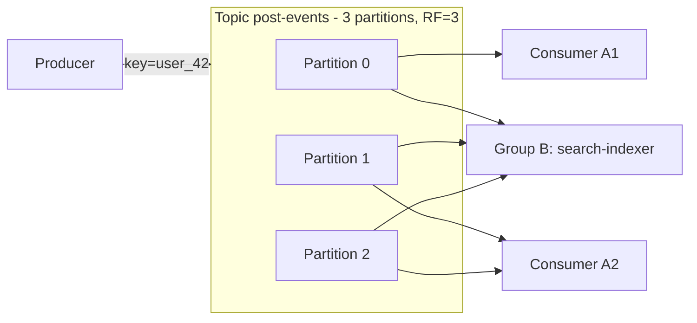

# Messaging: Kafka, RabbitMQ và các lựa chọn khác

**Mục đích:** hiểu khi nào cần xử lý bất đồng bộ, chọn đúng công cụ (Kafka, RabbitMQ, SQS, Redis Streams, NATS, Postgres queue, BullMQ), và làm đúng các phần khó: đảm bảo giao nhận, idempotency, outbox, saga, retry/DLQ, thứ tự, tiến hóa schema.
**Phạm vi công nghệ:** ví dụ TypeScript (kafkajs, BullMQ) + PostgreSQL; nguyên lý áp dụng cho mọi ngôn ngữ và broker.
**Liên quan:** [09-scale-trieu-user.md](09-scale-trieu-user.md) · [05-module-bai-viet-kiem-duyet.md](05-module-bai-viet-kiem-duyet.md) · [06-module-bai-kiem-tra-cham-bai.md](06-module-bai-kiem-tra-cham-bai.md) · [07-thiet-ke-database.md](07-thiet-ke-database.md) · [12-observability-reliability.md](12-observability-reliability.md) · [13-checklist-review-backend.md](13-checklist-review-backend.md)

---

## 1. Tại sao bất đồng bộ

Đưa việc ra khỏi request khi:

| Lý do | Ví dụ LearnHub |
|---|---|
| Việc **chậm** không cần kết quả ngay | Gửi email chào mừng, resize ảnh, kiểm duyệt AI bài viết (1–5s) |
| Việc **nặng** cần giới hạn tốc độ | Chấm bài code trong sandbox (CPU nặng) |
| **Đỉnh tải** cần làm phẳng | 50k bài nộp trong 5 phút → xếp hàng, worker chấm dần |
| **Nhiều bên** quan tâm cùng một sự kiện | `PostPublished` → feed, thông báo, search index, analytics |
| Tách phụ thuộc (service phía sau chết không làm hỏng request chính) | Dịch vụ email sập, đăng ký vẫn thành công |

**Cái giá:** eventual consistency (dữ liệu đồng bộ "sau một lúc"), phải xử lý trùng lặp, thứ tự, lỗi, giám sát lag, khó debug hơn. Nếu kết quả phải trả ngay cho user và việc nhanh (< 100 ms) → **làm đồng bộ**.

---

## 2. Queue và Log: hai mô hình khác nhau

| | **Queue** (RabbitMQ, SQS, BullMQ) | **Log/Stream** (Kafka, Redis Streams, JetStream, Kinesis) |
|---|---|---|
| Message sau khi xử lý | **Bị xóa** khi ack | **Giữ lại** theo retention (ngày/tuần/mãi) |
| Nhiều consumer | Chia việc (mỗi message 1 worker) | Mỗi **consumer group** đọc toàn bộ, độc lập |
| Đọc lại quá khứ (replay) | Không | **Có** — tua offset |
| Thứ tự | Thường không đảm bảo khi nhiều worker | Đảm bảo **trong một partition** |
| Định tuyến linh hoạt | Mạnh (RabbitMQ exchange) | Theo topic/partition |
| Mô hình tư duy | "Danh sách việc cần làm" (task) | "Nhật ký những gì đã xảy ra" (event) |

**Command vs Event:** `GradeSubmission` là command (một người làm) → queue. `SubmissionGraded` là event (nhiều bên nghe) → log/pub-sub.

---

## 3. Kafka chuyên sâu



| Khái niệm | Ý nghĩa | Điều quan trọng |
|---|---|---|
| **Topic** | Tên luồng sự kiện | Một loại sự kiện/domain mỗi topic: `post-events`, `submission-events` |
| **Partition** | Topic chia thành N log có thứ tự | Đơn vị song song: **số consumer hoạt động trong group ≤ số partition**. Tăng partition được, giảm thì không; tăng làm thay đổi ánh xạ key → partition |
| **Key** | `hash(key) % N` chọn partition | **Thứ tự chỉ đảm bảo cho cùng key**. Chọn key = thực thể cần thứ tự (`post_id`, `user_id`) |
| **Offset** | Vị trí message trong partition | Consumer commit offset sau khi xử lý xong |
| **Consumer group** | Nhóm consumer chia partition | Mỗi partition chỉ thuộc 1 consumer trong group |
| **Retention** | Giữ theo thời gian/dung lượng hoặc **compaction** (giữ bản mới nhất theo key) | Compaction cho topic "trạng thái" (profile mới nhất của user) |
| **Replication factor (RF)** | Số bản sao mỗi partition | Production: RF=3 |
| **ISR** (in-sync replicas) | Các replica theo kịp leader | `min.insync.replicas=2` + `acks=all` → ghi chỉ thành công khi ≥ 2 bản có dữ liệu |
| **acks** | `0` không chờ; `1` leader ghi; `all` mọi ISR ghi | Dữ liệu quan trọng: `acks=all` |
| **Idempotent producer** | `enable.idempotence=true`: broker loại bỏ bản trùng khi producer retry | Mặc định bật trong client Kafka mới; vẫn cần consumer idempotent |
| **Transactions** | Ghi nhiều partition + commit offset nguyên tử | Cho "đọc–xử lý–ghi" **trong Kafka** (exactly-once nội bộ Kafka); **không** bao gồm DB bên ngoài |
| **Rebalancing** | Consumer vào/ra → chia lại partition | Trong lúc rebalance, tiêu thụ tạm dừng; xử lý lâu hơn `max.poll.interval.ms` → bị đá khỏi group → rebalance liên tục. Dùng cooperative-sticky assignor, static membership |
| **Lag** | Offset mới nhất − offset đã commit | **Chỉ số giám sát số 1** của consumer |

### Chọn số partition

Throughput mục tiêu / throughput 1 consumer. Ví dụ: cần 3.000 msg/s, 1 consumer xử lý 200 msg/s → ≥ 15 partition → chọn 24 (dư cho tăng trưởng). Đừng tạo hàng nghìn partition "cho chắc": tốn tài nguyên broker, rebalance chậm.

### Consumer đúng cách

```ts
import { Kafka } from 'kafkajs';
const kafka = new Kafka({ clientId: 'learnhub-notifier', brokers: process.env.KAFKA_BROKERS!.split(',') });
const consumer = kafka.consumer({ groupId: 'notifier' });

await consumer.connect();
await consumer.subscribe({ topic: 'post-events', fromBeginning: false });
await consumer.run({
  autoCommit: false,                       // tự commit SAU khi xử lý xong
  eachMessage: async ({ topic, partition, message }) => {
    const evt = decode(message.value!);    // schema registry / zod validate
    await handleIdempotently(evt);         // mục 6
    await consumer.commitOffsets([{ topic, partition, offset: (BigInt(message.offset) + 1n).toString() }]);
  },
});
```

Commit **trước** khi xử lý = at-most-once (mất nếu crash). Commit **sau** = at-least-once (có thể trùng) → cần idempotent.

---

## 4. Các lựa chọn khác

| Công cụ | Bản chất | Điểm mạnh | Điểm yếu |
|---|---|---|---|
| **RabbitMQ** | Queue broker (AMQP); quorum queue; có Streams | Định tuyến mạnh: exchange `direct`/`topic`/`fanout`/`headers`; ack từng message; **DLX** (dead-letter exchange); priority; TTL; độ trễ thấp | Không replay (trừ Streams); throughput thấp hơn Kafka khi rất lớn |
| **AWS SQS / SNS** | Queue/pub-sub managed | Không phải vận hành; SQS FIFO có thứ tự theo message group + dedupe 5 phút; DLQ có sẵn; SNS fan-out → nhiều SQS | Gắn với AWS; standard queue có thể trùng và lộn thứ tự; message tối đa 256 KB |
| **Redis Streams** | Log nhẹ trong Redis | Consumer group, ack, `XPENDING`/`XCLAIM`; đã có Redis sẵn | Bị giới hạn RAM; độ bền phụ thuộc AOF/replica; không cho dữ liệu lớn/lâu |
| **NATS / JetStream** | Messaging nhẹ, rất nhanh; JetStream thêm lưu trữ | Độ trễ cực thấp, request-reply, vận hành đơn giản | Hệ sinh thái nhỏ hơn Kafka |
| **PostgreSQL làm queue** | Bảng `jobs` + `SELECT … FOR UPDATE SKIP LOCKED` | **Không thêm hạ tầng**; job nằm cùng transaction với dữ liệu nghiệp vụ | Không hợp vài nghìn job/s trở lên; bloat, cần vacuum |
| **BullMQ** (Node) / Sidekiq / Celery | Thư viện job queue trên Redis | Retry, delay, cron, priority, rate limit, dashboard có sẵn | Gắn với ngôn ngữ; Redis phải bền (AOF, `noeviction`) |

### Postgres làm queue

```sql
CREATE TABLE jobs (
  id          bigserial PRIMARY KEY,
  kind        text        NOT NULL,
  payload     jsonb       NOT NULL,
  run_at      timestamptz NOT NULL DEFAULT now(),
  attempts    int         NOT NULL DEFAULT 0,
  locked_until timestamptz,
  last_error  text
);
CREATE INDEX jobs_ready ON jobs (run_at) WHERE locked_until IS NULL;

-- Worker lấy 10 job, các worker khác bỏ qua dòng đang bị khóa
WITH picked AS (
  SELECT id FROM jobs
  WHERE locked_until IS NULL AND run_at <= now()
  ORDER BY run_at
  LIMIT 10
  FOR UPDATE SKIP LOCKED
)
UPDATE jobs j SET locked_until = now() + interval '5 minutes', attempts = attempts + 1
FROM picked WHERE j.id = picked.id
RETURNING j.*;
```

`locked_until` cho phép job bị worker crash được lấy lại sau 5 phút (visibility timeout).

---

## 5. Bảng quyết định: dùng cái nào khi nào

| Tình huống | Chọn | Không chọn |
|---|---|---|
| Job nền đơn giản (email, resize ảnh), < ~1.000 job/s, đã có Postgres | **Postgres queue** hoặc BullMQ (nếu Node + Redis bền) | Kafka |
| Job nền cần retry/delay/cron/priority, stack Node | **BullMQ** | Tự viết trên Redis list |
| Định tuyến phức tạp, RPC qua message, priority, độ trễ thấp | **RabbitMQ** | Kafka |
| Trên AWS, muốn không vận hành | **SQS** (+ SNS để fan-out), FIFO khi cần thứ tự | Tự dựng Kafka |
| Luồng sự kiện cho **nhiều hệ thống** tiêu thụ độc lập, cần **replay**, > ~10k msg/s, event sourcing, CDC, analytics pipeline | **Kafka** (hoặc Redpanda, MSK, Confluent Cloud) | RabbitMQ classic queue |
| Pub/sub thời gian thực nhẹ giữa instance (WebSocket fan-out) | Redis Pub/Sub, NATS | Kafka |
| Đã có Redis, cần stream nhỏ có consumer group | Redis Streams | — |

**Khi KHÔNG dùng Kafka:**
- Đội < vài người, chưa có ai vận hành Kafka (managed service giảm đáng kể nhưng vẫn phải hiểu partition, lag, rebalance).
- Lưu lượng vài chục message/giây.
- Cần ưu tiên từng message, delay từng message, hay xóa từng message — Kafka không làm tự nhiên.
- Cần request-reply đồng bộ.
- Chỉ có **một** consumer và không cần replay → queue là đủ.

**LearnHub:**
- Giai đoạn đầu: **BullMQ** (hoặc Postgres queue) cho email, thông báo, kiểm duyệt, chấm bài + outbox.
- Khi analytics, search, feed, recommendation cùng cần sự kiện và lưu lượng event > ~10k/s → thêm **Kafka** cho luồng sự kiện; job nền vẫn có thể ở BullMQ.

---

## 6. Đảm bảo giao nhận và idempotency

| Mức | Nghĩa | Khi nào |
|---|---|---|
| At-most-once | Có thể mất, không trùng | Metric không quan trọng |
| **At-least-once** | Không mất, **có thể trùng** | **Mặc định thực tế** |
| Exactly-once | Không mất, không trùng | Gần như không có end-to-end khi có hệ thống ngoài. Thực tế là **effectively-once** = at-least-once + **consumer idempotent** |

**Consumer idempotent:** xử lý cùng message 2 lần cho kết quả như 1 lần.

```sql
CREATE TABLE processed_messages (
  consumer   text NOT NULL,
  message_id text NOT NULL,
  processed_at timestamptz NOT NULL DEFAULT now(),
  PRIMARY KEY (consumer, message_id)
);
```

```ts
async function handleIdempotently(evt: PostPublished) {
  await db.tx(async (tx) => {
    const inserted = await tx.query(
      `INSERT INTO processed_messages (consumer, message_id) VALUES ('notifier', $1)
       ON CONFLICT DO NOTHING RETURNING 1`, [evt.eventId]);
    if (inserted.rowCount === 0) return;          // đã xử lý rồi → bỏ qua
    await tx.query('INSERT INTO notifications (user_id, post_id, kind) SELECT follower_id, $1, $2 FROM follows WHERE followee_id=$3',
      [evt.postId, 'new_post', evt.authorId]);
  });                                             // dedupe + tác dụng phụ trong CÙNG transaction
}
```

Các cách khác: thao tác tự nhiên idempotent (`UPSERT`, `SET status='graded'` thay vì `count = count + 1`), so sánh version (`WHERE version < $newVersion`). Với tác dụng phụ ra ngoài (gửi email, gọi API thanh toán), dùng **idempotency key** của bên nhận nếu có. Dọn bảng dedupe theo thời gian (giữ > thời gian retry tối đa).

---

## 7. Transactional outbox + CDC

**Vấn đề dual-write:** lưu DB rồi publish Kafka. Nếu crash giữa hai bước → DB có bài nhưng không ai nhận sự kiện (hoặc ngược lại: sự kiện về bài không tồn tại vì transaction rollback).

**Giải pháp outbox:** ghi sự kiện vào bảng `outbox` **trong cùng transaction** với dữ liệu nghiệp vụ; một tiến trình riêng đọc outbox và publish.

```sql
CREATE TABLE outbox (
  id           uuid PRIMARY KEY,
  aggregate    text NOT NULL,       -- 'post'
  aggregate_id text NOT NULL,       -- dùng làm key Kafka → thứ tự theo bài
  type         text NOT NULL,       -- 'PostPublished'
  payload      jsonb NOT NULL,
  created_at   timestamptz NOT NULL DEFAULT now(),
  published_at timestamptz
);
```

```ts
await db.tx(async (tx) => {
  const post = await tx.posts.insert(input);
  await tx.query(`INSERT INTO outbox (id, aggregate, aggregate_id, type, payload) VALUES ($1,'post',$2,'PostPublished',$3)`,
    [uuidv7(), post.id, { eventId: uuidv7(), postId: post.id, authorId: post.authorId, at: new Date().toISOString() }]);
});
```

Hai cách đưa outbox ra broker:

| Cách | Mô tả | Ưu/nhược |
|---|---|---|
| **Polling relay** | Job đọc `WHERE published_at IS NULL ORDER BY created_at LIMIT 100 FOR UPDATE SKIP LOCKED`, publish, đánh dấu | Đơn giản; độ trễ = chu kỳ poll; tải DB thêm |
| **CDC** (Debezium đọc WAL của Postgres) | Mỗi INSERT vào outbox thành message Kafka (Debezium Outbox Event Router) | Độ trễ thấp, không poll; thêm hạ tầng (Kafka Connect), cần quản lý replication slot (slot treo → WAL phình đầy đĩa) |

Relay vẫn có thể publish trùng (crash sau publish, trước đánh dấu) → consumer phải idempotent. Outbox biến dual-write thành at-least-once **đáng tin cậy**.

---

## 8. Saga: transaction xuyên nhiều service

Không có transaction ACID xuyên service → chia thành chuỗi bước cục bộ, mỗi bước có **hành động bù trừ** (compensation).

Ví dụ: đăng ký khóa học trả phí = giữ chỗ → thanh toán → cấp quyền truy cập. Thanh toán thất bại → hủy giữ chỗ.

| | Choreography | Orchestration |
|---|---|---|
| Cách | Mỗi service nghe sự kiện và phát sự kiện tiếp | Một orchestrator gửi command từng bước, lưu trạng thái saga |
| Ưu | Không điểm trung tâm, ít coupling | Luồng nhìn thấy rõ ở một chỗ, dễ theo dõi, timeout, bù trừ |
| Nhược | Khó thấy toàn cảnh, dễ vòng lặp sự kiện | Orchestrator là thành phần thêm |
| Dùng khi | 2–3 bước đơn giản | ≥ 3 bước, có nhánh, cần audit (có thể dùng Temporal, Camunda, AWS Step Functions) |

Hành động bù trừ cũng phải idempotent và có thể thất bại → cần retry và báo động người xử lý.

---

## 9. Retry, backoff, DLQ, poison message

- **Phân loại lỗi:** tạm thời (timeout, 503, deadlock) → retry; vĩnh viễn (dữ liệu sai schema, 400, không tìm thấy) → **không retry**, đưa thẳng DLQ.
- **Exponential backoff + jitter:** 1s, 2s, 4s, 8s… ± ngẫu nhiên; giới hạn số lần (ví dụ 5–8) và tổng thời gian.
- **DLQ (dead-letter queue):** message thất bại hết retry → DLQ kèm lý do, số lần, stack. Phải có: cảnh báo khi DLQ > 0, dashboard, **công cụ replay** sau khi sửa lỗi, người chịu trách nhiệm.
- **Poison message trong Kafka:** một message lỗi chặn cả partition (vì xử lý tuần tự). Đừng retry vô hạn tại chỗ — dùng topic retry theo tầng (`post-events.retry-1m`, `.retry-10m`) rồi `.dlq`; lưu ý điều này **phá thứ tự** cho key đó — chấp nhận hoặc tạm dừng key.
- BullMQ: `attempts: 5, backoff: { type: 'exponential', delay: 1000 }`, job thất bại nằm ở tập `failed`.

---

## 10. Thứ tự (ordering)

- Kafka: chỉ trong partition → chọn key đúng. Producer retry có thể đảo thứ tự nếu không bật idempotence (`max.in.flight.requests.per.connection` ≤ 5 với idempotence là an toàn).
- Queue nhiều worker: **không có thứ tự**. Cần thì: SQS FIFO + MessageGroupId, hoặc thiết kế không cần thứ tự.
- Thiết kế chịu lộn thứ tự: mang **version/timestamp** trong sự kiện, consumer bỏ sự kiện cũ hơn trạng thái đang có (`UPDATE … WHERE version < $v`).
- Sự kiện nên mang đủ dữ liệu (event-carried state) hoặc consumer đọc lại trạng thái mới nhất từ nguồn — tránh phụ thuộc thứ tự chặt.

---

## 11. Tiến hóa schema sự kiện

Producer và consumer deploy ở thời điểm khác nhau → schema phải tương thích.

| Quy tắc | Nghĩa |
|---|---|
| Backward compatible | Consumer mới đọc được message cũ (thêm trường **có mặc định**) |
| Forward compatible | Consumer cũ đọc được message mới (bỏ qua trường lạ) |
| Không làm | Đổi kiểu, đổi tên, xóa trường bắt buộc |
| Thay đổi phá vỡ | Tạo sự kiện/topic mới (`PostPublished.v2`), chạy song song, chuyển dần |

Dùng **Avro hoặc Protobuf + Schema Registry** (Confluent/Apicurio) đặt chế độ `BACKWARD` để registry **từ chối** schema phá vỡ ngay khi publish. JSON + JSON Schema chấp nhận được ở quy mô nhỏ nhưng phải validate ở consumer.

Envelope chuẩn cho mọi sự kiện:

```json
{ "eventId": "0190…", "type": "SubmissionGraded", "version": 1, "occurredAt": "2026-11-20T08:00:00Z",
  "traceId": "4bf92f…", "producer": "exam-service", "data": { "submissionId": "…", "score": 8.5 } }
```

---

## 12. Ví dụ LearnHub

| Luồng | Công cụ | Thiết kế |
|---|---|---|
| **Kiểm duyệt bài viết** | Outbox → queue `moderation` | Bài lưu trạng thái `pending_review`; worker gọi bộ lọc từ khóa + model AI; kết quả `approved`/`rejected`/`needs_human`; idempotent theo `post_id + content_version` (sửa bài tạo version mới, kết quả cho version cũ bị bỏ). Chi tiết: [05-module-bai-viet-kiem-duyet.md](05-module-bai-viet-kiem-duyet.md) |
| **Thông báo** | Event `PostPublished`, `CommentCreated` → consumer notifier | Fan-out cho người theo dõi; tác giả có 1M follower → không ghi 1M dòng đồng bộ: chia lô, hoặc mô hình pull (fan-out-on-read) cho tài khoản lớn |
| **Chấm bài** | Queue `grading` (BullMQ/RabbitMQ), priority | Nộp bài → lưu + outbox → 202 Accepted; worker chấm trắc nghiệm ngay, tự luận/code trong sandbox; giới hạn concurrency theo CPU; kết quả qua sự kiện `SubmissionGraded`. Chi tiết: [06-module-bai-kiem-tra-cham-bai.md](06-module-bai-kiem-tra-cham-bai.md) |
| **Analytics** | Kafka topic `activity-events` → ClickHouse/data lake | Gửi theo lô, `acks=1` chấp nhận được (mất ít event không sao), retention 7 ngày để replay |
| **Search index** | CDC / outbox → Kafka → indexer → OpenSearch | Upsert theo `post_id` + version, idempotent tự nhiên |

---

## 13. Lỗi thường gặp (đặc biệt ở code do AI agent viết)

- Publish sự kiện **ngoài transaction** (`await db.save(); await kafka.send()`) — dual-write, không outbox.
- Publish **trong** transaction trước khi commit → sự kiện về dữ liệu bị rollback.
- Consumer không idempotent ("Kafka exactly-once mà") — nhầm transaction nội bộ Kafka với end-to-end.
- `autoCommit` mặc định + xử lý async không await → commit offset trước khi xử lý xong.
- Retry vô hạn, không DLQ; hoặc có DLQ nhưng không ai giám sát.
- Key ngẫu nhiên hoặc không có key mà vẫn giả định thứ tự.
- Chọn Kafka cho job nền 50 msg/s; hoặc Redis làm queue với `maxmemory-policy allkeys-lru` (job bị evict!).
- Message chứa toàn bộ PII/file lớn thay vì ID + dữ liệu cần thiết.
- Không có giám sát lag, không cảnh báo khi consumer ngừng.
- Thay đổi schema sự kiện phá vỡ mà không version.

## Checklist review

- [ ] Có lý do rõ ràng cho xử lý bất đồng bộ; user nhận phản hồi phù hợp (202 + trạng thái, polling/WebSocket).
- [ ] Công cụ được chọn theo bảng quyết định, có ước lượng lưu lượng; không dùng Kafka khi không cần replay/nhiều consumer/lưu lượng lớn.
- [ ] Ghi dữ liệu + phát sự kiện dùng **outbox** (hoặc CDC), không dual-write.
- [ ] Mọi consumer **idempotent** (bảng dedupe trong cùng transaction, upsert, hoặc version check); có `eventId` duy nhất.
- [ ] Offset/ack commit **sau** khi xử lý xong.
- [ ] Retry có backoff + jitter + giới hạn; phân biệt lỗi tạm thời/vĩnh viễn; có DLQ + cảnh báo + công cụ replay.
- [ ] Thứ tự: key chọn theo thực thể cần thứ tự, hoặc consumer chịu được lộn thứ tự (version).
- [ ] Kafka: `acks=all`, `min.insync.replicas=2`, RF=3 cho dữ liệu quan trọng; số partition có tính toán; xử lý không vượt `max.poll.interval.ms`.
- [ ] Schema có version, tương thích ngược; có schema registry hoặc validate ở consumer.
- [ ] Message không chứa bí mật; PII tối thiểu; kích thước giới hạn.
- [ ] Giám sát: lag, tốc độ xử lý, tỷ lệ lỗi, kích thước DLQ, tuổi message cũ nhất; `traceId` truyền qua message.
- [ ] Graceful shutdown: worker xử lý xong message đang làm rồi mới thoát, không commit dở.
