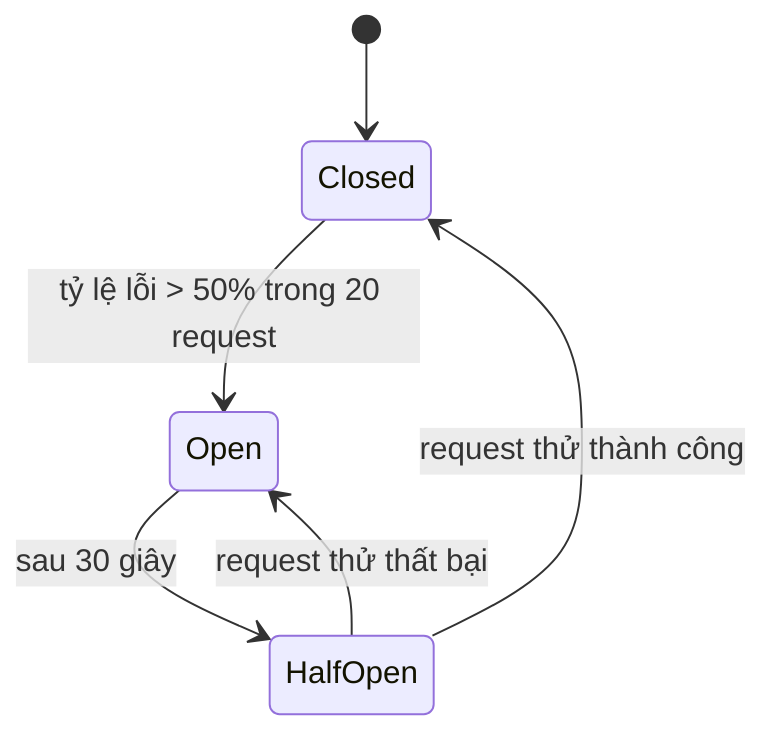

# Observability và Reliability

**Mục đích:** biết hệ thống đang làm gì (log, metric, trace), đặt mục tiêu độ tin cậy đo được (SLI/SLO/error budget), cảnh báo đúng, và áp dụng các kỹ thuật chịu lỗi (timeout, retry, circuit breaker, bulkhead, degrade), vận hành an toàn (health check, shutdown, deploy, feature flag), xử lý sự cố, DR và chaos testing.
**Phạm vi công nghệ:** ví dụ TypeScript/Node, OpenTelemetry, Prometheus/Grafana; nguyên lý áp dụng cho mọi stack.
**Liên quan:** [09-scale-trieu-user.md](09-scale-trieu-user.md) · [10-messaging-kafka.md](10-messaging-kafka.md) · [11-bao-mat.md](11-bao-mat.md) · [13-checklist-review-backend.md](13-checklist-review-backend.md)

---

## 1. Ba trụ cột observability

| Trụ cột | Trả lời câu hỏi | Chi phí | Ví dụ |
|---|---|---|---|
| **Metric** | Có vấn đề không? Bao nhiêu? | Rẻ (số tổng hợp) | p95 latency `POST /submissions` = 800 ms |
| **Trace** | Vấn đề ở đâu trong chuỗi gọi? | Vừa (lấy mẫu) | 700 ms nằm ở query `SELECT … FROM answers` |
| **Log** | Chính xác chuyện gì đã xảy ra? | Đắt (dữ liệu lớn) | `deadlock detected` cho submission 123 |

Luồng điều tra điển hình: **cảnh báo từ metric → trace để khoanh vùng → log để biết chi tiết**. Ba thứ nối với nhau bằng `traceId`/`requestId`.

---

## 2. Log

### Log có cấu trúc (JSON)

```ts
import pino from 'pino';
export const logger = pino({ level: process.env.LOG_LEVEL ?? 'info', redact: ['req.headers.authorization', 'req.headers.cookie', '*.password', '*.token'] });

// Middleware gắn correlation id
app.use((req, res, next) => {
  const requestId = (req.headers['x-request-id'] as string) ?? crypto.randomUUID();
  res.setHeader('x-request-id', requestId);
  req.log = logger.child({ requestId, traceId: currentTraceId(), userId: req.user?.id, route: req.route?.path });
  next();
});

req.log.info({ submissionId, examId, durationMs }, 'submission.saved');
```

```json
{"level":"info","time":"2026-11-20T08:00:01Z","requestId":"9f1…","traceId":"4bf9…","userId":"u_42","route":"/submissions","submissionId":"s_1","durationMs":42,"msg":"submission.saved"}
```

### Mức log

| Mức | Dùng khi | Ví dụ |
|---|---|---|
| `error` | Lỗi cần người xem; request thất bại do hệ thống | Không kết nối được DB |
| `warn` | Bất thường nhưng đã tự xử lý | Retry lần 3 thành công; dùng giá trị fallback |
| `info` | Sự kiện nghiệp vụ quan trọng | Nộp bài, đăng nhập, bài bị từ chối |
| `debug` | Chi tiết để dev debug, **tắt ở prod** | Payload trung gian |

Quy tắc: lỗi do **người dùng** (400, 404, sai mật khẩu) không phải `error`. Không log trong vòng lặp nóng. Không log PII/bí mật ([11-bao-mat.md](11-bao-mat.md)). Ghi ra **stdout**, hạ tầng (Loki, ELK, CloudWatch) thu gom. Có retention rõ ràng.

---

## 3. Metric

### RED (cho service/endpoint)

- **R**ate: số request/giây
- **E**rrors: tỷ lệ lỗi (5xx, timeout)
- **D**uration: phân phối độ trễ (**p50, p95, p99**, không phải trung bình — trung bình che giấu đuôi chậm)

### USE (cho tài nguyên: CPU, RAM, đĩa, pool kết nối, queue)

- **U**tilization: % đang dùng
- **S**aturation: hàng chờ (pool chờ kết nối, run queue, lag)
- **E**rrors: lỗi tài nguyên

### Bốn golden signals (Google SRE)

Latency, Traffic, Errors, **Saturation**.

### Metric riêng cho LearnHub

| Metric | Loại | Ghi chú |
|---|---|---|
| `http_server_request_duration_seconds{route,method,status}` | histogram | `route` là **mẫu** (`/posts/:id`), không phải URL thật (tránh bùng nổ cardinality) |
| `db_pool_waiting`, `db_pool_in_use` | gauge | Saturation của DB pool |
| `queue_depth{queue}`, `queue_oldest_job_age_seconds` | gauge | Tuổi job cũ nhất quan trọng hơn độ dài |
| `kafka_consumer_lag{group,topic}` | gauge | |
| `submissions_saved_total`, `submissions_failed_total` | counter | Chỉ số nghiệp vụ |
| `moderation_pending_total` | gauge | Bài chờ duyệt |
| `login_failed_total{reason}` | counter | Phát hiện tấn công |

**Cardinality:** không đưa `userId`, `postId`, email vào label metric — mỗi giá trị tạo một chuỗi thời gian mới, làm sập Prometheus. Những thứ đó thuộc về log/trace.

---

## 4. Distributed tracing (OpenTelemetry)

Một request đi qua API → Redis → PostgreSQL → queue → worker. Trace ghép các **span** thành cây thời gian.

```ts
// tracing.ts — nạp TRƯỚC mọi import khác
import { NodeSDK } from '@opentelemetry/sdk-node';
import { getNodeAutoInstrumentations } from '@opentelemetry/auto-instrumentations-node';
import { OTLPTraceExporter } from '@opentelemetry/exporter-trace-otlp-http';

new NodeSDK({
  serviceName: 'learnhub-api',
  traceExporter: new OTLPTraceExporter({ url: process.env.OTEL_EXPORTER_OTLP_ENDPOINT }),
  instrumentations: [getNodeAutoInstrumentations()],   // http, express, pg, redis, kafkajs…
}).start();
```

- Ngữ cảnh truyền qua header chuẩn W3C `traceparent`; **qua message queue phải tự gắn** `traceparent` vào header message ([10-messaging-kafka.md](10-messaging-kafka.md)).
- Lấy mẫu (sampling): 100% ở traffic thấp; ở quy mô lớn 1–10% + **tail sampling** giữ lại 100% trace lỗi/chậm (OpenTelemetry Collector).
- Thêm span thủ công cho đoạn nghiệp vụ quan trọng (`grade.essay`, `moderation.ai_check`) kèm attribute không nhạy cảm.
- Backend: Jaeger, Tempo, Honeycomb, Datadog…

---

## 5. SLI, SLO, error budget

| Khái niệm | Nghĩa |
|---|---|
| **SLI** (indicator) | Phép đo: tỷ lệ request "tốt" / tổng request |
| **SLO** (objective) | Mục tiêu nội bộ cho SLI trong một cửa sổ thời gian |
| **SLA** (agreement) | Cam kết với khách hàng, có phạt; luôn **lỏng hơn** SLO |
| **Error budget** | 1 − SLO: lượng "không tốt" được phép |

### SLO cho LearnHub (cửa sổ 30 ngày)

| Hành trình | SLI | SLO | Error budget |
|---|---|---|---|
| Đăng nhập | Request `POST /auth/login` không 5xx và < 1s | 99,9% | ~43 phút "xấu"/30 ngày |
| Xem feed/bài | `GET` thành công và < 500 ms | 99,5% | ~3,6 giờ |
| **Nộp bài thi** | Bài nộp được **lưu bền** và trả thành công < 2s | **99,95%** | ~22 phút; trong giờ thi gần như không được phép lỗi |
| Chấm bài | Bài trắc nghiệm có điểm trong 60s | 99% | |
| Kiểm duyệt | Bài được xử lý trong 5 phút | 95% | |

Tính: 30 ngày = 43.200 phút; 99,9% → 0,1% × 43.200 ≈ **43 phút**.

**Dùng error budget để ra quyết định:** còn budget → được deploy nhanh, thử nghiệm; hết budget → đóng băng tính năng, ưu tiên ổn định. Đây là công cụ để người duyệt cân bằng "tốc độ vs ổn định" bằng số liệu, không bằng cảm tính.

100% không phải mục tiêu hợp lý: chi phí tăng theo cấp số nhân với mỗi số 9, và mạng/thiết bị người dùng đã kém hơn thế.

---

## 6. Cảnh báo (alerting)

- **Cảnh báo theo triệu chứng người dùng thấy** (tỷ lệ lỗi, độ trễ, SLO), không theo nguyên nhân (CPU 80% mà user không bị ảnh hưởng thì không cần đánh thức ai).
- **Burn-rate alert:** cảnh báo khi đang tiêu error budget quá nhanh. Ví dụ (theo Google SRE workbook): tốc độ đốt 14,4× trong 1 giờ (và 5 phút) → page ngay; 6× trong 6 giờ → page; 1× trong 3 ngày → ticket.
- Mỗi cảnh báo phải: **hành động được**, có **runbook** link, có người trực nhận. Cảnh báo không ai xử lý → xóa hoặc chuyển thành dashboard.
- Phân mức: **page** (đánh thức ngay: nộp bài lỗi giờ thi), **ticket** (giờ hành chính: DLQ có message), **thông tin** (dashboard).
- Cảnh báo cho thứ "im lặng": consumer ngừng (lag tăng), cron không chạy (heartbeat/dead man's switch), chứng chỉ TLS sắp hết hạn, đĩa sắp đầy.

---

## 7. Các kỹ thuật chịu lỗi

### 7.1 Timeout ở mọi nơi

Không có timeout = một dependency treo kéo cạn mọi worker/kết nối. Đặt timeout cho: HTTP client, query DB (`statement_timeout`), Redis, lấy kết nối từ pool, gọi AI, khóa (lock).

**Ngân sách timeout giảm dần theo chuỗi:** client 10s → API gateway 8s → service 5s → DB 2s. Truyền **deadline** xuống tầng dưới; tầng dưới không làm việc khi deadline đã qua.

```ts
const res = await fetch(url, { signal: AbortSignal.timeout(2000) });
await db.query("SET LOCAL statement_timeout = '2s'");
```

### 7.2 Retry với exponential backoff + jitter

```ts
async function withRetry<T>(fn: () => Promise<T>, { attempts = 4, baseMs = 100, maxMs = 2000 } = {}): Promise<T> {
  for (let i = 0; ; i++) {
    try { return await fn(); }
    catch (e) {
      if (i >= attempts - 1 || !isTransient(e)) throw e;          // chỉ retry lỗi tạm thời
      const cap = Math.min(maxMs, baseMs * 2 ** i);
      await sleep(Math.random() * cap);                           // "full jitter"
    }
  }
}
```

- Chỉ retry thao tác **idempotent** (GET, PUT, DELETE, hoặc POST có idempotency key).
- Retry ở **một** tầng thôi: 3 tầng × 3 lần = 27 lần gọi → **retry storm** làm sập dependency đang hồi phục.
- Dùng **retry budget** (ví dụ retry ≤ 10% tổng request).
- Không retry 4xx (trừ 408/429 — và tôn trọng `Retry-After`).

### 7.3 Circuit breaker

Dependency lỗi liên tục → "ngắt mạch": thất bại nhanh không gọi nữa trong một khoảng, rồi thử lại vài request (half-open).



Node: `opossum`; Java: Resilience4j; .NET: Polly. Khi mạch mở → trả **fallback** (dữ liệu cache, giá trị mặc định, thông báo thân thiện) thay vì lỗi 500.

### 7.4 Bulkhead (vách ngăn)

Cô lập tài nguyên để một phần hỏng không chìm cả tàu:
- Pool kết nối/concurrency riêng cho từng dependency (gọi AI kiểm duyệt tối đa 20 đồng thời — AI chậm không chiếm hết worker phục vụ nộp bài).
- Worker riêng cho từng hàng đợi (chấm code CPU nặng không làm chậm gửi email).
- Instance/cluster riêng cho luồng quan trọng (API thi tách khỏi API mạng xã hội trong mùa thi).

### 7.5 Graceful degradation

Xác định trước tính năng nào **được phép tắt** khi quá tải:

| Mức độ | LearnHub làm gì |
|---|---|
| Bình thường | Đầy đủ |
| Tải cao | Tắt gợi ý bài, đếm view realtime; feed dùng cache lâu hơn |
| Quá tải | Chế độ chỉ đọc cho mạng xã hội; ưu tiên toàn bộ tài nguyên cho thi |
| Dependency AI chết | Bài mới vào hàng `needs_human` thay vì chặn đăng |

Thực hiện bằng **feature flag / kill switch** bật được trong vài giây, không cần deploy.

---

## 8. Health check, graceful shutdown

| Probe | Câu hỏi | Kiểm tra gì | Thất bại thì |
|---|---|---|---|
| **Liveness** | Process còn sống, không treo? | Đơn giản: event loop phản hồi. **Không** kiểm tra DB | Restart container |
| **Readiness** | Sẵn sàng nhận traffic? | Đã khởi tạo xong, kết nối được DB/Redis cần thiết, không đang shutdown | Bỏ khỏi load balancer (không restart) |
| Startup | Đã khởi động xong? | Cho app khởi động chậm | Chưa chạy liveness |

**Sai lầm kinh điển:** liveness kiểm tra DB → DB chậm 10 giây → **mọi** pod bị restart cùng lúc → sập hoàn toàn và tạo bão kết nối khi khởi động lại.

**Graceful shutdown** (khi deploy/scale down, nhận `SIGTERM`):

```ts
let shuttingDown = false;
app.get('/readyz', (_req, res) => res.status(shuttingDown ? 503 : 200).end());

process.on('SIGTERM', async () => {
  shuttingDown = true;                         // 1. báo không sẵn sàng → LB ngừng gửi request mới
  await sleep(5_000);                          // 2. chờ LB cập nhật
  server.close();                              // 3. ngừng nhận kết nối, chờ request đang xử lý xong
  await worker.close();                        // 4. worker hoàn thành job đang chạy, không nhận job mới
  await Promise.all([db.end(), redis.quit()]); // 5. đóng kết nối
  process.exit(0);
});
// terminationGracePeriodSeconds (K8s) phải > tổng thời gian trên
```

---

## 9. Deploy an toàn và feature flag

| Chiến lược | Cách | Ưu | Nhược |
|---|---|---|---|
| Rolling | Thay dần từng instance | Mặc định, không tốn thêm | Hai phiên bản chạy song song → API/DB phải tương thích |
| Blue-green | Dựng môi trường mới đầy đủ, chuyển traffic một lần | Rollback tức thì | Tốn gấp đôi tài nguyên lúc deploy |
| **Canary** | 1% → 10% → 50% → 100%, so metric với bản cũ | Phát hiện lỗi với ít user bị ảnh hưởng | Cần metric tốt, tự động hóa |

**Migration DB tương thích hai chiều (expand → migrate → contract):**
1. *Expand:* thêm cột mới (nullable), code ghi cả cũ và mới.
2. *Migrate:* backfill dữ liệu theo lô.
3. Chuyển code sang đọc cột mới.
4. *Contract:* bản deploy sau cùng mới xóa cột cũ.
Không bao giờ đổi tên/xóa cột trong cùng release với code dùng nó — rollback sẽ hỏng.

**Feature flag:** tách *deploy* (đưa code lên) khỏi *release* (bật cho user). Bật theo % user, theo trường, theo nhóm thử nghiệm; kill switch. Dọn flag cũ (nợ kỹ thuật). **Không deploy trong/ngay trước giờ thi lớn** — đặt lịch đóng băng (change freeze).

---

## 10. Xử lý sự cố (incident response)

1. **Phát hiện:** cảnh báo hoặc báo cáo người dùng.
2. **Tuyên bố sự cố,** chỉ định **Incident Commander** (điều phối, không tự sửa), người liên lạc, người kỹ thuật.
3. **Giảm thiểu trước, tìm nguyên nhân sau:** rollback, tắt flag, scale up, chuyển traffic. Mục tiêu là phục hồi dịch vụ.
4. **Thông báo** trạng thái định kỳ cho stakeholder/người dùng (status page).
5. **Đóng sự cố** khi ổn định và theo dõi đủ lâu.
6. **Postmortem không đổ lỗi (blameless)** trong vài ngày:
   - Dòng thời gian (phát hiện, phản ứng, giảm thiểu, khắc phục — kèm giờ).
   - Ảnh hưởng (bao nhiêu user, bao lâu, error budget tiêu bao nhiêu).
   - Nguyên nhân gốc và yếu tố góp phần (5 Whys).
   - Điều gì tốt, điều gì tệ, điều gì may mắn.
   - **Hành động** có người chịu trách nhiệm và hạn — đây là phần quan trọng nhất.

Chỉ số: MTTD (thời gian phát hiện), MTTR (thời gian phục hồi).

---

## 11. Disaster recovery (DR)

| Khái niệm | Nghĩa | LearnHub |
|---|---|---|
| **RPO** (Recovery Point Objective) | Mất tối đa bao nhiêu dữ liệu (tính theo thời gian) | Bài thi: ≤ 1 phút; bài viết: ≤ 15 phút |
| **RTO** (Recovery Time Objective) | Phục hồi trong bao lâu | 1 giờ cho toàn hệ thống; 15 phút cho thi |

| Chiến lược | RPO/RTO | Chi phí |
|---|---|---|
| Backup + restore | giờ / giờ | Thấp |
| Pilot light (hạ tầng tối thiểu sẵn ở vùng khác) | phút / chục phút | Vừa |
| Warm standby | giây–phút / phút | Cao |
| Active-active đa vùng | ~0 / ~0 | Rất cao, phức tạp |

Thực hành bắt buộc:
- Backup tự động + **PITR** (point-in-time recovery: base backup + WAL archive), lưu ở vùng/tài khoản khác, mã hóa, **không thể xóa** trong thời hạn giữ (chống ransomware).
- **Thử restore định kỳ** (ví dụ mỗi quý) và đo thời gian thật — backup chưa từng restore thành công coi như không có.
- Runbook DR được viết và diễn tập.
- Object storage bật versioning + replication.

---

## 12. Chaos testing cơ bản

Chủ động gây lỗi có kiểm soát để kiểm chứng hệ thống chịu lỗi như thiết kế.

1. Định nghĩa **trạng thái ổn định** bằng metric (tỷ lệ nộp bài thành công ≥ 99,95%).
2. Giả thuyết: "Nếu 1 replica Redis chết, nộp bài vẫn thành công".
3. Thử ở **staging** trước, phạm vi nhỏ (blast radius), có nút dừng.
4. Gây lỗi: kill pod, thêm độ trễ mạng 500 ms tới DB, làm đầy đĩa, chặn dịch vụ AI, failover DB.
5. So sánh với giả thuyết, sửa điểm yếu.

Công cụ: Chaos Mesh, LitmusChaos, AWS FIS, Toxiproxy (giả lập mạng xấu trong test). Bắt đầu đơn giản bằng **game day**: cả đội cùng diễn tập một kịch bản sự cố.

**Load test trước sự kiện lớn:** k6/Gatling/Locust mô phỏng 50k thí sinh autosave + nộp bài, ở môi trường giống production, đến điểm gãy — biết giới hạn thật trước khi người dùng tìm ra nó.

---

## 13. Lỗi thường gặp (đặc biệt ở code do AI agent viết)

- `console.log` chuỗi tự do, không cấu trúc, không `requestId`; log toàn bộ request/response.
- `catch (e) { console.log(e) }` rồi tiếp tục — lỗi bị nuốt, không metric, không cảnh báo.
- Gọi HTTP/DB **không có timeout**.
- Retry mọi lỗi, không backoff, không giới hạn, retry cả thao tác không idempotent (POST thanh toán).
- Health check gọi DB trong liveness; một endpoint `/health` dùng cho cả hai probe.
- Không xử lý `SIGTERM` → mất request/job khi deploy.
- Label metric chứa `userId`/URL thật.
- Migration xóa/đổi tên cột cùng lúc với code mới.
- Cảnh báo theo CPU thay vì theo trải nghiệm người dùng; không có runbook.
- Báo "đã thêm monitoring" nhưng không có dashboard/cảnh báo thực sự được cấu hình.

## Checklist review

- [ ] Log JSON có cấu trúc, có `requestId`/`traceId`, mức log hợp lý, redact dữ liệu nhạy cảm, ghi stdout.
- [ ] Metric RED cho endpoint mới, USE cho tài nguyên mới (pool, queue); label có cardinality thấp; có metric nghiệp vụ cho luồng quan trọng.
- [ ] Tracing tự động bật; ngữ cảnh trace được truyền qua message queue; span thủ công cho đoạn nghiệp vụ chính.
- [ ] Luồng quan trọng có SLI/SLO; cảnh báo dựa trên SLO/burn-rate, có runbook, có người nhận.
- [ ] Mọi lời gọi ra ngoài (HTTP, DB, Redis, AI, lock) có timeout; ngân sách timeout giảm dần theo chuỗi.
- [ ] Retry chỉ cho lỗi tạm thời và thao tác idempotent, có backoff + jitter + giới hạn, chỉ ở một tầng.
- [ ] Dependency không thiết yếu có circuit breaker + fallback; tài nguyên được ngăn cách (bulkhead).
- [ ] Đã xác định tính năng nào có thể tắt khi quá tải, có kill switch.
- [ ] Liveness không phụ thuộc dependency; readiness phản ánh khả năng phục vụ; graceful shutdown xử lý `SIGTERM` cho cả API và worker.
- [ ] Migration theo expand/contract, tương thích rollback; deploy có canary/rolling với tiêu chí rollback rõ ràng; feature flag cho thay đổi rủi ro.
- [ ] RPO/RTO được định nghĩa; backup + PITR có, đã thử restore; runbook DR tồn tại.
- [ ] Sự kiện đỉnh (kỳ thi) có load test và kế hoạch change freeze.
