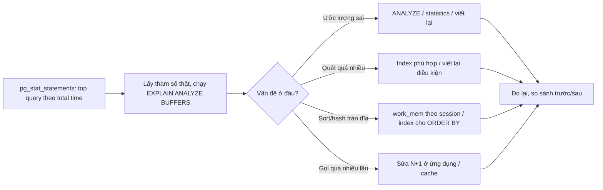

# Index và tối ưu truy vấn

**Mục đích:** đọc được kế hoạch truy vấn, chọn đúng loại index, tìm truy vấn tốn tài nguyên nhất và sửa có phương pháp — thay vì "thêm index cho chắc".
**Liên quan:** cơ bản ở [../05-backend-senior/07-thiet-ke-database.md](../05-backend-senior/07-thiet-ke-database.md) · [01-postgres-internals.md](01-postgres-internals.md) · [03-transaction-lock-concurrency.md](03-transaction-lock-concurrency.md) · [07-cau-hinh-van-hanh-monitoring.md](07-cau-hinh-van-hanh-monitoring.md) · [08-migration-schema-evolution.md](08-migration-schema-evolution.md)

---

## 1. Quy trình tối ưu (đừng đoán)



## 2. pg_stat_statements – tìm truy vấn cần sửa

```sql
-- postgresql.conf: shared_preload_libraries = 'pg_stat_statements' (cần restart)
CREATE EXTENSION IF NOT EXISTS pg_stat_statements;

SELECT queryid,
       calls,
       round(total_exec_time::numeric / 1000, 1)        AS total_s,
       round(mean_exec_time::numeric, 2)                AS mean_ms,
       round((100 * total_exec_time / sum(total_exec_time) OVER ())::numeric, 1) AS pct,
       rows / nullif(calls, 0)                          AS rows_per_call,
       shared_blks_read, temp_blks_written,
       left(query, 120)                                 AS query
FROM pg_stat_statements
ORDER BY total_exec_time DESC
LIMIT 20;
```

Đọc kết quả:

| Mẫu | Ý nghĩa | Hướng xử lý |
|---|---|---|
| `calls` rất lớn, `mean_ms` nhỏ, `pct` cao | Truy vấn nhanh nhưng gọi quá nhiều (N+1, không cache) | Sửa ở ứng dụng, cache |
| `mean_ms` lớn, `calls` ít | Truy vấn nặng | EXPLAIN, index, viết lại |
| `temp_blks_written` > 0 | Sort/hash tràn đĩa | `work_mem` hoặc index |
| `shared_blks_read` cao | Đọc nhiều từ ngoài shared_buffers | Index tốt hơn, giảm cột/dòng |

Ưu tiên sửa theo **tổng thời gian** (`total_exec_time`), không theo truy vấn chậm nhất. Reset sau khi sửa để đo lại: `SELECT pg_stat_statements_reset();`.

Bổ sung: `auto_explain` (`auto_explain.log_min_duration = '500ms'`, `log_analyze = on` — cẩn thận chi phí) để ghi kế hoạch của truy vấn chậm ngay khi chúng xảy ra trên production.

## 3. Đọc EXPLAIN (ANALYZE, BUFFERS) từng dòng

Truy vấn LearnHub: 20 bài mới nhất đã xuất bản của một tag.

```sql
EXPLAIN (ANALYZE, BUFFERS)
SELECT p.id, p.title, p.published_at
FROM posts p
JOIN post_tags pt ON pt.post_id = p.id
WHERE pt.tag_id = 17 AND p.status = 'published'
ORDER BY p.published_at DESC
LIMIT 20;
```

```
Limit  (cost=48211.10..48211.15 rows=20 width=56) (actual time=812.4..812.4 rows=20 loops=1)
  Buffers: shared hit=1204 read=40211
  ->  Sort  (cost=48211.10..48420.30 rows=83680 width=56) (actual time=812.4..812.4 rows=20 loops=1)
        Sort Key: p.published_at DESC
        Sort Method: top-N heapsort  Memory: 27kB
        ->  Hash Join  (cost=2150.00..45984.30 rows=83680 width=56) (actual time=35.2..790.1 rows=91234 loops=1)
              Hash Cond: (p.id = pt.post_id)
              ->  Seq Scan on posts p  (cost=0.00..39871.00 rows=1650000 width=56) (actual time=0.02..520.3 rows=1648112 loops=1)
                    Filter: (status = 'published')
                    Rows Removed by Filter: 351888
              ->  Hash  (cost=1100.00..1100.00 rows=84000 width=8) (actual time=34.9..34.9 rows=91234 loops=1)
                    ->  Index Only Scan using post_tags_pkey on post_tags pt ...
Planning Time: 0.4 ms
Execution Time: 812.6 ms
```

Cách đọc:

1. **Đọc từ trong ra ngoài, từ dưới lên.** Node thụt sâu nhất chạy trước.
2. `cost=khởi_động..tổng` — đơn vị tùy ý của planner, chỉ dùng để so sánh. `actual time` tính bằng ms, **cho mỗi loop**; nhân `loops` để có tổng.
3. **So `rows` ước lượng với `actual rows`.** Lệch 10× trở lên → planner đang quyết định dựa trên thông tin sai (mục 5).
4. `Buffers: shared hit` = trang có trong shared_buffers; `read` = phải đọc từ OS/đĩa. Ở đây 40.211 trang × 8 KB ≈ 314 MB đọc chỉ để trả 20 dòng.
5. `Rows Removed by Filter` lớn → điều kiện không dùng index.
6. Node tốn thời gian nhất ở đây: **Seq Scan on posts (520 ms)**.

Sửa: index phục vụ cả lọc lẫn thứ tự, và đổi chiều join để đi từ tag:

```sql
CREATE INDEX CONCURRENTLY posts_published_at_idx
  ON posts (published_at DESC) WHERE status = 'published';     -- partial index
CREATE INDEX CONCURRENTLY post_tags_tag_post_idx
  ON post_tags (tag_id, post_id);
```

Hoặc phi chuẩn hóa: thêm `published_at` vào `post_tags` + index `(tag_id, published_at DESC)` → truy vấn chỉ đọc ~20 entry index. Đó là quyết định trade-off (phải đồng bộ khi bài đổi `published_at`).

**Lưu ý an toàn:** `EXPLAIN ANALYZE` **thực thi thật** câu lệnh. Với `UPDATE/DELETE`:

```sql
BEGIN; EXPLAIN ANALYZE DELETE FROM ...; ROLLBACK;
```

## 4. Các loại scan và join

| Node | Khi nào tốt | Khi nào là dấu hiệu xấu |
|---|---|---|
| Seq Scan | Bảng nhỏ, hoặc lấy phần lớn bảng | Bảng lớn mà chỉ cần ít dòng |
| Index Scan | Lấy ít dòng (vài %) | Lấy nhiều dòng rải rác → nhiều random I/O |
| Index Only Scan | Mọi cột cần đều trong index + visibility map tốt | `Heap Fetches` cao → bảng cần VACUUM |
| Bitmap Heap Scan | Số dòng trung bình, kết hợp nhiều index (AND/OR) | `Recheck` nhiều do bitmap lossy (`work_mem` nhỏ) |
| Nested Loop | Phía ngoài ít dòng, phía trong có index | Phía ngoài ước lượng 1, thực tế 100.000 |
| Hash Join | Hai tập lớn, điều kiện bằng | Hash tràn đĩa (`Batches > 1`) |
| Merge Join | Hai tập đã sắp theo khóa join | Phải sort lớn trước khi merge |

## 5. Ước lượng sai và thống kê

Nguyên nhân phổ biến khiến `rows` ước lượng lệch:

| Nguyên nhân | Sửa |
|---|---|
| Thống kê cũ (vừa nạp/xóa nhiều) | `ANALYZE posts;` |
| Phân bố lệch, histogram quá thô | `ALTER TABLE posts ALTER COLUMN author_id SET STATISTICS 1000; ANALYZE posts;` |
| Cột tương quan (`status` và `published_at`, `school_id` và `class_id`) | Extended statistics |
| Hàm/biểu thức trong WHERE | Expression index (có thống kê riêng) |
| Generic plan của prepared statement với tham số lệch | `plan_cache_mode = force_custom_plan` cho truy vấn đó |

```sql
CREATE STATISTICS exam_attempts_exam_class (dependencies, ndistinct, mcv)
  ON exam_id, class_id FROM exam_attempts;
ANALYZE exam_attempts;
```

## 6. Chọn loại index

| Loại | Dùng cho | Ví dụ LearnHub |
|---|---|---|
| **B-tree** (mặc định) | `=`, `<`, `>`, `BETWEEN`, `ORDER BY`, `LIKE 'abc%'` | `users(lower(email))`, `posts(author_id, created_at DESC)` |
| **Hash** | Chỉ `=`; nhỏ hơn B-tree với khóa dài | Hiếm khi cần; B-tree thường đủ |
| **GIN** | Giá trị chứa nhiều phần tử: `jsonb`, mảng, full-text, `pg_trgm` | `posts USING gin(to_tsvector('simple', title))`, `posts USING gin(tags)` |
| **GiST** | Hình học, khoảng (range), gần đúng, loại trừ chồng lấn | `EXCLUDE USING gist (room WITH =, during WITH &&)` cho lịch phòng thi |
| **SP-GiST** | Dữ liệu phân vùng không cân bằng: IP, số điện thoại, quadtree | `inet` |
| **BRIN** | Bảng rất lớn, cột tương quan với thứ tự vật lý (thời gian chèn) | `audit_log(created_at)` — index vài MB cho bảng hàng trăm GB |

Tìm kiếm có dấu tiếng Việt: dùng extension `unaccent` + `pg_trgm` (GIN) cho `ILIKE '%từ khóa%'`; full-text cấu hình `simple` + `unaccent`. Khi cần xếp hạng, gợi ý, đa ngôn ngữ nghiêm túc → OpenSearch/Elasticsearch ([10-chon-database-nosql-search.md](10-chon-database-nosql-search.md)).

### 6.1 Giải phẫu B-Tree (B+Tree): Cơ chế rẽ nhánh Trái / Giữa / Phải & Cân bằng cây

#### 1. Khác biệt với Cây nhị phân (BST)
Trong BST thường, mỗi node chỉ có 1 khóa nên 1 triệu dòng cần cây cao ~20 tầng. Trong **B+Tree của PostgreSQL**, mỗi node là một trang đĩa **8 KB** chứa hàng trăm khóa sắp xếp tăng dần $[K_1, K_2, \dots, K_m]$ làm **"cột mốc phân làn" (Separator Keys)** — nhờ đó **1 triệu dòng chỉ cần cây cao 3–4 tầng** (`< 0.5ms`):

```text
                  [  K1 = 100   |   K2 = 500  ]   <-- Root Page (8 KB)
                 /              |              \
     Nhánh Trái (< 100)   Nhánh Giữa (100..499)  Nhánh Phải (>= 500)
            ▼                   ▼                       ▼
     [ 10 | 42 | 85 ]    [ 100 | 250 | 410 ]     [ 500 | 720 | 990 ]  <-- Leaf Pages
            │                    │
       ctid=(18,4)          ctid=(52,1)   (Tọa độ dòng thật trên heap)
            ◄────────────────────┴────────────────────► (Nối ngang bằng Doubly Linked List)
```

#### 2. Quy tắc so sánh rẽ nhánh theo kiểu dữ liệu
- **Số (`INT`, `NUMERIC`) & `TIMESTAMP`:** So sánh giá trị số trực tiếp (`42 < 100` $\rightarrow$ rẽ Trái).
- **Chuỗi (`TEXT`, `VARCHAR`):** So sánh theo **thứ tự từ điển từ trái sang phải** (`'alice' < 'bob'`, `'jakepham' < 'john'`). Đó là lý do `LIKE 'jake%'` dùng được B-Tree (biết 4 ký tự đầu), còn `LIKE '%jake%'` thì **mất Index** vì đứng ở Root không biết ký tự đầu là `'a'` hay `'z'` để rẽ nhánh.
- **Composite Index `(exam_id, score)`:** So sánh cột bên trái (`exam_id`) trước; chỉ khi `exam_id` bằng nhau mới xét tiếp `score`. Vì vậy truy vấn `WHERE score = 9` (thiếu `exam_id` đứng đầu) không dùng được nhánh chia của Root.

#### 3. Tự cân bằng từ dưới lên (Bottom-Up 50/50 Split)
Khi chèn `id = 1, 2, 3, 4...` tăng dần, dữ liệu mới luôn đi vào **Node Lá**. Khi một Leaf Page đầy 8 KB, PostgreSQL cắt đôi 50/50 thành 2 trang Trái–Phải và đẩy khóa ở chính giữa (**Median Key**) lên Node Cha làm cột mốc mới — đảm bảo mọi nhánh luôn có chiều cao bằng nhau 100%.

> ⚠️ **Lưu ý cực quan trọng:** PostgreSQL **tự động tạo Index cho `PRIMARY KEY` và `UNIQUE`**, nhưng **KHÔNG tự động tạo Index cho `FOREIGN KEY`**! Với các cột khóa ngoại hay dùng để `JOIN`/`WHERE` (`exam_attempts(user_id)`, `exam_attempts(exam_id)`, `refresh_tokens(user_id)`, `Question(LessonTypeId)`), bắt buộc phải tự viết `CREATE INDEX`.

## 7. Thiết kế index B-tree

### Thứ tự cột trong index nhiều cột

Quy tắc: **cột so sánh bằng trước, cột khoảng/sắp xếp sau.**

```sql
-- Truy vấn: WHERE author_id = $1 AND status = 'published' ORDER BY created_at DESC LIMIT 20
CREATE INDEX ON posts (author_id, status, created_at DESC);   -- tốt
CREATE INDEX ON posts (created_at, author_id);                -- kém: phải quét theo thời gian rồi lọc
```

Index `(a, b, c)` phục vụ được `WHERE a=…`, `WHERE a=… AND b=…`, nhưng thường **không** phục vụ tốt `WHERE b=…`. PG18 có **skip scan** cho B-tree giúp trường hợp cột đầu có ít giá trị khác nhau, nhưng đừng thiết kế dựa vào nó.

### INCLUDE (covering index)

```sql
CREATE INDEX ON exam_attempts (exam_id, user_id) INCLUDE (status, score);
-- Truy vấn chỉ cần status, score → Index Only Scan, không đọc heap
```

### Partial index

```sql
CREATE INDEX ON exam_attempts (deadline_at) WHERE status = 'in_progress';
-- Job auto-submit chỉ quét các attempt đang làm, index nhỏ hơn hàng trăm lần
CREATE UNIQUE INDEX ON users (lower(email)) WHERE deleted_at IS NULL;
-- Duy nhất trong các tài khoản còn hoạt động
```

### Expression index

```sql
-- WHERE lower(email) = lower($1)  → cần index trên chính biểu thức
CREATE UNIQUE INDEX users_email_lower_uq ON users (lower(email));
```

Viết điều kiện **khớp chính xác** biểu thức của index. `WHERE date(created_at) = '2026-11-20'` không dùng index trên `created_at`; viết `created_at >= '2026-11-20' AND created_at < '2026-11-21'`.

### Index-only scan và visibility map

Index-only scan vẫn phải kiểm tra heap cho các trang chưa "all-visible". `Heap Fetches: 85000` trong EXPLAIN → bảng cần VACUUM thường xuyên hơn (xem [01](01-postgres-internals.md)).

## 8. Chi phí của index

Mỗi index: tăng chi phí INSERT/UPDATE/DELETE, giảm HOT update, tốn đĩa, tốn RAM cache, kéo dài VACUUM.

Tìm index không dùng (đo trên **tất cả** node, kể cả replica, sau đủ một chu kỳ nghiệp vụ, ví dụ một tháng có kỳ thi):

```sql
SELECT s.relname AS tbl, s.indexrelname AS idx, s.idx_scan,
       pg_size_pretty(pg_relation_size(s.indexrelid)) AS size
FROM pg_stat_user_indexes s
JOIN pg_index i ON i.indexrelid = s.indexrelid
WHERE s.idx_scan = 0 AND NOT i.indisunique AND NOT i.indisprimary
ORDER BY pg_relation_size(s.indexrelid) DESC;
```

Index trùng: `(a)` thừa nếu đã có `(a, b)` (trừ khi `(a)` là unique). Index không hợp lệ (CREATE CONCURRENTLY thất bại):

```sql
SELECT indexrelid::regclass FROM pg_index WHERE NOT indisvalid;
```

## 9. CREATE INDEX CONCURRENTLY – bẫy

`CREATE INDEX` thường giữ khóa **SHARE** → chặn mọi ghi vào bảng trong lúc tạo (có thể hàng chục phút). Trên production luôn dùng `CONCURRENTLY`:

```sql
SET lock_timeout = '5s';
CREATE INDEX CONCURRENTLY IF NOT EXISTS posts_author_created_idx
  ON posts (author_id, created_at DESC);
```

| Bẫy | Chi tiết |
|---|---|
| Không chạy được trong transaction | Nhiều công cụ migration bọc mọi thứ trong transaction → cần tắt cho migration đó |
| Chờ mọi transaction cũ kết thúc | Một transaction dài làm nó treo |
| Thất bại để lại index **INVALID** | Vẫn bị cập nhật khi ghi, không dùng để đọc → `DROP INDEX CONCURRENTLY` rồi tạo lại |
| Quét bảng 2 lần | Chậm hơn, tốn I/O; chạy giờ thấp điểm |
| Unique concurrently gặp trùng | Thất bại sau khi chạy rất lâu → kiểm tra trùng trước |

## 10. Viết lại truy vấn

| Vấn đề | Trước | Sau |
|---|---|---|
| OR trên hai cột khác nhau | `WHERE author_id = $1 OR reviewer_id = $1` | `… WHERE author_id = $1 UNION … WHERE reviewer_id = $1` (mỗi nhánh dùng index riêng) |
| `NOT IN` với subquery có NULL | `WHERE id NOT IN (SELECT post_id FROM reports)` | `WHERE NOT EXISTS (SELECT 1 FROM reports r WHERE r.post_id = p.id)` — `NOT IN` gặp NULL trả rỗng, và chậm |
| Phân trang offset sâu | `OFFSET 100000 LIMIT 20` (đọc rồi bỏ 100.000 dòng) | Keyset: `WHERE (created_at, id) < ($1, $2) ORDER BY created_at DESC, id DESC LIMIT 20` |
| Hàm trên cột index | `WHERE lower(email) = $1` không có index biểu thức | Index biểu thức, hoặc lưu sẵn dạng chuẩn hóa |
| Ép kiểu ngầm | `WHERE user_id = '123'` với kiểu khác nhau ở tham số | Truyền đúng kiểu |
| `COUNT(*)` toàn bảng cho UI | `SELECT count(*) FROM posts` | Ước lượng `reltuples` hoặc counter riêng |
| CTE (PG ≤ 11 luôn materialize) | `WITH x AS (...)` | PG12+ inline tự động; ép bằng `AS MATERIALIZED` / `NOT MATERIALIZED` khi cần |
| Lấy dòng mới nhất mỗi nhóm | Subquery `max()` lồng | `DISTINCT ON (user_id) … ORDER BY user_id, created_at DESC` hoặc `LATERAL … LIMIT 1` |

## 11. work_mem, sort và hash tràn đĩa

```
Sort Method: external merge  Disk: 512000kB     ← tràn đĩa
Hash ... Batches: 16  Memory Usage: 4096kB       ← hash chia lô, tràn đĩa
```

Xử lý: (1) index cho `ORDER BY` để khỏi sort; (2) giảm số dòng/cột; (3) tăng `work_mem` **theo session/transaction** cho truy vấn báo cáo:

```sql
BEGIN;
SET LOCAL work_mem = '256MB';
-- truy vấn báo cáo
COMMIT;
```

Theo dõi file tạm: `log_temp_files = 0` (ghi log mọi file tạm), `pg_stat_database.temp_bytes`.

## 12. Lỗi agent hay mắc

| Lỗi | Hậu quả |
|---|---|
| Thêm index cho mọi cột trong WHERE | Ghi chậm, bloat, nhiều index không dùng |
| `CREATE INDEX` không `CONCURRENTLY` trong migration | Khóa ghi bảng lớn hàng chục phút |
| Kết luận từ `EXPLAIN` không `ANALYZE` | Chỉ là ước lượng |
| Kiểm thử trên DB dev 1.000 dòng | Planner chọn seq scan, không phản ánh production |
| Dùng `OFFSET` cho infinite scroll | Trang sâu chậm dần, trùng/thiếu dòng khi dữ liệu thay đổi |
| `LIKE '%x%'` trên B-tree và tưởng có index | Cần `pg_trgm` GIN |
| Đặt index `(created_at, user_id)` cho `WHERE user_id = ? ORDER BY created_at` | Thứ tự cột sai |

## Checklist review

- [ ] Truy vấn mới trên bảng lớn có `EXPLAIN (ANALYZE, BUFFERS)` với dữ liệu cỡ thật.
- [ ] Ước lượng `rows` không lệch quá 10× ở các node quan trọng.
- [ ] Index mới có lý do (truy vấn cụ thể), thứ tự cột đúng (bằng trước, khoảng/sort sau).
- [ ] Cân nhắc partial/INCLUDE/expression thay vì index rộng.
- [ ] Tạo/xóa index trên production bằng `CONCURRENTLY`, có `lock_timeout`, migration không bọc transaction.
- [ ] Không có index trùng; có kế hoạch kiểm tra index INVALID sau khi chạy.
- [ ] Phân trang keyset cho danh sách lớn; `limit` có trần.
- [ ] Không có hàm/ép kiểu trên cột index trong WHERE.
- [ ] Không `NOT IN (subquery)` với cột có thể NULL.
- [ ] Không có sort/hash tràn đĩa thường xuyên; `work_mem` lớn chỉ đặt theo session.
- [ ] pg_stat_statements được bật và có người xem định kỳ.
