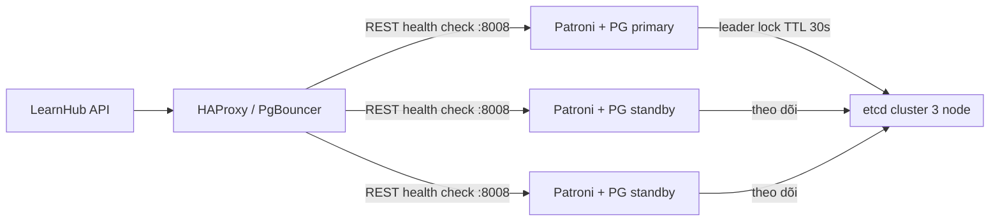

# Replication và High Availability (HA)

**Mục đích:** thiết kế PostgreSQL chịu được mất một node mà không mất dữ liệu ngoài mức cho phép, chuyển đổi dự phòng (failover) an toàn, và dùng replica đọc mà không trả dữ liệu cũ sai chỗ.
**Liên quan:** [01-postgres-internals.md](01-postgres-internals.md) · [05-backup-restore-dr.md](05-backup-restore-dr.md) · [07-cau-hinh-van-hanh-monitoring.md](07-cau-hinh-van-hanh-monitoring.md) · [06-partition-sharding.md](06-partition-sharding.md) · [../07-he-thong-server/](../07-he-thong-server/)

---

## 1. Replication không phải backup, HA không phải DR

| Khái niệm | Bảo vệ khỏi | Không bảo vệ khỏi |
|---|---|---|
| **Replication** | Mất một server | `DELETE` nhầm (được replicate ngay sang replica) |
| **HA** (tự failover) | Downtime khi primary chết | Hỏng dữ liệu logic, mất cả vùng (region) |
| **Backup + PITR** | Lỗi người, lỗi ứng dụng, ransomware | Downtime (khôi phục mất thời gian) |
| **DR** (vùng khác) | Mất cả datacenter/region | — |

Cần **cả bốn**. Backup ở [05-backup-restore-dr.md](05-backup-restore-dr.md).

## 2. Streaming replication (vật lý)

Primary gửi WAL qua kết nối `walsender` → standby (`walreceiver`) ghi WAL và phát lại. Standby là **bản sao từng byte** của cả cluster (mọi database), cùng major version, cùng kiến trúc.

```
Primary ──WAL stream──► Standby 1 (cùng AZ khác)    ← ứng viên failover
        ──WAL stream──► Standby 2 (AZ thứ ba)        ← ứng viên failover / đọc
        ──WAL archive─► Object storage (S3)          ← PITR, dựng lại standby
```

Tạo standby:

```bash
pg_basebackup -h primary.db.internal -U replicator -D /var/lib/postgresql/18/main \
  -X stream -c fast -R -S standby1_slot -C -P
# -R ghi primary_conninfo + standby.signal; -S/-C tạo và dùng replication slot
```

## 3. Đồng bộ hay bất đồng bộ – synchronous_commit

| `synchronous_commit` | COMMIT trả về khi | Mất dữ liệu khi primary chết | Độ trễ thêm |
|---|---|---|---|
| `off` | Chưa flush WAL cục bộ | Vài trăm ms giao dịch gần nhất | Không |
| `local` | WAL flush cục bộ | Giao dịch chưa tới standby (async) | Không |
| `on` + không có `synchronous_standby_names` | Như `local` | Như trên | Không |
| `remote_write` | Standby đã nhận, ghi vào OS (chưa fsync) | Chỉ khi primary và standby cùng chết trước khi standby fsync | 1 vòng mạng |
| `on` + có sync standby | Standby đã **fsync** WAL | Không (RPO = 0) | 1 vòng mạng + fsync |
| `remote_apply` | Standby đã **áp dụng** (query trên standby thấy ngay) | Không | Lớn nhất |

```ini
# Primary: cần ACK từ 1 trong 2 standby (quorum) — một standby chết không làm treo ghi
synchronous_standby_names = 'ANY 1 (standby1, standby2)'
synchronous_commit = on
```

**Bẫy lớn:** với `FIRST 1 (standby1)` và chỉ một sync standby — standby đó chết thì **mọi COMMIT trên primary treo**. Luôn dùng quorum `ANY 1 (…)` với ≥ 2 standby, hoặc để công cụ HA (Patroni) quản lý.

Có thể chọn **theo transaction**: dữ liệu quan trọng (nộp bài thi, thanh toán) `SET LOCAL synchronous_commit = on`; log xem bài `SET LOCAL synchronous_commit = local`.

Trade-off cho LearnHub: các AZ cách nhau 1–2 ms → sync replication cộng ~2–5 ms mỗi COMMIT, chấp nhận được. Khác region (30–100 ms) → **không** dùng sync, dùng async cho DR.

## 4. Replication slot – lợi và hại

Slot đảm bảo primary **giữ lại WAL** cho tới khi consumer (standby hoặc CDC) đã nhận.

- **Lợi:** standby mất kết nối một lúc vẫn bắt kịp được, không phải dựng lại.
- **Hại:** consumer chết hẳn → WAL tích tụ **vô hạn** → đầy đĩa → primary dừng. Slot logical còn giữ `catalog_xmin` → cản VACUUM ([01](01-postgres-internals.md)).

```sql
SELECT slot_name, slot_type, active, wal_status,
       pg_size_pretty(pg_wal_lsn_diff(pg_current_wal_lsn(), restart_lsn)) AS retained_wal
FROM pg_replication_slots;
```

```ini
max_slot_wal_keep_size = 100GB    # PG13+: vượt ngưỡng thì slot bị vô hiệu thay vì làm đầy đĩa
```

PG18 thêm `idle_replication_slot_timeout` để vô hiệu slot không hoạt động quá lâu.
Cảnh báo: slot `active = false` > 15 phút; `retained_wal` > 20% dung lượng đĩa.

## 5. Đọc từ standby (hot standby)

### Xung đột hot standby

Standby đang chạy query đọc dòng X; primary đã VACUUM xóa X; WAL tới standby yêu cầu xóa X → xung đột:

```
ERROR: canceling statement due to conflict with recovery
```

| Tham số | Tác dụng | Cái giá |
|---|---|---|
| `max_standby_streaming_delay = 30s` | Standby chờ query xong tối đa 30s trước khi hủy nó | Replica bị trễ tối đa 30s |
| `hot_standby_feedback = on` | Standby báo `xmin` về primary → primary không dọn dòng standby còn cần | Bloat trên **primary** do query dài trên replica |

Thực tế: replica cho API (query ngắn) bật `hot_standby_feedback`; replica cho báo cáo dài tách riêng, cho phép trễ, hoặc dùng logical replication sang kho phân tích.

### Đo độ trễ replication

```sql
-- Trên primary
SELECT application_name, state, sync_state,
       write_lag, flush_lag, replay_lag,
       pg_size_pretty(pg_wal_lsn_diff(pg_current_wal_lsn(), replay_lsn)) AS replay_bytes_behind
FROM pg_stat_replication;

-- Trên standby
SELECT now() - pg_last_xact_replay_timestamp() AS replay_delay;  -- lưu ý: tăng giả khi primary không có ghi
```

### Read-your-writes – người dùng vừa sửa xong lại thấy dữ liệu cũ

Người dùng sửa hồ sơ (ghi primary) → reload trang (đọc replica trễ 300 ms) → thấy tên cũ, tưởng lỗi.

| Chiến lược | Cách làm | Khi dùng |
|---|---|---|
| Đọc primary sau khi ghi | Đánh dấu session "vừa ghi" N giây (cookie/Redis) → đọc primary | Đơn giản, phổ biến nhất |
| Theo LSN | Sau ghi lấy `pg_current_wal_lsn()`; khi đọc replica kiểm tra `pg_last_wal_replay_lsn() >= lsn`, chưa đạt thì đọc primary | Chính xác, phức tạp hơn |
| Theo loại dữ liệu | Dữ liệu của chính user (hồ sơ, bài làm) luôn đọc primary; dữ liệu công khai (feed) đọc replica | Dễ hiểu, hợp LearnHub |
| `remote_apply` | Ghi chờ replica áp dụng | Tốn độ trễ ghi; ít dùng |

**Không bao giờ** đọc từ replica để quyết định một thao tác ghi (ví dụ kiểm tra "đã nộp chưa" trên replica rồi cho nộp).

## 6. Logical replication

Gửi **thay đổi theo dòng** (INSERT/UPDATE/DELETE) của các bảng chọn lọc, qua publication/subscription.

```sql
-- Nguồn
CREATE PUBLICATION learnhub_pub FOR TABLE posts, comments;
-- Đích
CREATE SUBSCRIPTION learnhub_sub
  CONNECTION 'host=old-primary dbname=learnhub user=replicator password=<password>'
  PUBLICATION learnhub_pub;
```

| Dùng cho | Giới hạn cần biết |
|---|---|
| Nâng cấp major version gần như không downtime (PG16 → PG18) | **Không** replicate DDL → schema phải tạo trước và đồng bộ thủ công |
| Đồng bộ một phần bảng sang DB khác / kho phân tích | **Sequence** không được replicate → đặt lại giá trị trước khi chuyển |
| CDC (Debezium) sang Kafka | Bảng cần khóa chính hoặc `REPLICA IDENTITY` để UPDATE/DELETE |
| Gộp dữ liệu từ nhiều nguồn | Large object không được hỗ trợ; xung đột ở đích phải tự xử lý |

PG17+: failover slot cho logical replication (`failover = true` khi tạo slot, `sync_replication_slots` trên standby) → CDC tiếp tục sau failover. Bản cũ hơn: failover làm mất slot logical, consumer phải đồng bộ lại.

## 7. HA tự động với Patroni

PostgreSQL **không tự failover**. Công cụ phổ biến nhất trên máy tự quản: **Patroni** + kho đồng thuận phân tán (etcd/Consul/ZooKeeper/Kubernetes API).



Cơ chế:

1. Primary liên tục gia hạn **leader lock** trong etcd (TTL ví dụ 30s).
2. Primary không gia hạn được (chết, mất mạng tới etcd) → **tự hạ xuống read-only** (Patroni demote) — đây là cơ chế chống split-brain quan trọng.
3. Lock hết hạn → standby có WAL mới nhất (và trong giới hạn `maximum_lag_on_failover`) giành lock, được promote.
4. HAProxy hỏi REST API Patroni (`/primary`, `/replica`) để định tuyến.

```yaml
# patroni.yml (trích)
bootstrap:
  dcs:
    ttl: 30
    loop_wait: 10
    retry_timeout: 10
    maximum_lag_on_failover: 1048576     # không promote standby trễ quá 1 MB WAL
    synchronous_mode: true               # Patroni quản lý synchronous_standby_names
    postgresql:
      use_pg_rewind: true                # primary cũ quay lại làm standby mà không cần dựng lại
```

Lệnh vận hành:

```bash
patronictl -c /etc/patroni.yml list                       # trạng thái cluster
patronictl -c /etc/patroni.yml switchover --leader pg1 --candidate pg2   # chủ động (bảo trì)
patronictl -c /etc/patroni.yml failover                    # ép khi primary đã hỏng
patronictl -c /etc/patroni.yml pause / resume              # tạm dừng tự động khi bảo trì
```

Trên Kubernetes: operator như CloudNativePG, Crunchy PGO, Zalando postgres-operator. Xem [../07-he-thong-server/](../07-he-thong-server/).

## 8. Split-brain và fencing

**Split-brain**: hai node cùng nghĩ mình là primary và cùng nhận ghi → dữ liệu phân kỳ, gần như không thể hợp nhất tự động.

Phòng chống nhiều lớp:

| Lớp | Cơ chế |
|---|---|
| Đồng thuận | Leader lock trong etcd với số node lẻ (3/5), quorum |
| Tự hạ cấp | Primary mất kết nối DCS tự chuyển read-only |
| Watchdog | Patroni dùng Linux watchdog (`/dev/watchdog`) reset máy nếu Patroni treo |
| Fencing ở định tuyến | HAProxy chỉ gửi ghi tới node trả `200` ở `/primary` |
| Sync replication | Primary cũ bị cô lập không commit được vì không có ACK |

**Không bao giờ** tự viết script failover kiểu "ping primary không thấy thì promote standby" — đó là công thức của split-brain khi mạng chập chờn.

## 9. Định tuyến kết nối

| Cách | Ưu | Nhược |
|---|---|---|
| HAProxy + health check Patroni | Phổ biến, tách đọc/ghi theo cổng (5000 ghi, 5001 đọc) | Thêm một tầng |
| PgBouncer phía trước | Pooling + định tuyến | PgBouncer không tự biết ai là primary → kết hợp HAProxy/DNS |
| libpq multi-host | `host=pg1,pg2,pg3 target_session_attrs=read-write` — driver tự tìm primary | Phụ thuộc driver hỗ trợ (libpq, JDBC, node-postgres qua cấu hình riêng) |
| DNS / VIP (keepalived, vip-manager) | Ứng dụng không đổi cấu hình | TTL DNS, cache DNS phía client gây chậm chuyển |
| Managed endpoint (RDS/Aurora) | Nhà cung cấp lo | Phụ thuộc DNS; client cần retry |

Ứng dụng **bắt buộc** có: retry khi mất kết nối, timeout kết nối ngắn (2–5s), pool kiểm tra kết nối trước khi dùng. Failover luôn làm rơi các kết nối/transaction đang chạy.

## 10. Dịch vụ quản lý (managed)

| Dịch vụ | HA | Failover thường | Đặc điểm |
|---|---|---|---|
| AWS RDS PostgreSQL Multi-AZ (1 standby) | Standby đồng bộ, **không đọc được** | 60–120s | Đơn giản |
| AWS RDS Multi-AZ DB cluster (2 standby đọc được) | Semi-sync | thường < 35s | Standby đọc được |
| Amazon Aurora PostgreSQL | Lưu trữ phân tán 6 bản / 3 AZ, tới 15 replica | thường < 30s | Replica lag thấp, tính phí I/O (hoặc I/O-Optimized) |
| Google Cloud SQL / AlloyDB | Regional HA | ~60s / thấp hơn với AlloyDB | AlloyDB tối ưu phân tích |
| Azure Database for PostgreSQL Flexible Server | Zone-redundant HA | 60–120s | — |

Tự quản (Patroni) phù hợp khi: cần extension đặc biệt, cần quyền superuser, chi phí lớn ở quy mô lớn, chạy on-prem. Managed phù hợp khi đội không có DBA trực 24/7 — **đây là trường hợp phổ biến**. Số liệu failover là tham khảo; kiểm tra tài liệu hiện hành của nhà cung cấp.

## 11. RPO/RTO cho LearnHub

| Dữ liệu | RPO | RTO | Thiết kế |
|---|---|---|---|
| Bài làm, nộp bài, điểm | 0 | < 1 phút | Sync quorum trong region, Patroni/Aurora, WAL archive |
| Bài viết, bình luận | < 5s | < 5 phút | Như trên (dùng chung cluster) |
| Lượt xem, analytics | < 15 phút | < 1 giờ | Async, có thể mất |
| Toàn bộ khi mất region | < 15 phút | < 4 giờ | Standby async khác region + WAL archive sao chép sang region khác |

Viết RPO/RTO thành con số và **diễn tập** đo thực tế (ít nhất mỗi quý một lần switchover có kế hoạch).

## 12. Câu chuyện sự cố

**"Failover xong mất 4 phút đơn hàng"** — Cluster async, standby trễ 4 phút do một job tạo index lớn sinh WAL dồn dập. Primary chết, công cụ promote standby trễ.
**Bài học:** `maximum_lag_on_failover`, sync quorum cho dữ liệu quan trọng, cảnh báo replication lag.

**"Primary treo mọi COMMIT"** — `synchronous_standby_names = 'standby1'`, standby1 bị reboot để vá kernel.
**Bài học:** quorum `ANY 1 (…)` với ≥ 2 standby, hoặc Patroni `synchronous_mode` tự điều chỉnh.

## 13. Lỗi agent hay mắc

| Lỗi | Hậu quả |
|---|---|
| Coi replica là backup | `DELETE` nhầm được replicate, không cứu được |
| Đọc replica ngay sau khi ghi | Người dùng thấy dữ liệu cũ |
| Kiểm tra điều kiện nghiệp vụ trên replica rồi ghi | Quyết định dựa trên dữ liệu cũ |
| Một sync standby duy nhất | Primary treo khi standby chết |
| Tạo replication slot cho thử nghiệm rồi bỏ | Đầy đĩa, chặn VACUUM |
| Script failover tự viết dựa trên ping | Split-brain |
| Ứng dụng không retry khi mất kết nối | Mỗi failover = lỗi hàng loạt cho người dùng |

## Checklist review

- [ ] Có ít nhất 2 standby ở AZ khác nhau; quorum sync cho dữ liệu RPO = 0.
- [ ] Failover do công cụ có đồng thuận (Patroni + etcd 3 node / managed), không script tự chế.
- [ ] `maximum_lag_on_failover` (hoặc tương đương) được đặt.
- [ ] Mọi slot có chủ sở hữu, có `max_slot_wal_keep_size`, có cảnh báo slot không active.
- [ ] Có cảnh báo replication lag (byte và thời gian).
- [ ] Chiến lược read-your-writes rõ ràng; thao tác ghi không dựa vào dữ liệu đọc từ replica.
- [ ] `hot_standby_feedback` / `max_standby_streaming_delay` chọn có chủ đích theo vai trò replica.
- [ ] Ứng dụng có retry + timeout kết nối ngắn; đã thử failover thật và đo thời gian gián đoạn.
- [ ] RPO/RTO viết thành con số, có lịch diễn tập switchover.
- [ ] Logical replication: đã xử lý DDL, sequence, `REPLICA IDENTITY`.
