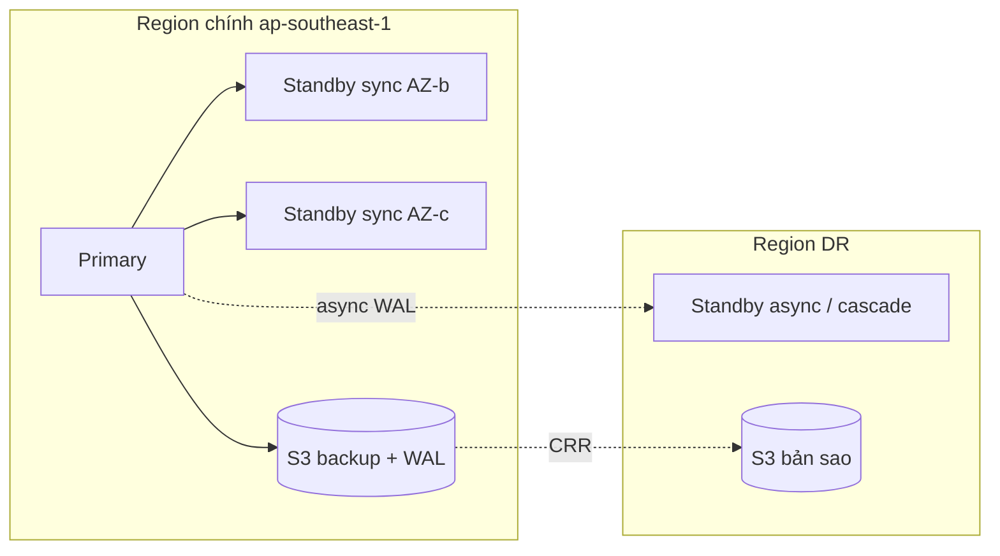

# Backup, khôi phục và Disaster Recovery

**Mục đích:** bảo đảm luôn khôi phục được dữ liệu về một thời điểm bất kỳ trong khoảng giữ lại, trong thời gian đã cam kết — và biết chính xác phải làm gì trong giờ đầu tiên của sự cố mất dữ liệu.
**Nguyên tắc số một:** **backup chưa từng được khôi phục thử = không có backup.**
**Liên quan:** [04-replication-ha.md](04-replication-ha.md) · [01-postgres-internals.md](01-postgres-internals.md) · [11-bao-mat-database.md](11-bao-mat-database.md) · [07-cau-hinh-van-hanh-monitoring.md](07-cau-hinh-van-hanh-monitoring.md)

---

## 1. Hai loại backup

| | Logical (`pg_dump`) | Physical (`pg_basebackup`, pgBackRest…) |
|---|---|---|
| Nội dung | Lệnh SQL / định dạng custom để tạo lại đối tượng và dữ liệu | Bản sao file dữ liệu của cả cluster |
| Phạm vi | Một database, chọn bảng/schema được | Cả cluster |
| Khôi phục tới thời điểm bất kỳ (PITR) | **Không** — chỉ tới lúc dump | **Có** (kết hợp WAL archive) |
| Khác major version / kiến trúc | Được | Không |
| Tốc độ với DB 2 TB | Rất chậm (dump hàng giờ, restore + tạo index lâu hơn nữa) | Nhanh hơn nhiều, song song, incremental |
| Dùng cho | Xuất một phần dữ liệu, chuyển DB nhỏ, lưu trữ dài hạn bổ sung | **Backup chính của production** |

`pg_dump` cho một snapshot nhất quán (nó chạy trong một transaction Repeatable Read) — nghĩa là dump dài sẽ giữ transaction dài trên primary ([03](03-transaction-lock-concurrency.md)). Chạy dump trên replica.

```bash
# Dump định dạng thư mục, song song 8 job
pg_dump -h replica.db.internal -U backup -d learnhub -Fd -j 8 -f /backup/learnhub_20261120
# Restore song song; --no-owner khi chuyển sang môi trường khác
pg_restore -h target -U postgres -d learnhub_restore -j 8 --no-owner /backup/learnhub_20261120
# Chỉ một bảng
pg_restore -d learnhub_restore -t posts /backup/learnhub_20261120
# Đối tượng toàn cluster (role, tablespace) không nằm trong pg_dump
pg_dumpall --globals-only > globals.sql
```

## 2. Physical backup + WAL archive = PITR

```
Thứ 2 01:00        full backup
Thứ 3 01:00        incremental / differential
...                WAL được archive liên tục (mỗi segment 16 MB, hoặc theo archive_timeout)
Thứ 5 14:32:10     sự cố
→ Khôi phục: full backup gần nhất + incremental + phát lại WAL tới 14:32:09
```

Cấu hình archive WAL:

```ini
wal_level = replica
archive_mode = on
archive_command = 'pgbackrest --stanza=learnhub archive-push %p'
archive_timeout = 60s    # ép chuyển segment ít nhất mỗi 60s khi ít ghi → RPO của archive ≤ ~60s
```

`archive_command` phải: trả mã lỗi khác 0 khi thất bại (PostgreSQL sẽ thử lại và **giữ WAL** — đĩa có thể đầy nếu archive hỏng lâu), không ghi đè file đã có. Đừng tự viết bằng `cp`; dùng công cụ.

Theo dõi:

```sql
SELECT archived_count, last_archived_wal, last_archived_time,
       failed_count, last_failed_wal, last_failed_time
FROM pg_stat_archiver;
-- Cảnh báo: last_failed_time > last_archived_time, hoặc last_archived_time cũ hơn 5 phút
```

## 3. Công cụ

| Công cụ | Điểm mạnh |
|---|---|
| **pgBackRest** | Full/diff/incremental, song song, nén zstd/lz4, mã hóa, S3/GCS/Azure, kiểm tra checksum, restore delta, chính sách retention. Lựa chọn mặc định hợp lý |
| **WAL-G** | Gọn, mạnh với object storage, delta backup, phổ biến trên Kubernetes |
| **Barman** | Quản lý tập trung nhiều server, streaming WAL |
| `pg_basebackup` | Có sẵn; PG17+ hỗ trợ **incremental** (`--incremental` + `pg_combinebackup`, cần `summarize_wal = on`) — vẫn thiếu retention/quản lý |
| Snapshot đĩa / managed | RDS/Aurora automated backup + PITR; snapshot EBS cần đảm bảo nhất quán (dùng cùng `pg_backup_start/stop`) |

Ví dụ pgBackRest:

```ini
# /etc/pgbackrest/pgbackrest.conf
[global]
repo1-type=s3
repo1-s3-bucket=learnhub-pg-backup
repo1-s3-region=ap-southeast-1
repo1-path=/learnhub
repo1-retention-full=4               # giữ 4 bản full (~4 tuần nếu full hàng tuần)
repo1-cipher-type=aes-256-cbc
repo1-cipher-pass=<từ secret manager, không viết vào file commit>
compress-type=zst
process-max=8
start-fast=y

[learnhub]
pg1-path=/var/lib/postgresql/18/main
```

```bash
pgbackrest --stanza=learnhub stanza-create
pgbackrest --stanza=learnhub check                       # kiểm tra archive hoạt động
pgbackrest --stanza=learnhub --type=full backup          # CN 01:00
pgbackrest --stanza=learnhub --type=diff backup          # T2–T7 01:00
pgbackrest --stanza=learnhub info                        # danh sách backup, khoảng WAL có
pgbackrest --stanza=learnhub verify                      # kiểm tra tính toàn vẹn kho backup
```

## 4. PITR từng bước (pgBackRest)

Tình huống: 14:32:10 một migration lỗi xóa dữ liệu bảng `answers`.

```bash
# 1. Dựng server khôi phục RIÊNG (không ghi đè primary đang chạy)
sudo systemctl stop postgresql            # trên máy khôi phục
# 2. Restore tới ngay trước sự cố
pgbackrest --stanza=learnhub --delta \
  --type=time --target="2026-11-20 14:32:00+07" \
  --target-action=pause restore
# 3. Khởi động; PostgreSQL phát lại WAL tới target rồi tạm dừng (pause)
sudo systemctl start postgresql
```

```sql
-- 4. Kiểm tra dữ liệu ở trạng thái tạm dừng
SELECT count(*) FROM answers WHERE created_at < '2026-11-20 14:32';
SELECT pg_is_in_recovery(), pg_last_xact_replay_timestamp();
-- Đúng thời điểm mong muốn → kết thúc recovery
SELECT pg_wal_replay_resume();
-- Sai (cần lùi thêm) → dừng, restore lại với target khác
```

Các loại target: `--type=time`, `--type=xid`, `--type=lsn`, `--type=name` (điểm tạo bằng `SELECT pg_create_restore_point('before_migration_42');` — **nên tạo trước mọi migration rủi ro**).

## 5. Runbook: "lỡ DELETE/UPDATE không WHERE"

**Phút 0–5: chặn thiệt hại**

1. Dừng nguồn gây hại: tắt job/deploy/script đang chạy. Nếu còn đang chạy: `pg_cancel_backend(pid)`.
2. **Không** chạy "sửa nhanh" bằng tay trên production.
3. Ghi lại: thời điểm chính xác (từ log ứng dụng, `log_statement`/`pg_stat_activity`, audit), câu lệnh, bảng bị ảnh hưởng, ước lượng số dòng.
4. Thông báo kênh sự cố, chỉ định một người chỉ huy (incident commander).

**Phút 5–15: chọn chiến lược**

| Tình huống | Cách khôi phục |
|---|---|
| Một/vài bảng bị hỏng, phần còn lại vẫn đúng và tiếp tục được ghi | PITR ra **server riêng** tới trước sự cố → trích xuất dòng bị mất → đưa vào production bằng `INSERT … ON CONFLICT` / script đối soát |
| Hỏng lan rộng, dữ liệu sau sự cố không quan trọng bằng | PITR toàn bộ, chuyển ứng dụng sang cluster khôi phục (mất dữ liệu ghi sau sự cố — cần quyết định của chủ sản phẩm) |
| Có **delayed replica** (`recovery_min_apply_delay = '4h'`) | Tạm dừng replay trên replica trễ ngay (`pg_wal_replay_pause()`), trích dữ liệu từ đó — nhanh nhất |

**Phút 15+: thực hiện**

Trích dữ liệu từ server khôi phục sang production qua bảng tạm (`pg_dump` không lọc theo điều kiện dòng, nên dùng `\copy`):

```sql
-- Trên server khôi phục
\copy (SELECT * FROM answers WHERE exam_id = 9) TO 'answers_exam9.csv' CSV HEADER
-- Trên production
CREATE TABLE recover_answers_exam9 (LIKE answers INCLUDING ALL);
\copy recover_answers_exam9 FROM 'answers_exam9.csv' CSV HEADER
-- Đối soát trước khi chèn
SELECT count(*) FROM recover_answers_exam9 r WHERE NOT EXISTS (SELECT 1 FROM answers a WHERE a.id = r.id);
INSERT INTO answers SELECT * FROM recover_answers_exam9 ON CONFLICT (id) DO NOTHING;
```

**Sau sự cố:** postmortem không đổ lỗi; biện pháp: code review migration, `pg_create_restore_point` trước migration, role ứng dụng không có quyền `TRUNCATE`/`DROP`, cấm thao tác tay trên production không qua quy trình, `SET statement_timeout` và bắt buộc `BEGIN … ROLLBACK` khi thao tác tay.

Phòng ngừa từ đầu: trong `psql` thao tác tay, đặt `\set AUTOCOMMIT off` để mọi lệnh cần `COMMIT` rõ ràng.

## 6. Retention và quy tắc 3-2-1

**3** bản sao dữ liệu, trên **2** loại phương tiện khác nhau, **1** bản ở nơi khác (khác region/tài khoản). Bổ sung hiện đại: **1** bản bất biến (immutable / S3 Object Lock) chống ransomware và chống người có quyền admin xóa nhầm, **0** lỗi khi kiểm tra khôi phục.

Ví dụ LearnHub:

| Lớp | Giữ | Vị trí |
|---|---|---|
| WAL archive + full tuần + diff ngày | 30 ngày PITR | S3 cùng region, tài khoản AWS backup riêng |
| Bản sao kho backup | 30 ngày | S3 khác region (Cross-Region Replication) |
| Snapshot tháng | 12 tháng | S3 Object Lock (compliance mode) |
| `pg_dump` logical tháng | 12 tháng | Bổ sung, khác định dạng — phòng lỗi công cụ backup vật lý |

Retention phải khớp nghĩa vụ pháp lý và **quyền xóa dữ liệu cá nhân** (Nghị định 13/2023): dữ liệu đã xóa theo yêu cầu vẫn nằm trong backup cũ → ghi rõ chính sách hết hạn backup, không khôi phục dữ liệu đã xóa vào hệ thống đang chạy. Xem [11-bao-mat-database.md](11-bao-mat-database.md).

## 7. Mã hóa và quyền truy cập backup

- Mã hóa phía công cụ (pgBackRest cipher) **và** phía lưu trữ (SSE-KMS).
- Khóa mã hóa trong secret manager/KMS; **mất khóa = mất backup**. Có quy trình lưu khóa dự phòng (escrow).
- Tài khoản ghi backup không có quyền xóa; tài khoản xóa cần MFA, tách người.
- Backup chứa toàn bộ PII → kiểm soát truy cập chặt như production, có log truy cập.

## 8. Kiểm chứng backup

| Mức | Cách | Tần suất |
|---|---|---|
| Backup chạy thành công | Theo dõi exit code, `pgbackrest info`, cảnh báo nếu backup cuối > 26 giờ | Hằng ngày, tự động |
| Archive liên tục | `pg_stat_archiver`, `pgbackrest check` | Liên tục |
| Toàn vẹn file | `pgbackrest verify`, checksum dữ liệu (`initdb --data-checksums`; PG18 bật mặc định) | Hằng tuần |
| **Khôi phục tự động** | Job dựng server tạm, restore bản mới nhất + PITR tới 1 giờ trước, chạy truy vấn kiểm tra (đếm dòng các bảng chính, dòng mới nhất, `amcheck`), ghi thời gian khôi phục | Hằng tuần |
| Diễn tập DR có người | Kịch bản mất region, đo RTO thực tế, cập nhật runbook | Mỗi quý |

Thời gian khôi phục đo được chính là **RTO thực**. Nếu restore 2 TB mất 5 giờ mà RTO cam kết 1 giờ → phải đổi thiết kế (standby, delayed replica, incremental, chia nhỏ DB).

## 9. DR khác region



Runbook DR phải trả lời: ai quyết định chuyển region (không tự động — rủi ro split-brain giữa region), DNS/endpoint đổi thế nào, ứng dụng, cache, hàng đợi, object storage ở region DR đã sẵn sàng chưa, chấp nhận mất bao nhiêu dữ liệu (RPO async), quay về region chính ra sao (failback).

## 10. Lỗi agent hay mắc

| Lỗi | Hậu quả |
|---|---|
| Đề xuất cron `pg_dump` hằng đêm là "đủ backup" cho DB lớn | Không PITR, RPO 24 giờ, restore cực chậm |
| `archive_command = 'cp %p /mnt/archive/%f'` | Không fsync, ghi đè, không kiểm tra, cùng máy |
| Không đề cập kiểm tra khôi phục | Phát hiện backup hỏng đúng lúc cần |
| Restore PITR đè lên primary đang chạy | Mất luôn dữ liệu ghi sau sự cố và kéo dài downtime |
| Ghi khóa mã hóa backup vào file cấu hình trong repo | Lộ toàn bộ dữ liệu |
| Coi snapshot RDS là bản sao khác vùng/tài khoản | Cùng tài khoản bị xâm nhập = mất cả backup |

## Checklist review

- [ ] Backup chính là physical + WAL archive (hoặc PITR của managed), không chỉ `pg_dump`.
- [ ] RPO/RTO viết thành con số; RTO đã đo bằng khôi phục thật.
- [ ] Archive được giám sát (`pg_stat_archiver`), cảnh báo khi lỗi hoặc ngừng.
- [ ] Có job khôi phục tự động định kỳ với truy vấn kiểm tra dữ liệu.
- [ ] 3-2-1-1-0: khác region/tài khoản, có bản bất biến.
- [ ] Backup được mã hóa; khóa nằm trong KMS/secret manager và có bản dự phòng an toàn.
- [ ] Quyền xóa backup tách riêng, cần MFA.
- [ ] Runbook "xóa nhầm dữ liệu" và runbook DR tồn tại, đã diễn tập.
- [ ] Migration rủi ro có `pg_create_restore_point` trước khi chạy.
- [ ] Data checksums bật; `amcheck` chạy định kỳ.
- [ ] Retention khớp yêu cầu pháp lý và chính sách xóa dữ liệu cá nhân.
