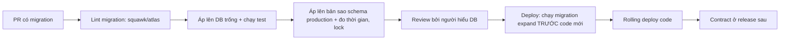

# Migration và tiến hóa schema không downtime

**Mục đích:** thay đổi schema của database đang phục vụ hàng triệu user mà không khóa bảng, không làm sập ứng dụng, và luôn có đường lui.
**Liên quan:** [01-postgres-internals.md](01-postgres-internals.md) · [03-transaction-lock-concurrency.md](03-transaction-lock-concurrency.md) · [06-partition-sharding.md](06-partition-sharding.md) · [07-cau-hinh-van-hanh-monitoring.md](07-cau-hinh-van-hanh-monitoring.md) · [12-checklist-review-database.md](12-checklist-review-database.md) · Cơ bản expand/contract: [../05-backend-senior/07-thiet-ke-database.md](../05-backend-senior/07-thiet-ke-database.md) · Release: [../02-quy-trinh-phan-mem/08-release.md](../02-quy-trinh-phan-mem/08-release.md)

---

## 1. Vì sao migration nguy hiểm

Ba cơ chế gây sự cố:

1. **Lock mạnh trên bảng lớn.** Hầu hết `ALTER TABLE` lấy `ACCESS EXCLUSIVE` — chặn cả đọc lẫn ghi.
2. **Hàng đợi lock.** Ngay cả lệnh chỉ cần lock vài mili giây cũng phải **chờ** mọi transaction đang giữ lock xung đột (ví dụ một truy vấn báo cáo chạy 10 phút). Trong lúc chờ, mọi truy vấn mới tới bảng đó **xếp hàng sau** lệnh ALTER → toàn bộ API dừng. Đây là nguyên nhân sự cố migration phổ biến nhất.
3. **Viết lại bảng (rewrite).** Một số thay đổi buộc PG sao chép toàn bộ bảng — với bảng 500 GB là hàng giờ giữ lock và gấp đôi dung lượng đĩa.

Thêm nữa: trong khi deploy, **code cũ và code mới cùng chạy** (rolling deploy). Schema phải tương thích với cả hai.

## 2. Công cụ

| Công cụ | Kiểu | Ghi chú |
|---|---|---|
| Flyway | File SQL đánh số `V1__init.sql` | Đơn giản, SQL thuần, phổ biến hệ Java |
| Liquibase | Changelog XML/YAML/SQL | Nhiều tính năng (rollback, precondition), cồng kềnh hơn |
| Prisma Migrate / TypeORM / Knex / Drizzle | Migration trong hệ sinh thái Node | Tiện; **kiểm tra SQL sinh ra** — ORM hay sinh DDL không an toàn |
| Alembic (Python), EF Core migrations (.NET), golang-migrate | Theo ngôn ngữ | |
| sqitch | Thay đổi có phụ thuộc, deploy/revert/verify | |
| Atlas | Khai báo schema mong muốn, tính diff; có lint | Hữu ích để phát hiện thay đổi nguy hiểm |

Nguyên tắc dù dùng công cụ gì:
- Migration là **file trong repo**, được review như code, chạy theo thứ tự, ghi lại trong bảng lịch sử.
- **Không sửa migration đã chạy trên môi trường dùng chung** — tạo migration mới.
- Xem **SQL thực tế** sẽ chạy (`prisma migrate diff`, `flyway info`, `atlas migrate lint`).

## 3. Forward-only hay có down migration?

| | Down migration | Forward-only |
|---|---|---|
| Ý tưởng | Mỗi migration có lệnh hoàn tác | Sai thì viết migration mới để sửa |
| Thực tế | Down của `DROP COLUMN` không lấy lại được dữ liệu; down hiếm khi được test | Trung thực hơn; kết hợp expand/contract nên mỗi bước đều an toàn |
| Khuyến nghị | Có ích ở môi trường dev | **Production: forward-only + expand/contract + backup/PITR** |

Đường lui thực sự cho production là: (1) code mới vẫn chạy được trên schema cũ và ngược lại, (2) không xóa gì cho tới khi chắc chắn, (3) PITR cho thảm họa.

## 4. Expand / Contract chi tiết – ví dụ đổi tên cột

Yêu cầu: đổi `users.fullname` thành `users.display_name` trên bảng 5 triệu hàng, không downtime.

`ALTER TABLE users RENAME COLUMN fullname TO display_name;` chạy rất nhanh, **nhưng** code cũ đang chạy sẽ lỗi ngay lập tức (`column fullname does not exist`). Vì vậy phải chia nhiều lần deploy:

| Bước | Thay đổi DB | Thay đổi code | Code đang chạy đọc/ghi |
|---|---|---|---|
| 1. Expand | `ADD COLUMN display_name text` (nullable) | — | `fullname` |
| 2. Ghi kép | — | Ghi cả hai cột; đọc `fullname` | cả hai |
| 3. Backfill | Sao chép `fullname → display_name` theo lô | — | cả hai |
| 4. Đổi nguồn đọc | (tùy chọn) ràng buộc NOT NULL an toàn | Đọc `display_name`, vẫn ghi cả hai | cả hai |
| 5. Ngừng ghi cũ | — | Chỉ ghi `display_name` | `display_name` |
| 6. Contract | `DROP COLUMN fullname` (sau 1+ chu kỳ release) | — | `display_name` |

Có thể thay bước 2 bằng trigger đồng bộ ở DB (ghi một cột, trigger cập nhật cột kia) — giảm thay đổi code nhưng thêm logic ẩn; ghi rõ và xóa trigger ở bước contract.

Mỗi bước là một deploy riêng, có thể dừng hoặc quay lại bước trước mà không mất dữ liệu. Chỉ bước 6 là không đảo ngược — làm sau khi đã quan sát đủ lâu.

Mẫu tương tự áp dụng cho: tách bảng, đổi kiểu cột, chuyển dữ liệu sang bảng mới, đổi khóa chính.

## 5. DDL an toàn và nguy hiểm (PostgreSQL 12+)

| Thao tác | An toàn? | Cách làm an toàn |
|---|---|---|
| `ADD COLUMN` nullable, không default | ✅ Chỉ metadata | Vẫn cần `lock_timeout` (xem §6) |
| `ADD COLUMN ... DEFAULT <hằng>` | ✅ từ PG11 (không rewrite) | Default **biến động** như `clock_timestamp()`, `gen_random_uuid()` vẫn rewrite → thêm nullable, backfill, rồi đặt default |
| `ADD COLUMN ... NOT NULL DEFAULT <hằng>` | ✅ từ PG11 | |
| `SET NOT NULL` trên cột có sẵn | ⚠️ Quét toàn bảng dưới ACCESS EXCLUSIVE | `ADD CONSTRAINT c CHECK (col IS NOT NULL) NOT VALID;` → `VALIDATE CONSTRAINT c;` (lock nhẹ, SHARE UPDATE EXCLUSIVE) → `SET NOT NULL` (PG12+ dùng CHECK hợp lệ, không quét) → `DROP CONSTRAINT c` |
| `ADD FOREIGN KEY` | ⚠️ Quét + lock cả hai bảng | `ADD CONSTRAINT fk ... NOT VALID;` rồi `VALIDATE CONSTRAINT fk;` |
| `ADD CHECK` | ⚠️ Quét | `NOT VALID` rồi `VALIDATE` |
| `ADD UNIQUE` / PK | ⚠️ Tạo index dưới lock | `CREATE UNIQUE INDEX CONCURRENTLY idx ...;` rồi `ADD CONSTRAINT u UNIQUE USING INDEX idx;` |
| `CREATE INDEX` | ❌ Chặn ghi suốt thời gian tạo | `CREATE INDEX CONCURRENTLY` (không chạy trong transaction; nếu thất bại để lại index `INVALID` → `DROP INDEX CONCURRENTLY` rồi làm lại) |
| `DROP INDEX` | ⚠️ ACCESS EXCLUSIVE ngắn | `DROP INDEX CONCURRENTLY` |
| `REINDEX` | ⚠️ | `REINDEX INDEX CONCURRENTLY` (PG12+) |
| Đổi kiểu cột `ALTER COLUMN TYPE` | ❌ Thường rewrite bảng + rebuild index | Ngoại lệ không rewrite: `varchar(n)` → `varchar(m>n)` hoặc → `text`; còn lại dùng expand/contract (cột mới + backfill) |
| `int` → `bigint` cho PK | ❌ Rewrite | Cột mới `bigint` + trigger đồng bộ + backfill + đổi PK bằng index tạo concurrently; **lên kế hoạch trước khi sequence chạm 2,1 tỷ** |
| `RENAME COLUMN/TABLE` | ✅ nhanh nhưng phá code cũ | Expand/contract hoặc view tương thích |
| `DROP COLUMN` | ✅ nhanh (đánh dấu) nhưng phá code cũ còn đọc | Đảm bảo không code nào (kể cả ORM `SELECT *`) dùng nữa |
| `ATTACH PARTITION` | ⚠️ Quét nếu không có CHECK khớp | Thêm CHECK `NOT VALID` + `VALIDATE` trước |
| `VACUUM FULL` / `CLUSTER` | ❌ Khóa toàn bảng, rewrite | `pg_repack` (cần extension, cũng cần lock ngắn đầu/cuối) |
| Thêm giá trị `ENUM` | ✅ (`ALTER TYPE ... ADD VALUE`); trước PG12 không chạy trong transaction | Xóa/đổi tên giá trị enum khó → cân nhắc bảng tra cứu hoặc `text` + CHECK |

Ghi chú ORM: nhiều ORM khi đổi kiểu, đổi tên hoặc thêm NOT NULL sẽ sinh DDL một bước nguy hiểm. Luôn đọc SQL.

## 6. lock_timeout và retry

Mọi migration trên production phải đặt giới hạn chờ lock để không tạo hàng đợi chặn toàn hệ thống:

```sql
SET lock_timeout = '3s';
SET statement_timeout = '15min';   -- hoặc 0 cho CREATE INDEX CONCURRENTLY dài, nhưng có giám sát
ALTER TABLE users ADD COLUMN display_name text;
```

Nếu không lấy được lock trong 3 giây → lỗi → script **thử lại** sau vài giây (có giới hạn số lần, backoff). Thất bại an toàn tốt hơn treo toàn hệ thống.

```bash
for i in 1 2 3 4 5; do
  psql "$DATABASE_URL" -v ON_ERROR_STOP=1 -f V42__add_display_name.sql && break
  echo "Lock chưa lấy được, thử lại lần $i"; sleep $((i * 5))
done
```

Trước khi chạy: kiểm tra giao dịch dài đang mở trên bảng (xem truy vấn ở [07-cau-hinh-van-hanh-monitoring.md](07-cau-hinh-van-hanh-monitoring.md)). Chạy vào giờ thấp điểm, **không** chạy lúc LearnHub có kỳ thi.

Một migration = một thay đổi nguy hiểm. Đừng gộp 10 `ALTER` vào một transaction — lock tích lũy và giữ tới cuối.

## 7. Backfill dữ liệu lớn

Sai: `UPDATE users SET display_name = fullname;` trên 5 triệu hàng → một transaction khổng lồ, lock hàng lâu, WAL tăng vọt, replica trễ, bloat gấp đôi.

Đúng: theo lô theo khóa chính, mỗi lô một transaction, có nghỉ:

```sql
-- Một lô (chạy lặp từ script, nhớ last_id)
WITH batch AS (
  SELECT id FROM users
  WHERE id > $1 AND display_name IS NULL
  ORDER BY id LIMIT 5000
)
UPDATE users u SET display_name = u.fullname
FROM batch WHERE u.id = batch.id
RETURNING u.id;
```

```ts
let lastId = 0n;
for (;;) {
  const rows = await db.query(BATCH_SQL, [lastId]);
  if (rows.length === 0) break;
  lastId = rows[rows.length - 1].id;
  const lag = await replicaLagSeconds();
  await sleep(lag > 5 ? 2000 : 100);   // tự giảm tốc khi replica trễ
}
```

Nguyên tắc:
- Lô 1k–10k hàng, mỗi lô < 1 giây.
- Phân trang bằng khóa (keyset), không `OFFSET`.
- **Idempotent và có thể tiếp tục** (điều kiện `display_name IS NULL`, lưu tiến độ).
- Giảm tốc theo trễ replica và tải CPU.
- Chạy `ANALYZE` sau khi xong.
- Backfill **không** nằm trong file migration chạy lúc deploy — là job riêng có giám sát.

## 8. Schema migration vs data migration

| | Schema migration | Data migration |
|---|---|---|
| Nội dung | DDL | Sửa/chuyển dữ liệu |
| Thời gian | Phải ngắn | Có thể dài |
| Chạy ở | Pipeline deploy | Job riêng, theo dõi được, tạm dừng được |
| Test | Trên bản sao schema | Trên bản sao dữ liệu cỡ thật (đã ẩn danh) |

Tách hai loại này. Data migration dùng code ứng dụng thì nhớ: code có thể đổi sau này, migration cũ chạy lại sẽ sai → viết data migration bằng SQL thuần hoặc đóng băng logic.

## 9. Migration trong CI/CD



- **Lint tự động**: [squawk](https://squawkhq.com) bắt `CREATE INDEX` không `CONCURRENTLY`, `ADD COLUMN` với default biến động, `SET NOT NULL` trực tiếp, đổi kiểu cột, thiếu `lock_timeout`… Ý tưởng tương tự như gem `strong_migrations` của Rails.
- Test trên **dữ liệu cỡ thật** (bản sao đã ẩn danh — xem [11-bao-mat-database.md](11-bao-mat-database.md)): migration chạy 50 ms trên dev có thể chạy 2 giờ trên production.
- Thứ tự: migration expand chạy **trước** khi code mới lên; contract chạy **sau** khi code cũ đã biến mất hoàn toàn.
- Một job chạy migration (một lần), không để mỗi pod app tự chạy migration khi khởi động (nhiều pod cùng chạy → tranh chấp; nếu bắt buộc, dùng advisory lock).

## 10. Phối hợp với deploy và rollback

| Tình huống | Hành động |
|---|---|
| Code mới lỗi, schema đã expand | Rollback code; schema expand tương thích với code cũ → không cần làm gì DB |
| Migration expand thất bại giữa chừng | Vì mỗi file một thay đổi + lock_timeout → sửa và chạy lại; index `INVALID` thì drop và tạo lại |
| Backfill sai dữ liệu | Dừng job; cột cũ vẫn còn (chưa contract) → sửa và chạy lại |
| Contract xóa nhầm | Chỉ còn PITR/backup → vì vậy contract chậm, có review riêng, có backup ngay trước |

## 11. Sai lầm hay gặp (kể cả của agent)

- Agent dùng `CREATE INDEX` thường trên bảng lớn hoặc đặt `CREATE INDEX CONCURRENTLY` trong migration được bọc transaction (lỗi `cannot run inside a transaction block`) — nhiều công cụ cần cờ riêng để tắt transaction cho file đó.
- Đổi tên cột trong một bước "vì nhanh".
- `SET NOT NULL` trực tiếp trên bảng lớn.
- Backfill trong cùng file migration, một câu `UPDATE` duy nhất.
- Thêm cột với `DEFAULT gen_random_uuid()` → rewrite bảng.
- Sửa migration cũ đã chạy thay vì thêm migration mới → môi trường lệch nhau.
- Không đặt `lock_timeout`.
- Down migration "có" nhưng chưa bao giờ chạy thử.
- Xóa cột cùng release với việc ngừng sử dụng nó.
- ORM `SELECT *` hoặc cache schema → lỗi khi cột bị xóa dù code "không dùng".

## Checklist review

- [ ] Đã đọc SQL thực tế sẽ chạy (không chỉ file khai báo ORM).
- [ ] Mỗi DDL nguy hiểm dùng biến thể an toàn: `CONCURRENTLY`, `NOT VALID` + `VALIDATE`, CHECK trước `SET NOT NULL`.
- [ ] Có `lock_timeout` và cơ chế retry; một thay đổi nguy hiểm mỗi migration.
- [ ] Schema sau migration tương thích với **cả** code cũ và code mới (rolling deploy).
- [ ] Đổi tên/đổi kiểu/xóa đi theo expand/contract qua nhiều release.
- [ ] Backfill tách khỏi migration, theo lô, idempotent, tiếp tục được, có giảm tốc theo trễ replica.
- [ ] Đã chạy trên bản sao cỡ production, có số liệu thời gian và lock.
- [ ] Lint migration (squawk/atlas) pass trong CI.
- [ ] Không sửa migration đã áp dụng ở môi trường dùng chung.
- [ ] Contract (DROP) có review riêng, backup ngay trước, thực hiện sau ít nhất một chu kỳ release.
- [ ] Có kế hoạch cho cột `int` sắp tràn (theo dõi giá trị sequence).
