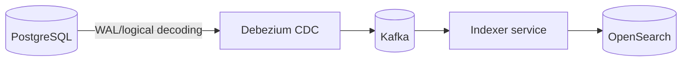

# Chọn database: SQL, NoSQL, search, OLAP, vector

**Mục đích:** có khung quyết định để chọn loại database theo mẫu truy cập và yêu cầu nhất quán, thay vì theo trào lưu; biết chi phí thật của việc dùng nhiều database.
**Liên quan:** [06-partition-sharding.md](06-partition-sharding.md) · [09-redis-chuyen-sau.md](09-redis-chuyen-sau.md) · [12-checklist-review-database.md](12-checklist-review-database.md) · Cơ bản: [../05-backend-senior/07-thiet-ke-database.md](../05-backend-senior/07-thiet-ke-database.md) · CDC/outbox: [../05-backend-senior/10-messaging-kafka.md](../05-backend-senior/10-messaging-kafka.md) · Tìm kiếm bài viết: [../05-backend-senior/05-module-bai-viet-kiem-duyet.md](../05-backend-senior/05-module-bai-viet-kiem-duyet.md)

---

## 1. Khung quyết định

Trả lời theo thứ tự:

1. **Mẫu truy cập**: đọc/ghi theo khóa? truy vấn tùy biến, join? tìm kiếm văn bản? tổng hợp trên hàng tỷ hàng? quan hệ nhiều bước (bạn của bạn)? tương tự ngữ nghĩa?
2. **Nhất quán**: cần giao dịch ACID nhiều bảng không? chấp nhận đọc dữ liệu cũ vài giây không?
3. **Quy mô thật** (đo/ước lượng): số hàng, GB, QPS đọc/ghi, tăng trưởng.
4. **Vận hành**: đội có ai vận hành được không? có bản managed không? backup/restore thế nào?
5. **Chi phí tổng**: giấy phép, hạ tầng, con người, đồng bộ dữ liệu.

Mặc định hợp lý cho hầu hết sản phẩm: **PostgreSQL làm nguồn sự thật + Redis cho cache/trạng thái tạm**. Chỉ thêm hệ thống khác khi một mẫu truy cập cụ thể mà PG phục vụ kém **đã được đo**.

PostgreSQL bao phủ rất rộng nhờ extension: JSONB (document), full-text search, `pg_trgm` (tìm gần đúng), PostGIS (địa lý), pgvector (vector), TimescaleDB (chuỗi thời gian), Citus (phân tán).

## 2. PostgreSQL vs MySQL

| Tiêu chí | PostgreSQL | MySQL (InnoDB) |
|---|---|---|
| Tính năng SQL | Rất phong phú: CTE, window, JSONB + GIN index, partial/expression index, kiểu tùy biến, `RETURNING` | Đủ cho OLTP; JSON kém linh hoạt hơn; MySQL 8 đã có CTE, window |
| MVCC | Lưu phiên bản cũ trong bảng → cần VACUUM | Undo log; không có vấn đề vacuum kiểu PG nhưng có purge lag |
| Replication | Physical streaming + logical | Binlog; hệ sinh thái sharding trưởng thành (Vitess) |
| Kết nối | Process mỗi kết nối → cần pooler | Thread mỗi kết nối → chịu nhiều kết nối hơn |
| Extension | Rất mạnh | Hạn chế |
| Khi chọn | Mặc định cho dự án mới | Đội đã thành thạo MySQL, hệ thống sẵn có, cần Vitess |

Không có lựa chọn sai lớn giữa hai cái này cho OLTP thông thường; chọn theo năng lực đội.

## 3. Các họ NoSQL

### 3.1 Document – MongoDB

- Mô hình: tài liệu JSON (BSON) lồng nhau; schema linh hoạt; có index phụ, aggregation pipeline, transaction đa tài liệu (từ 4.0, chi phí cao hơn).
- **Hợp**: dữ liệu tự nhiên dạng cây đọc/ghi nguyên khối (cấu hình đề thi với câu hỏi lồng nhau, CMS), schema thay đổi nhanh giai đoạn đầu.
- **Không hợp**: dữ liệu quan hệ nhiều chiều (user ↔ bài viết ↔ bình luận ↔ like ↔ báo cáo) — sẽ phải nhân bản dữ liệu hoặc `$lookup` liên tục.
- Với PG: JSONB thường đủ cho phần "linh hoạt", vẫn giữ join và ràng buộc cho phần còn lại.

### 3.2 Key-value – DynamoDB

- Truy cập theo partition key (+ sort key), độ trễ ổn định ở mọi quy mô, serverless, trả theo request hoặc capacity.
- **Thiết kế bắt đầu từ mẫu truy cập** (access-pattern-first): liệt kê mọi truy vấn trước, rồi thiết kế khóa; thường **single-table design** với khóa tổng hợp:

| PK | SK | Thuộc tính | Phục vụ truy vấn |
|---|---|---|---|
| `USER#123` | `PROFILE` | name, avatar | Lấy hồ sơ |
| `USER#123` | `ATTEMPT#2026-11-20T08:00#a1` | exam_id, score | Bài làm của user theo thời gian |
| `EXAM#9` | `ATTEMPT#USER#123` | score | (GSI) bài làm theo đề |

- Ưu: không vận hành, scale gần như vô hạn. Nhược: truy vấn mới chưa lường trước = thêm GSI hoặc sao chép dữ liệu; không có truy vấn tùy biến; hot partition; giới hạn item 400 KB; transaction giới hạn 100 item.
- **Hợp**: phiên, giỏ hàng, trạng thái thiết bị, dữ liệu theo user truy cập theo khóa ở quy mô rất lớn, đội đã trên AWS.

### 3.3 Wide-column – Cassandra / ScyllaDB

- Ghi cực nhanh (LSM tree), phân tán không có master, đa datacenter; nhất quán điều chỉnh theo truy vấn (`ONE`, `QUORUM`, `ALL`).
- Mô hình: một bảng cho mỗi truy vấn; partition key quyết định phân phối; không join, không giao dịch nhiều partition (LWT đắt).
- **Hợp**: khối lượng ghi khổng lồ dạng chuỗi theo khóa (tin nhắn chat, lịch sử hoạt động, IoT), cần đa vùng ghi.
- **Không hợp**: đội nhỏ, cần truy vấn tùy biến, xóa nhiều (tombstone gây chậm đọc).

### 3.4 Graph – Neo4j, Amazon Neptune

- Hợp khi truy vấn chính là duyệt quan hệ nhiều bước có độ sâu biến đổi (gợi ý "người học cùng khóa với bạn cũng học…", phát hiện gian lận theo mạng lưới).
- Với 1–2 bước, `JOIN`/`WITH RECURSIVE` trong PG thường đủ.

## 4. Search – Elasticsearch / OpenSearch

### 4.1 Khi nào cần

| Nhu cầu | PG FTS + pg_trgm | Elasticsearch/OpenSearch |
|---|---|---|
| Tìm từ khóa đơn giản, < vài chục triệu tài liệu | ✅ | Thừa |
| Xếp hạng liên quan tinh chỉnh (BM25, boosting theo trường, độ mới) | Hạn chế | ✅ |
| Tìm kiếm gần đúng, gõ sai, gợi ý (autocomplete) | `pg_trgm` cơ bản | ✅ |
| Facet/aggregation nhanh trên kết quả tìm kiếm | Chậm khi lớn | ✅ |
| Tiếng Việt có dấu/không dấu, tách từ | Phải tự cấu hình (`unaccent`) | Analyzer + plugin |
| Log, observability | ❌ | ✅ (hoặc Loki/ClickHouse) |

LearnHub: bắt đầu với PG FTS cho bài viết; chuyển sang OpenSearch khi cần xếp hạng/facet/autocomplete hoặc truy vấn tìm kiếm ảnh hưởng tải DB chính.

### 4.2 Nguyên lý

- **Inverted index**: từ → danh sách tài liệu chứa nó. Tìm nhanh theo từ; cập nhật tài liệu = đánh index lại.
- **Analyzer** = char filter → tokenizer → token filter (lowercase, bỏ dấu, stemming, synonym). Cùng analyzer khi index và khi tìm.
- Tiếng Việt: từ ghép nhiều âm tiết ("học sinh", "kiểm tra"). Lựa chọn:
  - `icu_tokenizer` + `icu_folding` (bỏ dấu) — đơn giản, tìm được "kiem tra" ra "kiểm tra".
  - Plugin tách từ tiếng Việt (ví dụ dựa trên coccoc-tokenizer) cho độ chính xác cao hơn — kiểm tra tương thích phiên bản.
  - Lưu hai trường: có dấu (khớp chính xác, điểm cao hơn) và không dấu (khớp rộng).
- Shard và replica: số primary shard cố định khi tạo index (đổi phải reindex); shard 10–50 GB là mức thường gặp.

### 4.3 Đồng bộ từ DB

| Cách | Ưu | Nhược |
|---|---|---|
| Ghi kép trong code (DB rồi ES) | Đơn giản | Lệch dữ liệu khi một bên lỗi; không nguyên tử |
| Outbox + worker | Nhất quán cuối cùng đáng tin | Thêm bảng outbox, worker |
| CDC (Debezium) | Không đổi code ghi, bắt mọi thay đổi | Vận hành Kafka Connect, replication slot (giữ WAL nếu consumer chết) |

Bắt buộc có: **reindex toàn bộ** được (từ DB) bằng index mới + alias swap; cơ chế đối soát định kỳ (đếm, checksum mẫu).

### 4.4 Anti-pattern: Elasticsearch làm nguồn sự thật

ES không có giao dịch, cập nhật gần thời gian thực (refresh ~1s), từng có lịch sử mất dữ liệu khi phân mảnh mạng, mapping khó đổi. Luôn coi nó là **index phái sinh** dựng lại được từ DB.

## 5. OLTP vs OLAP

| | OLTP (PostgreSQL, MySQL) | OLAP (ClickHouse, BigQuery, Redshift, Snowflake, DuckDB) |
|---|---|---|
| Truy vấn | Nhiều, nhỏ, theo khóa, ghi thường xuyên | Ít, lớn, quét và tổng hợp hàng tỷ hàng |
| Lưu trữ | Theo hàng | Theo cột, nén mạnh |
| Cập nhật/xóa từng hàng | Tốt | Đắt/hạn chế |
| Ví dụ LearnHub | Làm bài, đăng bài | Thống kê điểm theo trường/tỉnh/tháng, phễu hoạt động, báo cáo cho giáo viên trên mọi bài làm |

Đừng chạy báo cáo nặng trên primary OLTP. Thứ tự: replica đọc riêng cho báo cáo → khi chậm/nặng: đồng bộ (CDC hoặc ETL theo lô) sang OLAP.

- **ClickHouse**: tự vận hành hoặc cloud, cực nhanh cho tổng hợp và sự kiện; mô hình `MergeTree`, nên thiết kế cho append-only.
- **BigQuery/Snowflake**: managed, trả theo dữ liệu quét/tính toán; tiện cho đội dữ liệu; chú ý chi phí truy vấn không lọc partition.

## 6. Time-series

- **TimescaleDB** (extension PG): hypertable tự partition theo thời gian, nén, continuous aggregate. Hợp khi muốn giữ SQL/PG cho metric sản phẩm, sự kiện.
- Metric hạ tầng: Prometheus/VictoriaMetrics/Mimir — đừng tự lưu metric hạ tầng vào OLTP.

## 7. Vector search

Dùng cho tìm kiếm ngữ nghĩa, gợi ý bài viết tương tự, RAG trên tài liệu học tập.

| | pgvector (PG) | DB vector chuyên dụng (Qdrant, Milvus, Weaviate, Pinecone) / OpenSearch k-NN |
|---|---|---|
| Quy mô hợp lý | Tới vài chục triệu vector (HNSW) | Hàng trăm triệu – tỷ |
| Lọc kết hợp với dữ liệu quan hệ (quyền, tenant) | ✅ cùng truy vấn SQL, cùng giao dịch | Phải đồng bộ metadata; lọc tùy hệ thống |
| Vận hành | Không thêm hệ thống | Thêm hệ thống |
| Ghi chú | Index HNSW tốn RAM và thời gian build; `ef_search` đánh đổi độ chính xác/tốc độ; lọc sau ANN có thể trả thiếu kết quả (pgvector 0.8 có iterative scan) | Tối ưu cho ANN, sharding sẵn |

Khởi đầu với pgvector; chuyển khi quy mô hoặc độ trễ đo được không đạt.

## 8. CAP và PACELC – hiểu thực tế

- **CAP**: khi có **phân mảnh mạng (P)**, hệ phân tán phải chọn **nhất quán (C)** (từ chối một số request) hoặc **sẵn sàng (A)** (trả lời có thể sai/cũ). Không có "chọn 2 trong 3" lúc bình thường — P không phải lựa chọn.
- **PACELC**: nếu Partition thì A hoặc C; **Else** (bình thường) thì đánh đổi **Latency** hay **Consistency**. Ví dụ: replication đồng bộ (C, trễ cao) vs bất đồng bộ (trễ thấp, replica đọc có thể cũ).

| Hệ thống | Hành vi điển hình |
|---|---|
| PostgreSQL primary + replica async | Ghi C trên primary; đọc replica có thể cũ (EL) |
| PG với `synchronous_commit = remote_apply` | Đọc replica nhất quán hơn, ghi chậm hơn (EC) |
| DynamoDB | Mặc định đọc nhất quán cuối cùng; có tùy chọn strongly consistent read (đắt gấp đôi) |
| Cassandra | Tùy chỉnh mỗi truy vấn (`QUORUM` đọc + ghi → nhất quán mạnh hơn) |
| Spanner/CockroachDB | Ưu tiên C (và đánh đổi latency) |

Hệ quả cho code: **đọc-sau-khi-ghi** của chính user (vừa sửa hồ sơ rồi tải lại trang) phải đọc từ primary hoặc có cơ chế "dính" vào primary trong vài giây; dữ liệu công khai đọc từ replica/cache.

## 9. Polyglot persistence – chi phí thật

Mỗi hệ thống thêm vào đồng nghĩa:
- Một cách sao lưu/khôi phục, giám sát, nâng cấp, bảo mật, phân quyền riêng.
- Một đường đồng bộ dữ liệu có thể lệch, và việc đối soát.
- Kiến thức chuyên môn mà ai đó trực đêm phải có.
- Thêm điểm lỗi trong luồng request.

Quy tắc: **thêm hệ thống mới cần một ADR** (xem [../04-mau/adr-template.md](../04-mau/adr-template.md)) nêu mẫu truy cập, số liệu PG không đáp ứng, nguồn sự thật, cách đồng bộ, cách dựng lại, người vận hành.

## 10. Bản đồ LearnHub

| Dữ liệu / chức năng | Lưu ở | Lý do |
|---|---|---|
| User, bài viết, bình luận, đề thi, bài làm, điểm | PostgreSQL (nguồn sự thật) | Quan hệ, giao dịch, ràng buộc |
| Câu trả lời (`answers`) | PostgreSQL, partition theo tháng | Khối lượng lớn, truy cập theo attempt và thời gian |
| Cấu hình đề thi phức tạp, lồng nhau | PG JSONB trong bảng `exams` | Đọc nguyên khối, vẫn ở cùng giao dịch |
| Phiên, rate limit, bộ đếm tạm, bảng xếp hạng | Redis | Tốc độ, mất được/dựng lại được |
| Tìm kiếm bài viết | PG FTS → OpenSearch khi cần | Bắt đầu đơn giản |
| Ảnh, file đính kèm, bài nộp dạng file | Object storage (S3) | Không lưu blob lớn trong DB |
| Sự kiện hoạt động, thống kê | Kafka → ClickHouse/BigQuery | Tổng hợp lớn, không ảnh hưởng OLTP |
| Bài viết liên quan, tìm kiếm ngữ nghĩa | pgvector | Lọc theo quyền cùng truy vấn |
| Metric/log hạ tầng | Prometheus, Loki/OpenSearch | Công cụ chuyên dụng |

## 11. Anti-pattern

- **MongoDB cho dữ liệu quan hệ** vì "không cần schema" → schema ẩn trong code, nhân bản dữ liệu, mất tính toàn vẹn.
- **Elasticsearch làm DB chính.**
- **Redis làm DB chính** cho dữ liệu không được mất.
- **Thêm Cassandra/DynamoDB** khi chưa có mẫu truy cập cố định → mỗi tính năng mới phải sao chép dữ liệu.
- **Lưu file/blob lớn trong PG** (bytea vài MB mỗi hàng) → backup chậm, replica trễ.
- **Báo cáo trên primary.**
- **Dùng microservices = mỗi service một loại DB** chỉ để "đúng mô hình".
- Agent đề xuất công nghệ mới mà không nêu mẫu truy cập, số liệu, và cách vận hành.

## Checklist review

- [ ] Có danh sách mẫu truy cập và yêu cầu nhất quán trước khi chọn DB.
- [ ] Có số liệu cho thấy PostgreSQL (kèm extension) không đáp ứng trước khi thêm hệ thống mới.
- [ ] Nguồn sự thật cho mỗi loại dữ liệu là duy nhất và được ghi rõ.
- [ ] Hệ thống phái sinh (search, cache, OLAP) dựng lại được hoàn toàn từ nguồn; có đối soát.
- [ ] Đồng bộ dùng outbox/CDC, không ghi kép rời rạc.
- [ ] Đọc-sau-khi-ghi của người dùng không bị ảnh hưởng bởi replica/hệ thống phái sinh trễ.
- [ ] Có ADR cho mỗi hệ thống lưu trữ mới: vận hành, backup, giám sát, người phụ trách, chi phí.
- [ ] Mô hình NoSQL được thiết kế từ mẫu truy cập (khóa, GSI), đã xét hot partition và giới hạn kích thước.
- [ ] Analyzer tìm kiếm phù hợp tiếng Việt (có dấu/không dấu).
- [ ] Không chạy truy vấn phân tích nặng trên OLTP primary.
