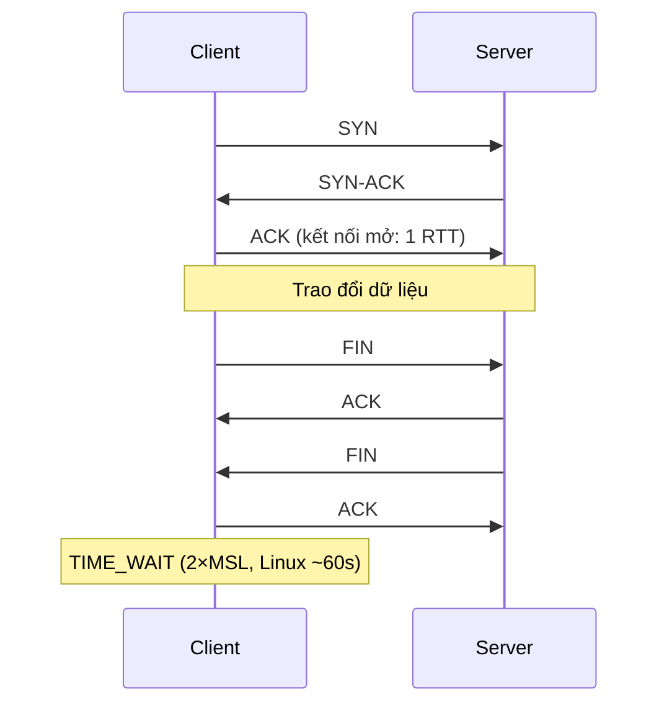
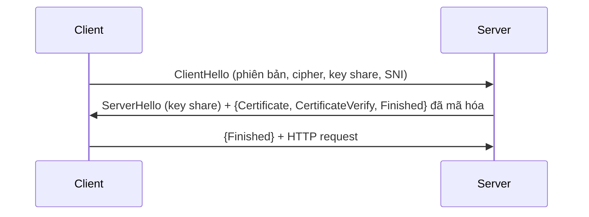

# Mạng cho kỹ sư backend

**Mục đích:** hiểu đủ sâu về TCP, DNS, TLS, HTTP, địa chỉ IP và CDN để thiết kế, cấu hình và chẩn đoán lỗi kết nối của LearnHub thay vì đoán mò.
**Liên quan:** [01-linux-server.md](01-linux-server.md) · [03-load-balancer-reverse-proxy.md](03-load-balancer-reverse-proxy.md) · [07-cloud-kien-truc.md](07-cloud-kien-truc.md) · [08-xu-ly-su-co-production.md](08-xu-ly-su-co-production.md) · [../05-backend-senior/09-scale-trieu-user.md](../05-backend-senior/09-scale-trieu-user.md)

---

## 1. Mô hình lớp trong thực tế

| Lớp (TCP/IP) | Giao thức | Thiết bị/thành phần LearnHub | Lỗi điển hình |
|---|---|---|---|
| Ứng dụng (L7) | HTTP, gRPC, WebSocket, DNS | API Node, Nginx, ALB | 4xx/5xx, timeout ứng dụng |
| Bảo mật | TLS | Nginx/ALB terminate TLS | Chứng chỉ hết hạn, sai chuỗi, sai SNI |
| Giao vận (L4) | TCP, UDP (QUIC) | NLB, kết nối DB | Connection refused, reset, timeout |
| Mạng (L3) | IP, ICMP | Route table, subnet, NAT | Không có route, security group chặn |
| Liên kết (L2) | Ethernet, ARP | Hạ tầng cloud | Hiếm khi do bạn xử lý trên cloud |

Phân biệt lỗi theo lớp giúp đi đúng hướng:
- `Connection refused` → máy có tới, nhưng không có process lắng nghe cổng đó (hoặc lắng nghe trên 127.0.0.1).
- `Connection timed out` → gói tin bị rơi: tường lửa/security group, route sai, máy đích chết.
- `Connection reset by peer` → phía bên kia đóng đột ngột (process crash, LB timeout idle, proxy giết kết nối).
- `502 Bad Gateway` → proxy tới được upstream nhưng nhận phản hồi hỏng/bị đóng. `504` → upstream không trả lời kịp.

## 2. TCP

### Bắt tay và đóng kết nối



- Mỗi kết nối mới tốn 1 RTT cho TCP + 1 RTT cho TLS 1.3 trước khi gửi request. Từ Việt Nam tới Singapore RTT ~30–50 ms → kết nối mới tốn ~100 ms. **Tái sử dụng kết nối (keep-alive, pool)** là tối ưu hiệu năng rẻ nhất.
- **TIME_WAIT** nằm ở phía **chủ động đóng**. Proxy mở/đóng hàng nghìn kết nối tới upstream mỗi giây → hàng chục nghìn socket TIME_WAIT → hết cổng nguồn. Sửa: keep-alive upstream ([03-load-balancer-reverse-proxy.md](03-load-balancer-reverse-proxy.md)).
- **Keep-alive HTTP** (tái sử dụng kết nối) khác **TCP keepalive** (gói thăm dò để phát hiện kết nối chết, mặc định Linux sau 2 giờ). Kết nối DB qua NAT/LB có idle timeout (AWS NLB 350 s) → bật TCP keepalive ngắn hơn trong driver để kết nối không bị cắt âm thầm.
- **Nagle**: gom gói nhỏ, gây trễ khi kết hợp với delayed ACK. Hầu hết runtime server hiện đại bật `TCP_NODELAY` cho HTTP (Node `http.createServer` có tùy chọn `noDelay`, mặc định bật ở các bản LTS hiện hành — kiểm tra tài liệu đúng phiên bản bạn dùng). Gặp độ trễ bất thường quanh 40 ms giữa các gói nhỏ thì nghi Nagle + delayed ACK.
- Retransmit: `ss -ti` (cột `retrans`), `nstat -az TcpRetransSegs`. Tỷ lệ retransmit cao = mạng mất gói.

### Trạng thái cần nhận biết (`ss -tan state <state>`)

| Trạng thái | Nhiều bất thường nghĩa là |
|---|---|
| `SYN-RECV` | Hàng đợi bắt tay đầy, có thể SYN flood |
| `ESTABLISHED` | Số kết nối thực; so với pool size |
| `CLOSE-WAIT` | **Ứng dụng không đóng socket** sau khi bên kia đóng → rò rỉ, lỗi code |
| `TIME-WAIT` | Đóng chủ động nhiều; thiếu keep-alive |

## 3. DNS

### Bản ghi

| Loại | Dùng cho | Ví dụ LearnHub |
|---|---|---|
| A / AAAA | Tên → IPv4 / IPv6 | `api.learnhub.example` → IP của LB |
| CNAME | Bí danh tới tên khác (không đặt ở apex) | `cdn.learnhub.example` → tên miền CDN |
| ALIAS/ANAME | Như CNAME nhưng dùng được ở apex (tính năng nhà cung cấp DNS) | `learnhub.example` → ALB |
| MX | Máy chủ thư | |
| TXT | SPF, DKIM, DMARC, xác minh domain, ACME DNS-01 | |
| CAA | CA nào được cấp chứng chỉ cho domain | `0 issue "letsencrypt.org"` |
| NS | Máy chủ DNS có thẩm quyền | |
| SRV | Dịch vụ + cổng | Hiếm dùng cho web |

### Chuỗi phân giải

App → resolver cục bộ (systemd-resolved, cache) → resolver đệ quy (của cloud/ISP) → root → TLD (`.example`) → máy chủ có thẩm quyền → trả lời kèm **TTL** → mọi tầng cache theo TTL.

- **TTL là công cụ di chuyển:** trước khi đổi IP/chuyển nhà cung cấp, hạ TTL xuống 60 s **trước ít nhất một TTL cũ**; xong rồi nâng lại (300–3600 s).
- Cache âm (NXDOMAIN) cũng có TTL (theo SOA) → tạo bản ghi sau khi đã có người tra cứu có thể chưa thấy ngay.
- Runtime cũng cache: JVM cache DNS (có khi vĩnh viễn với security manager); Node `dns.lookup` dùng `getaddrinfo` của hệ điều hành, không tự cache, và chạy trong thread pool libuv (4 luồng) → DNS chậm làm nghẽn cả I/O file/crypto.

### DNS gây sự cố

"It's always DNS": hết hạn domain, xóa nhầm bản ghi, TTL dài khi cần chuyển đổi khẩn, resolver nội bộ quá tải, giới hạn truy vấn của resolver cloud (ví dụ AWS VPC resolver giới hạn gói/giây mỗi ENI). Giảm thiểu: cache DNS cục bộ, theo dõi thời gian phân giải, bật tự gia hạn domain, khóa domain (registrar lock).

## 4. TLS

### TLS 1.3 handshake (1 RTT)



- TLS 1.2 cần 2 RTT; TLS 1.3 cần 1 RTT; nối lại phiên với 0-RTT có thể 0 RTT nhưng **dữ liệu 0-RTT có thể bị replay** → chỉ cho request idempotent (GET), hoặc tắt.
- Cấu hình hiện nay: chỉ TLS 1.2 và 1.3, tắt 1.0/1.1; dùng cấu hình "Intermediate" của Mozilla SSL Configuration Generator.
- **SNI**: client gửi tên miền trong ClientHello để server chọn chứng chỉ đúng khi nhiều domain chung IP. `curl` tới IP trực tiếp → sai chứng chỉ.

### Chứng chỉ và chuỗi

- Server phải gửi **chứng chỉ lá + chứng chỉ trung gian** (fullchain). Thiếu trung gian: trình duyệt có thể vẫn chạy (tự tải), nhưng client Node/Java/mobile báo lỗi `unable to verify the first certificate`.
- Kiểm tra: `openssl s_client -connect api.learnhub.example:443 -servername api.learnhub.example -showcerts </dev/null`.
- **Let's Encrypt / ACME**: chứng chỉ ngắn hạn (90 ngày, và CA/B Forum đang rút dần thời hạn tối đa của mọi chứng chỉ công khai xuống còn 47 ngày vào năm 2029) → **tự động gia hạn là bắt buộc**. `certbot renew` chạy qua systemd timer; với nhiều máy/wildcard dùng DNS-01. Trên cloud, dùng chứng chỉ quản lý (AWS ACM, GCP managed cert) gắn vào LB.
- Giám sát ngày hết hạn từ bên ngoài, cảnh báo trước 21 ngày. Chứng chỉ hết hạn là một trong những nguyên nhân sự cố phổ biến nhất và hoàn toàn tránh được.
- Chứng chỉ nội bộ do CA công ty ký (repo này có `company-ca.pem`): thêm vào trust store của runtime (`NODE_EXTRA_CA_CERTS`), **không** tắt kiểm tra (`NODE_TLS_REJECT_UNAUTHORIZED=0` là lỗi bảo mật nghiêm trọng mà agent hay đề xuất).

### mTLS

Cả hai bên trình chứng chỉ. Dùng cho service-to-service (service mesh tự cấp và xoay vòng chứng chỉ), webhook từ đối tác, thiết bị. Chi phí: vận hành CA, xoay vòng, thu hồi.

## 5. HTTP/1.1, HTTP/2, HTTP/3

| | HTTP/1.1 | HTTP/2 | HTTP/3 |
|---|---|---|---|
| Vận chuyển | TCP | TCP | QUIC (UDP) |
| Đa luồng trên 1 kết nối | Không (1 request/lần mỗi kết nối; trình duyệt mở ~6 kết nối/host) | Có (multiplexing) | Có |
| Head-of-line blocking | Mức HTTP | Mức TCP (mất 1 gói chặn mọi stream) | Không (mỗi stream độc lập) |
| Nén header | Không | HPACK | QPACK |
| Lợi thế | Đơn giản, mọi thứ hỗ trợ | Ít kết nối, nhanh hơn cho trang nhiều tài nguyên | Mạng di động/mất gói, đổi mạng không đứt kết nối |
| Lưu ý | | gRPC yêu cầu HTTP/2 | UDP 443 phải mở; một số mạng doanh nghiệp chặn UDP → fallback |

Thực tế: bật HTTP/2 (và HTTP/3 nếu CDN/LB hỗ trợ) ở **cạnh** (CDN/LB ↔ người dùng). Giữa LB và backend thường HTTP/1.1 keep-alive là đủ, trừ gRPC.

## 6. Realtime: WebSocket và SSE

| | WebSocket | Server-Sent Events | Long polling |
|---|---|---|---|
| Hướng | Hai chiều | Server → client | Giả lập |
| Giao thức | Nâng cấp từ HTTP (`Upgrade: websocket`) | HTTP thường, `text/event-stream` | HTTP |
| Tự kết nối lại | Tự viết | Có sẵn trong trình duyệt (`EventSource`, `Last-Event-ID`) | Tự viết |
| Dùng ở LearnHub | Chat lớp học, làm bài cộng tác | Thông báo, tiến độ chấm bài | Môi trường chặn hai loại trên |

Ảnh hưởng tới hạ tầng:
- **Kết nối sống lâu**: 200k người dùng đồng thời mở WebSocket = 200k kết nối giữ trên LB và server → cần fd, RAM (~vài–vài chục KB/kết nối), cấu hình idle timeout LB (ALB mặc định 60 s → gửi ping/heartbeat < 60 s).
- **Deploy làm rớt kết nối** → client phải kết nối lại có backoff + jitter, nếu không khi deploy 200k client kết nối lại cùng lúc (thundering herd).
- **Nhiều instance**: tin nhắn gửi tới user ở instance khác → cần pub/sub (Redis Pub/Sub, NATS, Kafka) giữa các instance. Không dựa vào sticky session để giải bài toán này.
- Proxy phải chuyển header `Upgrade`/`Connection` (xem cấu hình Nginx ở file 03).

## 7. Địa chỉ IP, NAT, CIDR

- **IP riêng** (RFC 1918): `10.0.0.0/8`, `172.16.0.0/12`, `192.168.0.0/16` — không định tuyến trên Internet.
- **NAT**: máy riêng đi ra Internet qua NAT gateway (một hoặc vài IP công khai). Hệ quả: đối tác whitelist IP NAT của bạn; NAT có giới hạn kết nối đồng thời tới cùng một đích (AWS NAT Gateway ~55.000 kết nối đồng thời tới mỗi đích duy nhất) và tốn phí theo GB.
- **CIDR**: `/n` = n bit đầu là mạng. Số địa chỉ = 2^(32−n). Cloud giữ lại một số địa chỉ mỗi subnet (AWS giữ 5).

### Ví dụ chia subnet cho LearnHub

VPC `10.20.0.0/16` (65.536 địa chỉ), 3 vùng sẵn sàng (AZ), mỗi AZ 3 tầng:

| Tầng | AZ-a | AZ-b | AZ-c | Kích thước |
|---|---|---|---|---|
| Public (LB, NAT) | 10.20.0.0/24 | 10.20.1.0/24 | 10.20.2.0/24 | 256 (251 dùng được) |
| Private app (API, pod) | 10.20.32.0/19 | 10.20.64.0/19 | 10.20.96.0/19 | 8.192 — đủ cho pod Kubernetes nhận IP VPC |
| Private data (DB, Redis) | 10.20.10.0/24 | 10.20.11.0/24 | 10.20.12.0/24 | 256 |

Nguyên tắc: để chừa khoảng trống cho tương lai; **không trùng dải** với VPN văn phòng, VPC khác sẽ peering (đổi CIDR VPC sau này rất đau đớn); subnet cho Kubernetes cần lớn hơn bạn nghĩ.

## 8. Con số độ trễ cần thuộc (xấp xỉ)

| Thao tác | Thời gian |
|---|---|
| Truy cập RAM | ~100 ns |
| Đọc 1 MB tuần tự từ RAM | ~10–50 µs |
| Đọc ngẫu nhiên SSD NVMe | ~20–100 µs |
| Round trip trong cùng AZ | ~0,1–0,5 ms |
| Round trip giữa các AZ cùng region | ~0,5–2 ms |
| Redis GET trong cùng AZ | ~0,2–1 ms |
| Truy vấn PostgreSQL đơn giản có index | ~0,5–5 ms |
| Hà Nội ↔ TP.HCM | ~15–25 ms |
| Việt Nam ↔ Singapore | ~30–50 ms |
| Việt Nam ↔ Tokyo | ~50–80 ms |
| Việt Nam ↔ Mỹ (bờ Tây) | ~150–200 ms |

Hệ quả: một API gọi tuần tự 20 truy vấn DB cách nhau 1 ms = 20 ms chỉ cho mạng. Đặt app và DB cùng region; gom truy vấn; tránh N+1. Đặt region gần người dùng (Singapore cho người dùng Việt Nam nếu không có region trong nước phù hợp yêu cầu lưu trữ dữ liệu).

## 9. CDN

- Phục vụ tài nguyên tĩnh (JS, CSS, ảnh, video bài giảng) từ máy gần người dùng; giảm tải origin.
- **Cache key** mặc định thường là host + path + query. Thêm header/cookie vào cache key làm tỷ lệ trúng cache giảm mạnh; bỏ query không liên quan (`utm_*`).
- **Đặt tên file theo hash nội dung** (`app.3f9a2c.js`) + `Cache-Control: public, max-age=31536000, immutable` → không bao giờ cần purge.
- HTML/API: `Cache-Control: no-store` hoặc TTL ngắn; **không bao giờ cache phản hồi có dữ liệu cá nhân dưới khóa dùng chung** (sự cố kinh điển: người A thấy trang hồ sơ của người B). Kiểm tra `Vary`, `Cache-Control: private`, cookie.
- Purge: theo URL/tag; có độ trễ lan truyền; không dựa vào purge cho tính đúng đắn.
- Ảnh/bài nộp riêng tư: dùng **signed URL** có hạn ngắn, không để công khai.
- CDN cũng che IP origin và hấp thụ DDoS lớp 3/4; chỉ cho origin nhận traffic từ dải IP của CDN.

## 10. Công cụ chẩn đoán

```bash
# DNS
dig api.learnhub.example +short
dig api.learnhub.example @1.1.1.1          # so với resolver khác
dig +trace api.learnhub.example            # đi từ root xuống
resolvectl query api.learnhub.example      # resolver cục bộ của systemd

# HTTP + phân rã thời gian
curl -sv -o /dev/null https://api.learnhub.example/health
curl -s -o /dev/null -w 'dns=%{time_namelookup} tcp=%{time_connect} tls=%{time_appconnect} ttfb=%{time_starttransfer} total=%{time_total}\n' \
  https://api.learnhub.example/health
curl --resolve api.learnhub.example:443:10.20.0.15 https://api.learnhub.example/health   # ép IP, giữ SNI đúng

# Đường đi và mất gói
mtr -rwzc 100 api.learnhub.example

# Cổng có mở không
nc -vz db.internal 5432
ss -ltnp                                     # trên máy đích: ai đang lắng nghe

# TLS
openssl s_client -connect api.learnhub.example:443 -servername api.learnhub.example </dev/null 2>/dev/null \
  | openssl x509 -noout -subject -issuer -dates

# Bắt gói (cần quyền, dùng có thời hạn, không lưu dữ liệu nhạy cảm lâu)
sudo tcpdump -i any -nn port 5432 -c 200
sudo tcpdump -i any -nn 'tcp[tcpflags] & (tcp-rst) != 0'   # chỉ gói RST
```

Đọc phân rã `curl -w`: `dns` cao → DNS; `tcp − dns` cao → mạng/RTT/hàng đợi SYN; `tls − tcp` cao → TLS (OCSP, chuỗi dài, CPU); `ttfb − tls` cao → **ứng dụng/backend chậm**.

## 11. Lỗi hay gặp (kể cả do agent đề xuất)

| Lỗi | Hậu quả | Đúng |
|---|---|---|
| `NODE_TLS_REJECT_UNAUTHORIZED=0` / `verify=False` để "sửa" lỗi chứng chỉ | Mất bảo vệ chống MITM | Thêm CA vào trust store, sửa fullchain |
| App lắng nghe `127.0.0.1` trong container | LB nhận `connection refused` | Lắng nghe `0.0.0.0` trong container, giới hạn bằng mạng/security group |
| Không keep-alive giữa proxy và upstream | TIME_WAIT, hết cổng, tăng độ trễ | Keepalive pool |
| Idle timeout LB < timeout keep-alive của app | 502 lẻ tẻ khó tái hiện | Keep-alive timeout của app **lớn hơn** idle timeout của LB |
| Hardcode IP thay vì tên DNS | Đổi hạ tầng là hỏng | Dùng tên, TTL hợp lý |
| Cache API có dữ liệu người dùng ở CDN | Lộ dữ liệu chéo người dùng | `private`/`no-store`, cache key đúng |
| Mở `0.0.0.0/0` trong security group "để test" rồi quên | Lộ dịch vụ | Mở theo nguồn cụ thể, có hạn, IaC review |

## Checklist review

- [ ] TLS chỉ 1.2/1.3; fullchain; tự động gia hạn; giám sát hết hạn từ bên ngoài; có bản ghi CAA.
- [ ] Không có tắt kiểm tra chứng chỉ ở bất kỳ client nào (`rejectUnauthorized: false`, `NODE_TLS_REJECT_UNAUTHORIZED=0`, `-k` trong script production).
- [ ] Keep-alive giữa mọi tầng; timeout tầng trong < tầng ngoài nhất quán (client > LB > proxy > app > DB).
- [ ] DNS: TTL phù hợp; kế hoạch hạ TTL trước di chuyển; domain tự gia hạn và khóa.
- [ ] Dải CIDR không trùng với mạng khác sẽ kết nối; subnet đủ lớn cho Kubernetes.
- [ ] DB/Redis chỉ ở subnet riêng, không IP công khai.
- [ ] WebSocket/SSE: heartbeat < idle timeout LB; client reconnect có backoff + jitter; có pub/sub giữa instance.
- [ ] CDN: tài nguyên tĩnh có hash + `immutable`; API cá nhân không bị cache chung; origin chỉ nhận từ CDN/LB.
- [ ] Tài nguyên riêng tư dùng signed URL có hạn.
- [ ] Security group không có `0.0.0.0/0` ngoài 80/443 trên LB.
