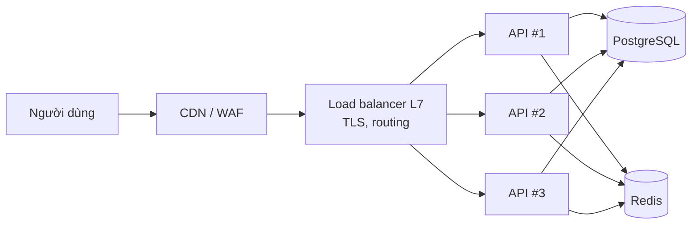

# Load balancer và reverse proxy

**Mục đích:** chọn và cấu hình đúng lớp cân bằng tải/proxy đứng trước API LearnHub: thuật toán, health check, draining, TLS, Nginx production, khi nào dùng HAProxy/Envoy/LB của cloud/API gateway, và các lỗi cấu hình gây 502/504.
**Liên quan:** [01-linux-server.md](01-linux-server.md) · [02-mang-network.md](02-mang-network.md) · [05-kubernetes.md](05-kubernetes.md) · [07-cloud-kien-truc.md](07-cloud-kien-truc.md) · [08-xu-ly-su-co-production.md](08-xu-ly-su-co-production.md) · [../05-backend-senior/09-scale-trieu-user.md](../05-backend-senior/09-scale-trieu-user.md)

---

## 1. Vai trò



Một reverse proxy/LB làm: phân phối tải, loại bỏ instance hỏng, terminate TLS, định tuyến theo host/path, giới hạn tốc độ, nén, đệm request/response chậm, ẩn cấu trúc nội bộ, gắn header (`X-Request-Id`, `X-Forwarded-*`).

### 1.1 Mô hình ẩn IP Origin Server & Đường đi request đầy đủ

Để người ngoài không bao giờ dò ra IP thật của VPS hoặc chạm trực tiếp vào cổng Node.js (`3001`) / PostgreSQL (`5432`), kết hợp Firewall + Reverse Proxy + Proxy DNS:

```text
[Trình duyệt Học sinh]  (Chỉ thấy: https://learnhub.vn/api/...)
       │
       ▼
[1. Cloudflare (WAF + Proxy DNS)]  ──► Ẩn IP thật của VPS; chặn DDoS/Bot
       │  (Firewall VPS chỉ mở port 443 cho dải IP Cloudflare; ĐÓNG port 3001 & 5432)
       ▼
[2. Nginx Reverse Proxy]           ──► Chặn /.git, /.env; ẩn server_tokens; gắn X-Request-Id
       │  (proxy_pass http://127.0.0.1:3001)
       ▼
[3. Node.js Express (:3001)]       ──► Lắng nghe 127.0.0.1, không mở ra Internet
       │
       ▼
[4. PostgreSQL (:5432)]            ──► Lắng nghe 127.0.0.1 / Private VPC
```

Xem chi tiết luồng xử lý bên trong ứng dụng và database tại [../05-backend-senior/00-request-lifecycle-tu-trinh-duyet-den-db.md](../05-backend-senior/00-request-lifecycle-tu-trinh-duyet-den-db.md).

## 2. L4 và L7

| | L4 (TCP/UDP) | L7 (HTTP) |
|---|---|---|
| Nhìn thấy | IP, cổng | URL, header, cookie, method |
| Ví dụ | AWS NLB, HAProxy mode tcp, LVS | AWS ALB, Nginx, HAProxy mode http, Envoy |
| Định tuyến theo path/host | Không | Có |
| TLS | Passthrough hoặc terminate (NLB có TLS listener) | Terminate, đọc nội dung |
| Hiệu năng/độ trễ | Cao hơn, ít xử lý | Thấp hơn chút, nhiều tính năng |
| Cân bằng theo | Kết nối | Từng request (quan trọng với HTTP/2, gRPC — 1 kết nối nhiều request) |
| Dùng cho LearnHub | DB proxy, kết nối TCP thuần, IP tĩnh, hiệu năng cực cao | API, WebSocket, web |

**Bẫy gRPC/HTTP2 sau L4:** client giữ 1 kết nối lâu dài → L4 dồn toàn bộ tải của client đó vào một backend. Dùng LB L7 hiểu HTTP/2 hoặc cân bằng phía client.

## 3. Thuật toán cân bằng

| Thuật toán | Cách làm | Dùng khi | Không dùng khi |
|---|---|---|---|
| Round robin | Lần lượt | Request đồng đều, backend giống nhau | Thời gian xử lý chênh lệch lớn |
| Weighted RR | Theo trọng số | Backend cấu hình khác nhau; canary 5% | |
| Least connections | Chọn backend ít kết nối đang mở nhất | Request dài ngắn khác nhau, WebSocket | |
| Least request / EWMA / P2C | Chọn ngẫu nhiên 2, lấy cái tốt hơn theo độ trễ/request đang chạy (Envoy, Linkerd) | Quy mô lớn, backend có lúc chậm | Cần đơn giản, dễ giải thích |
| IP hash / consistent hashing | Cùng khóa → cùng backend; thêm/bớt node chỉ dịch chuyển ~1/N khóa | Cache cục bộ theo khóa, sharding | API stateless (gây lệch tải) |

Mặc định cho API stateless của LearnHub: **least connections** hoặc **least request**.

## 4. Health check

| Loại | Cách | Ưu/nhược |
|---|---|---|
| Active | LB gọi `/health` định kỳ | Phát hiện cả khi không có traffic; thêm tải nhỏ |
| Passive (outlier detection) | Đếm lỗi thực của request (5xx, timeout) để loại backend | Phản ứng theo lỗi thật; cần traffic |

Thiết kế endpoint:
- **Liveness** (`/livez`): process còn sống, event loop phản hồi. **Không** kiểm tra DB — nếu DB chết mà liveness fail, orchestrator restart toàn bộ app vô ích → bão restart.
- **Readiness** (`/readyz`): sẵn sàng nhận traffic (đã warm-up, pool DB có kết nối, không đang shutdown). LB/Kubernetes dùng cái này để đưa vào/rút ra.
- Rẻ, nhanh (< 50 ms), không yêu cầu xác thực nhưng không lộ thông tin nội bộ (phiên bản, chuỗi kết nối).
- Ngưỡng: ví dụ 3 lần lỗi liên tiếp mới loại, 2 lần thành công mới đưa lại — tránh dao động.

## 5. Connection draining và deploy không rớt request

Khi rút một instance (deploy, scale in):
1. Instance nhận SIGTERM → readiness trả 503.
2. LB ngừng gửi request mới (sau 1–2 chu kỳ health check hoặc qua API deregister).
3. Request đang chạy hoàn tất trong thời gian draining (AWS: `deregistration_delay`, mặc định 300 s — với API nên giảm xuống 30–60 s; với WebSocket cân nhắc thời gian dài hơn và cho client reconnect).
4. Instance thoát.

Nếu app thoát ngay khi nhận SIGTERM → request đang chạy bị cắt → 502 mỗi lần deploy. Trên Kubernetes thường cần thêm `preStop` sleep vài giây vì endpoint được gỡ bất đồng bộ (xem [05-kubernetes.md](05-kubernetes.md)).

## 6. Sticky session – vì sao tránh

Sticky = gắn client vào một backend (cookie LB, IP hash).

| Vấn đề | Hệ quả |
|---|---|
| Lệch tải | Một backend "nóng", autoscale không giúp |
| Instance chết = mất phiên | Người dùng bị đăng xuất / mất bài đang làm |
| Deploy/scale in phá phiên | |
| Che giấu thiết kế stateful | Khó mở rộng về sau |

Làm đúng: app **stateless**, phiên ở Redis/DB hoặc token ([../05-backend-senior/02-session-token.md](../05-backend-senior/02-session-token.md)), file ở object storage. Chấp nhận sticky chỉ khi có lý do kỹ thuật cụ thể (ví dụ fallback long polling của Socket.IO cần sticky) và đã hiểu cái giá.

## 7. TLS: terminate, re-encrypt, passthrough

| Mô hình | Mô tả | Khi nào |
|---|---|---|
| Terminate ở LB | LB giải mã, gửi HTTP thường tới backend trong mạng riêng | Phổ biến; LB đọc được HTTP để định tuyến, WAF |
| Terminate + re-encrypt | LB giải mã rồi mã hóa lại tới backend | Yêu cầu tuân thủ "mã hóa mọi chặng"; zero-trust |
| Passthrough | LB L4 chuyển nguyên gói TLS, backend giải mã | Cần mTLS đầu-cuối với client; LB không được thấy nội dung |

## 8. Nginx reverse proxy cho LearnHub (có chú thích)

`/etc/nginx/nginx.conf` (rút gọn phần liên quan):

```nginx
user  www-data;
worker_processes auto;                 # = số core
worker_rlimit_nofile 65536;

events {
    worker_connections 16384;          # mỗi kết nối proxy tốn 2 fd (client + upstream)
}

http {
    server_tokens off;                 # không lộ phiên bản Nginx
    sendfile on;
    tcp_nopush on;
    keepalive_timeout 65s;             # phía client
    client_max_body_size 10m;          # mặc định 1m; upload lớn nên đi thẳng object storage bằng presigned URL
    client_body_timeout 15s;           # chống client gửi chậm (slowloris)
    client_header_timeout 15s;

    # IP thật khi đứng sau CDN/LB: CHỈ tin header từ dải IP của LB/CDN
    set_real_ip_from 10.20.0.0/22;     # subnet public chứa LB
    real_ip_header X-Forwarded-For;
    real_ip_recursive on;

    # Định dạng log JSON, có request id và thời gian upstream
    log_format json escape=json '{"time":"$time_iso8601","rid":"$request_id","ip":"$remote_addr",'
        '"method":"$request_method","uri":"$uri","status":$status,"bytes":$body_bytes_sent,'
        '"rt":$request_time,"urt":"$upstream_response_time","ua":"$http_user_agent"}';
    access_log /var/log/nginx/access.log json;
    # Lưu ý: dùng $uri thay vì $request_uri để không ghi query string (có thể chứa token)

    gzip on;
    gzip_types application/json text/css application/javascript image/svg+xml;
    gzip_min_length 1024;
    # brotli cần module ngoài (ngx_brotli); thường để CDN nén

    # Rate limit: khóa theo IP thật
    limit_req_zone $binary_remote_addr zone=api:20m   rate=20r/s;
    limit_req_zone $binary_remote_addr zone=login:10m rate=5r/m;
    limit_req_status 429;

    # Nâng cấp WebSocket
    map $http_upgrade $connection_upgrade {
        default upgrade;
        ''      '';                    # không có Upgrade → để trống để giữ keep-alive upstream
    }

    upstream learnhub_api {
        least_conn;
        server 10.20.32.11:3000 max_fails=3 fail_timeout=10s;
        server 10.20.64.11:3000 max_fails=3 fail_timeout=10s;
        server 10.20.96.11:3000 max_fails=3 fail_timeout=10s;
        keepalive 64;                  # pool kết nối nhàn rỗi tới upstream MỖI worker
        keepalive_timeout 50s;         # nhỏ hơn keep-alive timeout của Node (đặt Node 65s)
    }

    server {
        listen 80;
        server_name api.learnhub.example;
        return 301 https://$host$request_uri;
    }

    server {
        listen 443 ssl backlog=4096;
        http2 on;
        server_name api.learnhub.example;

        ssl_certificate     /etc/letsencrypt/live/api.learnhub.example/fullchain.pem;
        ssl_certificate_key /etc/letsencrypt/live/api.learnhub.example/privkey.pem;
        ssl_protocols TLSv1.2 TLSv1.3;
        ssl_prefer_server_ciphers off;
        ssl_session_cache shared:SSL:20m;
        ssl_session_timeout 1d;

        # Header bảo mật (API JSON; trang HTML cần thêm CSP phù hợp)
        add_header Strict-Transport-Security "max-age=63072000; includeSubDomains" always;
        add_header X-Content-Type-Options nosniff always;
        add_header Referrer-Policy no-referrer always;
        add_header X-Frame-Options DENY always;

        # Header chung tới upstream
        proxy_http_version 1.1;                       # bắt buộc cho keepalive upstream
        proxy_set_header Host $host;
        proxy_set_header X-Request-Id $request_id;
        proxy_set_header X-Real-IP $remote_addr;
        proxy_set_header X-Forwarded-For $proxy_add_x_forwarded_for;
        proxy_set_header X-Forwarded-Proto $scheme;
        proxy_set_header Connection "";               # xóa "close" để giữ keepalive
        add_header X-Request-Id $request_id always;   # trả về để người dùng báo lỗi kèm mã

        proxy_connect_timeout 3s;                     # không kết nối được trong 3s = upstream có vấn đề
        proxy_send_timeout 30s;
        proxy_read_timeout 30s;                       # > timeout xử lý của app, < timeout của LB phía trước
        proxy_next_upstream error timeout http_502 http_503;
        proxy_next_upstream_tries 2;                  # retry sang upstream khác; Nginx mặc định KHÔNG retry POST/PATCH (non-idempotent) — giữ như vậy
        proxy_buffering on;                           # đệm response: giải phóng app sớm khi client mạng chậm

        location /api/ {
            limit_req zone=api burst=40 nodelay;
            proxy_pass http://learnhub_api;
        }

        location = /api/auth/login {
            limit_req zone=login burst=5 nodelay;     # thêm giới hạn theo tài khoản ở tầng app
            proxy_pass http://learnhub_api;
        }

        location /ws/ {
            proxy_pass http://learnhub_api;
            proxy_set_header Upgrade $http_upgrade;
            proxy_set_header Connection $connection_upgrade;
            proxy_read_timeout 120s;                  # > chu kỳ heartbeat
            proxy_buffering off;
        }

        location /sse/ {
            proxy_pass http://learnhub_api;
            proxy_buffering off;                      # SSE cần đẩy từng sự kiện ngay
            proxy_read_timeout 1h;
        }

        location = /readyz { proxy_pass http://learnhub_api; access_log off; }
    }
}
```

Trước khi áp dụng: `sudo nginx -t && sudo systemctl reload nginx` (reload không rớt kết nối; `restart` thì có).

Chú ý về `add_header`: khai báo `add_header` trong `location` sẽ **xóa** mọi `add_header` kế thừa từ `server` → header bảo mật biến mất ở location đó. Lặp lại hoặc dùng `include`.

## 9. Chuỗi timeout phải nhất quán

```
Client (60s) > CDN (60s) > LB idle (60s) > Nginx proxy_read (30s) > App request timeout (25s) > Truy vấn DB statement_timeout (5–10s)
```

Và về keep-alive (chiều ngược lại): **keep-alive timeout của tầng sau phải lớn hơn tầng trước** để tầng trước luôn là bên đóng kết nối nhàn rỗi:

```
ALB idle 60s  <  Nginx keepalive_timeout 65s
Nginx upstream keepalive_timeout 50s  <  Node server.keepAliveTimeout 65s (headersTimeout lớn hơn keepAliveTimeout)
```

Vi phạm → backend đóng kết nối nhàn rỗi đúng lúc proxy gửi request mới trên đó → **502 lẻ tẻ** (khoảng 0,01–0,1%), rất khó tái hiện. Đây là lỗi kinh điển với Node sau ALB vì `keepAliveTimeout` mặc định của Node là 5 s.

```ts
const server = app.listen(3000);
server.keepAliveTimeout = 65_000;
server.headersTimeout = 66_000;   // phải lớn hơn keepAliveTimeout
server.requestTimeout = 30_000;
```

## 10. X-Forwarded-For và IP thật

- `X-Forwarded-For: <client>, <proxy1>, <proxy2>` — **client tự gửi được giá trị tùy ý ở đầu chuỗi**.
- Chỉ tin phần do proxy **của bạn** thêm vào: lấy từ phải sang, bỏ qua số proxy tin cậy đã biết.
- Express: `app.set('trust proxy', 1)` (số tầng proxy chính xác) hoặc danh sách dải IP; **không** `trust proxy: true` khi app có thể bị truy cập trực tiếp.
- Hậu quả nếu sai: kẻ tấn công giả IP → vượt rate limit đăng nhập, ghi log sai, vượt whitelist IP.
- Backend chỉ nhận kết nối từ LB (security group), không công khai.

## 11. Chọn công cụ

| Công cụ | Mạnh | Chọn khi |
|---|---|---|
| **LB của cloud** (AWS ALB/NLB, GCP LB, Azure App Gateway/Front Door) | Không phải vận hành, tự mở rộng, tích hợp chứng chỉ, WAF, autoscaling | Mặc định trên cloud |
| **Nginx** | Phổ biến, reverse proxy + phục vụ tĩnh + cache, tài liệu nhiều | VM tự quản, ingress Kubernetes (ingress-nginx đã ngừng phát triển; cân nhắc Gateway API/các controller khác cho dự án mới) |
| **HAProxy** | LB L4/L7 hiệu năng rất cao, health check và quan sát chi tiết, cấu hình động qua runtime API | Cân bằng tải chuyên dụng, TCP (PostgreSQL), lưu lượng lớn tại chỗ |
| **Envoy** | Cấu hình động (xDS), HTTP/2/gRPC hạng nhất, outlier detection, tracing | Nền tảng service mesh (Istio), gRPC, kiến trúc nhiều service |
| **Caddy / Traefik** | Tự động HTTPS, cấu hình đơn giản / tự phát hiện container | Dự án nhỏ, môi trường dev |

### LB, API gateway, service mesh

| | Load balancer | API gateway | Service mesh |
|---|---|---|---|
| Vị trí | Biên (north-south) | Biên, trước các API | Giữa service với service (east-west) |
| Việc chính | Phân phối tải, TLS, health check | Xác thực token, quota theo client/API key, chuyển đổi request, gom API, cổng cho đối tác | mTLS tự động, retry/timeout/circuit breaker, quan sát giữa service |
| Ví dụ | ALB, Nginx | Kong, AWS API Gateway, Apigee | Istio, Linkerd |
| LearnHub cần? | Có | Khi mở API cho đối tác/ứng dụng bên thứ ba | Khi có nhiều service (thường > 10) và đội vận hành đủ lực. Monolith module hóa thì không cần |

## 12. Lỗi cấu hình kinh điển

| Triệu chứng | Nguyên nhân | Sửa |
|---|---|---|
| 502 lẻ tẻ, không có log lỗi ở app | Keep-alive timeout app < proxy/LB | Mục 9 |
| 504 ở request dài (xuất báo cáo, chấm bài) | `proxy_read_timeout` ngắn hơn thời gian xử lý | Đừng tăng timeout vô hạn: chuyển thành tác vụ nền, trả `202` + endpoint trạng thái |
| 502 mỗi lần deploy | Không draining / app không graceful shutdown | Mục 5 |
| 413 Request Entity Too Large | `client_max_body_size` 1m mặc định | Đặt đúng, hoặc upload thẳng object storage |
| WebSocket kết nối rồi đứt sau 60 s | Thiếu header Upgrade, idle timeout | Mục 8, heartbeat |
| Rate limit chặn cả công ty | Khóa theo IP NAT chung / tin sai X-Forwarded-For | IP thật đúng cách; kết hợp giới hạn theo tài khoản |
| Retry nhân đôi đơn hàng/bài nộp | Proxy retry POST khi timeout | Không retry non-idempotent; idempotency key |
| Header bảo mật mất ở một số route | `add_header` trong `location` | Mục 8 |
| Một backend quá tải | Sticky session/IP hash với NAT | Bỏ sticky |

## Checklist review

- [ ] App stateless; không phụ thuộc sticky session.
- [ ] Readiness và liveness tách biệt; liveness không kiểm tra DB.
- [ ] App graceful shutdown; LB có draining phù hợp; deploy thử không ra 5xx.
- [ ] Chuỗi timeout nhất quán; keep-alive timeout tầng sau > tầng trước (Node `keepAliveTimeout` > idle timeout LB).
- [ ] Keepalive tới upstream bật (`proxy_http_version 1.1`, `Connection ""`).
- [ ] Chỉ tin `X-Forwarded-For` từ proxy của mình; số tầng `trust proxy` đúng.
- [ ] Không retry request non-idempotent ở proxy.
- [ ] Rate limit ở biên + giới hạn theo tài khoản ở app cho endpoint nhạy cảm.
- [ ] TLS 1.2/1.3, HSTS, header bảo mật có mặt ở **mọi** route (kiểm tra bằng `curl -I`).
- [ ] `client_max_body_size` đúng nhu cầu; upload lớn đi presigned URL.
- [ ] Access log không ghi query string chứa token, có request id.
- [ ] Cấu hình được kiểm tra (`nginx -t`) và quản lý trong Git/IaC, không sửa tay trên server.
