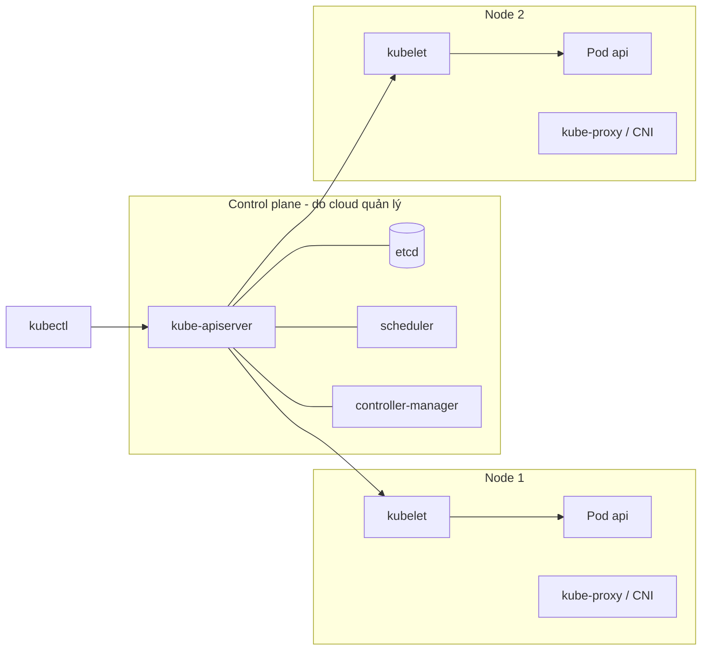

# Kubernetes cho backend production

**Mục đích:** hiểu khi nào cần Kubernetes (K8s), các đối tượng cốt lõi, manifest chuẩn production cho LearnHub API, và cách gỡ lỗi. Đủ để review manifest do agent viết.
**Liên quan:** [04-container-docker.md](04-container-docker.md) · [03-load-balancer-reverse-proxy.md](03-load-balancer-reverse-proxy.md) · [06-ci-cd-iac.md](06-ci-cd-iac.md) · [07-cloud-kien-truc.md](07-cloud-kien-truc.md) · [08-xu-ly-su-co-production.md](08-xu-ly-su-co-production.md) · [09-checklist-review-ha-tang.md](09-checklist-review-ha-tang.md) · [../05-backend-senior/09-scale-trieu-user.md](../05-backend-senior/09-scale-trieu-user.md) · [../05-backend-senior/12-observability-reliability.md](../05-backend-senior/12-observability-reliability.md)

---

## 1. Có thật sự cần Kubernetes không?

K8s giải quyết bài toán **chạy nhiều container trên nhiều máy**: lập lịch, tự phục hồi, scale, service discovery, rolling update. Đổi lại nó tốn công vận hành: nâng cấp cluster, mạng, bảo mật, quan sát, con người hiểu nó.

| Tình huống | Lựa chọn hợp lý |
|---|---|
| 1–3 service, đội < 5 người, không có người chuyên hạ tầng | PaaS (Cloud Run, App Service, ECS Fargate, Render…) hoặc VM + Docker Compose + systemd |
| 5–30 service, nhiều đội, cần chuẩn hóa deploy | **K8s managed** (EKS / GKE / AKS) |
| Workload đặc biệt (GPU, batch lớn, cần kiểm soát mạng chi tiết) | K8s |
| Tự dựng K8s on-premise (kubeadm) | Chỉ khi có đội platform; nếu không thì cluster sẽ là nguồn sự cố lớn nhất |

**Quy tắc:** không chọn K8s chỉ vì "chuẩn ngành". Với LearnHub giai đoạn đầu, một PaaS chạy container là đủ; chuyển sang K8s managed khi số service và đội tăng. Nếu chọn K8s, **luôn dùng bản managed** — không tự vận hành control plane.

## 2. Kiến trúc



| Thành phần | Vai trò |
|---|---|
| kube-apiserver | Cửa ngõ duy nhất; mọi thứ (kubectl, controller) đều đi qua API |
| etcd | Kho key-value lưu **toàn bộ trạng thái** cluster. Mất etcd = mất cluster |
| scheduler | Chọn node cho Pod dựa trên requests, affinity, taint/toleration |
| controller-manager | Vòng lặp "trạng thái mong muốn → trạng thái thực tế" (Deployment, ReplicaSet, Node…) |
| kubelet | Agent trên mỗi node, chạy container qua container runtime (containerd) |
| CNI (Calico, Cilium, VPC CNI…) | Mạng Pod-to-Pod, thực thi NetworkPolicy |

Tư duy cốt lõi: **khai báo (declarative)**. Bạn mô tả trạng thái mong muốn trong YAML; controller liên tục kéo thực tế về đó. Vì vậy sửa tay bằng `kubectl edit` trên production là chống mẫu — lần deploy sau sẽ ghi đè.

## 3. Các đối tượng cốt lõi

| Đối tượng | Dùng cho | Ghi chú |
|---|---|---|
| Pod | Đơn vị chạy nhỏ nhất (1+ container chung mạng/volume) | Không tạo Pod trực tiếp; dùng controller |
| Deployment → ReplicaSet → Pod | Service stateless (API, worker) | Rolling update, rollback |
| StatefulSet | Ứng dụng cần định danh và đĩa ổn định | DB, Kafka — xem mục 7 |
| DaemonSet | Một Pod trên mỗi node | Agent log/metric |
| Job / CronJob | Việc chạy xong rồi thoát | Migration, báo cáo đêm |
| Service | IP/DNS ổn định trước một nhóm Pod | ClusterIP, NodePort, LoadBalancer |
| Ingress / Gateway API | Định tuyến HTTP(S) từ ngoài vào | Gateway API là thế hệ mới, tách vai trò rõ hơn |
| ConfigMap | Cấu hình không bí mật | |
| Secret | Bí mật | **base64 không phải mã hóa** — xem mục 5 |
| HPA | Tự scale số Pod | CPU, memory, custom metrics |
| PodDisruptionBudget | Giới hạn số Pod bị gỡ đồng thời khi bảo trì | |
| Namespace | Phân vùng logic | Không phải ranh giới bảo mật nếu thiếu RBAC + NetworkPolicy |

### Service types

| Type | Truy cập | Khi dùng |
|---|---|---|
| ClusterIP (mặc định) | Chỉ trong cluster | Giao tiếp nội bộ |
| NodePort | IP node + port 30000–32767 | Hiếm khi dùng trực tiếp |
| LoadBalancer | Tạo LB của cloud | Mỗi service một LB → tốn tiền; thường chỉ cho Ingress controller |
| Headless (`clusterIP: None`) | DNS trả IP từng Pod | StatefulSet |

## 4. Manifest production cho LearnHub API (có chú thích)

```yaml
apiVersion: apps/v1
kind: Deployment
metadata:
  name: learnhub-api
  namespace: learnhub
  labels: { app: learnhub-api }
spec:
  replicas: 6                     # HPA sẽ ghi đè; đây là giá trị khởi đầu
  revisionHistoryLimit: 5
  selector:
    matchLabels: { app: learnhub-api }
  strategy:
    type: RollingUpdate
    rollingUpdate:
      maxSurge: 25%               # tạo thêm tối đa 25% Pod mới trước khi gỡ Pod cũ
      maxUnavailable: 0           # không bao giờ giảm dưới số replica mong muốn khi deploy
  template:
    metadata:
      labels: { app: learnhub-api }
    spec:
      serviceAccountName: learnhub-api
      automountServiceAccountToken: false   # API không cần gọi K8s API
      terminationGracePeriodSeconds: 40     # > preStop + thời gian xử lý request dài nhất
      securityContext:
        runAsNonRoot: true
        runAsUser: 10001
        fsGroup: 10001
        seccompProfile: { type: RuntimeDefault }
      topologySpreadConstraints:            # rải Pod đều qua các AZ và node
        - maxSkew: 1
          topologyKey: topology.kubernetes.io/zone
          whenUnsatisfiable: ScheduleAnyway
          labelSelector: { matchLabels: { app: learnhub-api } }
        - maxSkew: 1
          topologyKey: kubernetes.io/hostname
          whenUnsatisfiable: ScheduleAnyway
          labelSelector: { matchLabels: { app: learnhub-api } }
      containers:
        - name: api
          # Pin theo digest (bất biến), KHÔNG dùng :latest
          image: registry.example.internal/learnhub/api@sha256:<digest>
          ports: [{ name: http, containerPort: 8080 }]
          envFrom:
            - configMapRef: { name: learnhub-api-config }
          env:
            - name: DATABASE_URL
              valueFrom: { secretKeyRef: { name: learnhub-api-secrets, key: database-url } }
            - name: NODE_OPTIONS
              value: "--max-old-space-size=768"   # heap Node < memory limit, chừa chỗ cho phần ngoài heap
          resources:
            requests: { cpu: "500m", memory: "1Gi" }   # scheduler dựa vào requests
            limits:   { memory: "1Gi" }                # limit memory = request → không bị OOM do node quá tải
            # Không đặt CPU limit cho service nhạy độ trễ (tránh throttling) – xem mục 9
          startupProbe:              # cho app thời gian khởi động; trong lúc này liveness chưa chạy
            httpGet: { path: /healthz/startup, port: http }
            periodSeconds: 5
            failureThreshold: 24     # tối đa 120s
          readinessProbe:            # có nhận traffic không (DB/Redis sẵn sàng?)
            httpGet: { path: /healthz/ready, port: http }
            periodSeconds: 5
            failureThreshold: 3
          livenessProbe:             # process có bị treo không. KHÔNG kiểm tra DB ở đây
            httpGet: { path: /healthz/live, port: http }
            periodSeconds: 10
            failureThreshold: 3
            timeoutSeconds: 2
          lifecycle:
            preStop:                 # chờ LB/kube-proxy gỡ Pod khỏi endpoint trước khi tắt
              exec: { command: ["sh", "-c", "sleep 10"] }
          securityContext:
            allowPrivilegeEscalation: false
            readOnlyRootFilesystem: true
            capabilities: { drop: ["ALL"] }
          volumeMounts:
            - { name: tmp, mountPath: /tmp }
      volumes:
        - name: tmp
          emptyDir: { sizeLimit: 256Mi }
---
apiVersion: v1
kind: Service
metadata: { name: learnhub-api, namespace: learnhub }
spec:
  selector: { app: learnhub-api }
  ports: [{ name: http, port: 80, targetPort: http }]
---
apiVersion: policy/v1
kind: PodDisruptionBudget
metadata: { name: learnhub-api, namespace: learnhub }
spec:
  minAvailable: 75%           # khi drain node để nâng cấp, luôn giữ ≥ 75% Pod
  selector: { matchLabels: { app: learnhub-api } }
---
apiVersion: autoscaling/v2
kind: HorizontalPodAutoscaler
metadata: { name: learnhub-api, namespace: learnhub }
spec:
  scaleTargetRef: { apiVersion: apps/v1, kind: Deployment, name: learnhub-api }
  minReplicas: 6              # ≥ 2 Pod mỗi AZ khi có 3 AZ
  maxReplicas: 60
  metrics:
    - type: Resource
      resource: { name: cpu, target: { type: Utilization, averageUtilization: 60 } }
    - type: Pods              # custom metric (cần Prometheus Adapter / KEDA)
      pods:
        metric: { name: http_requests_per_second }
        target: { type: AverageValue, averageValue: "300" }
  behavior:
    scaleUp:   { stabilizationWindowSeconds: 0,   policies: [{ type: Percent, value: 100, periodSeconds: 30 }] }
    scaleDown: { stabilizationWindowSeconds: 300, policies: [{ type: Percent, value: 10,  periodSeconds: 60 }] }
```

### Vì sao từng phần quan trọng

| Phần | Nếu thiếu thì… |
|---|---|
| `requests` | Scheduler nhồi quá nhiều Pod vào một node → tranh tài nguyên, OOM dây chuyền |
| `limits.memory` | Một Pod rò rỉ bộ nhớ làm chết cả node |
| `readinessProbe` | Pod nhận traffic khi chưa kết nối DB → 5xx mỗi lần deploy |
| `livenessProbe` kiểm tra DB | DB chậm 30s → **toàn bộ** Pod bị restart cùng lúc → sự cố lớn hơn. Liveness chỉ kiểm tra process |
| `startupProbe` | App khởi động chậm bị liveness giết trước khi kịp chạy → CrashLoopBackOff |
| `preStop sleep` + grace period | Request đang bay bị cắt khi rolling update → lỗi 502 lẻ tẻ mỗi lần deploy |
| `maxUnavailable: 0` | Deploy làm giảm năng lực phục vụ đúng giờ cao điểm |
| PDB | Nâng cấp node drain hết Pod một lúc |
| `topologySpreadConstraints` | Mọi Pod nằm cùng một AZ → mất AZ là mất dịch vụ |
| image theo digest | `:latest` khiến hai node chạy hai phiên bản khác nhau, rollback không xác định |
| `securityContext` | Container chạy root, ghi được filesystem → bị khai thác dễ leo thang |

App phải xử lý **SIGTERM**: ngừng nhận kết nối mới, hoàn tất request đang xử lý, đóng pool DB, rồi thoát (xem [../05-backend-senior/12-observability-reliability.md](../05-backend-senior/12-observability-reliability.md)).

## 5. ConfigMap, Secret và quản lý bí mật

- `Secret` trong K8s chỉ được **mã hóa base64** — ai đọc được YAML là đọc được giá trị. Commit Secret YAML vào Git = lộ bí mật.
- Bật **encryption at rest cho etcd** (managed K8s thường có tùy chọn KMS).
- Hạn chế quyền `get/list secrets` bằng RBAC.

| Giải pháp | Cách hoạt động | Khi dùng |
|---|---|---|
| External Secrets Operator | Đồng bộ từ AWS Secrets Manager / GCP Secret Manager / Azure Key Vault / Vault vào Secret | **Khuyến nghị** khi đã dùng cloud secret manager |
| Sealed Secrets | Mã hóa bằng khóa công khai của controller; YAML đã mã hóa được commit | GitOps đơn giản, không có secret manager |
| SOPS (+ KMS/age) | Mã hóa file trong Git, giải mã lúc deploy | Helm/Kustomize + GitOps |
| CSI Secrets Store driver | Mount bí mật trực tiếp thành file | Không muốn bí mật thành K8s Secret |

```yaml
apiVersion: external-secrets.io/v1
kind: ExternalSecret
metadata: { name: learnhub-api-secrets, namespace: learnhub }
spec:
  refreshInterval: 1h
  secretStoreRef: { name: cloud-secret-store, kind: ClusterSecretStore }
  target: { name: learnhub-api-secrets }
  data:
    - secretKey: database-url
      remoteRef: { key: learnhub/prod/database-url }
```

Pod đọc bí mật qua biến môi trường sẽ **không** nhận giá trị mới khi xoay vòng cho tới khi restart → kế hoạch xoay vòng phải có bước rollout restart (hoặc mount file và app tự đọc lại).

## 6. Ingress và Gateway API

```yaml
apiVersion: gateway.networking.k8s.io/v1
kind: HTTPRoute
metadata: { name: learnhub-api, namespace: learnhub }
spec:
  parentRefs: [{ name: public-gateway, namespace: infra }]
  hostnames: ["api.learnhub.example"]
  rules:
    - matches: [{ path: { type: PathPrefix, value: /v1 } }]
      backendRefs: [{ name: learnhub-api, port: 80 }]
```

- **Ingress**: ổn định, phổ biến, nhưng tính năng nâng cao (canary, header routing) phụ thuộc annotation riêng của từng controller.
- **Gateway API**: chuẩn mới, tách vai trò (đội hạ tầng quản lý `Gateway`, đội ứng dụng quản lý `HTTPRoute`), hỗ trợ chia traffic theo trọng số chuẩn. Dự án mới nên ưu tiên nếu controller hỗ trợ.
- TLS: cert-manager + Let's Encrypt hoặc chứng chỉ của LB cloud. Theo dõi ngày hết hạn (xem [08-xu-ly-su-co-production.md](08-xu-ly-su-co-production.md)).

## 7. StatefulSet và cơ sở dữ liệu

StatefulSet cho Pod tên cố định (`pg-0`, `pg-1`), PersistentVolume riêng, thứ tự khởi động. Nhưng chạy PostgreSQL production **không chỉ** là StatefulSet: còn failover, replication, backup/PITR, nâng cấp major version, tuning, giám sát.

| Lựa chọn | Đánh giá |
|---|---|
| **Managed DB** (RDS/Aurora, Cloud SQL/AlloyDB, Azure Database for PostgreSQL) | **Mặc định cho LearnHub.** Multi-AZ, backup, PITR, patch có sẵn |
| Operator (CloudNativePG, Crunchy PGO, Zalando) | Khi bắt buộc on-premise/K8s; có đội hiểu Postgres |
| StatefulSet tự viết | **Không** dùng cho production |

Tương tự cho Kafka (Strimzi operator hoặc managed) và Redis (managed). Chi tiết vận hành DB: [../06-database-chuyen-sau/](../06-database-chuyen-sau/).

## 8. Namespace, RBAC, NetworkPolicy

```yaml
# RBAC: CI chỉ được deploy trong namespace learnhub
apiVersion: rbac.authorization.k8s.io/v1
kind: Role
metadata: { name: deployer, namespace: learnhub }
rules:
  - apiGroups: ["apps"]
    resources: ["deployments"]
    verbs: ["get", "list", "patch", "update"]
  - apiGroups: [""]
    resources: ["services", "configmaps"]
    verbs: ["get", "list", "create", "patch", "update"]
---
# NetworkPolicy: mặc định chặn hết vào namespace, chỉ mở cái cần
apiVersion: networking.k8s.io/v1
kind: NetworkPolicy
metadata: { name: default-deny-ingress, namespace: learnhub }
spec:
  podSelector: {}
  policyTypes: ["Ingress"]
---
apiVersion: networking.k8s.io/v1
kind: NetworkPolicy
metadata: { name: allow-gateway-to-api, namespace: learnhub }
spec:
  podSelector: { matchLabels: { app: learnhub-api } }
  policyTypes: ["Ingress"]
  ingress:
    - from:
        - namespaceSelector: { matchLabels: { kubernetes.io/metadata.name: infra } }
      ports: [{ port: 8080 }]
```

- Không dùng `cluster-admin` cho CI hay con người hằng ngày.
- NetworkPolicy chỉ có hiệu lực khi CNI hỗ trợ (Calico, Cilium…).
- Áp dụng **Pod Security Admission** mức `restricted` cho namespace ứng dụng:
  `kubectl label ns learnhub pod-security.kubernetes.io/enforce=restricted`

## 9. Tài nguyên, QoS, OOMKilled, CPU throttling

| QoS class | Điều kiện | Khi node thiếu bộ nhớ |
|---|---|---|
| Guaranteed | requests = limits cho cả CPU và memory | Bị đuổi sau cùng |
| Burstable | Có requests, limits khác requests | Ở giữa |
| BestEffort | Không có requests/limits | Bị đuổi đầu tiên |

- **Memory là tài nguyên không nén được**: vượt limit → kernel giết container (`OOMKilled`, exit code 137).
- **CPU là tài nguyên nén được**: vượt CPU limit → bị **throttle** (chạy chậm lại), không bị giết. Throttling gây độ trễ p99 tăng vọt mà CPU trung bình trông vẫn thấp. Nhiều đội bỏ CPU limit cho API nhạy độ trễ, chỉ giữ CPU request; giữ CPU limit cho batch/worker.
- Node.js: đặt `--max-old-space-size` khoảng 70–75% memory limit; Java: `-XX:MaxRAMPercentage=75`.
- Đặt request dựa trên số đo thực (p95 sử dụng trong 1–2 tuần), không đoán.

Kiểm tra:
```bash
kubectl top pods -n learnhub
kubectl describe pod <pod> -n learnhub | grep -A5 "Last State"   # Reason: OOMKilled
# Throttling (cần Prometheus/cAdvisor):
# rate(container_cpu_cfs_throttled_periods_total[5m]) / rate(container_cpu_cfs_periods_total[5m])
```

## 10. Helm hay Kustomize

| | Helm | Kustomize |
|---|---|---|
| Cách làm | Template (Go template) + values | Base YAML + overlay vá (patch) |
| Mạnh | Đóng gói và phân phối chart, cài phần mềm bên thứ ba | YAML thuần, dễ đọc, có sẵn trong `kubectl -k` |
| Yếu | Template phức tạp khó review | Không có logic điều kiện |
| Khuyến nghị | Cài phần mềm bên ngoài (ingress controller, cert-manager) | Manifest ứng dụng của mình theo môi trường |

```
deploy/
  base/            deployment.yaml service.yaml hpa.yaml pdb.yaml kustomization.yaml
  overlays/
    staging/       kustomization.yaml (replicas, image digest, config)
    prod/          kustomization.yaml
```

Luôn **render và review** trước khi áp dụng: `kubectl kustomize deploy/overlays/prod` hoặc `helm template …`, và `kubectl diff -k deploy/overlays/prod`.

## 11. Gỡ lỗi

Thứ tự: **get → describe → events → logs → exec**.

```bash
kubectl get pods -n learnhub -o wide
kubectl describe pod <pod> -n learnhub            # phần Events ở cuối là quan trọng nhất
kubectl get events -n learnhub --sort-by=.lastTimestamp | tail -30
kubectl logs <pod> -n learnhub --previous          # log của lần chạy trước khi crash
kubectl logs deploy/learnhub-api -n learnhub --since=10m
kubectl exec -it <pod> -n learnhub -- sh           # image distroless không có shell → dùng:
kubectl debug -it <pod> -n learnhub --image=busybox --target=api
kubectl rollout status deploy/learnhub-api -n learnhub
kubectl rollout history deploy/learnhub-api -n learnhub
kubectl rollout undo deploy/learnhub-api -n learnhub   # rollback nhanh (nhưng GitOps sẽ ghi đè – xem 06)
```

| Trạng thái | Nguyên nhân thường gặp | Kiểm tra |
|---|---|---|
| `Pending` | Không đủ CPU/memory theo requests; PVC chưa bind; taint không có toleration; affinity quá chặt | `describe pod` → Events: `Insufficient cpu`, `didn't match node affinity` |
| `ImagePullBackOff` / `ErrImagePull` | Sai tên/tag/digest; thiếu `imagePullSecrets`; registry không truy cập được | `describe pod` |
| `CrashLoopBackOff` | App lỗi khi khởi động (thiếu biến môi trường, không kết nối DB); liveness giết quá sớm; OOM | `logs --previous`, `describe` → Last State |
| `CreateContainerConfigError` | ConfigMap/Secret tham chiếu không tồn tại | `describe pod` |
| `OOMKilled` | Memory limit thấp hoặc rò rỉ | Exit code 137, xem metric memory |
| Running nhưng không nhận traffic | Readiness thất bại; selector Service không khớp label | `kubectl get endpoints learnhub-api -n learnhub` |
| 502/503 khi deploy | Thiếu preStop/grace period; readiness sai | Xem mục 4 |

## 12. Lỗi agent hay mắc khi viết manifest

| Lỗi | Hậu quả |
|---|---|
| Không có `resources` | Pod BestEffort, bị đuổi đầu tiên; scheduler đặt sai |
| `image: ...:latest` | Không tái lập, rollback vô nghĩa |
| `privileged: true`, `hostNetwork`, `hostPath` "cho chạy được" | Thoát container ra node dễ dàng |
| Secret YAML với giá trị thật commit vào Git | Lộ bí mật vĩnh viễn trong lịch sử Git |
| Liveness gọi DB | Restart hàng loạt khi DB chậm |
| Thiếu readiness / startup probe | Lỗi khi deploy, CrashLoop khi khởi động chậm |
| `replicas: 1` cho production | Mỗi lần deploy/drain là downtime |
| Dùng `kubectl apply` thẳng lên prod từ máy cá nhân | Không có lịch sử, lệch với Git |
| HPA cùng lúc với `replicas` cố định trong GitOps | Hai bên tranh nhau đặt số Pod — bỏ `replicas` khỏi manifest khi dùng HPA (hoặc để GitOps bỏ qua trường đó) |
| ServiceAccount mặc định + RBAC rộng | Pod bị chiếm có thể điều khiển cluster |

## Checklist review

- [ ] Có lý do rõ ràng để dùng K8s thay vì PaaS/VM.
- [ ] Mọi container có `requests` (CPU, memory) và `limits.memory`; số liệu dựa trên đo đạc.
- [ ] Image pin theo digest hoặc tag bất biến; không `latest`.
- [ ] Có `readinessProbe`, `livenessProbe` (không phụ thuộc DB), `startupProbe` khi khởi động chậm.
- [ ] `preStop` + `terminationGracePeriodSeconds` hợp lý; app xử lý SIGTERM.
- [ ] `maxUnavailable: 0` (hoặc có lý do) cho service phục vụ người dùng.
- [ ] Production: ≥ 2 replica mỗi AZ dùng, có PDB, có topologySpreadConstraints.
- [ ] `securityContext`: non-root, `allowPrivilegeEscalation: false`, drop ALL capabilities, read-only root FS; không `privileged`/`hostNetwork`/`hostPath`.
- [ ] Không có Secret giá trị thật trong Git; dùng External Secrets/Sealed Secrets/SOPS.
- [ ] ServiceAccount riêng, RBAC tối thiểu, `automountServiceAccountToken: false` khi không cần.
- [ ] NetworkPolicy default-deny + mở theo nhu cầu.
- [ ] HPA có min/max hợp lý và hành vi scale-down chậm; không xung đột với `replicas` trong GitOps.
- [ ] DB/Kafka/Redis dùng managed hoặc operator, không StatefulSet tự viết.
- [ ] Manifest đã được render và `kubectl diff` trước khi áp dụng; áp dụng qua pipeline/GitOps.
