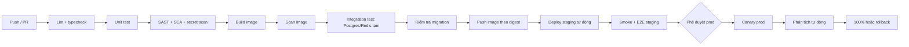

# CI/CD và Infrastructure as Code

**Mục đích:** thiết kế pipeline từ commit tới production an toàn, lặp lại được; quản lý hạ tầng bằng code (Terraform/OpenTofu, Ansible) với các cổng phê duyệt rõ ràng.
**Liên quan:** [04-container-docker.md](04-container-docker.md) · [05-kubernetes.md](05-kubernetes.md) · [07-cloud-kien-truc.md](07-cloud-kien-truc.md) · [08-xu-ly-su-co-production.md](08-xu-ly-su-co-production.md) · [09-checklist-review-ha-tang.md](09-checklist-review-ha-tang.md) · [../02-quy-trinh-phan-mem/08-release.md](../02-quy-trinh-phan-mem/08-release.md) · [../06-database-chuyen-sau/](../06-database-chuyen-sau/)

---

## 1. Nguyên tắc

1. **Build một lần, deploy nhiều nơi.** Cùng một image (cùng digest) đi qua dev → staging → prod. Chỉ cấu hình khác nhau.
2. **Mọi thay đổi đi qua Git và pipeline.** Không sửa tay trên server/cluster/console cloud.
3. **Fail nhanh:** kiểm tra rẻ chạy trước (lint, unit), đắt chạy sau (integration, E2E).
4. **Production có cổng phê duyệt của người**, và người duyệt xem được *chính xác cái gì sẽ thay đổi* (diff manifest, `terraform plan`).
5. **Rollback phải nhanh hơn sửa lỗi.** Mỗi lần deploy phải có cách quay lại trong vài phút.
6. **Không có khóa bí mật sống lâu trong CI.** Dùng OIDC để lấy credential tạm thời.

## 2. Pipeline CI cho LearnHub



| Bước | Công cụ ví dụ | Chặn merge nếu |
|---|---|---|
| Lint, typecheck | ESLint, `tsc --noEmit` | Lỗi |
| Unit test + coverage | Vitest/Jest | Test fail; coverage dòng code mới thấp hơn ngưỡng |
| SAST | Semgrep, CodeQL | Lỗi mức High |
| SCA (thư viện) | `npm audit`, OSV-Scanner, Dependabot/Renovate | Lỗ hổng Critical/High có bản vá |
| Secret scan | gitleaks | Có phát hiện |
| Build image | Docker Buildx, multi-stage | |
| Scan image | Trivy, Grype | CVE Critical trong image |
| SBOM + ký image | Syft, cosign | (khuyến nghị cho prod) |
| Integration test | Postgres/Redis chạy làm service container | Fail |
| Migration check | Chạy migration lên DB trống **và** lên bản sao schema prod; lint migration (squawk cho Postgres) | Migration khóa bảng/không tương thích ngược |
| E2E staging | Playwright, k6 smoke | Fail |

## 3. Ví dụ GitHub Actions

```yaml
name: ci
on:
  pull_request:
  push:
    branches: [main]

permissions:
  contents: read          # mặc định tối thiểu; bật thêm theo job

jobs:
  test:
    runs-on: ubuntu-24.04
    services:
      postgres:
        image: postgres:17
        env:
          POSTGRES_HOST_AUTH_METHOD: trust     # chỉ cho DB tạm trong CI, không bao giờ dùng ở môi trường thật
        ports: ["5432:5432"]
        options: >-
          --health-cmd "pg_isready -U postgres" --health-interval 5s --health-retries 10
    env:
      PGHOST: localhost
      PGUSER: postgres
      PGDATABASE: postgres
    steps:
      - uses: actions/checkout@v4
      - uses: actions/setup-node@v4
        with: { node-version: 22, cache: npm }
      - run: npm ci                                # dùng lockfile, không npm install
      - run: npm run lint && npx tsc --noEmit
      - run: npm test -- --coverage
      - run: npm run migrate:up                    # migration chạy được trên DB trống
      - run: npm run test:integration

  build:
    needs: test
    if: github.ref == 'refs/heads/main'
    runs-on: ubuntu-24.04
    permissions:
      contents: read
      id-token: write                              # cho OIDC → cloud, không cần access key
    outputs:
      digest: ${{ steps.push.outputs.digest }}
    steps:
      - uses: actions/checkout@v4
      - uses: aws-actions/configure-aws-credentials@v4
        with:
          role-to-assume: arn:aws:iam::<account-id>:role/learnhub-ci-push
          aws-region: ap-southeast-1
      - uses: docker/setup-buildx-action@v3
      - id: push
        uses: docker/build-push-action@v6
        with:
          push: true
          tags: <registry>/learnhub/api:${{ github.sha }}
      - name: Scan image
        run: trivy image --exit-code 1 --severity CRITICAL <registry>/learnhub/api@${{ steps.push.outputs.digest }}

  deploy-prod:
    needs: build
    runs-on: ubuntu-24.04
    environment: production                        # GitHub Environment có required reviewers
    steps:
      - run: echo "Cập nhật digest ${{ needs.build.outputs.digest }} vào repo GitOps (overlay prod)"
```

Điểm cần chú ý:
- Pin action theo phiên bản (tốt hơn nữa: theo commit SHA) — action bên thứ ba là chuỗi cung ứng.
- `permissions` tối thiểu ở cấp workflow, mở thêm ở cấp job.
- PR từ fork không được nhận bí mật.
- `environment: production` + required reviewers = cổng phê duyệt của người.

### 3.1 Phương án gọn nhẹ: CI/CD tự host trên máy cá nhân / Home Server (Không mở port Router)

Với dự án cá nhân hoặc team nhỏ tự host trên Mac / Mini PC ở nhà (thường bị IP động / CGNAT và không nên mở Port Forwarding trên modem để tránh lộ IP nhà riêng), có thể dùng bộ 3 miễn phí: **PM2 Cluster + Cloudflare Tunnel (`cloudflared`) + GitHub Self-Hosted Runner**:

```text
[git push origin main] ──► [GitHub Repo]
                                 ▲
     (Máy cá nhân chủ động kết nối ra ngoài qua HTTPS - KHÔNG mở port!)
┌────────────────────────────────┴──────────────────────────────────┐
│ MÁY CÁ NHÂN (Mac / Ubuntu / Mini PC)                              │
│  [GitHub Self-Hosted Runner]                                      │
│    ├─► npm ci --omit=dev                                          │
│    ├─► psql "$DB_URL" -f script/create_recommended_indexes.sql    │
│    └─► pm2 reload ecosystem.config.cjs (0s downtime)              │
│          │                                                        │
│          ▼                                                        │
│  [Node.js :3001] ◄─── [Cloudflare Tunnel (cloudflared)] ──► HTTPS │
└───────────────────────────────────────────────────────────────────┘
```

- **PM2 Cluster (`ecosystem.config.cjs`):** `instances: 2, exec_mode: 'cluster'` để `pm2 reload` khởi động lại từng process mà không rớt request đang chạy.
- **Cloudflare Tunnel (`cloudflared`):** `cloudflared tunnel run --url http://localhost:3001 <tunnel-name>` đưa API ra domain HTTPS mà không mở port router.
- **Workflow (`.github/workflows/deploy-self-hosted.yml`):** Dùng `runs-on: self-hosted` để tự kéo code, chạy migration idempotent (`IF NOT EXISTS`) và `pm2 reload` ngay khi push lên `main`.

## 4. Artifact bất biến và promotion

```
commit abc123 → image api@sha256:9f… (build 1 lần)
   dev      : api@sha256:9f…  + config dev
   staging  : api@sha256:9f…  + config staging
   prod     : api@sha256:9f…  + config prod
```

- Không build lại cho từng môi trường (build lại = artifact khác, test staging không còn giá trị).
- Không dùng tag thay đổi được (`latest`, `prod`) để deploy; tag chỉ để người đọc, deploy theo digest.
- Cấu hình theo môi trường đến từ ConfigMap/biến môi trường/secret manager, không nằm trong image.

## 5. Môi trường và phê duyệt

| Môi trường | Deploy | Dữ liệu | Ai duyệt |
|---|---|---|---|
| dev / preview theo PR | Tự động | Giả | Không |
| staging | Tự động khi merge main | Giả hoặc đã ẩn danh hóa (không copy PII thật) | Không, nhưng phải pass smoke/E2E |
| production | Sau phê duyệt | Thật | Người có thẩm quyền, xem diff + kết quả staging |

Staging phải **giống prod về cấu trúc** (cùng phiên bản DB, cùng loại ingress, cùng cách inject secret), nhỏ hơn về quy mô.

## 6. Chiến lược deploy

| Chiến lược | Cách làm | Ưu | Nhược | Dùng khi |
|---|---|---|---|---|
| Rolling | Thay dần Pod cũ bằng Pod mới | Đơn giản, mặc định K8s | Hai phiên bản chạy cùng lúc; rollback cũng mất thời gian | Phần lớn thay đổi |
| Blue-green | Dựng nguyên bộ mới, chuyển toàn bộ traffic | Rollback tức thì (chuyển lại) | Gấp đôi tài nguyên lúc deploy; DB dùng chung vẫn phải tương thích | Thay đổi lớn, cần cắt chuyển nhanh |
| Canary | 1% → 5% → 25% → 100%, phân tích metric mỗi bước | Giới hạn phạm vi ảnh hưởng | Cần metric tốt và công cụ (Argo Rollouts, Flagger) | Service lưu lượng lớn như LearnHub API |
| Feature flag | Code mới đã deploy nhưng tắt; bật theo nhóm user | Tách deploy khỏi release; tắt trong vài giây | Nợ kỹ thuật nếu không dọn flag | Tính năng rủi ro, A/B |

Canary tự động (ví dụ Argo Rollouts `AnalysisTemplate`): mỗi bước so sánh tỷ lệ lỗi 5xx và p95 latency của bản mới với ngưỡng; vượt ngưỡng → tự rollback, không cần người thức dậy.

Với **bài kiểm tra trực tuyến của LearnHub**: đặt lịch "đóng băng deploy" (change freeze) trong khung giờ thi lớn.

## 7. Migration database trong pipeline

Quy tắc vàng: **mọi migration phải tương thích với cả code cũ và code mới** vì trong lúc rolling/canary, cả hai cùng chạy.

Mẫu expand → migrate → contract (chi tiết ở [../06-database-chuyen-sau/](../06-database-chuyen-sau/)):

| Release | DB | Code |
|---|---|---|
| N | Thêm cột mới `display_name` (nullable) | Ghi cả cột cũ và mới, đọc cột cũ |
| N (job) | Backfill theo lô | |
| N+1 | | Đọc cột mới |
| N+2 | Xóa cột cũ | Không còn dùng cột cũ |

Thứ tự trong pipeline:
1. Chạy migration **expand** như một Job riêng **trước** khi deploy code mới (có timeout, `lock_timeout`).
2. Deploy code.
3. Migration **contract** ở release sau, khi chắc chắn không còn code cũ.

Không chạy migration trong lúc khởi động của mỗi Pod (60 Pod tranh nhau chạy migration).

## 8. Rollback hay roll-forward

| Tình huống | Hành động |
|---|---|
| Lỗi do code, migration đã tương thích ngược | **Rollback** image ngay (vài phút) |
| Đã có migration phá vỡ (xóa cột) | Không rollback được code → roll-forward bản sửa, hoặc khôi phục dữ liệu |
| Lỗi chỉ ở một tính năng có flag | Tắt flag |
| Lỗi nhỏ, ảnh hưởng ít, bản sửa đã sẵn sàng và đã test | Roll-forward |

Nguyên tắc: **giảm thiệt hại trước, tìm nguyên nhân sau.** Đừng debug trên production đang cháy khi rollback có thể dập lửa trong 2 phút.

Với GitOps: `kubectl rollout undo` sẽ bị Argo CD/Flux ghi đè ở lần đồng bộ sau → rollback bằng **git revert** trên repo GitOps (hoặc tạm dừng auto-sync rồi revert).

## 9. GitOps

Repo cấu hình (manifest/Kustomize/Helm values) là nguồn sự thật; Argo CD hoặc Flux trong cluster **kéo** về và đồng bộ.

| Ưu | Nhược |
|---|---|
| Lịch sử mọi thay đổi = lịch sử Git; audit dễ | Thêm một hệ thống phải vận hành |
| CI không cần quyền ghi vào cluster (pull model) | Bí mật phải giải quyết riêng (External Secrets/SOPS) |
| Phát hiện và tự sửa lệch (drift) | Cần kỷ luật: không sửa tay |

Luồng: CI build image → mở PR cập nhật digest trong overlay staging (tự merge) → PR cho overlay prod (người duyệt) → Argo CD đồng bộ.

## 10. Bí mật trong CI

- **OIDC federation**: GitHub Actions/GitLab CI xin token ngắn hạn từ AWS/GCP/Azure qua vai trò được giới hạn theo repo + nhánh + environment. Không lưu access key trong secret của CI.
- Bí mật còn lại (token registry bên thứ ba): lưu trong secret của CI ở mức **environment**, không mức repo; xoay vòng định kỳ.
- Không `echo` biến bí mật, không bật `set -x` khi có bí mật; kiểm tra log CI.
- Runner tự host: không dùng cho PR từ fork; runner tạm (ephemeral).

## 11. Infrastructure as Code với Terraform / OpenTofu

### Cấu trúc thư mục khuyến nghị

```
infra/
  modules/
    network/        # VPC, subnet, NAT
    postgres/       # managed DB + parameter group + alarm
    k8s-cluster/
  envs/
    staging/        main.tf  backend.tf  terraform.tfvars
    prod/           main.tf  backend.tf  terraform.tfvars
```

**Thư mục riêng cho từng môi trường** thường an toàn hơn `terraform workspace`: thấy rõ đang thao tác prod, state tách biệt, quyền IAM tách biệt.

### State

- State chứa **toàn bộ** thuộc tính tài nguyên, có thể gồm cả mật khẩu → **không commit state vào Git**.
- Lưu remote, có khóa (locking) và mã hóa: S3 (khóa bằng `use_lockfile` ở Terraform mới, hoặc DynamoDB ở bản cũ), GCS, Azure Blob, HCP Terraform.
- Bật versioning cho bucket state để khôi phục khi hỏng.

```hcl
# envs/prod/backend.tf
terraform {
  required_version = ">= 1.10"
  backend "s3" {
    bucket       = "learnhub-tfstate-prod"
    key          = "prod/terraform.tfstate"
    region       = "ap-southeast-1"
    encrypt      = true
    use_lockfile = true          # khóa state, tránh hai người apply cùng lúc
  }
  required_providers {
    aws = { source = "hashicorp/aws", version = "~> 5.0" }   # pin phiên bản provider
  }
}

# envs/prod/main.tf
module "postgres" {
  source              = "../../modules/postgres"
  name                = "learnhub-prod"
  instance_class      = "db.r7g.2xlarge"
  multi_az            = true
  backup_retention    = 14
  deletion_protection = true      # chặn xóa nhầm
  # mật khẩu master: để dịch vụ quản lý tự sinh và lưu vào secret manager
  # (ví dụ manage_master_user_password = true trên RDS), không đặt giá trị trong .tf/.tfvars
}
```

### Plan là cổng phê duyệt

```bash
terraform fmt -check && terraform validate
terraform plan -out=tfplan          # trong CI, đăng kết quả vào PR
# Người duyệt đọc plan: bao nhiêu add / change / DESTROY?
terraform apply tfplan              # apply ĐÚNG plan đã duyệt, sau khi merge
```

Khi đọc plan, tìm:
- `-/+ destroy and then create replacement` trên tài nguyên có dữ liệu (DB, bucket, volume) → **dừng lại**.
- Thay đổi security group/IAM mở rộng quyền (`0.0.0.0/0`, `"*"`).
- Số lượng thay đổi nhiều bất thường so với mô tả PR.

Bảo vệ thêm: `lifecycle { prevent_destroy = true }` cho tài nguyên chứa dữ liệu; công cụ lint/policy (tflint, Checkov, OPA/Conftest) trong CI.

### Drift

Ai đó sửa tay trên console → state lệch thực tế. Chạy `terraform plan -detailed-exitcode` định kỳ (ví dụ hằng đêm; exit code 2 = có thay đổi) và cảnh báo. Sửa bằng cách đưa thay đổi vào code hoặc hoàn tác thay đổi tay.

## 12. Ansible cho VM

Khi chạy trên VM (on-premise, hoặc giai đoạn chưa container hóa): Terraform tạo máy, Ansible cấu hình bên trong (gói, user, systemd, nginx, hardening).

```yaml
# playbooks/api.yml
- hosts: api_servers
  become: true
  tasks:
    - name: Tạo user chạy dịch vụ (không đăng nhập)
      ansible.builtin.user: { name: learnhub, shell: /usr/sbin/nologin, system: true }
    - name: Cài unit systemd
      ansible.builtin.template: { src: learnhub-api.service.j2, dest: /etc/systemd/system/learnhub-api.service, mode: "0644" }
      notify: restart api
  handlers:
    - name: restart api
      ansible.builtin.systemd: { name: learnhub-api, state: restarted, daemon_reload: true }
```

- Playbook phải **idempotent**: chạy lại không thay đổi gì nếu đã đúng. Chạy `--check --diff` trước.
- Bí mật dùng Ansible Vault hoặc lấy từ secret manager, không để plaintext trong inventory.
- Restart cuốn chiếu (`serial: 1` hoặc `serial: "25%"`) để không tắt cả cụm cùng lúc.

## 13. Lỗi agent hay mắc

| Lỗi | Hậu quả |
|---|---|
| Đề xuất `terraform apply -auto-approve` trên prod | Không ai xem plan; một `destroy` lọt qua |
| Commit `terraform.tfstate` hoặc `.tfvars` chứa mật khẩu | Lộ bí mật |
| Lưu access key cloud vào secret CI thay vì OIDC | Khóa sống lâu, rò rỉ là mất kiểm soát |
| `permissions: write-all` trong workflow | Action bị chiếm có thể sửa repo |
| Build lại image cho prod | Prod chạy artifact chưa được test |
| Migration xóa/đổi tên cột cùng release với code | Rollback không còn khả thi |
| Bỏ bước scan/test "vì CI chậm" | Lỗ hổng lọt lên prod |
| Dùng action bên thứ ba không pin phiên bản | Tấn công chuỗi cung ứng |
| Sửa tay trên cluster để "fix nhanh" mà không cập nhật Git | GitOps ghi đè, sự cố quay lại |

## Checklist review

- [ ] Pipeline có đủ: lint, unit, SAST, SCA, secret scan, build, scan image, integration, migration check.
- [ ] Image build một lần, deploy theo digest qua các môi trường.
- [ ] Production có cổng phê duyệt người; người duyệt thấy diff/plan.
- [ ] CI dùng OIDC, `permissions` tối thiểu, action được pin.
- [ ] Không có bí mật trong repo, log CI, state Terraform trong Git.
- [ ] Migration tương thích ngược, chạy như bước riêng trước deploy, có `lock_timeout`.
- [ ] Có chiến lược deploy phù hợp (canary cho service lớn) và kế hoạch rollback đã thử.
- [ ] Rollback trong GitOps làm bằng git revert.
- [ ] Terraform: remote state + khóa + mã hóa; môi trường tách thư mục; provider pin; `prevent_destroy`/`deletion_protection` cho tài nguyên chứa dữ liệu.
- [ ] Plan được đọc: không có destroy bất ngờ, không mở quyền rộng.
- [ ] Có phát hiện drift định kỳ.
- [ ] Ansible idempotent, đã chạy `--check --diff`, restart cuốn chiếu.
