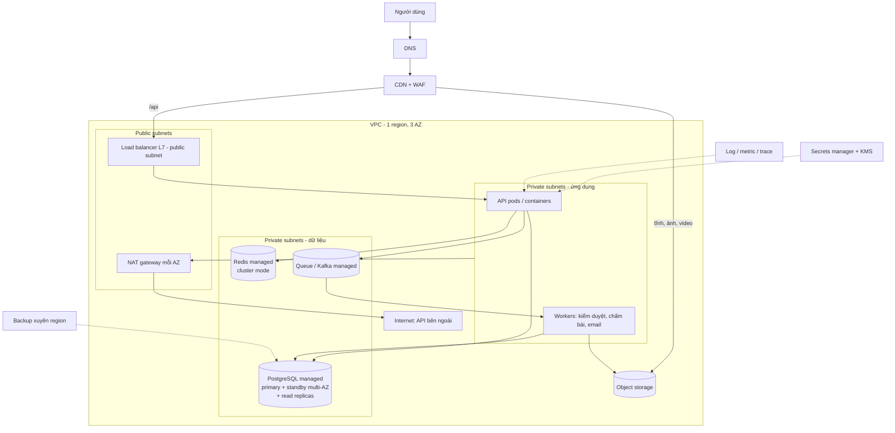

# Kiến trúc tham chiếu trên cloud cho LearnHub

**Mục đích:** một kiến trúc production chuẩn, trung lập nhà cung cấp, kèm bảng đối chiếu AWS/GCP/Azure; các quyết định về sẵn sàng cao, khôi phục thảm họa, chi phí và lưu trữ dữ liệu tại Việt Nam.
**Liên quan:** [02-mang-network.md](02-mang-network.md) · [03-load-balancer-reverse-proxy.md](03-load-balancer-reverse-proxy.md) · [05-kubernetes.md](05-kubernetes.md) · [06-ci-cd-iac.md](06-ci-cd-iac.md) · [08-xu-ly-su-co-production.md](08-xu-ly-su-co-production.md) · [09-checklist-review-ha-tang.md](09-checklist-review-ha-tang.md) · [../05-backend-senior/09-scale-trieu-user.md](../05-backend-senior/09-scale-trieu-user.md) · [../06-database-chuyen-sau/](../06-database-chuyen-sau/) · [../08-aws-cloud/00-README.md](../08-aws-cloud/00-README.md)

---

## 1. Sơ đồ tổng thể

Nguyên tắc: **chỉ load balancer (và NAT) ở public subnet**. Ứng dụng và dữ liệu không có IP công khai.

## 2. Bảng đối chiếu dịch vụ

| Chức năng | AWS | GCP | Azure |
|---|---|---|---|
| Mạng riêng | VPC | VPC | Virtual Network (VNet) |
| Tường lửa mức instance | Security Group | Firewall rules / tags | Network Security Group |
| Tường lửa mức subnet | Network ACL | (firewall rules) | NSG gắn subnet |
| LB L7 | Application Load Balancer | External Application LB | Application Gateway / Front Door |
| CDN + WAF | CloudFront + AWS WAF | Cloud CDN + Cloud Armor | Front Door + WAF |
| Kubernetes managed | EKS | GKE | AKS |
| Container không quản lý node | ECS Fargate, App Runner | Cloud Run | Container Apps |
| PostgreSQL managed | RDS / Aurora PostgreSQL | Cloud SQL / AlloyDB | Azure Database for PostgreSQL Flexible |
| Redis managed | ElastiCache / MemoryDB | Memorystore | Azure Cache for Redis / Managed Redis |
| Kafka managed | MSK | Managed Service for Apache Kafka | Event Hubs (giao thức Kafka) |
| Queue đơn giản | SQS (+ SNS) | Pub/Sub, Cloud Tasks | Service Bus, Storage Queue |
| Object storage | S3 | Cloud Storage | Blob Storage |
| Bí mật | Secrets Manager / Parameter Store | Secret Manager | Key Vault |
| Khóa mã hóa | KMS | Cloud KMS | Key Vault (keys) |
| Danh tính cho workload | IAM Role (IRSA / Pod Identity) | Workload Identity | Managed Identity / Workload Identity |
| Truy cập máy không SSH công khai | SSM Session Manager | IAP TCP forwarding | Azure Bastion |
| Log/metric | CloudWatch | Cloud Logging / Monitoring | Azure Monitor |
| IaC gốc | CloudFormation / CDK | Deployment Manager / Config Connector | Bicep / ARM |

Chi tiết AWS: [../08-aws-cloud/00-README.md](../08-aws-cloud/00-README.md).

## 3. Region và Availability Zone

- **Region**: một khu vực địa lý (ví dụ Singapore, Jakarta, Tokyo). Độ trễ từ Việt Nam tới Singapore thường khoảng 30–50 ms.
- **AZ**: các trung tâm dữ liệu độc lập về điện/mạng trong cùng region, độ trễ giữa AZ ~1–2 ms.
- **Multi-AZ là mức tối thiểu cho production**: LB, ứng dụng, DB standby, Redis replica, NAT trải ít nhất 2, tốt nhất 3 AZ.
- Chọn region theo: độ trễ tới người dùng, dịch vụ có sẵn, giá, **yêu cầu pháp lý về lưu trữ dữ liệu** (mục 10).

## 4. Mạng

| Thành phần | Thiết kế cho LearnHub |
|---|---|
| CIDR VPC | `/16` (ví dụ `10.20.0.0/16`), không trùng mạng văn phòng/VPN/VPC khác để còn peering |
| Subnet | Mỗi AZ: 1 public (`/24`), 1 private-app (`/20` — K8s tiêu tốn IP nhanh), 1 private-data (`/24`) |
| NAT | Một NAT gateway mỗi AZ (một NAT chung = điểm lỗi đơn + phí truyền qua AZ) |
| Truy cập dịch vụ cloud | VPC endpoint / Private Service Connect / Private Link cho object storage, secret manager, registry → không qua NAT, rẻ hơn và an toàn hơn |
| Security group | Theo vai trò: `sg-lb` cho 443 từ internet; `sg-api` chỉ nhận từ `sg-lb`; `sg-db` chỉ nhận 5432 từ `sg-api` và `sg-worker` |

**Security group vs NACL:**

| | Security Group | Network ACL |
|---|---|---|
| Gắn vào | Interface/instance | Subnet |
| Trạng thái | Stateful (tự cho phép chiều về) | Stateless (phải mở cả chiều về, cổng tạm 1024–65535) |
| Luật | Chỉ allow | Allow + deny, theo thứ tự |
| Dùng | Kiểm soát chính | Lớp chặn thô bổ sung (chặn dải IP xấu) |

**Truy cập quản trị:** không mở SSH/RDP ra internet. Ưu tiên SSM Session Manager / IAP / Azure Bastion (có log phiên, không cần khóa SSH). Bastion host tự dựng chỉ khi không có lựa chọn trên. DB chỉ truy cập qua đường này hoặc VPN.

## 5. Tầng dữ liệu

| Dịch vụ | Cấu hình production |
|---|---|
| PostgreSQL | Multi-AZ (standby đồng bộ, failover tự động 1–2 phút); 1–3 read replica cho đọc nặng (feed, báo cáo); backup tự động + PITR 7–35 ngày; `deletion_protection`; mã hóa KMS; parameter group riêng; PgBouncer/RDS Proxy cho kết nối |
| Redis | Cluster mode hoặc primary + replica đa AZ; `maxmemory-policy` phù hợp (cache: `allkeys-lru`; dữ liệu phiên: `volatile-lru` hoặc tách cụm riêng); TLS + AUTH |
| Queue/Kafka | Managed; replication factor 3 trải 3 AZ; DLQ |
| Object storage | Chặn truy cập công khai mặc định; ảnh/video phục vụ qua CDN với origin access control; URL ký trước (presigned) để upload; vòng đời (lifecycle) chuyển lớp lưu trữ rẻ cho file cũ; versioning cho bucket quan trọng |

Ứng dụng phải **chịu được failover DB** (kết nối bị ngắt 30–120 giây): retry kết nối có backoff, timeout ngắn, không cache IP của DB (DNS TTL thấp).

## 6. IAM và bí mật

- **Không dùng tài khoản root** cho việc hằng ngày; bật MFA; khóa phiên root.
- **Con người đăng nhập qua SSO** (IAM Identity Center / Google Workspace / Entra ID), nhận quyền tạm thời theo vai trò.
- **Workload dùng role, không dùng access key**: Pod nhận role qua IRSA/Pod Identity/Workload Identity; VM qua instance profile.
- **Quyền tối thiểu**: role của API chỉ đọc/ghi bucket `learnhub-media-prod/uploads/*`, chỉ đọc secret `learnhub/prod/*`. Không `"Action": "*"`, `"Resource": "*"`.
- **Tách tài khoản/project theo môi trường** (prod, staging, shared-services, log-archive) → sự cố ở staging không lan sang prod; quyền và chi phí tách bạch.
- Bí mật trong secret manager, mã hóa bằng KMS, bật xoay vòng tự động cho mật khẩu DB.
- Bật audit log của cloud (CloudTrail / Cloud Audit Logs / Activity Log), lưu sang tài khoản log riêng không ai xóa được.

## 7. Quan sát và sao lưu

| Hạng mục | Tối thiểu |
|---|---|
| Log | Tập trung (CloudWatch/Loki/ELK/Datadog), giữ 30–90 ngày nóng, lâu hơn ở lưu trữ rẻ |
| Metric | Prometheus/managed Prometheus + Grafana, hoặc dịch vụ của cloud |
| Trace | OpenTelemetry → Tempo/Jaeger/X-Ray/Cloud Trace |
| Cảnh báo | Theo SLO (xem [../05-backend-senior/12-observability-reliability.md](../05-backend-senior/12-observability-reliability.md)) |
| Backup DB | Snapshot tự động + PITR; **sao chép sang region khác** và tài khoản khác (chống xóa nhầm/ransomware) |
| Diễn tập khôi phục | Mỗi quý khôi phục thử vào môi trường riêng, đo thời gian thực tế |

Backup chưa từng được khôi phục thử thì coi như **không có backup**.

## 8. Sẵn sàng cao (HA) và khôi phục thảm họa (DR)

- **HA**: chịu lỗi một thành phần/một AZ mà không (hoặc gần như không) gián đoạn. Đạt bằng multi-AZ.
- **DR**: khôi phục sau mất cả region, lỗi dữ liệu diện rộng, xóa nhầm, ransomware. Đo bằng:
  - **RPO** (Recovery Point Objective): chấp nhận mất tối đa bao nhiêu dữ liệu (ví dụ 5 phút).
  - **RTO** (Recovery Time Objective): bao lâu phải chạy lại (ví dụ 1 giờ).

| Chiến lược DR | Mô tả | RPO / RTO điển hình | Chi phí tương đối |
|---|---|---|---|
| Backup & restore | Backup sang region khác; khi thảm họa dựng lại từ IaC | Giờ / nhiều giờ | Thấp nhất |
| Pilot light | DB replica chạy sẵn ở region 2, phần còn lại tắt, dựng bằng IaC khi cần | Phút / chục phút–1 giờ | Thấp–vừa |
| Warm standby | Bản thu nhỏ chạy đầy đủ ở region 2, scale lên khi chuyển | Giây–phút / phút | Vừa–cao |
| Active-active đa region | Cả hai region phục vụ | ~0 / ~0 | Cao nhất, rất phức tạp (xung đột ghi, nhất quán dữ liệu) |

**Khuyến nghị cho LearnHub:** multi-AZ trong một region + **backup & restore** hoặc **pilot light** sang region thứ hai. Active-active đa region chỉ khi có yêu cầu kinh doanh rõ ràng và đội đủ năng lực — phần lớn hệ thống không cần.

Lưu ý: multi-AZ **không** bảo vệ trước xóa nhầm hoặc lệnh `DELETE` sai — standby sao chép cả lỗi. Chỉ PITR/backup mới cứu được.

## 9. Quản lý chi phí

| Biện pháp | Chi tiết |
|---|---|
| Gắn tag bắt buộc | `env`, `service`, `owner`, `cost-center` — không tag thì không biết tiền đi đâu; ép bằng policy |
| Rightsizing | Xem CPU/memory thực tế 2–4 tuần; nhiều instance dùng < 20% |
| Cam kết dài hạn | Reserved Instances / Savings Plans / Committed Use Discounts cho phần nền ổn định (DB, số node tối thiểu): giảm ~30–60% |
| Spot / preemptible | Cho worker chịu được bị ngắt (chấm bài code, xử lý ảnh, batch) — giảm tới ~70–90%; không dùng cho DB |
| Autoscaling | Scale theo giờ cao điểm; tắt staging/dev ngoài giờ làm việc |
| Chi phí truyền dữ liệu (egress) | Thường là khoản "bất ngờ": dữ liệu ra internet, qua AZ, qua NAT. Dùng CDN cho media, VPC endpoint cho object storage, đặt app và DB cùng AZ ưu tiên khi hợp lý |
| Lưu trữ | Lifecycle object storage, xóa snapshot/volume mồ côi, giới hạn thời gian giữ log |
| Ngân sách và cảnh báo | Budget alert theo tài khoản/tag; phát hiện bất thường chi phí |

## 10. On-premise, data center Việt Nam và lưu trữ dữ liệu

**Khung pháp lý cần biết (tóm tắt, không thay thế tư vấn pháp lý):**

- **Nghị định 13/2023/NĐ-CP** về bảo vệ dữ liệu cá nhân: phân loại dữ liệu cá nhân cơ bản/nhạy cảm; yêu cầu sự đồng ý; quyền của chủ thể dữ liệu; **đánh giá tác động xử lý dữ liệu** và **hồ sơ đánh giá tác động chuyển dữ liệu ra nước ngoài** khi chuyển dữ liệu cá nhân của công dân Việt Nam ra nước ngoài; thông báo vi phạm trong thời hạn quy định. Luật Bảo vệ dữ liệu cá nhân (có hiệu lực từ 2026) nâng các yêu cầu này lên mức luật — kiểm tra văn bản hiện hành.
- **Nghị định 53/2022/NĐ-CP** (hướng dẫn Luật An ninh mạng): một số loại doanh nghiệp trong nước và doanh nghiệp nước ngoài cung cấp dịch vụ trên không gian mạng tại Việt Nam có thể phải **lưu trữ một số loại dữ liệu tại Việt Nam** (dữ liệu cá nhân, dữ liệu về quan hệ của người dùng, dữ liệu do người dùng tạo ra) trong thời hạn quy định, khi có yêu cầu của cơ quan có thẩm quyền.

**Hệ quả kiến trúc:**

| Quyết định | Câu hỏi phải trả lời với bộ phận pháp chế |
|---|---|
| Đặt DB ở region nước ngoài (Singapore…) | Đã có hồ sơ chuyển dữ liệu ra nước ngoài chưa? LearnHub có thuộc đối tượng phải lưu trữ trong nước không? |
| Dùng cloud/data center trong nước (Viettel IDC, VNPT, FPT, CMC…) | Dịch vụ managed (DB, K8s, object storage) có đủ không, SLA ra sao? |
| Hybrid | Dữ liệu cá nhân ở trong nước, xử lý/CDN ở nước ngoài? Đồng bộ thế nào? |

**Khi tự vận hành on-premise / data center trong nước**, bạn tự gánh những gì cloud managed vốn làm:
- Dự phòng phần cứng (nguồn kép, RAID, dự phòng máy), ít nhất 2 data center cho DR.
- Tự vận hành PostgreSQL HA (Patroni + etcd + HAProxy/PgBouncer), backup (pgBackRest) ra địa điểm khác.
- Tự vận hành K8s (Rancher/RKE2, OpenShift, kubeadm) và lưu trữ (Ceph, SAN) — cần đội platform.
- Object storage tương thích S3 (MinIO, Ceph RGW).
- Mạng: hai đường truyền từ hai nhà mạng, chống DDoS (dịch vụ của nhà mạng hoặc CDN có WAF).

## 11. Lỗi agent hay mắc

| Lỗi | Hậu quả |
|---|---|
| Đặt DB/Redis ở public subnet hoặc bật "publicly accessible" | DB bị quét và tấn công từ internet |
| Security group `0.0.0.0/0` cho cổng 22/5432/6379 | Như trên |
| Dùng access key gắn cứng trong app | Rò rỉ khóa = mất tài khoản |
| Policy IAM `*:*` "cho chạy được" | Một lỗ hổng app thành toàn quyền cloud |
| Một NAT chung, một AZ cho DB | Mất một AZ là mất dịch vụ |
| Bucket công khai để phục vụ ảnh | Lộ dữ liệu, mất kiểm soát truy cập |
| Không bật deletion protection/backup xuyên region | Xóa nhầm là mất vĩnh viễn |
| Bỏ qua chi phí egress/NAT | Hóa đơn tăng bất ngờ |
| Chọn region chỉ theo độ trễ, bỏ qua pháp lý dữ liệu | Vi phạm Nghị định 13/53 |

## Checklist review

- [ ] Chỉ LB/NAT ở public subnet; app và dữ liệu ở private subnet.
- [ ] Mọi thành phần trải ≥ 2 AZ (tốt nhất 3); NAT mỗi AZ.
- [ ] Security group theo vai trò, không mở `0.0.0.0/0` cho cổng quản trị/dữ liệu.
- [ ] Truy cập quản trị qua SSM/IAP/Bastion có log; không SSH công khai.
- [ ] DB managed multi-AZ, PITR, `deletion_protection`, mã hóa, backup sao chép sang region/tài khoản khác.
- [ ] App chịu được failover DB (retry, timeout, DNS TTL thấp).
- [ ] Workload dùng role/identity, không access key; IAM tối thiểu; con người qua SSO + MFA.
- [ ] Bí mật trong secret manager + KMS, có xoay vòng.
- [ ] Audit log cloud bật và lưu ở tài khoản riêng.
- [ ] RPO/RTO được định nghĩa, chiến lược DR tương ứng, đã diễn tập khôi phục.
- [ ] Tag chi phí bắt buộc, budget alert, xem xét spot cho worker và cam kết cho phần nền.
- [ ] Đã xác nhận với pháp chế về vị trí lưu trữ và chuyển dữ liệu cá nhân ra nước ngoài.
