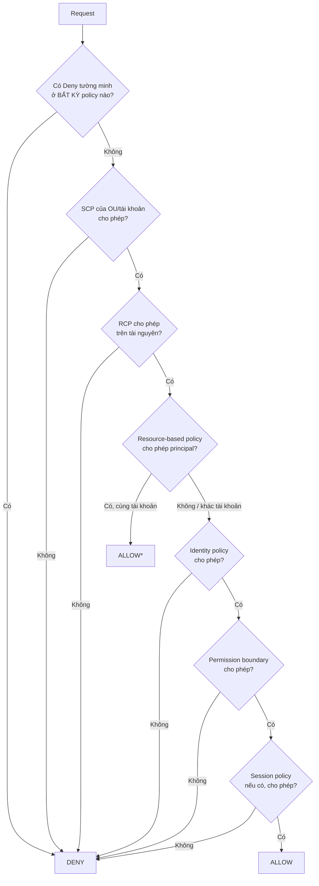

# Tài khoản, IAM và AWS Organizations

**Mục đích:** thiết kế nền móng danh tính và tài khoản AWS cho LearnHub: nhiều tài khoản, quyền tối thiểu, không dùng khóa truy cập dài hạn, chặn sai lầm bằng chính sách tổ chức. Đây là phần quyết định "ai được làm gì" trước khi có bất kỳ server nào.
**Liên quan:** [02-mang-vpc.md](02-mang-vpc.md) · [07-bao-mat-aws.md](07-bao-mat-aws.md) · [09-iac-ci-cd-aws.md](09-iac-ci-cd-aws.md) · [13-checklist-review-aws.md](13-checklist-review-aws.md) · [../07-he-thong-server/07-cloud-kien-truc.md](../07-he-thong-server/07-cloud-kien-truc.md) · [../05-backend-senior/03-phan-quyen.md](../05-backend-senior/03-phan-quyen.md)

> Ghi chú độ chính xác: AWS thay đổi tính năng liên tục. Tên dịch vụ/tính năng dưới đây đúng theo hiểu biết đến 2026; giới hạn (quota) và giá luôn phải kiểm tra lại trên tài liệu AWS chính thức.

---

## 1. Tại sao nhiều tài khoản (multi-account)

Một tài khoản AWS là **ranh giới cô lập mạnh nhất** AWS cung cấp: quyền IAM, hạn mức (quota), hóa đơn và "bán kính nổ" (blast radius) khi lộ thông tin đăng nhập đều tách biệt theo tài khoản.

| Một tài khoản chung | Nhiều tài khoản |
|---|---|
| Dev vô tình xóa DB production vì cùng quyền | Dev không có quyền gì trong tài khoản prod |
| Một khóa bị lộ → toàn bộ hệ thống | Lộ khóa dev → chỉ dev bị ảnh hưởng |
| Hạn mức (ví dụ Lambda concurrency) dùng chung, load test làm sập prod | Hạn mức riêng mỗi tài khoản |
| Khó tách chi phí | Chi phí theo tài khoản rõ ràng |
| Chính sách IAM phức tạp với điều kiện theo tag | Chính sách đơn giản: "trong tài khoản này, team X là admin" |

**Quy tắc:** ít nhất tách **prod** khỏi **non-prod**, và tách **log/bảo mật** khỏi workload.

## 2. Cấu trúc Organizations cho LearnHub

```
Root (management account — chỉ billing + Organizations, KHÔNG chạy workload)
├── OU: Security
│   ├── log-archive        (CloudTrail org trail, Config, VPC Flow Logs — chỉ ghi, gần như không ai có quyền xóa)
│   └── security-tooling   (GuardDuty/Security Hub delegated admin, IAM Access Analyzer)
├── OU: Infrastructure
│   ├── network            (Transit Gateway, Route 53 Resolver, egress tập trung — tùy chọn)
│   └── shared-services    (ECR, CI runners, artifact)
├── OU: Workloads
│   ├── OU: Prod
│   │   └── learnhub-prod
│   └── OU: NonProd
│       ├── learnhub-staging
│       └── learnhub-dev
├── OU: Sandbox            (thử nghiệm cá nhân, ngân sách giới hạn, dọn định kỳ)
└── OU: Suspended          (tài khoản chờ đóng — SCP deny all)
```

- **Management account**: quyền tối cao với Organizations. SCP **không áp dụng** cho management account → không chạy gì ở đây, ít người truy cập nhất.
- **Delegated administrator**: giao quyền quản trị GuardDuty, Security Hub, Config, IAM Identity Center… cho tài khoản security-tooling để không phải đăng nhập management account.
- **AWS Control Tower** dựng sẵn landing zone theo mô hình trên (OU Security, log archive, audit, guardrails, Account Factory). Dùng khi muốn chuẩn hóa nhanh; tự dựng bằng Terraform khi cần kiểm soát chi tiết. Không bắt buộc, nhưng **đừng** bỏ các thành phần nó mang lại (org trail, log archive, SCP baseline).

## 3. Service Control Policies (SCP) và Resource Control Policies (RCP)

**SCP** đặt *trần quyền tối đa* cho principal (user/role) trong tài khoản thành viên. SCP **không cấp quyền**, chỉ giới hạn. Nếu SCP không cho phép thì dù IAM policy có `Allow` vẫn bị từ chối.

**RCP** (ra mắt cuối 2024) đặt trần cho *tài nguyên* trong tổ chức, áp dụng cho một số dịch vụ (ban đầu gồm S3, STS, KMS, SQS, Secrets Manager — kiểm tra danh sách hiện tại). Dùng để thực thi "data perimeter": tài nguyên của ta chỉ được truy cập bởi principal trong tổ chức, kể cả khi ai đó lỡ viết bucket policy mở.

### SCP mẫu (áp ở OU Workloads)

```json
{
  "Version": "2012-10-17",
  "Statement": [
    {
      "Sid": "DenyOutsideApprovedRegions",
      "Effect": "Deny",
      "NotAction": [
        "iam:*", "organizations:*", "sts:*", "support:*",
        "cloudfront:*", "route53:*", "waf:*", "wafv2:*", "acm:*",
        "budgets:*", "ce:*", "health:*", "globalaccelerator:*", "shield:*"
      ],
      "Resource": "*",
      "Condition": {
        "StringNotEquals": { "aws:RequestedRegion": ["ap-southeast-1", "us-east-1"] },
        "ArnNotLike": { "aws:PrincipalArn": "arn:aws:iam::*:role/OrgBreakGlass" }
      }
    },
    {
      "Sid": "ProtectSecurityBaseline",
      "Effect": "Deny",
      "Action": [
        "cloudtrail:StopLogging", "cloudtrail:DeleteTrail", "cloudtrail:UpdateTrail",
        "guardduty:DeleteDetector", "guardduty:DisassociateFromMasterAccount",
        "config:DeleteConfigurationRecorder", "config:StopConfigurationRecorder",
        "access-analyzer:DeleteAnalyzer"
      ],
      "Resource": "*"
    },
    {
      "Sid": "DenyLeavingOrg",
      "Effect": "Deny",
      "Action": "organizations:LeaveOrganization",
      "Resource": "*"
    },
    {
      "Sid": "DenyRootUser",
      "Effect": "Deny",
      "Action": "*",
      "Resource": "*",
      "Condition": { "StringLike": { "aws:PrincipalArn": "arn:aws:iam::*:root" } }
    },
    {
      "Sid": "DenyIamUserAccessKeys",
      "Effect": "Deny",
      "Action": ["iam:CreateAccessKey", "iam:CreateUser"],
      "Resource": "*",
      "Condition": {
        "ArnNotLike": { "aws:PrincipalArn": "arn:aws:iam::*:role/OrgBreakGlass" }
      }
    }
  ]
}
```

Giải thích:

- Giữ `us-east-1` vì ACM cho CloudFront, một số dịch vụ toàn cầu có endpoint ở đó.
- `NotAction` liệt kê dịch vụ toàn cầu — nếu không, chặn region sẽ làm hỏng IAM/CloudFront. Rà lại danh sách khi dùng thêm dịch vụ toàn cầu.
- SCP có giới hạn kích thước và số policy mỗi target — kiểm tra quota hiện tại.

### RCP mẫu: chỉ principal trong tổ chức được truy cập S3

```json
{
  "Version": "2012-10-17",
  "Statement": [
    {
      "Sid": "EnforceOrgIdentities",
      "Effect": "Deny",
      "Principal": "*",
      "Action": "s3:*",
      "Resource": "*",
      "Condition": {
        "StringNotEqualsIfExists": { "aws:PrincipalOrgID": "<ORG_ID>" },
        "BoolIfExists": { "aws:PrincipalIsAWSService": "false" }
      }
    }
  ]
}
```

> Bucket công khai có chủ đích hoặc truy cập qua CloudFront OAC (service principal) cần được tính tới. **Luôn thử SCP/RCP mới ở OU thử nghiệm** — một SCP sai có thể khóa cả team khỏi prod.

## 4. Danh tính cho con người: IAM Identity Center

**Không tạo IAM user cho người.** Dùng IAM Identity Center (trước đây là AWS SSO):

- Nguồn danh tính: Microsoft Entra ID / Google Workspace / Okta qua SAML + SCIM, hoặc thư mục tích hợp sẵn.
- **Permission set** = mẫu quyền được triển khai thành IAM role trong từng tài khoản.
- Người dùng đăng nhập portal → chọn tài khoản + vai trò → nhận thông tin đăng nhập tạm thời.

| Permission set | Gán cho | Tài khoản | Ghi chú |
|---|---|---|---|
| `ReadOnly` | Mọi dev | prod, staging | Xem log, metric; deny đọc giá trị secret |
| `Developer` | Dev | dev | Gần toàn quyền trong dev, trừ IAM rộng |
| `OnCallOperator` | Trực ca | prod | Restart, scale, xem metric DB; không xóa tài nguyên |
| `Admin` | 2–3 người | prod | MFA, session ngắn (1h), cảnh báo khi dùng |
| (deploy) | Không gán cho người | — | CI dùng role riêng, xem [09-iac-ci-cd-aws.md](09-iac-ci-cd-aws.md) |

CLI với Identity Center:

```bash
aws configure sso                                  # tạo profile, ví dụ learnhub-prod-readonly
aws sso login --profile learnhub-prod-readonly
aws sts get-caller-identity --profile learnhub-prod-readonly
```

Không còn file `~/.aws/credentials` chứa khóa dài hạn.

## 5. Danh tính cho máy: luôn là role

| Workload | Cơ chế lấy quyền |
|---|---|
| EC2 | Instance profile (role) qua IMDSv2 |
| ECS task | Task role (`taskRoleArn`) — khác execution role (kéo image, đọc secret lúc khởi động) |
| EKS pod | EKS Pod Identity hoặc IRSA |
| Lambda | Execution role |
| GitHub Actions / GitLab CI | OIDC federation → `AssumeRoleWithWebIdentity` |
| Server on-prem | IAM Roles Anywhere (chứng chỉ X.509) |
| Tài khoản khác | `sts:AssumeRole` cross-account với trust policy chặt |

### STS AssumeRole cross-account

Trust policy trên role `LearnHubDeploy` trong tài khoản prod:

```json
{
  "Version": "2012-10-17",
  "Statement": [{
    "Effect": "Allow",
    "Principal": { "AWS": "arn:aws:iam::<SHARED_SERVICES_ACCOUNT_ID>:role/ci-runner" },
    "Action": ["sts:AssumeRole", "sts:TagSession"],
    "Condition": {
      "StringEquals": { "aws:PrincipalOrgID": "<ORG_ID>" }
    }
  }]
}
```

```bash
aws sts assume-role \
  --role-arn arn:aws:iam::<PROD_ACCOUNT_ID>:role/LearnHubDeploy \
  --role-session-name deploy-$(date +%s) \
  --duration-seconds 3600
```

- `Principal` phải là ARN cụ thể, **không** `"AWS": "*"`.
- Bên thứ ba (SaaS giám sát): bắt buộc điều kiện `sts:ExternalId` để chống "confused deputy".
- `role-session-name` có ý nghĩa → hiện trong CloudTrail, giúp truy vết.

## 6. Logic đánh giá chính sách (policy evaluation)

Kiến thức nền quan trọng nhất của IAM. Một request được cho phép **chỉ khi** vượt qua mọi lớp:



Điểm then chốt:

1. **Mặc định là Deny** (implicit deny). Không có `Allow` nào → từ chối.
2. **Explicit Deny luôn thắng**, bất kể có bao nhiêu `Allow`.
3. **Cross-account**: cần **cả** identity policy ở tài khoản gọi **và** resource policy (hoặc trust policy) ở tài khoản đích cho phép.
4. **Cùng tài khoản**: resource policy cho phép trực tiếp một role ARN có thể đủ dù identity policy không có Allow (*có ngoại lệ, ví dụ với permission boundary/session policy, KMS, trust policy của role*). Đừng dựa vào điều này — thiết kế rõ ở cả hai phía.
5. **Permission boundary**, **SCP**, **RCP** chỉ giới hạn, không cấp.
6. **KMS** đặc biệt: key policy phải cho phép (trực tiếp hoặc ủy quyền cho IAM của tài khoản), nếu không thì không IAM policy nào cấp được quyền dùng key.

Kiểm tra bằng mô phỏng:

```bash
aws iam simulate-principal-policy \
  --policy-source-arn arn:aws:iam::<ACCOUNT_ID>:role/learnhub-api-task \
  --action-names s3:PutObject \
  --resource-arns arn:aws:s3:::learnhub-prod-media/uploads/abc.png
```

(Mô phỏng không tính SCP/RCP và một số điều kiện ngữ cảnh — dùng để kiểm tra nhanh, không thay cho thử thật ở staging.)

## 7. Identity policy vs resource policy

| | Identity-based | Resource-based |
|---|---|---|
| Gắn vào | User, group, role | Tài nguyên: S3 bucket, SQS queue, KMS key, SNS topic, Lambda, ECR repo, Secrets Manager… |
| Có `Principal` | Không | Có |
| Cross-account | Phải kết hợp với resource policy | Là nơi cấp quyền cho tài khoản khác |
| Ví dụ LearnHub | Role API được ghi S3 `uploads/*` | Bucket chỉ nhận request qua TLS, từ trong tổ chức |

### Identity policy tối thiểu cho task API của LearnHub

```json
{
  "Version": "2012-10-17",
  "Statement": [
    {
      "Sid": "MediaUploadsPresign",
      "Effect": "Allow",
      "Action": ["s3:PutObject", "s3:GetObject"],
      "Resource": "arn:aws:s3:::learnhub-prod-media/uploads/*"
    },
    {
      "Sid": "SendModerationJobs",
      "Effect": "Allow",
      "Action": "sqs:SendMessage",
      "Resource": "arn:aws:sqs:ap-southeast-1:<ACCOUNT_ID>:learnhub-moderation"
    },
    {
      "Sid": "ReadOwnSecrets",
      "Effect": "Allow",
      "Action": "secretsmanager:GetSecretValue",
      "Resource": "arn:aws:secretsmanager:ap-southeast-1:<ACCOUNT_ID>:secret:learnhub/prod/api/<NAME>-*"
    },
    {
      "Sid": "UseMediaKey",
      "Effect": "Allow",
      "Action": ["kms:GenerateDataKey", "kms:Decrypt"],
      "Resource": "arn:aws:kms:ap-southeast-1:<ACCOUNT_ID>:key/<KEY_ID>",
      "Condition": { "StringEquals": { "kms:ViaService": "s3.ap-southeast-1.amazonaws.com" } }
    }
  ]
}
```

(Hậu tố `-*` vì Secrets Manager thêm 6 ký tự ngẫu nhiên vào ARN.)

### Resource policy cho bucket media

```json
{
  "Version": "2012-10-17",
  "Statement": [
    {
      "Sid": "DenyInsecureTransport",
      "Effect": "Deny",
      "Principal": "*",
      "Action": "s3:*",
      "Resource": ["arn:aws:s3:::learnhub-prod-media", "arn:aws:s3:::learnhub-prod-media/*"],
      "Condition": { "Bool": { "aws:SecureTransport": "false" } }
    },
    {
      "Sid": "AllowCloudFrontOAC",
      "Effect": "Allow",
      "Principal": { "Service": "cloudfront.amazonaws.com" },
      "Action": "s3:GetObject",
      "Resource": "arn:aws:s3:::learnhub-prod-media/public/*",
      "Condition": {
        "StringEquals": { "AWS:SourceArn": "arn:aws:cloudfront::<ACCOUNT_ID>:distribution/<DISTRIBUTION_ID>" }
      }
    }
  ]
}
```

## 8. Condition key hay dùng

| Key | Dùng để | Ghi chú |
|---|---|---|
| `aws:PrincipalOrgID` | Chỉ principal trong tổ chức | Trust policy, bucket policy |
| `aws:ResourceOrgID` | Principal của ta chỉ ghi vào tài nguyên trong tổ chức (chống tuồn dữ liệu sang bucket ngoài) | VPC endpoint policy, SCP |
| `aws:SecureTransport` | Bắt buộc TLS | Deny khi `false` |
| `aws:SourceIp` | Giới hạn IP công khai | **Không khớp** khi request đi qua VPC endpoint (dùng `aws:SourceVpce`/`aws:SourceVpc`) — lỗi rất hay gặp |
| `aws:SourceVpce`, `aws:SourceVpc` | Chỉ cho phép qua VPC endpoint | Bucket chỉ truy cập từ VPC prod |
| `aws:MultiFactorAuthPresent` | Yêu cầu MFA | Áp dụng cho credential tạm có MFA; với Identity Center, MFA thực thi ở bước đăng nhập |
| `aws:RequestedRegion` | Chặn region | SCP |
| `aws:PrincipalTag/…`, `aws:ResourceTag/…` | ABAC theo tag | `team=learnhub` chỉ sửa tài nguyên `team=learnhub` |
| `aws:SourceArn`, `aws:SourceAccount` | Chống confused deputy khi service gọi thay | SNS→SQS, S3→Lambda, CloudFront OAC |
| `aws:CalledVia` / `kms:ViaService` | Chỉ cho phép khi gọi qua service cụ thể | Dùng KMS chỉ qua S3 |

## 9. Permission boundary

Dùng khi **ủy quyền tạo role** cho team/CI mà không cho leo thang đặc quyền.

Kịch bản: pipeline Terraform của LearnHub cần tạo role cho Lambda mới. Nếu cho `iam:CreateRole` + `iam:AttachRolePolicy` tự do → pipeline có thể tạo role admin và dùng nó.

```json
{
  "Sid": "CreateRolesOnlyWithBoundary",
  "Effect": "Allow",
  "Action": ["iam:CreateRole", "iam:PutRolePermissionsBoundary", "iam:AttachRolePolicy", "iam:PutRolePolicy"],
  "Resource": "arn:aws:iam::<ACCOUNT_ID>:role/learnhub-*",
  "Condition": {
    "StringEquals": {
      "iam:PermissionsBoundary": "arn:aws:iam::<ACCOUNT_ID>:policy/LearnHubWorkloadBoundary"
    }
  }
}
```

Kèm deny sửa/xóa chính boundary policy và deny `iam:DeleteRolePermissionsBoundary`. Quyền hiệu lực của role mới = (policy gắn) ∩ (boundary).

## 10. IAM Access Analyzer

| Tính năng | Tác dụng |
|---|---|
| External access findings | Tài nguyên chia sẻ ra ngoài tổ chức/tài khoản (bucket, KMS key, role trust…) |
| Unused access | Role/khóa/quyền không dùng trong N ngày |
| Policy validation | Kiểm cú pháp và cảnh báo bảo mật (`aws accessanalyzer validate-policy`) |
| Policy generation | Sinh policy tối thiểu từ CloudTrail thực tế của một role |
| Custom policy checks | Kiểm tra trong CI: policy mới có cấp quyền mới không, có cho phép action X không |

```bash
aws accessanalyzer check-no-new-access \
  --new-policy-document file://new.json \
  --existing-policy-document file://old.json \
  --policy-type IDENTITY_POLICY
```

## 11. Quy trình đạt quyền tối thiểu

1. Bắt đầu từ thiết kế: API cần ghi S3 `uploads/`, gửi SQS `moderation`… → danh sách action.
2. Viết policy với **ARN tài nguyên cụ thể**, không `*`.
3. Chạy ở dev/staging; xem `AccessDenied` trong CloudTrail/log, bổ sung có chủ đích.
4. Sau 30–90 ngày: Access Analyzer "unused access" → gỡ quyền thừa.
5. Policy là code (Terraform), review trong PR, `check-no-new-access` chặn mở rộng quyền âm thầm.

## 12. Root account

- Root có quyền không giới hạn trong tài khoản. Chỉ dùng cho tác vụ thật sự cần root (một số thao tác billing, đóng tài khoản, khôi phục).
- **Bật MFA** (ưu tiên khóa phần cứng/passkey), **không tạo access key** cho root.
- Email root là địa chỉ nhóm do công ty kiểm soát, không phải hộp thư cá nhân.
- Organizations có **quản lý root tập trung** (centralized root access, ra mắt cuối 2024): gỡ thông tin đăng nhập root của tài khoản thành viên và thực hiện tác vụ đặc quyền từ tài khoản quản trị. Kiểm tra và bật nếu khả dụng.
- SCP `DenyRootUser` (mục 3) chặn root trong tài khoản thành viên.
- Cảnh báo: EventBridge rule bắt `ConsoleLogin` của root → SNS → kênh trực ca.

## 13. Break-glass

Khi Identity Center hỏng, IdP mất kết nối, hoặc SCP sai khóa toàn bộ:

- 1–2 role `OrgBreakGlass` (ngoại lệ trong SCP), truy cập bằng phương tiện độc lập với IdP, MFA phần cứng, thông tin giữ offline, cần 2 người.
- Mọi lần dùng → cảnh báo tức thì + rà soát sau sự cố.
- **Diễn tập** 6 tháng/lần: có thật sự đăng nhập được không?

## 14. Câu chuyện sự cố điển hình

| Sự cố | Nguyên nhân | Bài học |
|---|---|---|
| Hóa đơn hàng chục nghìn USD qua đêm do máy đào coin | Access key dài hạn bị commit lên GitHub công khai | Không key dài hạn; SCP chặn region; budget alert; secret scanning (repo này có gitleaks) |
| `terraform destroy` nhầm workspace → mất DB prod | Một tài khoản cho mọi môi trường | Tách tài khoản; deletion protection; quyền prod chỉ qua pipeline |
| Bucket chứa đề thi lộ ra ngoài | Policy `"Principal": "*"` để "test nhanh" | Block Public Access cấp tài khoản; RCP; Access Analyzer |
| Team bị khóa khỏi prod 3 tiếng | SCP chặn region thiếu `sts:*` trong `NotAction` | Thử SCP ở OU sandbox; có break-glass |

## 15. Lỗi hay gặp (kể cả do AI agent viết)

| Lỗi | Vì sao nguy hiểm | Sửa |
|---|---|---|
| `"Action": "*", "Resource": "*"` "cho chạy được đã" | Toàn quyền, leo thang tức thì | Liệt kê action và ARN cụ thể |
| `"Action": "s3:*"` trên `"Resource": "*"` | Đọc/xóa mọi bucket, kể cả log | Giới hạn bucket/prefix |
| Tạo IAM user + access key cho ứng dụng trên EC2/ECS | Khóa dài hạn, dễ lộ | Instance profile / task role |
| Trust policy `"Principal": {"AWS": "*"}` | Mọi tài khoản AWS assume được | ARN cụ thể + `aws:PrincipalOrgID` |
| `aws:SourceIp` khi traffic qua VPC endpoint | Không bao giờ khớp → agent "sửa" bằng cách bỏ điều kiện | `aws:SourceVpce` |
| `iam:PassRole` trên `*` | Gắn role mạnh nhất vào EC2/Lambda tự tạo → leo thang | Role cụ thể + `iam:PassedToService` |
| `AdministratorAccess` cho role CI | Pipeline bị chiếm = mất tài khoản | Role deploy theo phạm vi, boundary |
| Chạy workload ở management account | SCP không áp dụng | Workload ở tài khoản thành viên |

## Checklist review

- [ ] Tách tài khoản prod / non-prod / log-archive / security; management account không chạy workload.
- [ ] Người dùng đăng nhập qua IAM Identity Center; **không** có IAM user cho người (trừ break-glass có tài liệu).
- [ ] Không access key dài hạn cho ứng dụng hoặc CI; CI dùng OIDC.
- [ ] Không policy nào `"Action": "*"` + `"Resource": "*"` ngoài role admin được phê duyệt.
- [ ] `iam:PassRole` giới hạn role cụ thể; quyền tạo role có permission boundary.
- [ ] Trust policy có principal cụ thể; bên thứ ba có `sts:ExternalId`.
- [ ] Điều kiện mạng đúng loại (`aws:SourceVpce` khi qua endpoint).
- [ ] SCP baseline: chặn region, bảo vệ CloudTrail/GuardDuty/Config, chặn rời tổ chức, chặn root; đã thử ở OU thử nghiệm.
- [ ] Root: MFA, không access key, email nhóm, cảnh báo khi đăng nhập.
- [ ] Access Analyzer bật cấp tổ chức; finding external access được xử lý.
- [ ] Policy nằm trong IaC, review qua PR, có kiểm tra tự động (validate / check-no-new-access).
- [ ] Có quy trình break-glass đã diễn tập.
