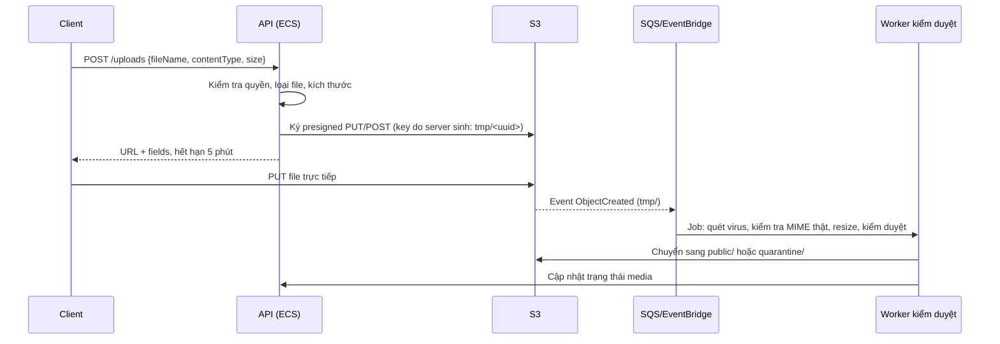

# Lưu trữ và database trên AWS: S3, EBS/EFS, RDS/Aurora, DynamoDB, ElastiCache, OpenSearch

**Mục đích:** chọn và vận hành đúng dịch vụ lưu trữ/dữ liệu được quản lý cho LearnHub: media trên S3, PostgreSQL trên RDS hoặc Aurora, cache trên ElastiCache, và biết khi nào DynamoDB/OpenSearch thực sự đáng dùng.
**Liên quan:** [02-mang-vpc.md](02-mang-vpc.md) · [05-messaging-integration.md](05-messaging-integration.md) · [07-bao-mat-aws.md](07-bao-mat-aws.md) · [10-ha-dr-well-architected.md](10-ha-dr-well-architected.md) · [11-chi-phi-finops.md](11-chi-phi-finops.md) · [../06-database-chuyen-sau/04-replication-ha.md](../06-database-chuyen-sau/04-replication-ha.md) · [../06-database-chuyen-sau/05-backup-restore-dr.md](../06-database-chuyen-sau/05-backup-restore-dr.md) · [../06-database-chuyen-sau/09-redis-chuyen-sau.md](../06-database-chuyen-sau/09-redis-chuyen-sau.md) · [../06-database-chuyen-sau/10-chon-database-nosql-search.md](../06-database-chuyen-sau/10-chon-database-nosql-search.md)

> Giới hạn, thời gian failover, giá: số liệu để định hướng — kiểm tra tài liệu AWS và AWS Pricing hiện hành.

---

## 1. Amazon S3 chuyên sâu

### Mô hình nhất quán và hiệu năng

- S3 có **strong read-after-write consistency** cho mọi thao tác (từ cuối 2020): ghi xong đọc ngay thấy bản mới, LIST thấy object mới.
- Hiệu năng: tối thiểu khoảng **3.500 PUT/COPY/POST/DELETE và 5.500 GET/HEAD mỗi giây mỗi prefix**; S3 tự chia partition khi tải tăng dần. Tải tăng đột ngột có thể gặp `503 SlowDown` tạm thời → SDK retry với backoff. Phân tán key qua nhiều prefix nếu cần rất cao.
- Object tối đa 5 TB; upload một lần tối đa 5 GB → file lớn dùng **multipart upload** (khuyến nghị từ ~100 MB), có thể upload song song và tiếp tục khi lỗi.
- Hỗ trợ **conditional writes** (`If-None-Match`, `If-Match`) để tránh ghi đè đồng thời — kiểm tra SDK hỗ trợ.

### Storage class

| Class | Dùng cho LearnHub | Lưu ý |
|---|---|---|
| S3 Standard | Ảnh/video bài viết mới, truy cập thường xuyên | |
| S3 Intelligent-Tiering | Media mà mẫu truy cập khó đoán | Phí giám sát mỗi object; object nhỏ (<128 KB) không được chuyển tier |
| S3 Standard-IA / One Zone-IA | Bài nộp cũ, ít đọc | Phí truy xuất, thời gian lưu tối thiểu; One Zone mất khi AZ mất |
| Glacier Instant Retrieval | Lưu trữ đọc hiếm nhưng cần ngay | |
| Glacier Flexible / Deep Archive | Log audit, backup dài hạn | Truy xuất phút–giờ; thời gian lưu tối thiểu dài |
| S3 Express One Zone | Dữ liệu tạm hiệu năng rất cao, độ trễ thấp (một AZ) | Không phải để lưu lâu dài |

### Lifecycle

```json
{
  "Rules": [
    {
      "ID": "uploads-tmp-cleanup",
      "Filter": { "Prefix": "tmp/" },
      "Status": "Enabled",
      "Expiration": { "Days": 1 },
      "AbortIncompleteMultipartUpload": { "DaysAfterInitiation": 1 }
    },
    {
      "ID": "submissions-archive",
      "Filter": { "Prefix": "submissions/" },
      "Status": "Enabled",
      "Transitions": [
        { "Days": 90, "StorageClass": "STANDARD_IA" },
        { "Days": 365, "StorageClass": "GLACIER_IR" }
      ],
      "NoncurrentVersionExpiration": { "NoncurrentDays": 30 }
    }
  ]
}
```

`AbortIncompleteMultipartUpload` hay bị quên → các phần upload dở dang tính phí âm thầm.

### Versioning và Object Lock

- **Versioning**: giữ mọi phiên bản; xóa chỉ tạo *delete marker*. Bảo vệ khỏi xóa/ghi đè nhầm và ransomware. Kết hợp lifecycle để xóa phiên bản cũ sau N ngày, nếu không chi phí tăng mãi.
- **Object Lock** (cần versioning): WORM — *Governance mode* (người có quyền đặc biệt vẫn gỡ được), *Compliance mode* (không ai xóa được trước hạn, kể cả root). Dùng cho backup, log audit, kết quả thi cần bảo toàn.
- **MFA Delete**: chỉ root bật được, vận hành phức tạp — thường thay bằng Object Lock + SCP.

### Block Public Access và quyền

- Bucket mới mặc định **bật Block Public Access** và **tắt ACL** (Object Ownership = BucketOwnerEnforced) từ 2023. **Bật Block Public Access ở cấp tài khoản** để không ai lỡ tay mở.
- Nội dung công khai (ảnh bài viết) **phục vụ qua CloudFront + OAC**, không mở bucket. Xem [06-edge-cloudfront-alb-waf.md](06-edge-cloudfront-alb-waf.md).
- Bucket policy: deny không TLS, giới hạn theo tổ chức/VPC endpoint (mẫu trong [01-tai-khoan-iam-organizations.md](01-tai-khoan-iam-organizations.md)).
- Mã hóa: mặc định SSE-S3 cho mọi object mới. Dùng **SSE-KMS** khi cần kiểm soát key/audit; bật **S3 Bucket Keys** để giảm số lần gọi KMS (giảm chi phí và tránh throttle KMS).

### Upload trực tiếp bằng presigned URL

Không cho file đi qua API server (tốn băng thông, RAM, thời gian request). Luồng:



- Dùng **presigned POST** với `content-length-range` để S3 ép giới hạn kích thước (presigned PUT không giới hạn được kích thước một cách chặt).
- Key do server sinh, không dùng tên file của người dùng.
- Không tin `Content-Type` client gửi — worker kiểm tra magic bytes.

```typescript
import { S3Client } from "@aws-sdk/client-s3";
import { createPresignedPost } from "@aws-sdk/s3-presigned-post";
import { randomUUID } from "node:crypto";

const s3 = new S3Client({ region: "ap-southeast-1" });

export async function createUpload(userId: string, contentType: string) {
  const allowed = ["image/png", "image/jpeg", "image/webp"];
  if (!allowed.includes(contentType)) throw new Error("UNSUPPORTED_TYPE");
  const key = `tmp/${userId}/${randomUUID()}`;
  return createPresignedPost(s3, {
    Bucket: process.env.MEDIA_BUCKET!,
    Key: key,
    Conditions: [
      ["content-length-range", 1, 10 * 1024 * 1024],   // tối đa 10 MB
      ["eq", "$Content-Type", contentType],
    ],
    Fields: { "Content-Type": contentType },
    Expires: 300,
  });
}
```

### Event notifications

- S3 → SQS/SNS/Lambda trực tiếp, hoặc S3 → **EventBridge** (lọc linh hoạt hơn, nhiều đích, replay qua archive).
- Sự kiện được giao **ít nhất một lần**, có thể trùng và không đảm bảo thứ tự → consumer idempotent (theo `bucket + key + versionId/sequencer`).
- Tránh vòng lặp: Lambda ghi vào cùng bucket/prefix kích hoạt chính nó → lọc theo prefix khác nhau (`tmp/` vs `public/`).

## 2. EBS vs EFS vs FSx

| | EBS | EFS | FSx (Lustre/ONTAP/Windows/OpenZFS) |
|---|---|---|---|
| Kiểu | Block, gắn 1 instance (multi-attach hạn chế với io2) | NFS, chia sẻ nhiều instance/task, đa AZ | Hệ thống file chuyên dụng |
| Phạm vi | 1 AZ | Region (hoặc One Zone) | Tùy loại |
| Dùng cho | Đĩa OS, DB tự quản | File chia sẻ giữa nhiều container (hiếm khi cần với kiến trúc S3) | HPC (Lustre), SMB Windows, ứng dụng enterprise NFS/SMB |
| LearnHub | Đĩa node chấm bài | Hầu như không cần — dùng S3 | Không cần |

Ứng dụng web hiện đại: **lưu file vào S3**, không vào hệ thống file chia sẻ. EFS hay bị dùng sai làm "ổ chung" gây chậm và tốn kém.

## 3. RDS PostgreSQL vs Aurora PostgreSQL

### Kiến trúc lưu trữ

- **RDS PostgreSQL**: PostgreSQL chuẩn trên EBS. Multi-AZ = standby đồng bộ ở AZ khác (không đọc được), hoặc **Multi-AZ DB cluster** (1 writer + 2 standby đọc được, dùng replication semi-sync).
- **Aurora PostgreSQL**: tương thích PostgreSQL nhưng tầng lưu trữ riêng: dữ liệu ghi **6 bản trên 3 AZ**, quorum 4/6 để ghi, 3/6 để đọc; replica dùng chung storage nên lag thường rất thấp; storage tự mở rộng.

| Tiêu chí | RDS PostgreSQL (Multi-AZ instance) | RDS Multi-AZ DB cluster | Aurora PostgreSQL |
|---|---|---|---|
| Failover | Thường 1–2 phút | Thường dưới ~35 giây | Thường dưới ~30 giây (nhanh hơn với RDS Proxy/driver thông minh) |
| Read replica | Tối đa 15 (async, lag phụ thuộc tải) | 2 standby đọc được | Tối đa 15, chung storage |
| Storage | EBS gp3/io2, cấu hình IOPS | EBS io/gp3 | Tự động, tính theo GB + I/O (Standard) hoặc giá cao hơn không tính I/O (I/O-Optimized) |
| Phiên bản/extension | Gần với PostgreSQL gốc, ra phiên bản mới nhanh | | Có thể chậm hơn vài tháng; một số khác biệt |
| Tính năng riêng | | | Global Database, Serverless v2, clone nhanh, backtrack (MySQL), Limitless (sharding — kiểm tra khả dụng) |
| Chi phí | Thấp hơn ở quy mô nhỏ–vừa | Trung bình | Cao hơn ở tải nhỏ; có thể rẻ hơn khi nhiều replica/IO lớn |

**Quy tắc chọn cho LearnHub:**

- Bắt đầu: **RDS PostgreSQL Multi-AZ** (hoặc Multi-AZ DB cluster) nếu ngân sách hạn chế và tải vừa.
- Chọn **Aurora** khi: cần nhiều read replica với lag thấp (feed, báo cáo), failover nhanh, DR cross-region (Global Database), hoặc I/O lớn (khi đó tính I/O-Optimized).
- **I/O-Optimized**: hợp lý khi chi phí I/O chiếm phần lớn hóa đơn Aurora (AWS gợi ý ngưỡng khoảng 25% — kiểm tra lại); chuyển đổi được giữa hai chế độ (có giới hạn tần suất).

### Aurora Serverless v2

- Scale theo ACU (Aurora Capacity Unit) trong khoảng min–max, gần như tức thì, trong cùng cluster có thể trộn instance provisioned và serverless.
- Hỗ trợ min = 0 ACU (tự tạm dừng) cho môi trường dev — kiểm tra phiên bản engine hỗ trợ.
- Prod tải dao động lớn (giờ thi) → Serverless v2 cho reader; lưu ý giá mỗi ACU-giờ cao hơn instance tương đương khi chạy liên tục.

### Global Database

- Replica ở region khác với lag thường dưới 1 giây, dùng cho DR (RPO giây, RTO phút) và đọc gần người dùng ở region khác. Có **switchover** (có kế hoạch, không mất dữ liệu) và **failover** (sự cố).

### RDS Proxy

- Pool kết nối được quản lý, nằm giữa ứng dụng và DB: giảm số kết nối thật, giữ kết nối khi failover (giảm thời gian gián đoạn), hỗ trợ IAM auth và lấy credential từ Secrets Manager.
- Bắt buộc gần như với **Lambda**; hữu ích với ECS khi số task lớn.
- Lưu ý **pinning**: một số thao tác phiên (SET, prepared statement theo cách nhất định, temp table, advisory lock) làm kết nối bị "ghim" vào client → mất lợi ích pooling. Theo dõi metric `DatabaseConnectionsCurrentlySessionPinned`. Tương tự PgBouncer transaction mode (xem [../06-database-chuyen-sau/07-cau-hinh-van-hanh-monitoring.md](../06-database-chuyen-sau/07-cau-hinh-van-hanh-monitoring.md)).

### Parameter group

- Tạo **custom parameter group** ngay từ đầu (default group không sửa được). Thay đổi tham số *static* cần reboot.
- Tham số hay chỉnh: `log_min_duration_statement`, `shared_preload_libraries` (pg_stat_statements), `idle_in_transaction_session_timeout`, `statement_timeout` (thường đặt ở role/app), `rds.force_ssl = 1`, autovacuum.
- `shared_buffers` trên RDS mặc định tính theo RAM instance — chỉ chỉnh khi có lý do đo được.

### Quan sát

- **Performance Insights** (DB load theo wait event, top SQL) đang được hợp nhất vào **CloudWatch Database Insights**; AWS đã thông báo lộ trình chuyển đổi cho giao diện Performance Insights — kiểm tra hiện trạng và bật Database Insights (mức Standard/Advanced).
- **Enhanced Monitoring** cho metric OS chi tiết.
- Xuất log PostgreSQL sang CloudWatch Logs.

### Backup, snapshot, PITR

- **Automated backup**: retention 1–35 ngày, cho phép **PITR** tới mức vài phút gần nhất. Restore PITR **tạo instance mới** (không ghi đè) → phải đổi endpoint ứng dụng hoặc đổi tên.
- **Manual snapshot**: giữ đến khi xóa; copy sang region khác/tài khoản khác (tài khoản backup riêng, chống ransomware).
- **AWS Backup**: chính sách tập trung, vault với **Vault Lock**, copy cross-region/cross-account.
- **Diễn tập restore** định kỳ — đo RTO thực tế (restore DB lớn mất hàng giờ).
- Bật **deletion protection** và **final snapshot** khi xóa.

```bash
aws rds restore-db-instance-to-point-in-time \
  --source-db-instance-identifier learnhub-prod \
  --target-db-instance-identifier learnhub-prod-pitr-0915 \
  --restore-time 2026-11-20T09:15:00Z \
  --db-subnet-group-name learnhub-prod-db \
  --vpc-security-group-ids <SG_ID>
```

### Nâng cấp với Blue/Green Deployments

- RDS/Aurora **Blue/Green**: tạo môi trường "green" là bản sao đồng bộ (logical replication) của "blue", nâng cấp major version/đổi tham số/đổi instance trên green, kiểm thử, rồi **switchover** (thường dưới một phút; ghi bị chặn trong lúc chuyển).
- Hạn chế: yêu cầu logical replication (bảng cần primary key/replica identity), DDL trong lúc chạy có thể làm hỏng replication, một số extension không hỗ trợ — đọc kỹ tài liệu cho phiên bản của bạn.
- Thay thế: `pg_upgrade` in-place (downtime dài hơn) hoặc logical replication tự quản.

## 4. DynamoDB chuyên sâu

### Khi nào hợp với LearnHub

| Hợp | Không hợp |
|---|---|
| Truy cập theo khóa biết trước, quy mô cực lớn, độ trễ ổn định ms: session, idempotency key, rate-limit counter, trạng thái "đang làm bài" của 200k thí sinh, thông báo | Dữ liệu quan hệ cần JOIN, truy vấn ad-hoc, báo cáo (bài viết, bình luận, điểm, phân quyền) |
| Ghi rất nhiều, schema linh hoạt | Đội chưa quen thiết kế theo access pattern |
| Cần serverless, không quản lý kết nối (Lambda) | Cần transaction phức tạp nhiều bảng lớn |

LearnHub: **PostgreSQL là nguồn sự thật chính**. DynamoDB chỉ cho vài bảng phụ trợ có access pattern rõ ràng.

### Thiết kế khóa

- **Partition key** quyết định phân tán. Mỗi partition vật lý có giới hạn khoảng **3.000 RCU và 1.000 WCU** mỗi giây → khóa phải có cardinality cao, phân bố đều.
- **Sort key** cho truy vấn khoảng trong một partition (`begins_with`, `between`).
- Item tối đa **400 KB**.

Ví dụ bảng `exam_sessions` (trạng thái làm bài):

| PK | SK | Thuộc tính |
|---|---|---|
| `ATTEMPT#<attemptId>` | `META` | userId, examId, deadline, status, version |
| `ATTEMPT#<attemptId>` | `ANS#<questionId>` | answer, updatedAt |
| `USER#<userId>` | `ATTEMPT#<examId>#<attemptId>` | (item chỉ mục cho "các lượt làm của tôi") |

### Single-table design

- Gom nhiều loại entity vào một bảng, thiết kế khóa để mỗi access pattern là **một Query**. Mạnh khi access pattern ổn định; khó khi yêu cầu thay đổi thường xuyên. Không bắt buộc — nhiều bảng vẫn hợp lệ.
- **Liệt kê access pattern trước** rồi mới thiết kế khóa (ngược với SQL).

### GSI vs LSI

| | GSI | LSI |
|---|---|---|
| Khóa | PK + SK mới bất kỳ | Cùng PK, SK khác |
| Tạo | Bất kỳ lúc nào | **Chỉ khi tạo bảng** |
| Nhất quán | Chỉ eventually consistent | Có thể strongly consistent |
| Giới hạn | Throughput riêng; ghi bảng → ghi GSI (tốn WCU) | Item collection (cùng PK) tối đa 10 GB |

GSI bị throttle (thiếu capacity) có thể **throttle ghi vào bảng chính** — theo dõi.

### On-demand vs provisioned

| | On-demand | Provisioned (+ auto scaling) |
|---|---|---|
| Trả theo | Request | Capacity giờ (có thể reserved) |
| Hợp | Tải khó đoán, mới ra mắt, tải đột biến | Tải ổn định, có thể dự đoán |
| Lưu ý | AWS đã giảm giá on-demand đáng kể (cuối 2024) → thường là mặc định tốt | Auto scaling phản ứng chậm hơn đột biến |

### Hot partition

- Ví dụ sai: PK = `examId` cho câu trả lời → 200k thí sinh cùng một kỳ thi ghi vào cùng partition key → throttle.
- Sửa: PK = `attemptId` (hoặc thêm hậu tố shard `examId#<0..N>` khi cần gom theo exam). DynamoDB có adaptive capacity và *split for heat*, nhưng **một partition key** vẫn có giới hạn.

### TTL, Streams, transactions, DAX

- **TTL**: tự xóa item hết hạn (session, idempotency key), miễn phí; xóa không tức thì (có thể trễ) → khi đọc vẫn kiểm tra hạn.
- **Streams**: thay đổi theo thứ tự trong mỗi item, giữ 24h → Lambda/Pipes xử lý (CDC sang OpenSearch, analytics).
- **Transactions**: `TransactWriteItems` tối đa 100 item (kiểm tra giới hạn hiện tại), chi phí gấp đôi.
- **Conditional writes** cho idempotency / optimistic locking:

```typescript
await ddb.send(new PutCommand({
  TableName: "idempotency",
  Item: { pk: `IDEMP#${key}`, status: "IN_PROGRESS", expiresAt: nowSec + 86400 },
  ConditionExpression: "attribute_not_exists(pk)",   // đã có → ConditionalCheckFailedException → request trùng
}));
```

- **DAX**: cache in-memory tương thích API DynamoDB cho đọc micro-giây. Chỉ khi đọc lặp lại cực nhiều; eventual consistency; thêm chi phí và thành phần.

## 5. ElastiCache vs MemoryDB

| | ElastiCache (Valkey / Redis OSS / Memcached) | MemoryDB |
|---|---|---|
| Vai trò | **Cache** (mất dữ liệu chấp nhận được) | **Database chính** tương thích Redis/Valkey, bền vững |
| Độ bền | Replication async; snapshot | Ghi qua transaction log đa AZ trước khi xác nhận |
| Độ trễ ghi | Micro-giây | Ghi chậm hơn (ms một chữ số), đọc micro-giây |
| Giá | Thấp hơn | Cao hơn |
| LearnHub | Cache feed, profile, rate limit, session cache | Chỉ khi muốn Redis là nguồn sự thật (ví dụ leaderboard không thể mất) |

- **Valkey**: fork mã nguồn mở của Redis sau thay đổi license 2024; ElastiCache hỗ trợ Valkey với giá thấp hơn Redis OSS (tham khảo) → mặc định tốt cho cluster mới.
- **Serverless vs node-based**: ElastiCache Serverless tự scale, trả theo dữ liệu lưu + ECPU; node-based rẻ hơn khi tải ổn định và dự đoán được.
- Cluster mode enabled cho sharding; lưu ý multi-key command cần hash tag (xem [../06-database-chuyen-sau/09-redis-chuyen-sau.md](../06-database-chuyen-sau/09-redis-chuyen-sau.md)).
- Bật in-transit encryption + AUTH/RBAC; đặt trong subnet data; Multi-AZ với automatic failover.

## 6. Amazon OpenSearch Service

- Tìm kiếm bài viết full-text, gợi ý, lọc theo tag, tiếng Việt (analyzer ICU/phân tách từ — cần thử chất lượng).
- **Không** là nguồn sự thật: đồng bộ từ PostgreSQL qua CDC/outbox (xem [05-messaging-integration.md](05-messaging-integration.md)); có thể reindex lại từ đầu.
- Domain có **dedicated master nodes** (3, đa AZ) cho prod, **Multi-AZ with Standby** cho độ sẵn sàng cao; UltraWarm/cold cho log cũ.
- **OpenSearch Serverless**: không quản lý node, nhưng có mức chi phí tối thiểu (OCU) — với tải nhỏ có thể đắt hơn domain nhỏ.
- Chỉ thêm OpenSearch khi PostgreSQL full-text search không còn đủ (xem [../05-backend-senior/05-module-bai-viet-kiem-duyet.md](../05-backend-senior/05-module-bai-viet-kiem-duyet.md)).

## 7. Câu chuyện sự cố

| Sự cố | Nguyên nhân | Bài học |
|---|---|---|
| Hóa đơn S3 tăng đều mỗi tháng dù dữ liệu "không đổi" | Versioning bật, không có lifecycle cho noncurrent version; multipart dở dang | Lifecycle noncurrent + abort multipart |
| PITR xong nhưng ứng dụng vẫn ghi vào DB hỏng | Không biết PITR tạo instance mới | Runbook có bước đổi endpoint; diễn tập |
| Ghi DynamoDB bị throttle giờ thi | PK = `examId` | Thiết kế PK theo `attemptId` |
| Failover Aurora 30s nhưng ứng dụng lỗi 5 phút | Driver/pool cache DNS cũ, không reconnect | Dùng RDS Proxy hoặc driver hỗ trợ failover; TTL DNS thấp; retry |
| ElastiCache đầy, eviction làm DB quá tải | Không đặt TTL, maxmemory-policy không phù hợp | TTL mọi key cache, giám sát evictions |
| Bucket bị đọc công khai | Tắt Block Public Access để "test CloudFront" | OAC; BPA cấp tài khoản; Access Analyzer |

## 8. Lỗi hay gặp (kể cả do AI agent viết)

- Mở bucket công khai (`"Principal": "*"` + `s3:GetObject`) thay vì CloudFront OAC.
- Upload file qua API server thay vì presigned; không giới hạn kích thước.
- Dùng tên file của người dùng làm key S3.
- RDS `publicly_accessible = true`, không Multi-AZ cho prod, `skip_final_snapshot = true`, `deletion_protection = false`.
- Ghi mật khẩu DB vào Terraform/biến môi trường thay vì `manage_master_user_password` (Secrets Manager quản lý) hoặc IAM auth.
- Dùng DynamoDB cho dữ liệu quan hệ rồi phải Scan toàn bảng.
- Không có TTL cho key cache; dùng ElastiCache như nơi lưu dữ liệu duy nhất.
- Bỏ qua `rds.force_ssl`.

## Checklist review

- [ ] S3: Block Public Access cấp tài khoản; ACL tắt; truy cập công khai qua CloudFront OAC; bucket policy deny non-TLS.
- [ ] S3: versioning cho bucket quan trọng + lifecycle noncurrent + abort multipart; Object Lock cho backup/audit.
- [ ] Upload qua presigned POST có giới hạn kích thước/loại; key do server sinh; worker kiểm tra nội dung thật; consumer sự kiện idempotent.
- [ ] RDS/Aurora: Multi-AZ, subnet data, không công khai, mã hóa KMS, `rds.force_ssl`, deletion protection, final snapshot.
- [ ] Credential DB do Secrets Manager quản lý (xoay vòng) hoặc IAM auth; không mật khẩu trong code/IaC.
- [ ] Custom parameter group; pg_stat_statements; log query chậm; Database Insights/Performance Insights bật.
- [ ] Backup: retention phù hợp RPO, copy cross-account/region, đã diễn tập restore và đo RTO.
- [ ] Kế hoạch nâng cấp major version (Blue/Green hoặc thay thế) được thử ở staging.
- [ ] DynamoDB (nếu dùng): access pattern liệt kê trước, PK phân tán đều, TTL, conditional write cho idempotency, theo dõi throttle.
- [ ] ElastiCache: Valkey/Redis với TLS + AUTH, Multi-AZ, TTL cho mọi key cache, cảnh báo evictions/memory.
- [ ] OpenSearch (nếu dùng): không là nguồn sự thật, có đường reindex, dedicated master đa AZ.
