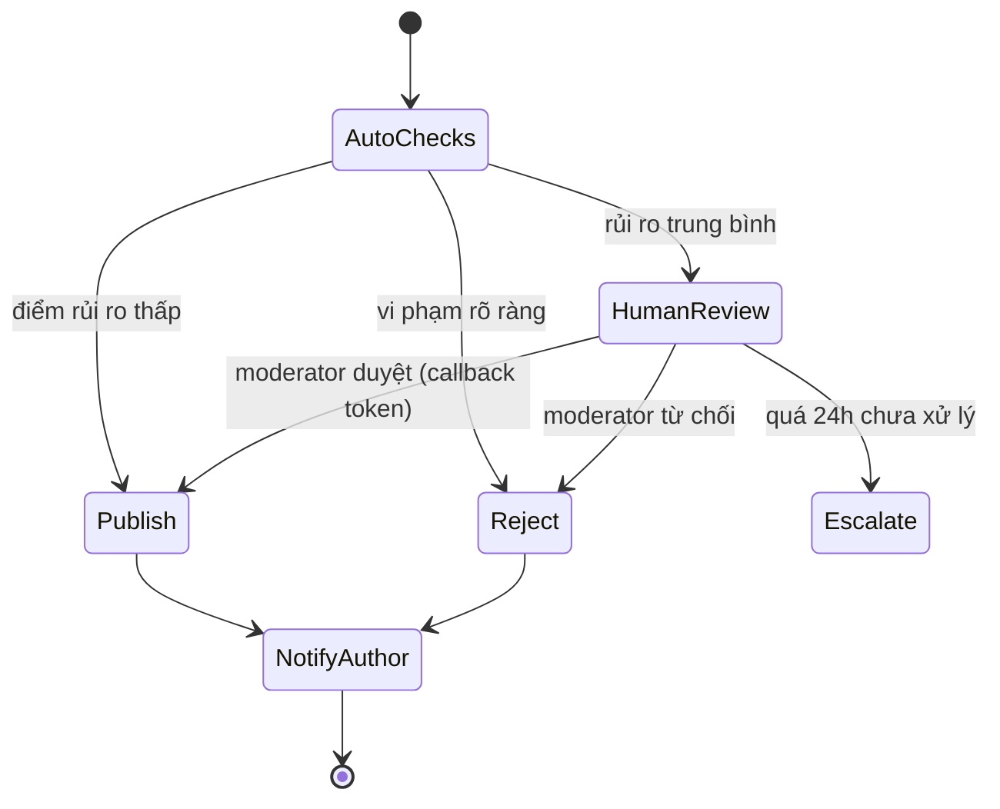

# Messaging và tích hợp trên AWS: SQS, SNS, EventBridge, Kinesis, MSK, Step Functions

**Mục đích:** chọn đúng dịch vụ bất đồng bộ của AWS cho từng luồng của LearnHub (kiểm duyệt, chấm bài, thông báo, analytics) và triển khai đúng ngữ nghĩa giao nhận (trùng lặp, thứ tự, lỗi, idempotency).
**Liên quan:** [03-compute-ec2-ecs-eks-lambda.md](03-compute-ec2-ecs-eks-lambda.md) · [04-luu-tru-va-database.md](04-luu-tru-va-database.md) · [08-observability-van-hanh.md](08-observability-van-hanh.md) · [11-chi-phi-finops.md](11-chi-phi-finops.md) · [../05-backend-senior/10-messaging-kafka.md](../05-backend-senior/10-messaging-kafka.md) · [../05-backend-senior/06-module-bai-kiem-tra-cham-bai.md](../05-backend-senior/06-module-bai-kiem-tra-cham-bai.md)

> Khái niệm chung (queue vs log, at-least-once, outbox, saga) ở [../05-backend-senior/10-messaging-kafka.md](../05-backend-senior/10-messaging-kafka.md). File này đi sâu vào dịch vụ AWS. Giới hạn/giá: kiểm tra tài liệu hiện hành.

---

## 1. Bảng quyết định tổng hợp

| Nhu cầu | Dịch vụ | Vì sao |
|---|---|---|
| Hàng đợi công việc, worker kéo về xử lý | **SQS Standard** | Gần như không giới hạn throughput, rẻ, đơn giản |
| Hàng đợi cần thứ tự theo nhóm + loại trùng | **SQS FIFO** | Thứ tự trong `MessageGroupId`, dedupe 5 phút |
| Một sự kiện → nhiều hệ thống nhận | **SNS → nhiều SQS** (fan-out) hoặc **EventBridge** | Tách producer khỏi consumer |
| Định tuyến sự kiện theo nội dung, tích hợp SaaS, nhiều đích, lịch | **EventBridge** | Rule lọc theo pattern JSON, 20+ loại đích, Scheduler, archive/replay |
| Luồng sự kiện thứ tự, nhiều consumer đọc lại, throughput cao, giữ lâu | **Kinesis Data Streams** hoặc **MSK** | Log có thứ tự theo shard/partition, replay |
| Đổ dữ liệu vào S3/Redshift/OpenSearch, không cần tự viết consumer | **Amazon Data Firehose** | Gom batch, nén, chuyển đổi định dạng |
| Hệ sinh thái Kafka (Connect, Streams, client có sẵn) | **Amazon MSK** | Kafka được quản lý |
| Di chuyển ứng dụng dùng JMS/AMQP/MQTT sẵn có | **Amazon MQ** (ActiveMQ/RabbitMQ) | Tương thích giao thức |
| Quy trình nhiều bước có trạng thái, retry, chờ người duyệt, saga | **Step Functions** | Workflow trực quan, retry/catch khai báo |
| Gửi thông báo đẩy/SMS/email tới người dùng | SNS mobile push / **Amazon SES** (email) / dịch vụ chuyên dụng | Chọn theo kênh |

**Mặc định cho LearnHub:** SQS + EventBridge + Step Functions. Chỉ thêm MSK/Kinesis khi có luồng sự kiện lớn cần replay/nhiều consumer độc lập (ví dụ analytics clickstream) — xem mục 6.

## 2. Amazon SQS chuyên sâu

### Standard vs FIFO

| | Standard | FIFO |
|---|---|---|
| Giao nhận | At-least-once (có thể trùng) | Exactly-once *processing* trong cửa sổ dedupe 5 phút (thực tế: vẫn thiết kế consumer idempotent) |
| Thứ tự | Best-effort, không đảm bảo | Đảm bảo trong cùng `MessageGroupId` |
| Throughput | Gần như không giới hạn | Giới hạn theo API (khoảng 300 TPS/ API, 3.000 với batch); **high-throughput mode** cao hơn nhiều — kiểm tra số hiện tại |
| Tên | Tự do | Hậu tố `.fifo` |

### Các tham số quan trọng

| Tham số | Ý nghĩa | Giá trị gợi ý |
|---|---|---|
| Visibility timeout | Thời gian message bị ẩn sau khi một consumer nhận; hết hạn mà chưa xóa → giao lại | > thời gian xử lý tối đa (với Lambda: ≥ 6× timeout hàm). Xử lý lâu → gọi `ChangeMessageVisibility` gia hạn (heartbeat) |
| Message retention | Thời gian giữ message chưa xử lý | 1 phút – 14 ngày; đặt 4–14 ngày để có thời gian khắc phục sự cố |
| Long polling (`WaitTimeSeconds`) | Chờ tối đa N giây nếu chưa có message | 20s — giảm request rỗng (chi phí) và độ trễ |
| Kích thước message | Giới hạn mỗi message (đã được nâng trong các bản gần đây — kiểm tra) | Payload lớn → lưu S3, gửi con trỏ (claim-check pattern) |
| Delay | Trì hoãn giao | Retry có trễ đơn giản |
| Redrive policy | Sau `maxReceiveCount` lần nhận không thành công → chuyển DLQ | 3–5 |

### DLQ và redrive

- Mỗi queue quan trọng có **DLQ** riêng (cùng loại: FIFO ↔ FIFO). Retention DLQ dài hơn queue nguồn.
- **Cảnh báo** khi `ApproximateNumberOfMessagesVisible` của DLQ > 0.
- Sau khi sửa lỗi, dùng **DLQ redrive** (console/API `StartMessageMoveTask`) để đẩy message về queue nguồn.
- Message "độc" (poison) phải dừng ở DLQ, không lặp vô hạn.

### Thứ tự với FIFO: chọn `MessageGroupId` đúng

- Thứ tự chỉ đảm bảo **trong một group**; các group khác nhau xử lý song song.
- Chọn group = thực thể cần thứ tự: `attemptId` cho các sự kiện của một lượt làm bài.
- **Sai**: một group duy nhất cho cả queue → chỉ xử lý tuần tự từng message, mất hết song song.
- Một message lỗi trong group chặn các message sau của group đó cho tới khi xử lý xong/vào DLQ.

### Consumer mẫu (ECS worker, Node)

```typescript
import { SQSClient, ReceiveMessageCommand, DeleteMessageCommand, ChangeMessageVisibilityCommand } from "@aws-sdk/client-sqs";

const sqs = new SQSClient({ region: "ap-southeast-1" });
const QueueUrl = process.env.GRADING_QUEUE_URL!;
let stopping = false;
process.on("SIGTERM", () => { stopping = true; });   // ngừng nhận mới khi ECS dừng task

while (!stopping) {
  const { Messages = [] } = await sqs.send(new ReceiveMessageCommand({
    QueueUrl, MaxNumberOfMessages: 10, WaitTimeSeconds: 20, VisibilityTimeout: 120,
    MessageSystemAttributeNames: ["ApproximateReceiveCount"],
  }));
  await Promise.all(Messages.map(async (m) => {
    const heartbeat = setInterval(() =>
      sqs.send(new ChangeMessageVisibilityCommand({ QueueUrl, ReceiptHandle: m.ReceiptHandle!, VisibilityTimeout: 120 })), 60_000);
    try {
      const job = JSON.parse(m.Body!);
      await gradeIdempotently(job);              // dedupe theo job.submissionId trong DB
      await sqs.send(new DeleteMessageCommand({ QueueUrl, ReceiptHandle: m.ReceiptHandle! }));
    } catch (err) {
      // không xóa → message được giao lại sau visibility timeout; quá maxReceiveCount → DLQ
      logger.error({ err, messageId: m.MessageId }, "grading failed");
    } finally {
      clearInterval(heartbeat);
    }
  }));
}
```

Scale worker theo **backlog per task** = `ApproximateNumberOfMessagesVisible / số task đang chạy`, mục tiêu = (độ trễ chấp nhận được / thời gian xử lý một message).

## 3. SNS và fan-out

- SNS topic đẩy (push) tới nhiều subscriber: SQS, Lambda, HTTP(S), email, SMS, mobile push, Firehose.
- **Fan-out chuẩn: SNS → nhiều SQS**. Mỗi consumer có queue riêng → có buffer, retry, DLQ độc lập; consumer chậm không ảnh hưởng consumer khác.
- **Subscription filter policy** (theo attribute hoặc body) để mỗi queue chỉ nhận sự kiện liên quan.
- **SNS FIFO** → SQS FIFO khi cần thứ tự + fan-out.
- Bật **raw message delivery** cho SQS để không phải bóc lớp envelope SNS.
- Queue policy phải cho phép topic gửi, với điều kiện `aws:SourceArn` = ARN topic.

## 4. Amazon EventBridge

| Thành phần | Ý nghĩa |
|---|---|
| Event bus | Default bus (sự kiện từ dịch vụ AWS), custom bus (sự kiện của ứng dụng), partner bus (SaaS) |
| Rule | Khớp event pattern JSON → gửi tới tối đa vài đích (kiểm tra giới hạn), có input transformer |
| Archive & replay | Lưu sự kiện, phát lại để khôi phục/kiểm thử |
| Schema registry | Khám phá/lưu schema sự kiện, sinh code binding |
| **Pipes** | Nối nguồn (SQS, Kinesis, DynamoDB Streams, MSK…) → lọc → làm giàu (Lambda/Step Functions/API) → đích, không cần viết glue |
| **Scheduler** | Lịch một lần hoặc định kỳ, hàng triệu lịch, có time zone, retry, DLQ |
| API destinations | Gọi HTTP API bên ngoài với rate limit, có lưu credential |

Event pattern mẫu (bài viết được công bố):

```json
{
  "source": ["learnhub.posts"],
  "detail-type": ["PostPublished"],
  "detail": { "visibility": ["public"], "authorRole": [{ "anything-but": "bot" }] }
}
```

So sánh với SNS:

| | SNS | EventBridge |
|---|---|---|
| Lọc | Filter policy theo attribute/body | Pattern phong phú hơn (prefix, numeric, anything-but, exists…) |
| Độ trễ, throughput | Thấp hơn, throughput rất cao | Độ trễ cao hơn một chút; quota PutEvents theo region (có thể tăng) |
| Đích | Ít loại | Nhiều dịch vụ AWS, API ngoài, bus tài khoản khác |
| Archive/replay | Không (SNS có message archiving cho FIFO — kiểm tra) | Có |
| Dùng khi | Fan-out khối lượng lớn, đơn giản, push mobile/SMS | Kiến trúc hướng sự kiện giữa nhiều domain/tài khoản, tích hợp SaaS, lịch |

**Scheduler cho LearnHub**: hết giờ làm bài → tự nộp. Khi thí sinh bắt đầu, tạo một lịch một lần tại `deadline + grace` gửi message vào SQS `auto-submit`; khi thí sinh nộp sớm, xóa lịch (hoặc consumer bỏ qua vì đã nộp — idempotent). Lưu ý: thời điểm kích hoạt có thể trễ nhẹ — server vẫn kiểm tra `deadline` khi nhận nộp bài.

## 5. Kinesis Data Streams vs Amazon Data Firehose

| | Kinesis Data Streams | Amazon Data Firehose (trước là Kinesis Data Firehose) |
|---|---|---|
| Vai trò | Log sự kiện có thứ tự theo shard, nhiều consumer đọc độc lập, replay | Đường ống chuyển dữ liệu vào kho đích |
| Retention | 24h mặc định, mở rộng tới 365 ngày | Không lưu (buffer ngắn) |
| Consumer | Bạn viết (KCL, Lambda, Flink) | Không cần — đích là S3, Redshift, OpenSearch, Splunk, HTTP… |
| Capacity | On-demand hoặc provisioned theo shard (mỗi shard ~1 MB/s hoặc 1.000 record/s ghi) | Tự động |
| Dùng khi | Cần xử lý luồng thời gian thực, nhiều ứng dụng đọc cùng luồng | Chỉ cần "đưa sự kiện vào data lake" |

LearnHub analytics: client/API gửi sự kiện (xem bài, làm bài) → **Firehose** → S3 (Parquet, phân vùng theo ngày) → **Athena**/Glue. Đơn giản, không phải quản lý consumer. Chỉ thêm Kinesis Data Streams/MSK khi cần xử lý thời gian thực (gợi ý bài viết theo hành vi tức thời).

## 6. Amazon MSK vs Kafka tự quản vs Kinesis

| | MSK Provisioned | MSK Serverless | Kafka tự quản trên EC2/EKS | Kinesis Data Streams |
|---|---|---|---|---|
| Vận hành | AWS lo broker, ZooKeeper/KRaft, vá lỗi; bạn chọn kích thước, partition, nâng cấp | Gần như không | Toàn bộ là của bạn | Gần như không |
| Tương thích Kafka API | Đầy đủ | Phần lớn (một số giới hạn cấu hình/quota) | Đầy đủ | Không (API riêng) |
| Mở rộng | Thêm broker, rebalance partition (Express brokers giúp nhanh hơn) | Tự động trong giới hạn | Thủ công | Shard/on-demand |
| Chi phí tối thiểu | Cao (nhiều broker chạy 24/7) | Theo cluster-giờ + partition + dữ liệu | EC2 + người vận hành | Thấp khi tải nhỏ |
| Dùng khi | Đội đã dùng Kafka, cần Connect/Streams, throughput lớn ổn định | Tải vừa, muốn Kafka API không quản lý | Yêu cầu đặc biệt, có đội Kafka | Chỉ trên AWS, không cần hệ sinh thái Kafka |

**Quy tắc:** nếu không có lý do cụ thể cần Kafka (hệ sinh thái, đa cloud, đội đã thành thạo), trên AWS hãy bắt đầu bằng SQS/SNS/EventBridge, và Kinesis cho luồng dữ liệu. Chi phí tối thiểu và độ phức tạp của Kafka chỉ đáng khi lưu lượng và số consumer đủ lớn.

## 7. Amazon MQ

- ActiveMQ hoặc RabbitMQ được quản lý. Dùng khi **di chuyển** ứng dụng có sẵn dùng AMQP/JMS/MQTT/STOMP mà không muốn viết lại.
- Ứng dụng mới trên AWS: ưu tiên SQS/SNS (không cần quản lý broker, scale tốt hơn).

## 8. Step Functions

| | Standard | Express |
|---|---|---|
| Thời gian chạy tối đa | Tới 1 năm | Tới 5 phút |
| Ngữ nghĩa | Exactly-once cho mỗi bước workflow | At-least-once (async) / at-most-once (sync) |
| Lịch sử | Lưu đầy đủ trong dịch vụ, xem trực quan | Gửi ra CloudWatch Logs |
| Giá | Theo số state transition | Theo số lần chạy + thời gian + bộ nhớ |
| Dùng cho | Quy trình nghiệp vụ dài, chờ người duyệt (callback token), saga | Xử lý sự kiện khối lượng lớn, ngắn |

Tính năng quan trọng: `Retry` (backoff, jitter) và `Catch` khai báo; **`.waitForTaskToken`** chờ hệ thống ngoài/người duyệt; **Map** (và Distributed Map) xử lý song song hàng nghìn–triệu item từ S3; tích hợp trực tiếp hơn 200 dịch vụ AWS (gọi DynamoDB, SQS, ECS RunTask… không cần Lambda trung gian).

### Saga kiểm duyệt bài viết (Standard)



- `AutoChecks` là `Parallel` gồm spam, độc hại (có thể gọi Amazon Comprehend/Rekognition hoặc mô hình riêng), PII, kiểm tra link.
- `HumanReview` dùng `.waitForTaskToken` với `HeartbeatSeconds`/`TimeoutSeconds`; token lưu cùng mục trong hàng chờ của moderator.
- Mỗi bước gọi API nội bộ **idempotent** (theo `postId` + `revision`), vì Retry có thể gọi lại.

## 9. Ánh xạ luồng LearnHub

| Luồng | Thiết kế | Ghi chú |
|---|---|---|
| Upload media → kiểm duyệt | S3 `ObjectCreated` (prefix `tmp/`) → EventBridge → SQS `media-scan` → worker ECS (quét virus, kiểm MIME, resize) → cập nhật DB | Idempotent theo `key + versionId`; DLQ |
| Bài viết gửi duyệt | API ghi DB + outbox → publisher → EventBridge `PostSubmitted` → Step Functions saga kiểm duyệt | Outbox để không mất sự kiện (mục 10) |
| Nộp bài thi → chấm | API ghi `submission` (unique `attemptId`) → SQS **FIFO** `grading.fifo`, `MessageGroupId = attemptId`, `MessageDeduplicationId = submissionId` → worker chấm (EC2 Spot sandbox) | Chấm code: timeout, cô lập; kết quả ghi bằng upsert |
| Hết giờ tự nộp | EventBridge Scheduler (one-time) → SQS `auto-submit` | Server vẫn kiểm `deadline` |
| Thông báo (bình luận mới, kết quả thi) | EventBridge rule → SQS `notifications` → worker gửi push (SNS mobile push/FCM) / email (SES) | Gộp (digest), tôn trọng tùy chọn người dùng |
| Analytics | API/client → Firehose → S3 Parquet → Athena | Không ảnh hưởng đường chính |
| Đồng bộ tìm kiếm | Outbox/CDC → EventBridge Pipes/ consumer → OpenSearch | Có thể reindex từ đầu |

## 10. Outbox và idempotency trên AWS

### Transactional outbox với PostgreSQL

Ghi DB rồi gọi `PutEvents` riêng rẽ → nếu tiến trình chết giữa hai bước, mất sự kiện (hoặc gửi sự kiện cho thay đổi đã rollback).

```sql
BEGIN;
UPDATE posts SET status = 'pending_review', revision = revision + 1 WHERE id = $1;
INSERT INTO outbox (id, aggregate_id, type, payload) VALUES (gen_random_uuid(), $1, 'PostSubmitted', $2);
COMMIT;
```

Publisher (ECS) đọc `outbox` bằng `SELECT … FOR UPDATE SKIP LOCKED LIMIT 100`, `PutEvents`/`SendMessageBatch`, đánh dấu đã gửi. Hoặc CDC (Debezium trên MSK Connect / logical replication) đọc WAL. Chi tiết: [../05-backend-senior/10-messaging-kafka.md](../05-backend-senior/10-messaging-kafka.md).

### Idempotent consumer

Mọi đích ở trên đều có thể nhận trùng. Ba cách phổ biến:

1. **Ràng buộc duy nhất trong DB**: `INSERT INTO processed_messages(message_id) … ON CONFLICT DO NOTHING` trong cùng transaction với thay đổi nghiệp vụ.
2. **DynamoDB conditional write** (`attribute_not_exists(pk)`) làm bảng khóa idempotency với TTL.
3. **Powertools for AWS Lambda — Idempotency utility** (có cho TypeScript, Python, Java, .NET): bọc handler, lưu trạng thái trong DynamoDB, trả lại kết quả cũ khi trùng.

```typescript
import { makeIdempotent } from "@aws-lambda-powertools/idempotency";
import { DynamoDBPersistenceLayer } from "@aws-lambda-powertools/idempotency/dynamodb";

const persistenceStore = new DynamoDBPersistenceLayer({ tableName: "idempotency" });

export const handler = makeIdempotent(
  async (event: { submissionId: string }) => gradeSubmission(event.submissionId),
  { persistenceStore }
);
```

(Kiểm tra cách cấu hình khóa idempotency theo trường cụ thể và cách dùng với SQS batch trong tài liệu Powertools.)

## 11. Câu chuyện sự cố

| Sự cố | Nguyên nhân | Bài học |
|---|---|---|
| Kết quả thi gửi email hai lần | SNS → Lambda retry, handler không idempotent | Idempotency theo `submissionId` |
| Chấm bài dừng hẳn 2 giờ | FIFO với một `MessageGroupId` cố định; một bài lỗi chặn cả queue | Group theo `attemptId`; DLQ với `maxReceiveCount` |
| Hàng đợi kiểm duyệt "mất" message | Retention mặc định 4 ngày, worker hỏng qua kỳ nghỉ dài | Retention 14 ngày, cảnh báo tuổi message cũ nhất (`ApproximateAgeOfOldestMessage`) |
| Hóa đơn SQS cao bất thường | Short polling liên tục trên queue rỗng | Long polling 20s |
| Kafka cluster tốn chi phí lớn nhưng chỉ chạy vài trăm message/phút | Chọn MSK "cho chuẩn" | SQS/EventBridge đủ; MSK khi có nhu cầu thật |
| Lambda xử lý S3 tự kích hoạt lặp vô hạn | Ghi output vào cùng prefix | Prefix đầu vào/đầu ra khác nhau; AWS có phát hiện vòng lặp cho một số tổ hợp nhưng đừng dựa vào nó |

## 12. Lỗi hay gặp (kể cả do AI agent viết)

- Consumer không idempotent, tin vào "exactly-once" của FIFO.
- Không có DLQ, hoặc có DLQ nhưng không cảnh báo.
- Visibility timeout nhỏ hơn thời gian xử lý; không heartbeat.
- Xóa message **trước** khi xử lý xong.
- Ghi DB rồi publish sự kiện rời rạc (không outbox).
- Queue policy/topic policy `"Principal": "*"` không có `aws:SourceArn`.
- Payload lớn nhét thẳng vào message thay vì claim-check S3.
- Chọn MSK/Kinesis khi chỉ cần một hàng đợi công việc.
- Một `MessageGroupId` cho toàn bộ FIFO queue.

## Checklist review

- [ ] Mỗi luồng bất đồng bộ có lý do chọn dịch vụ (bảng mục 1); không thêm Kafka khi chưa cần.
- [ ] Consumer idempotent (ràng buộc DB, conditional write, hoặc Powertools Idempotency) và có test cho message trùng.
- [ ] SQS: visibility timeout phù hợp (+ heartbeat), long polling, retention đủ dài, DLQ + cảnh báo, quy trình redrive.
- [ ] FIFO: `MessageGroupId` theo thực thể cần thứ tự; `MessageDeduplicationId` có ý nghĩa.
- [ ] Sự kiện phát sinh từ thay đổi DB dùng outbox/CDC.
- [ ] Policy của queue/topic/bus giới hạn nguồn bằng `aws:SourceArn`/`aws:SourceAccount`.
- [ ] Payload lớn qua S3 (claim-check); không chứa PII/secret không cần thiết trong message.
- [ ] Step Functions: Retry/Catch khai báo, timeout mỗi bước, bước gọi ra ngoài idempotent.
- [ ] Giám sát: độ dài hàng đợi, tuổi message cũ nhất, DLQ, lỗi consumer, lag (Kinesis/MSK).
- [ ] Scale worker theo backlog, có giới hạn để không làm quá tải DB.
