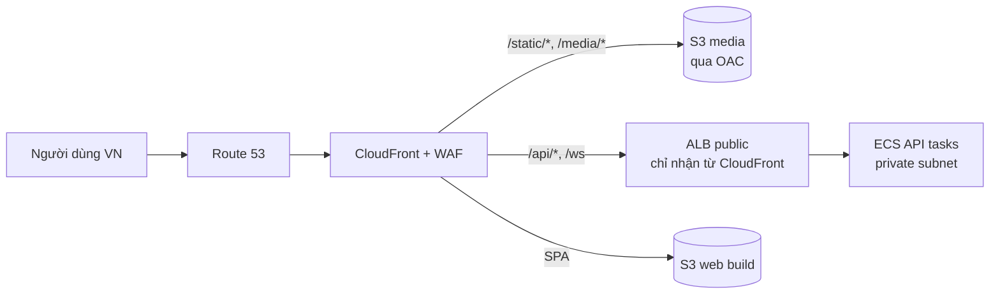

# Lớp biên (edge): CloudFront, ALB/NLB, API Gateway, WAF, Shield

**Mục đích:** thiết kế đường đi của request từ người dùng tới LearnHub: nhanh (cache ở edge gần Việt Nam), an toàn (WAF, chống DDoS, chỉ mở những gì cần) và ổn định (đúng timeout, health check, drain khi deploy).
**Liên quan:** [02-mang-vpc.md](02-mang-vpc.md) · [03-compute-ec2-ecs-eks-lambda.md](03-compute-ec2-ecs-eks-lambda.md) · [04-luu-tru-va-database.md](04-luu-tru-va-database.md) · [07-bao-mat-aws.md](07-bao-mat-aws.md) · [11-chi-phi-finops.md](11-chi-phi-finops.md) · [12-kien-truc-learnhub-tren-aws.md](12-kien-truc-learnhub-tren-aws.md) · [../07-he-thong-server/03-load-balancer-reverse-proxy.md](../07-he-thong-server/03-load-balancer-reverse-proxy.md) · [../07-he-thong-server/02-mang-network.md](../07-he-thong-server/02-mang-network.md)

> Giá (đặc biệt phí truyền dữ liệu, WAF, Shield Advanced) chỉ để tham khảo — kiểm tra AWS Pricing.

---

## 1. Bức tranh tổng thể cho LearnHub



- Mọi traffic đi qua **CloudFront** (TLS gần người dùng, cache, WAF, chống DDoS tầng 3/4 với Shield Standard).
- ALB chỉ chấp nhận traffic từ CloudFront (mục 3.4) → kẻ tấn công không vòng qua WAF.
- Media và web tĩnh không bao giờ chạm tới API.

## 2. Amazon CloudFront

### Origin

| Origin | Dùng cho | Cách bảo vệ |
|---|---|---|
| S3 bucket (REST endpoint) | Media, web build | **Origin Access Control (OAC)** — bucket chỉ cho CloudFront đọc. OAI là cơ chế cũ, không dùng cho thiết kế mới |
| ALB public | API | Header bí mật + SG theo managed prefix list của CloudFront; hoặc **VPC origin** |
| **VPC origin** | ALB/NLB/EC2 **private** | CloudFront kết nối vào subnet private, origin không cần public (ra mắt cuối 2024 — kiểm tra hỗ trợ cho region/loại origin) |
| Custom HTTP | Dịch vụ ngoài | TLS tới origin |

**Origin group** (primary/secondary) cho failover khi origin trả lỗi — chỉ áp dụng với request GET/HEAD/OPTIONS.

**Origin Shield**: lớp cache trung gian ở một region (chọn gần origin, ví dụ Singapore) → giảm tải origin khi nhiều edge cùng miss.

### Cache policy, cache key, origin request policy

Khái niệm hay bị nhầm nhất:

| | Cache policy | Origin request policy |
|---|---|---|
| Quyết định | **Cache key** (header/cookie/query nào làm khác bản cache) + TTL | Những gì được **chuyển tiếp tới origin** (nhưng không làm khác cache key) |
| Nguyên tắc | Cache key càng ít thành phần → tỉ lệ hit càng cao | Gửi đủ cho origin cần (ví dụ `User-Agent` để log) |

Cấu hình theo đường dẫn (behavior):

| Path pattern | Cache policy | Origin request policy | Ghi chú |
|---|---|---|---|
| `/static/*` (JS/CSS có hash trong tên) | TTL dài (1 năm), không query/cookie | — | Tên file đổi khi build → không cần invalidation |
| `/media/*` | TTL dài, query `w`/`h` (nếu resize động) | — | Ảnh công khai |
| `/api/*` | **CachingDisabled** (managed) | **AllViewerExceptHostHeader** (managed) | API động, có Authorization |
| `/api/public/posts*` | TTL ngắn (30–60s), query `cursor`,`tag` | | Feed công khai, tải đỉnh lớn — cache ngắn giúp rất nhiều |
| `/ws` | CachingDisabled | chuyển tiếp mọi header cần cho WebSocket | CloudFront hỗ trợ WebSocket |
| `/*` (SPA) | TTL ngắn cho `index.html` | — | Trả `index.html` cho route của SPA bằng custom error response hoặc CloudFront Function |

Sai lầm kinh điển: đưa `Authorization` hoặc cookie phiên vào cache key của nội dung công khai → mỗi người dùng một bản cache (hit rate gần 0). Ngược lại, **cache response có dữ liệu riêng tư mà không đưa định danh vào cache key** → người dùng A thấy dữ liệu của B. API trả dữ liệu riêng phải `Cache-Control: private, no-store` và behavior không cache.

### Signed URL / signed cookie cho nội dung trả phí

- Video bài giảng trả phí: CloudFront chỉ phục vụ khi request có chữ ký hợp lệ (hết hạn, tùy chọn giới hạn IP).
- **Signed URL**: một file. **Signed cookie**: nhiều file (ví dụ HLS gồm playlist + hàng trăm segment).
- Dùng **trusted key group** (khóa công khai tải lên CloudFront; khóa riêng giữ trong Secrets Manager và chỉ API ký), không dùng cơ chế key pair của root account (cũ).
- Hết hạn ngắn (phút–giờ) và API kiểm tra quyền (đã mua khóa học) trước khi ký.

### CloudFront Functions vs Lambda@Edge

| | CloudFront Functions | Lambda@Edge |
|---|---|---|
| Chạy ở | Mọi edge location | Regional edge cache |
| Ngôn ngữ | JavaScript (runtime giới hạn) | Node.js, Python |
| Thời gian | Dưới 1 ms | Tới vài giây (viewer) / lâu hơn (origin) |
| Mạng/IO | **Không** (có KeyValueStore để đọc cấu hình) | Có (gọi API, đọc S3) |
| Sự kiện | Viewer request/response | Viewer + origin request/response |
| Giá | Rẻ hơn nhiều | Đắt hơn |
| Dùng cho | Rewrite URL, redirect, header bảo mật, chuẩn hóa cache key, kiểm tra token đơn giản (JWT ký HMAC) | Xác thực phức tạp, tạo nội dung động, chọn origin theo dữ liệu ngoài |

Header bảo mật có thể dùng **response headers policy** (managed `SecurityHeadersPolicy` hoặc tùy chỉnh: HSTS, CSP, X-Content-Type-Options, Referrer-Policy) mà không cần function.

### Invalidation

- Một số path đầu tiên mỗi tháng miễn phí (khoảng 1.000 — kiểm tra), sau đó tính phí theo path; wildcard `/*` tính là một path nhưng xóa toàn bộ cache → origin chịu tải lớn.
- Tốt hơn: **versioned file name** (`app.3f9c2a.js`) cho tài sản tĩnh; TTL ngắn cho HTML.

### Chứng chỉ

- Chứng chỉ ACM cho CloudFront **phải ở `us-east-1`**. Chứng chỉ cho ALB ở cùng region với ALB (`ap-southeast-1`). Hai chứng chỉ riêng.
- ACM tự gia hạn khi xác thực bằng **DNS validation** (giữ bản ghi CNAME). Email validation hay gây hết hạn bất ngờ.
- TLS policy: tối thiểu TLS 1.2 (`TLSv1.2_2021` hoặc mới hơn); tắt giao thức cũ.

### Giá truyền dữ liệu

- Data transfer out từ CloudFront thường rẻ hơn từ region trực tiếp, và **origin → CloudFront không tính phí data transfer out** từ dịch vụ AWS. → Đặt CloudFront trước cả API cũng giúp giảm chi phí.
- Có lựa chọn **price class** (giới hạn edge theo khu vực) và các gói giá cố định — kiểm tra; với người dùng chủ yếu ở Việt Nam, đảm bảo price class có bao gồm edge châu Á.

## 3. Elastic Load Balancing: ALB vs NLB vs GWLB

| | ALB | NLB | GWLB |
|---|---|---|---|
| Tầng | L7 (HTTP/HTTPS/gRPC, WebSocket) | L4 (TCP/UDP/TLS) | L3 (GENEVE) |
| Định tuyến | Theo host, path, header, query, method | Theo cổng | Chuyển traffic qua thiết bị bảo mật |
| IP tĩnh | Không (DNS) | **Có** (Elastic IP mỗi AZ) | — |
| Giữ IP nguồn client | Qua `X-Forwarded-For` | Có (client IP preservation) | — |
| Độ trễ / throughput | Tốt | Rất thấp, hàng triệu kết nối | — |
| WAF | **Có** | Không | — |
| Dùng cho LearnHub | API, WebSocket | Dịch vụ TCP thuần, PrivateLink endpoint service, khi đối tác cần whitelist IP | Firewall tập trung (hiếm cần) |

### Target group và health check

- `target_type = ip` cho ECS Fargate/EKS (trỏ thẳng vào IP task/pod).
- Health check đường dẫn riêng `/healthz` — **kiểm tra chính tiến trình**, không gọi DB (nếu DB chậm, mọi target bị đánh dấu unhealthy cùng lúc → ALB "fail open" gửi traffic tới tất cả, hoặc ECS liên tục thay task — xem [../05-backend-senior/12-observability-reliability.md](../05-backend-senior/12-observability-reliability.md) phần liveness vs readiness).
- `healthy_threshold`, `unhealthy_threshold`, `interval` — cân bằng giữa phát hiện nhanh và tránh dao động.

### Deregistration delay và slow start

- **Deregistration delay** (connection draining): khi target bị gỡ (deploy, scale-in), ALB ngừng gửi request mới nhưng chờ request đang chạy xong, tối đa N giây (mặc định 300s). Đặt bằng thời gian request dài nhất hợp lý (ví dụ 30–60s) để deploy nhanh hơn. Ứng dụng phải xử lý SIGTERM và không thoát trước khi hết drain.
- **Slow start**: target mới nhận traffic tăng dần trong N giây — hữu ích khi ứng dụng cần warm-up (JIT, cache).

### Idle timeout và lỗi 502 kinh điển

ALB giữ kết nối keep-alive tới target. Nếu **ứng dụng đóng kết nối idle sớm hơn ALB**, ALB có thể gửi request vào kết nối vừa bị đóng → **502 Bad Gateway** ngẫu nhiên.

- ALB idle timeout mặc định **60 giây**.
- Node.js `server.keepAliveTimeout` mặc định **5 giây** → gây 502 chập chờn.

```typescript
const server = app.listen(3000);
server.keepAliveTimeout = 65_000;   // > ALB idle timeout (60s)
server.headersTimeout = 66_000;     // > keepAliveTimeout
```

Quy tắc: **timeout keep-alive của backend > idle timeout của LB > idle timeout của client/CloudFront**. Với WebSocket, idle timeout ALB phải đủ dài hoặc có ping định kỳ.

### Chỉ cho CloudFront vào ALB

1. SG của ALB chỉ cho phép inbound 443 từ **managed prefix list** `com.amazonaws.global.cloudfront.origin-facing`.
2. CloudFront thêm **custom header** bí mật khi gọi origin; ALB listener rule chỉ chuyển tiếp khi header khớp, còn lại trả 403. Giá trị header lưu trong Secrets Manager và xoay vòng định kỳ.
3. Hoặc dùng **VPC origin** để ALB hoàn toàn private.

(Bước 1 một mình chưa đủ: prefix list cho phép mọi distribution CloudFront của bất kỳ ai.)

## 4. API Gateway vs ALB

| | API Gateway REST API | API Gateway HTTP API | ALB |
|---|---|---|---|
| Tính năng | Đầy đủ nhất: usage plan + API key, request validation, transform, cache, WAF, private API | Nhẹ, rẻ, nhanh hơn; JWT authorizer sẵn; ít tính năng | Định tuyến L7, WAF, auth OIDC/Cognito |
| Timeout tích hợp | Mặc định 29s (có thể tăng cho một số loại — kiểm tra) | 30s | Không giới hạn kiểu đó (idle timeout) |
| Payload | Giới hạn (~10 MB) | Giới hạn | Không giới hạn kiểu đó |
| Giá | Theo request (cao hơn) | Theo request (thấp hơn) | Theo giờ + LCU |
| Dùng tốt với | Lambda, API công khai cho đối tác (usage plan, throttling theo khách hàng) | Lambda/HTTP backend đơn giản | Container/EC2 chạy liên tục, WebSocket nhiều, tải lớn ổn định |

Với LearnHub (API container, tải lớn ổn định): **ALB** rẻ và đơn giản hơn. API Gateway hợp lý cho **API công khai cho đối tác** (trường học tích hợp) cần API key, quota, throttling theo khách hàng.

Throttling API Gateway: giới hạn tài khoản/region (token bucket với rate + burst), giới hạn theo stage/method, theo usage plan. Lambda authorizer có cache kết quả theo TTL — cẩn thận khi thu hồi quyền.

## 5. AWS WAF

Gắn vào CloudFront (WAF scope `CLOUDFRONT`, tạo ở `us-east-1`), ALB, API Gateway, AppSync, Cognito…

### Thành phần

- **Web ACL** gồm các rule đánh giá theo thứ tự ưu tiên; mỗi rule: Allow / Block / Count / CAPTCHA / Challenge.
- **AWS Managed Rules**: `AWSManagedRulesCommonRuleSet` (OWASP chung), `KnownBadInputsRuleSet`, `SQLiRuleSet`, `AmazonIpReputationList`, `AnonymousIpList`, và các rule cho Linux/PHP/WordPress tùy stack.
- **Bot Control** (Common / Targeted), **Account Takeover Prevention (ATP)** cho endpoint đăng nhập, **Account Creation Fraud Prevention (ACFP)** cho đăng ký — tính phí thêm.
- **Rate-based rule**: đếm request theo khóa (IP, IP chuyển tiếp, header, cookie, query, label…) trong cửa sổ thời gian (1–10 phút, có thể cấu hình) và chặn khi vượt ngưỡng.

### Web ACL gợi ý cho LearnHub

| Thứ tự | Rule | Hành động | Ghi chú |
|---|---|---|---|
| 0 | Allow-list IP nội bộ (monitoring) | Allow | Hạn chế dùng |
| 1 | `AmazonIpReputationList` | Block | |
| 2 | `CommonRuleSet` | Block (bắt đầu **Count** 1–2 tuần để xem false positive) | Một số rule như giới hạn kích thước body có thể chặn upload/bài viết dài → loại trừ có chủ đích theo path |
| 3 | `KnownBadInputsRuleSet`, `SQLiRuleSet` | Block | |
| 4 | Rate-based `/api/auth/login`: 20 req/5 phút mỗi IP | Block hoặc CAPTCHA | Bổ sung cho rate limit trong ứng dụng (theo tài khoản) |
| 5 | Rate-based toàn cục: 2.000 req/5 phút mỗi IP | Block | Điều chỉnh theo dữ liệu thật; NAT của trường học/doanh nghiệp có thể chung một IP |
| 6 | ATP cho login (nếu ngân sách cho phép) | | Phát hiện credential stuffing |
| 7 | Bot Control Common | Count → Block có chọn lọc | |

### Vận hành WAF

- **Bắt đầu bằng Count**, phân tích log, rồi mới Block.
- Log WAF → S3/CloudWatch Logs/Firehose; **redact** trường nhạy cảm (header `authorization`, cookie).
- Lưu ý giới hạn WCU (capacity) của Web ACL và chi phí theo rule/request.
- Trường hợp IP dùng chung: nhiều học sinh cùng trường đi chung NAT → rate-based theo IP dễ chặn nhầm cả trường vào giờ thi. Cân nhắc khóa theo header/cookie đã xác thực, hoặc ngưỡng cao hơn cho path thi kèm rate limit ứng dụng theo user.

## 6. AWS Shield

| | Shield Standard | Shield Advanced |
|---|---|---|
| Giá | Miễn phí, tự động | Phí cố định hàng tháng đáng kể + phí data (cam kết 1 năm — tham khảo) |
| Bảo vệ | DDoS tầng 3/4 phổ biến cho CloudFront, Route 53, ELB… | Thêm: phát hiện tầng 7 nâng cao, **Shield Response Team** hỗ trợ 24/7, **bảo vệ chi phí** (hoàn phí scale do DDoS), WAF cho tài nguyên được bảo vệ không tính phí thêm (kiểm tra), health-based detection |
| Dùng khi | Mặc định | Hệ thống quan trọng về doanh thu/uy tín, là mục tiêu tấn công thường xuyên |

LearnHub giai đoạn đầu: Shield Standard + CloudFront + WAF rate-based là đủ. Xem lại Shield Advanced khi có lịch sử bị tấn công hoặc yêu cầu hợp đồng.

## 7. Global Accelerator

- Cung cấp **2 IP anycast tĩnh**, đưa traffic vào mạng AWS tại edge gần nhất rồi đi trong backbone AWS tới endpoint (ALB/NLB/EC2) ở một hoặc nhiều region.
- Dùng cho: **TCP/UDP không phải HTTP** (game, VoIP, MQTT), cần IP tĩnh toàn cầu để đối tác whitelist, failover đa region nhanh (không phụ thuộc DNS TTL).
- Với web/API HTTP thông thường, **CloudFront** thường là lựa chọn tốt hơn (có cache + WAF). Không dùng cả hai nếu không có lý do.

## 8. Thiết kế edge cho LearnHub — tóm tắt quyết định

| Quyết định | Lựa chọn | Lý do |
|---|---|---|
| Điểm vào | CloudFront (một distribution, nhiều behavior) | Edge tại VN, cache, WAF, giảm phí data |
| Tên miền | `learnhub.example` (web), `api.learnhub.example` hoặc `/api` cùng domain | Cùng domain tránh CORS và cookie cross-site phức tạp |
| Media | S3 + OAC, ảnh đã qua kiểm duyệt ở prefix `public/` | Bucket không public |
| Nội dung trả phí | Signed cookies, hết hạn 1–4 giờ | HLS nhiều file |
| API | ALB public chỉ nhận từ CloudFront (prefix list + header bí mật) hoặc VPC origin | Không vòng qua WAF |
| WebSocket (thông báo realtime) | Qua CloudFront → ALB; idle timeout + ping | |
| WAF | Managed rules + rate-based login/toàn cục, bắt đầu Count | |
| TLS | ACM DNS validation; cert `us-east-1` cho CloudFront, `ap-southeast-1` cho ALB | Tự gia hạn |
| API đối tác (sau này) | API Gateway REST với usage plan | Quota theo khách hàng |

## 9. Câu chuyện sự cố

| Sự cố | Nguyên nhân | Bài học |
|---|---|---|
| Người dùng thấy trang hồ sơ của người khác | Cache `/api/me` ở CloudFront với cache key không có định danh | API riêng tư không cache; `Cache-Control: private, no-store` |
| 502 rải rác 0,1% request | Node `keepAliveTimeout` 5s < ALB idle 60s | Tăng keep-alive backend > LB |
| Deploy mất 5 phút mỗi lần | Deregistration delay mặc định 300s | Đặt theo request dài nhất (30–60s) |
| Website "hết hạn chứng chỉ" | Chứng chỉ ACM email validation không ai xác nhận | DNS validation, cảnh báo `DaysToExpiry` |
| WAF chặn cả một trường học giờ thi | Rate-based theo IP, NAT dùng chung | Khóa theo người dùng đã xác thực, ngưỡng theo path |
| Kẻ tấn công bỏ qua WAF gọi thẳng ALB | ALB mở `0.0.0.0/0` | Prefix list + header bí mật / VPC origin |
| Origin quá tải sau khi invalidation `/*` | Xóa toàn bộ cache giờ cao điểm | Versioned assets; invalidation hẹp; Origin Shield |

## 10. Lỗi hay gặp (kể cả do AI agent viết)

- Mở bucket S3 public để CloudFront đọc (thay vì OAC), hoặc dùng OAI cũ.
- Đặt chứng chỉ CloudFront ở `ap-southeast-1` rồi "không thấy cert" và chuyển sang tự ký.
- Cache API động; đưa `Authorization`/cookie vào cache key của nội dung công khai.
- Health check gọi DB/dịch vụ phụ thuộc.
- Không chỉnh `keepAliveTimeout` của Node.
- Bật WAF Block ngay mà không Count trước; không redact log.
- Tin `X-Forwarded-For` tùy ý trong ứng dụng (phải lấy theo số proxy tin cậy — xem [../07-he-thong-server/03-load-balancer-reverse-proxy.md](../07-he-thong-server/03-load-balancer-reverse-proxy.md)).
- TLS policy cho phép TLS 1.0/1.1.

## Checklist review

- [ ] Toàn bộ traffic công khai qua CloudFront; origin (ALB) không thể gọi trực tiếp từ Internet (prefix list + header bí mật hoặc VPC origin).
- [ ] S3 origin dùng OAC; bucket không public; Block Public Access bật.
- [ ] Cache policy theo behavior: tĩnh TTL dài + tên file versioned; API riêng tư không cache; cache key tối thiểu.
- [ ] Nội dung trả phí dùng signed URL/cookie với trusted key group; khóa ký trong Secrets Manager.
- [ ] Chứng chỉ ACM DNS validation, đúng region (us-east-1 cho CloudFront); TLS ≥ 1.2; HSTS và header bảo mật qua response headers policy.
- [ ] ALB: target type `ip`, health check không phụ thuộc DB, deregistration delay hợp lý, keep-alive backend > idle timeout ALB.
- [ ] WAF: managed rules + rate-based cho login và toàn cục; đã chạy Count trước khi Block; log có redact.
- [ ] Đã cân nhắc rate limit với IP dùng chung (NAT trường học).
- [ ] Lựa chọn ALB vs API Gateway vs Global Accelerator có lý do rõ ràng.
- [ ] Có cảnh báo: tỉ lệ 5xx tại CloudFront/ALB, `TargetResponseTime`, `UnHealthyHostCount`, số request bị WAF chặn tăng đột biến.
