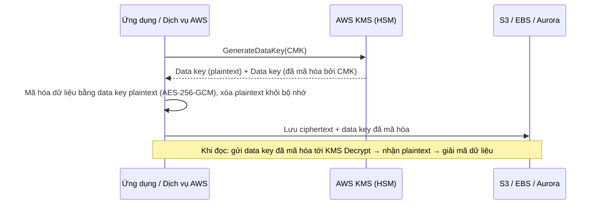

# Bảo mật trên AWS – KMS, Secrets, CloudTrail, GuardDuty, Security Hub và ứng cứu sự cố

**Mục đích:** nắm các dịch vụ bảo mật cốt lõi của AWS ở mức thiết kế và vận hành: mã hóa và quản lý khóa, quản lý bí mật, ghi vết, phát hiện mối đe dọa, đánh giá cấu hình, phạm vi dữ liệu (data perimeter) và quy trình ứng cứu khi lộ khóa truy cập. Áp dụng vào LearnHub (ap-southeast-1).
**Liên quan:** [01-tai-khoan-iam-organizations.md](01-tai-khoan-iam-organizations.md) · [02-mang-vpc.md](02-mang-vpc.md) · [04-luu-tru-va-database.md](04-luu-tru-va-database.md) · [08-observability-van-hanh.md](08-observability-van-hanh.md) · [10-ha-dr-well-architected.md](10-ha-dr-well-architected.md) · [13-checklist-review-aws.md](13-checklist-review-aws.md) · [../05-backend-senior/11-bao-mat.md](../05-backend-senior/11-bao-mat.md) · [../06-database-chuyen-sau/11-bao-mat-database.md](../06-database-chuyen-sau/11-bao-mat-database.md) · [../07-he-thong-server/08-xu-ly-su-co-production.md](../07-he-thong-server/08-xu-ly-su-co-production.md)

> Lưu ý độ chính xác: tên, tính năng và giá dịch vụ AWS thay đổi thường xuyên. Mọi con số giá chỉ để tham khảo — kiểm tra AWS Pricing Calculator và tài liệu chính thức trước khi quyết định.

---

## 1. Mô hình trách nhiệm chung (Shared Responsibility Model)

AWS chịu trách nhiệm bảo mật **của** đám mây (phần cứng, trung tâm dữ liệu, hypervisor, hạ tầng dịch vụ managed). Bạn chịu trách nhiệm bảo mật **trong** đám mây. Ranh giới dịch chuyển theo loại dịch vụ:

| Lớp | EC2 (IaaS) | ECS Fargate / RDS / Aurora (managed) | S3 / Lambda / DynamoDB (serverless) |
|---|---|---|---|
| Vá hệ điều hành | **Bạn** | AWS | AWS |
| Vá engine DB | **Bạn** (nếu tự cài) | AWS vá, **bạn chọn cửa sổ bảo trì** và nâng cấp major | — |
| Cấu hình mạng (SG, NACL, subnet) | **Bạn** | **Bạn** | Phần lớn AWS, bạn quản lý policy/endpoint |
| IAM, quyền truy cập | **Bạn** | **Bạn** | **Bạn** |
| Mã hóa dữ liệu (bật, chọn khóa) | **Bạn** | **Bạn** | **Bạn** (mặc định đã có SSE-S3) |
| Code ứng dụng, dependency | **Bạn** | **Bạn** | **Bạn** |
| Dữ liệu khách hàng, phân loại dữ liệu | **Bạn** | **Bạn** | **Bạn** |

Hệ quả thực tế: **IAM, cấu hình, dữ liệu và code luôn là của bạn.** Phần lớn sự cố bảo mật trên AWS đến từ cấu hình sai (bucket public, khóa truy cập lộ trên GitHub, security group mở 0.0.0.0/0 cho cổng DB), không phải do AWS.

## 2. AWS KMS – quản lý khóa mã hóa

### 2.1 Các loại khóa

| Loại | Ai tạo / quản lý | Key policy | Xoay vòng | Chi phí (tham khảo) | Dùng khi |
|---|---|---|---|---|---|
| **AWS owned key** | AWS, không hiện trong tài khoản | Không xem/sửa | AWS quản lý | Miễn phí | Mặc định của nhiều dịch vụ; không cần kiểm soát hay audit khóa |
| **AWS managed key** (`aws/s3`, `aws/rds`…) | AWS tạo trong tài khoản bạn | Không sửa được | Tự động hằng năm | Không phí lưu khóa; có phí API ở một số trường hợp | Muốn thấy khóa trong CloudTrail nhưng không cần chia sẻ chéo tài khoản |
| **Customer managed key (CMK)** | **Bạn** | **Bạn viết** | Tùy chọn tự động (chu kỳ cấu hình được) + xoay theo yêu cầu | Phí/khóa/tháng + phí API | Cần kiểm soát ai dùng khóa, chia sẻ chéo tài khoản, tách quyền, vô hiệu hóa khi sự cố, tuân thủ |

Quy tắc cho LearnHub:
- Dữ liệu cá nhân (Aurora, S3 media riêng tư, backup, Secrets Manager): **CMK**, mỗi miền dữ liệu một khóa (`learnhub-prod-db`, `learnhub-prod-media`, `learnhub-prod-backup`). Lý do: thu hồi được độc lập, audit rõ, cho phép copy backup sang tài khoản backup.
- Log, artefact build không nhạy cảm: AWS managed key là đủ.
- **Không dùng AWS managed key cho dữ liệu cần copy chéo tài khoản**: key policy của nó không sửa được nên tài khoản khác không giải mã được (lỗi rất hay gặp khi copy snapshot RDS sang tài khoản backup).

### 2.2 Envelope encryption – KMS thực sự làm gì

KMS **không** mã hóa trực tiếp file 5 GB. Cơ chế:



Ý nghĩa:
- Khóa gốc (CMK) **không bao giờ rời HSM** của KMS.
- Mỗi lần giải mã là một lệnh `Decrypt` → **ghi vào CloudTrail** → audit được ai đọc dữ liệu.
- Vô hiệu hóa CMK = toàn bộ dữ liệu dùng khóa đó không giải mã được (công cụ "ngắt cầu dao" khi sự cố, nhưng cũng là rủi ro tự gây mất dữ liệu).
- KMS có quota tốc độ gọi API theo Region: ứng dụng tự mã hóa từng bản ghi bằng `Encrypt` trực tiếp ở 200k user đồng thời có thể bị throttle → dùng **data key caching** (AWS Encryption SDK) hoặc để dịch vụ (S3 Bucket Keys) giảm số lần gọi KMS.

**S3 Bucket Keys:** bật cho bucket dùng SSE-KMS để S3 dùng một khóa cấp bucket tạm thời, giảm mạnh số lệnh gọi KMS và chi phí. Nên bật mặc định.

### 2.3 Key policy, IAM policy và grant

Quyền dùng một CMK được quyết định bởi **key policy trước tiên**. IAM policy chỉ có hiệu lực nếu key policy cho phép tài khoản dùng IAM (câu lệnh có `"Principal": {"AWS": "arn:aws:iam::<ACCOUNT_ID>:root"}`).

Key policy mẫu cho khóa DB của LearnHub, tách quyền quản trị và quyền sử dụng:

```json
{
  "Version": "2012-10-17",
  "Statement": [
    {
      "Sid": "EnableIAMPoliciesInThisAccount",
      "Effect": "Allow",
      "Principal": { "AWS": "arn:aws:iam::<ACCOUNT_ID>:root" },
      "Action": "kms:*",
      "Resource": "*"
    },
    {
      "Sid": "KeyAdministratorsCannotUseKey",
      "Effect": "Allow",
      "Principal": { "AWS": "arn:aws:iam::<ACCOUNT_ID>:role/SecurityKeyAdmin" },
      "Action": [
        "kms:Create*", "kms:Describe*", "kms:Enable*", "kms:List*", "kms:Put*",
        "kms:Update*", "kms:Revoke*", "kms:Disable*", "kms:Get*", "kms:Delete*",
        "kms:TagResource", "kms:UntagResource",
        "kms:ScheduleKeyDeletion", "kms:CancelKeyDeletion", "kms:RotateKeyOnDemand"
      ],
      "Resource": "*"
    },
    {
      "Sid": "AllowUseOnlyThroughRDSInThisRegion",
      "Effect": "Allow",
      "Principal": { "AWS": "arn:aws:iam::<ACCOUNT_ID>:role/learnhub-api-task-role" },
      "Action": ["kms:Decrypt", "kms:GenerateDataKey*", "kms:DescribeKey"],
      "Resource": "*",
      "Condition": {
        "StringEquals": {
          "kms:ViaService": "rds.ap-southeast-1.amazonaws.com",
          "kms:CallerAccount": "<ACCOUNT_ID>"
        }
      }
    }
  ]
}
```

Điểm then chốt:
- `kms:ViaService` buộc khóa chỉ được dùng **thông qua** dịch vụ nhất định, không gọi trực tiếp → kẻ chiếm được role không tự giải mã dữ liệu tải về được.
- Quản trị viên khóa **không** có `kms:Decrypt` → tách quyền (separation of duties). Câu lệnh đầu (root của tài khoản) vẫn cần để tránh khóa "mồ côi" không ai quản lý được; kiểm soát việc ai được gán quyền KMS bằng IAM + SCP.
- **Grant**: quyền tạm thời, có thể thu hồi, dịch vụ AWS (EBS, RDS) tự tạo khi gắn volume. Không cần tự tạo trừ khi có use case cụ thể; kiểm tra bằng `aws kms list-grants --key-id <KEY_ID>`.

Xóa khóa: `ScheduleKeyDeletion` có thời gian chờ **7–30 ngày** (mặc định 30). Trong thời gian này có thể hủy. Tạo EventBridge rule bắt sự kiện `ScheduleKeyDeletion` → cảnh báo ngay, vì xóa nhầm CMK = mất dữ liệu vĩnh viễn.

```bash
# Tạo CMK, đặt alias, bật xoay vòng tự động
aws kms create-key --description "learnhub prod db" --tags TagKey=app,TagValue=learnhub
aws kms create-alias --alias-name alias/learnhub-prod-db --target-key-id <KEY_ID>
aws kms enable-key-rotation --key-id <KEY_ID> --rotation-period-in-days 365
aws kms get-key-rotation-status --key-id <KEY_ID>
```

### 2.4 Xoay vòng khóa

- Xoay vòng KMS **giữ nguyên Key ID/ARN**, chỉ sinh vật liệu khóa mới cho lần mã hóa mới; dữ liệu cũ vẫn giải mã được bằng vật liệu cũ (KMS giữ lại). Không cần mã hóa lại dữ liệu.
- Xoay vòng **không** giúp khi khóa bị dùng trái phép qua quyền IAM — kẻ có quyền `Decrypt` vẫn giải mã được. Sự cố quyền phải xử lý bằng sửa policy, không phải xoay khóa.
- Khóa import vật liệu (BYOK) và khóa trong custom key store có quy trình xoay riêng (thủ công).

### 2.5 Multi-Region keys

Khóa nhiều Region có cùng key material và key ID ở các Region khác nhau → dữ liệu mã hóa ở Singapore giải mã được ở Region DR mà không cần gọi chéo Region. Dùng cho: DynamoDB global tables mã hóa phía client, dữ liệu mã hóa ở tầng ứng dụng cần đọc ở Region DR. **Không cần** cho snapshot RDS/Aurora copy chéo Region (khi copy bạn chỉ định khóa ở Region đích). Nhược điểm: khó tuân thủ yêu cầu "khóa chỉ tồn tại trong một vùng".

## 3. Secrets Manager vs SSM Parameter Store

| Tiêu chí | Secrets Manager | SSM Parameter Store (SecureString) |
|---|---|---|
| Mục đích | Bí mật: mật khẩu DB, khóa API bên thứ ba, khóa ký | Cấu hình; bí mật đơn giản |
| Xoay vòng tự động | **Có** (Lambda rotation, hoặc managed rotation cho RDS/Aurora) | Không có sẵn |
| Chia sẻ chéo tài khoản | Có (resource policy) | Hạn chế |
| Sao chép sang Region khác | Có (replica secret) | Không có sẵn |
| Phiên bản | Nhãn `AWSCURRENT`, `AWSPREVIOUS`, `AWSPENDING` | Lịch sử version |
| Giá (tham khảo) | Phí theo bí mật/tháng + phí API | Standard: miễn phí; Advanced: có phí |

Quy tắc LearnHub:
- Mật khẩu DB, khóa API của dịch vụ email/SMS, khóa ký JWT: **Secrets Manager**.
- Feature flag, URL endpoint, tên bucket: **Parameter Store Standard**.

### 3.1 Mật khẩu master RDS/Aurora do RDS quản lý

Thay vì tự tạo bí mật, bật **RDS-managed master user password**: RDS tạo bí mật trong Secrets Manager, mã hóa bằng khóa KMS bạn chọn, tự xoay vòng (mặc định 7 ngày). Không ai phải thấy mật khẩu master.

```bash
aws rds modify-db-cluster \
  --db-cluster-identifier learnhub-prod \
  --manage-master-user-password \
  --master-user-secret-kms-key-id alias/learnhub-prod-db \
  --apply-immediately
```

Ứng dụng **không** dùng tài khoản master. Tạo user ứng dụng riêng (quyền tối thiểu, xem [../06-database-chuyen-sau/11-bao-mat-database.md](../06-database-chuyen-sau/11-bao-mat-database.md)), lưu ở bí mật riêng với rotation kiểu **alternating users** (hai user luân phiên) để không gián đoạn kết nối khi xoay.

### 3.2 Ứng dụng đọc bí mật đúng cách

- ECS: khai báo `secrets` trong task definition (`valueFrom` = ARN bí mật) → ECS tiêm biến môi trường khi khởi động task. **Task execution role** cần `secretsmanager:GetSecretValue` + `kms:Decrypt` trên khóa đó.
- Nhược điểm: giá trị chỉ được đọc khi task khởi động → sau khi xoay, task cũ giữ giá trị cũ. Với alternating users thì giá trị cũ còn hợp lệ một chu kỳ; hoặc ứng dụng tự đọc lại bằng SDK + cache khi gặp lỗi xác thực.
- Kết nối Aurora qua **RDS Proxy** với xác thực IAM: proxy đọc bí mật, ứng dụng dùng IAM auth token ngắn hạn → ứng dụng không cầm mật khẩu DB.

Giới hạn quyền đọc bí mật theo tiền tố tên (ví dụ tiền tố `learnhub/prod/api/`):

```json
{
  "Effect": "Allow",
  "Action": "secretsmanager:GetSecretValue",
  "Resource": "arn:aws:secretsmanager:ap-southeast-1:<ACCOUNT_ID>:<SECRET_ARN_PREFIX>*"
}
```

`<SECRET_ARN_PREFIX>` là phần `secret` + tên bí mật theo tiền tố trên. Lỗi hay gặp: cấp `GetSecretValue` trên `"Resource": "*"` → mọi task đọc được mọi bí mật, kể cả bí mật của hệ thống khác.

## 4. CloudTrail – ghi vết mọi lệnh gọi API

### 4.1 Thiết kế

| Thành phần | Khuyến nghị |
|---|---|
| **Organization trail** | Một trail cho toàn bộ Organization, mọi Region, tạo từ management account (hoặc tài khoản quản trị được ủy quyền) |
| Đích lưu | S3 bucket trong **tài khoản Log Archive** riêng; bucket policy chỉ cho CloudTrail ghi; cân nhắc S3 Object Lock để chống sửa xóa |
| Mã hóa | SSE-KMS với CMK của tài khoản log |
| **Log file integrity validation** | Bật — CloudTrail tạo file digest có chữ ký; dùng `aws cloudtrail validate-logs` chứng minh log không bị sửa |
| Management events | Bật (đọc + ghi) |
| **Data events** | Chọn lọc: bucket S3 chứa dữ liệu nhạy cảm, Lambda invoke, DynamoDB. Tính phí theo số sự kiện — dùng advanced event selectors để lọc |
| Truy vấn điều tra | Athena trên S3 (rẻ cho khối lượng lớn) hoặc CloudTrail Lake (tiện hơn) |
| Gửi tới CloudWatch Logs | Tùy chọn — cho metric filter/alarm thời gian thực |

```bash
# Kiểm tra tính toàn vẹn log trong khoảng thời gian điều tra
aws cloudtrail validate-logs \
  --trail-arn arn:aws:cloudtrail:ap-southeast-1:<MGMT_ACCOUNT_ID>:trail/org-trail \
  --start-time 2026-11-01T00:00:00Z --end-time 2026-11-20T00:00:00Z
```

### 4.2 Những gì phải cảnh báo ngay (EventBridge rule)

- `ConsoleLogin` của root user.
- `StopLogging`, `DeleteTrail`, `UpdateTrail` (kẻ tấn công thường tắt log đầu tiên).
- `PutBucketPolicy`, `PutBucketAcl`, `DeletePublicAccessBlock` trên bucket chứa dữ liệu.
- `CreateAccessKey` cho IAM user (chính sách LearnHub: không dùng IAM user lâu dài).
- `ScheduleKeyDeletion`, `DisableKey`.
- `AuthorizeSecurityGroupIngress` mở `0.0.0.0/0` trên cổng khác 443.

```json
{
  "source": ["aws.cloudtrail"],
  "detail-type": ["AWS API Call via CloudTrail"],
  "detail": {
    "eventName": ["StopLogging", "DeleteTrail", "UpdateTrail"]
  }
}
```

Kết hợp **SCP** để **cấm** `cloudtrail:StopLogging`/`DeleteTrail` ở mọi tài khoản thành viên — phát hiện đã tốt, ngăn chặn còn tốt hơn (xem [01-tai-khoan-iam-organizations.md](01-tai-khoan-iam-organizations.md)).

## 5. AWS Config và conformance pack

AWS Config ghi lại **trạng thái cấu hình** tài nguyên theo thời gian ("security group này mở cổng 5432 từ khi nào, ai sửa") và đánh giá theo **rule**.

- Bật Config ở mọi tài khoản/Region qua Organization (thường qua Control Tower).
- Dùng **managed rules**: bucket S3 chặn public, EBS mã hóa, RDS không public, CloudTrail bật, root có MFA, IAM không có policy toàn quyền.
- **Conformance pack**: gói rule theo khung (Operational Best Practices for CIS, NIST, PCI DSS…) triển khai đồng loạt.
- **Remediation**: gắn SSM Automation để tự sửa (ví dụ bật Block Public Access). Cẩn thận: tự sửa trên production có thể làm hỏng ứng dụng — bắt đầu ở chế độ chỉ báo, bật tự sửa cho rule đã chắc chắn an toàn.
- Chi phí: theo số configuration item ghi nhận và số lần đánh giá. Tài nguyên thay đổi liên tục (ENI của Fargate/Lambda) làm tăng chi phí — cân nhắc periodic recording cho loại tài nguyên này.

## 6. Bộ phát hiện và đánh giá

| Dịch vụ | Làm gì | Bật ở đâu | Ghi chú LearnHub |
|---|---|---|---|
| **GuardDuty** | Phát hiện mối đe dọa từ CloudTrail, VPC Flow Logs, DNS logs và các nguồn bổ sung (S3, EKS, runtime, malware, đăng nhập RDS) | Mọi tài khoản, mọi Region, quản trị tập trung ở tài khoản Security | Bật S3 protection cho bucket media, RDS protection cho Aurora, Runtime Monitoring cho ECS Fargate (kiểm tra nền tảng được hỗ trợ) |
| **Security Hub** | Tổng hợp finding, kiểm tra cấu hình theo tiêu chuẩn (AWS Foundational Security Best Practices, CIS) | Tài khoản Security làm quản trị viên ủy quyền | AWS tái cấu trúc Security Hub năm 2025, phần kiểm tra cấu hình được gọi là Security Hub CSPM — kiểm tra tên và tính năng hiện hành trong console |
| **Inspector** | Quét lỗ hổng (CVE) trên EC2, image ECR, Lambda | Mọi tài khoản qua Organization | Quét liên tục image API trong ECR; chặn deploy nếu có CVE Critical đã có bản vá |
| **Macie** | Phát hiện dữ liệu nhạy cảm (PII) trong S3 | Tài khoản có bucket dữ liệu | Quét định kỳ bucket upload để phát hiện người dùng tải giấy tờ tùy thân, file chứa số CCCD |
| **Detective** | Điều tra: dựng đồ thị quan hệ từ log để trả lời "ai, từ đâu, làm gì" | Tài khoản Security | Dùng khi xử lý finding GuardDuty mức High |
| **IAM Access Analyzer** | Phát hiện tài nguyên chia sẻ ra ngoài vùng tin cậy; phát hiện quyền không dùng; kiểm tra policy trước khi deploy | Cấp Organization | Gắn `validate-policy` / custom policy checks vào CI |

Tối thiểu: GuardDuty + Security Hub + Config + CloudTrail bật **từ ngày đầu**, quản trị tập trung. Finding High/Critical → EventBridge → SNS → kênh on-call (xem [08-observability-van-hanh.md](08-observability-van-hanh.md)).

```bash
# Kiểm tra policy trước khi merge (chạy trong CI)
aws accessanalyzer validate-policy --policy-type IDENTITY_POLICY \
  --policy-document file://policies/api-task-role.json \
  --query 'findings[?findingType==`ERROR` || findingType==`SECURITY_WARNING`]'
```

## 7. Mã hóa mặc định – cái gì đã có, cái gì phải bật

| Dịch vụ | At rest | In transit | Việc bạn phải làm |
|---|---|---|---|
| S3 | SSE-S3 mặc định cho object mới (từ 2023) | HTTPS; HTTP vẫn có thể nếu không chặn | SSE-KMS + Bucket Key cho dữ liệu nhạy cảm; bucket policy từ chối `aws:SecureTransport = false` |
| EBS | Chỉ khi bật "EBS encryption by default" theo Region | — | Bật encryption by default ở mọi Region dùng |
| RDS/Aurora | Chọn khi tạo; không bật sau được cho cluster đang có — phải snapshot → copy có mã hóa → restore | Hỗ trợ TLS; ép bằng parameter `rds.force_ssl` | Bật mã hóa lúc tạo; ép TLS |
| ElastiCache | Tùy chọn at rest và in transit | Tùy chọn | Bật cả hai, dùng AUTH/RBAC |
| SQS | SSE-SQS mặc định cho queue mới | HTTPS | SSE-KMS nếu cần audit khóa |
| Secrets Manager | Luôn mã hóa KMS | HTTPS | Chọn CMK |
| ALB → target | — | Tùy cấu hình | HTTPS tới target nếu yêu cầu mã hóa đầu-cuối |

Lỗi "không sửa sau được": Aurora tạo không mã hóa thì phải dựng lại. Kiểm tra `storage_encrypted = true` trong review IaC.

## 8. Data perimeter – đúng người, đúng mạng, đúng tài nguyên

Ba câu hỏi:
1. **Danh tính tin cậy:** chỉ principal thuộc Organization của tôi được truy cập tài nguyên của tôi (`aws:PrincipalOrgID`).
2. **Tài nguyên tin cậy:** principal của tôi chỉ được ghi dữ liệu vào tài nguyên của tôi (`aws:ResourceOrgID`) — chống tuồn dữ liệu sang bucket của kẻ tấn công.
3. **Mạng tin cậy:** truy cập phải đi từ VPC/IP của tôi (`aws:SourceVpc`, `aws:SourceVpce`).

Bucket policy cho bucket media riêng tư của LearnHub:

```json
{
  "Version": "2012-10-17",
  "Statement": [
    {
      "Sid": "DenyOutsideOrg",
      "Effect": "Deny",
      "Principal": "*",
      "Action": "s3:*",
      "Resource": [
        "arn:aws:s3:::learnhub-prod-media-private",
        "arn:aws:s3:::learnhub-prod-media-private/*"
      ],
      "Condition": {
        "StringNotEqualsIfExists": { "aws:PrincipalOrgID": "<ORG_ID>" },
        "BoolIfExists": { "aws:PrincipalIsAWSService": "false" }
      }
    },
    {
      "Sid": "DenyInsecureTransport",
      "Effect": "Deny",
      "Principal": "*",
      "Action": "s3:*",
      "Resource": [
        "arn:aws:s3:::learnhub-prod-media-private",
        "arn:aws:s3:::learnhub-prod-media-private/*"
      ],
      "Condition": { "Bool": { "aws:SecureTransport": "false" } }
    }
  ]
}
```

VPC endpoint policy cho gateway endpoint S3, chỉ cho đi tới bucket thuộc Organization:

```json
{
  "Statement": [
    {
      "Sid": "OnlyOrgBuckets",
      "Effect": "Allow",
      "Principal": "*",
      "Action": "s3:*",
      "Resource": "*",
      "Condition": { "StringEquals": { "aws:ResourceOrgID": "<ORG_ID>" } }
    }
  ]
}
```

Cảnh báo: endpoint policy này cũng chặn bucket **của AWS** mà dịch vụ cần (bucket chứa layer image ECR, repo package của hệ điều hành). Phải thêm ngoại lệ cho các ARN đó và thử ở staging trước. Đây là lỗi làm hỏng `docker pull` từ ECR mà agent hay gây ra khi "siết" endpoint policy.

Áp perimeter ở quy mô Organization bằng **SCP** (phía danh tính) và **RCP – Resource Control Policy** (phía tài nguyên, ra mắt cuối 2024; kiểm tra danh sách dịch vụ hỗ trợ) thay vì viết lại từng bucket policy.

## 9. Ứng cứu sự cố bảo mật trên AWS

Khung chung ở [../07-he-thong-server/08-xu-ly-su-co-production.md](../07-he-thong-server/08-xu-ly-su-co-production.md). Dưới đây là runbook đặc thù AWS.

### 9.1 Runbook: lộ access key (ví dụ commit lên GitHub công khai)

Dấu hiệu: thông báo từ AWS/GitHub secret scanning, GuardDuty finding loại `UnauthorizedAccess:IAMUser/...`, hóa đơn tăng đột biến (EC2 GPU ở Region lạ để đào coin), AWS tự gắn policy cách ly (quarantine) vào user.

| Bước | Lệnh / hành động | Ghi chú |
|---|---|---|
| 1. Vô hiệu hóa key (chưa xóa) | `aws iam update-access-key --user-name <USER> --access-key-id <KEY_ID> --status Inactive` | Giữ lại để điều tra; xóa sau |
| 2. Thu hồi credential tạm thời đã cấp | Gắn policy deny mọi hành động với điều kiện `aws:TokenIssueTime` trước thời điểm hiện tại (console IAM có "Revoke active sessions" cho role) | Kẻ tấn công thường đã gọi `GetSessionToken`/`AssumeRole` để có credential tạm thời sống tới nhiều giờ |
| 3. Xác định phạm vi | CloudTrail (Athena/Lake): mọi sự kiện của key đó và các phiên phát sinh | Tìm `CreateUser`, `CreateAccessKey`, `CreateRole`, `AttachRolePolicy`, `RunInstances`, `CreateLoginProfile` — dấu hiệu cài cửa hậu |
| 4. Gỡ cửa hậu | Xóa user/role/key/instance/Lambda do kẻ tấn công tạo; kiểm tra **mọi Region** | Kẻ tấn công thích Region ít dùng |
| 5. Kiểm tra truy cập dữ liệu | Data events S3, `GetSecretValue`, `kms:Decrypt`, snapshot bị share ra ngoài (`ModifyDBSnapshotAttribute`, `ModifyDBClusterSnapshotAttribute`) | Có truy cập dữ liệu cá nhân → kích hoạt quy trình thông báo theo Nghị định 13/2023 |
| 6. Xoay mọi bí mật principal đó đọc được | Secrets Manager rotate | |
| 7. Sửa gốc | Bỏ IAM user lâu dài; chuyển sang SSO + role; CI dùng OIDC ([09-iac-ci-cd-aws.md](09-iac-ci-cd-aws.md)); bật secret scanning + push protection | |
| 8. Postmortem | Blameless, timeline lấy từ CloudTrail | |

```sql
-- Athena trên bảng CloudTrail: mọi hành động của key bị lộ
SELECT eventtime, eventsource, eventname, awsregion, sourceipaddress, errorcode
FROM cloudtrail_logs
WHERE useridentity.accesskeyid = '<KEY_ID>'
  AND eventtime >= '2026-11-01T00:00:00Z'
ORDER BY eventtime;
```

### 9.2 Runbook: EC2 nghi bị xâm nhập

1. **Không tắt instance** ngay — mất bằng chứng trong bộ nhớ.
2. Cô lập mạng: đổi security group sang SG "quarantine" không có rule. Lưu ý: kết nối đang được theo dõi (tracked connection) có thể không bị cắt ngay khi đổi SG — kết hợp NACL deny ở subnet nếu cần cắt tức thì.
3. Gỡ khỏi target group / Auto Scaling group (đặt Standby hoặc detach) để ASG không thay thế và hủy nó.
4. Gắn tag `incident=<ID>`, bật termination protection.
5. Thu thập: snapshot EBS, memory dump (nếu có công cụ), log hệ thống.
6. Thu hồi credential của instance role (deny theo `aws:TokenIssueTime`).
7. Phân tích trong **tài khoản forensic** riêng (share snapshot sang đó).
8. Thay thế bằng instance mới từ image sạch đã vá.

Với ECS Fargate không có EBS để snapshot: ưu tiên GuardDuty Runtime Monitoring + log ứng dụng, cô lập bằng SG, rồi thay task. Đây là đánh đổi của container serverless: ít bề mặt tấn công hơn nhưng ít dữ liệu forensic hơn.

### 9.3 Chuẩn bị trước sự cố

- Role `IncidentResponder` có sẵn (quyền đọc rộng + quyền cô lập); tài khoản break-glass có MFA phần cứng, quy trình dùng có ghi chép.
- Tài khoản forensic tách biệt.
- Diễn tập (tabletop) mỗi quý: "Khóa CI bị lộ", "Bucket media bị public".

## 10. Ánh xạ Nghị định 13/2023/NĐ-CP (bảo vệ dữ liệu cá nhân)

Đây là ánh xạ kỹ thuật tham khảo, **không phải tư vấn pháp lý** — xác nhận với bộ phận pháp chế. Luật Bảo vệ dữ liệu cá nhân (có hiệu lực từ 2026) có thể thay đổi/bổ sung yêu cầu; kiểm tra văn bản hiện hành.

| Yêu cầu (tóm lược) | Biện pháp trên AWS |
|---|---|
| Biện pháp kỹ thuật bảo vệ dữ liệu cá nhân, đặc biệt dữ liệu nhạy cảm | KMS CMK, TLS bắt buộc, data perimeter, IAM tối thiểu, Macie phát hiện PII lẫn trong S3 |
| Ghi nhận nhật ký hệ thống xử lý dữ liệu | CloudTrail org trail + data events cho bucket/DB chứa PII; audit trail ở ứng dụng |
| Thông báo vi phạm dữ liệu cá nhân trong thời hạn quy định (72 giờ theo Nghị định 13) | Runbook mục 9, cảnh báo GuardDuty/Security Hub, xác định phạm vi bằng CloudTrail |
| Đánh giá tác động xử lý dữ liệu; hồ sơ chuyển dữ liệu ra nước ngoài | ap-southeast-1 ở Singapore → lưu dữ liệu người dùng Việt Nam tại đây là **chuyển dữ liệu ra nước ngoài** → cần hồ sơ đánh giá tác động chuyển dữ liệu; ghi Region, luồng dữ liệu, bên xử lý (AWS) |
| Quyền của chủ thể dữ liệu (truy cập, xóa, rút lại đồng ý) | Thiết kế ở tầng ứng dụng ([../05-backend-senior/04-module-tai-khoan.md](../05-backend-senior/04-module-tai-khoan.md)); chú ý **dữ liệu trong backup** — công bố thời hạn lưu backup |
| Hạn chế người truy cập | IAM Identity Center + permission set theo nhóm; Access Analyzer phát hiện quyền thừa |

Nếu LearnHub thuộc phạm vi yêu cầu lưu trữ dữ liệu tại Việt Nam (Nghị định 53/2022, áp dụng theo điều kiện cụ thể), cân nhắc phương án lưu tại Việt Nam. Xem [../07-he-thong-server/07-cloud-kien-truc.md](../07-he-thong-server/07-cloud-kien-truc.md).

## 11. Sai lầm thường gặp (kể cả của agent AI)

| Sai lầm | Hậu quả | Cách đúng |
|---|---|---|
| Tạo IAM user + access key cho CI/ứng dụng | Khóa lâu dài bị lộ | OIDC cho CI, task role cho ECS, instance profile cho EC2 |
| Policy `"Action": "*"`, `"Resource": "*"` "cho chạy được đã" | Toàn quyền khi bị chiếm | Liệt kê hành động cụ thể; Access Analyzer sinh policy từ CloudTrail |
| Tắt Block Public Access để "sửa lỗi 403" khi CloudFront đọc S3 | Bucket public | CloudFront **OAC** + bucket policy cho service principal CloudFront với điều kiện `AWS:SourceArn` |
| Ghi bí mật dạng plain vào task definition hoặc file biến Terraform commit vào Git | Lộ bí mật trong Git, console, state | `secrets` + Secrets Manager; Terraform state mã hóa và giới hạn quyền |
| Dùng AWS managed key cho snapshot cần copy chéo tài khoản | Không copy được khi DR | CMK với key policy cho tài khoản backup |
| Chỉ bật GuardDuty ở Region chính | Tài nguyên lạ ở Region khác không bị phát hiện | Bật mọi Region; SCP cấm Region không dùng |
| Auto-remediation Config trên prod khi chưa thử | Gỡ quyền/đóng cổng làm sập dịch vụ | Báo cáo trước, tự sửa sau khi kiểm chứng |
| Agent đề xuất `kms:*` cho role ứng dụng | Role ứng dụng có thể xóa/vô hiệu hóa khóa | Chỉ `Decrypt`, `GenerateDataKey*`, kèm `kms:ViaService` |
| Xóa access key bị lộ ngay khi phát hiện | Mất dấu vết, credential tạm thời vẫn sống | Inactive → revoke session → điều tra → xóa |

## Checklist review

- [ ] Không có IAM user có access key lâu dài cho ứng dụng hoặc CI; dùng role/OIDC.
- [ ] Policy IAM mới không có `*` ở cả Action và Resource; đã chạy `validate-policy` hoặc Access Analyzer.
- [ ] Dữ liệu cá nhân dùng KMS CMK; key policy tách quyền quản trị và sử dụng; có `kms:ViaService` khi phù hợp.
- [ ] Xoay vòng tự động bật cho CMK; có cảnh báo `ScheduleKeyDeletion`/`DisableKey`.
- [ ] Aurora/RDS mã hóa at rest, ép TLS; EBS encryption by default bật.
- [ ] Bí mật nằm trong Secrets Manager, không nằm trong code, task definition dạng plain, file biến Terraform, state không mã hóa.
- [ ] Quyền `GetSecretValue` giới hạn theo ARN/tiền tố, không `*`.
- [ ] Master password RDS do RDS quản lý; ứng dụng dùng user riêng quyền tối thiểu.
- [ ] CloudTrail org trail mọi Region, log integrity validation, lưu ở tài khoản Log Archive, SCP cấm tắt trail.
- [ ] GuardDuty, Security Hub, Config, Inspector bật ở mọi tài khoản/Region dùng; finding High được định tuyến tới on-call.
- [ ] Bucket S3: Block Public Access bật, từ chối non-TLS, có `aws:PrincipalOrgID`; CloudFront đọc qua OAC.
- [ ] VPC endpoint policy đã thử ở staging (không chặn bucket của AWS mà ECR/OS cần).
- [ ] Có runbook lộ access key và cô lập instance; có role IncidentResponder và tài khoản forensic.
- [ ] Hồ sơ Nghị định 13/2023: ghi Region lưu trữ, luồng chuyển dữ liệu ra nước ngoài, thời hạn lưu backup.
