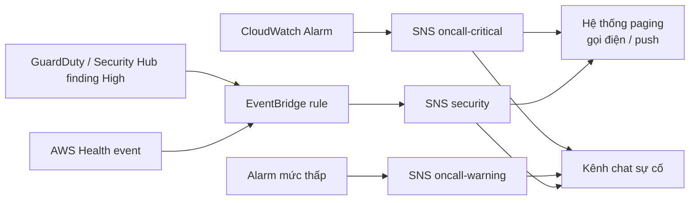

# Quan sát và vận hành trên AWS – CloudWatch, X-Ray/OpenTelemetry, Systems Manager, AWS Backup

**Mục đích:** thiết kế log, metric, trace, cảnh báo và công cụ vận hành cho LearnHub trên AWS; biết chi phí ẩn của observability; thay SSH bằng Session Manager; sao lưu tập trung có khóa chống xóa.
**Liên quan:** [07-bao-mat-aws.md](07-bao-mat-aws.md) · [03-compute-ec2-ecs-eks-lambda.md](03-compute-ec2-ecs-eks-lambda.md) · [10-ha-dr-well-architected.md](10-ha-dr-well-architected.md) · [11-chi-phi-finops.md](11-chi-phi-finops.md) · [12-kien-truc-learnhub-tren-aws.md](12-kien-truc-learnhub-tren-aws.md) · [13-checklist-review-aws.md](13-checklist-review-aws.md) · [../05-backend-senior/12-observability-reliability.md](../05-backend-senior/12-observability-reliability.md) · [../07-he-thong-server/08-xu-ly-su-co-production.md](../07-he-thong-server/08-xu-ly-su-co-production.md)

> Khái niệm SLI/SLO, RED/USE, log có cấu trúc đã có ở [../05-backend-senior/12-observability-reliability.md](../05-backend-senior/12-observability-reliability.md). File này đi sâu vào cách hiện thực trên AWS. Giá chỉ tham khảo — kiểm tra AWS Pricing Calculator.

---

## 1. Bản đồ công cụ

| Nhu cầu | Dịch vụ AWS | Lựa chọn thay thế |
|---|---|---|
| Metric hạ tầng | CloudWatch Metrics (tự có cho ALB, ECS, RDS, SQS…) | Amazon Managed Service for Prometheus |
| Metric ứng dụng | CloudWatch custom metrics / **EMF** | Prometheus + Managed Grafana |
| Log | CloudWatch Logs + Logs Insights | OpenSearch, Grafana Loki, SaaS |
| Trace | AWS X-Ray, thu thập qua **ADOT** (AWS Distro for OpenTelemetry) / CloudWatch agent | Jaeger/Tempo, SaaS APM |
| APM theo service, SLO | **CloudWatch Application Signals** | SaaS APM |
| Kiểm tra từ bên ngoài | CloudWatch **Synthetics** canary | Uptime checker bên ngoài |
| Dashboard | CloudWatch Dashboards | Amazon Managed Grafana |
| Cảnh báo | CloudWatch Alarms → SNS → kênh on-call | Alertmanager |
| Vận hành máy chủ | **Systems Manager** (Session Manager, Patch Manager, Run Command, Automation) | SSH + Ansible |
| Sao lưu | **AWS Backup** | Script tự viết (không khuyến khích) |
| Sức khỏe dịch vụ AWS | AWS Health Dashboard, Health API/EventBridge | — |

Quy tắc chọn: đội nhỏ, thuần AWS → CloudWatch + X-Ray/Application Signals (ít thứ để vận hành). Đội đã quen Prometheus/Grafana, chạy EKS, cần đa cloud → Managed Prometheus + Managed Grafana + OpenTelemetry. **Dù chọn gì, instrument bằng OpenTelemetry** để không bị khóa vào backend.

## 2. CloudWatch Metrics

### 2.1 Khái niệm cần chắc

- **Namespace / metric name / dimensions**: mỗi tổ hợp dimension là **một metric riêng** và tính phí riêng. Đặt dimension `userId` → hàng triệu metric → hóa đơn nổ. Chỉ dùng dimension có số giá trị thấp (service, route, status class, AZ).
- **Độ phân giải**: chuẩn 1 phút; high-resolution tới 1 giây (đắt hơn, chỉ cho metric cần phản ứng nhanh).
- **Thống kê**: dùng **p99/p95** cho độ trễ, không dùng Average (trung bình che đuôi chậm).
- Metric ECS Fargate mặc định ở cấp service; cần **Container Insights** (bản enhanced observability) để có metric cấp task/container.

### 2.2 Custom metric bằng EMF (Embedded Metric Format)

Thay vì gọi `PutMetricData` (tốn API call, độ trễ), ghi một dòng log JSON đúng định dạng EMF → CloudWatch tự trích metric. Log vẫn còn để truy vấn.

```ts
// Ghi metric "ExamSubmitLatency" kèm dimension Service + Outcome bằng EMF
function emitExamSubmitMetric(latencyMs: number, outcome: 'ok' | 'late' | 'error', examId: string) {
  console.log(JSON.stringify({
    _aws: {
      Timestamp: Date.now(),
      CloudWatchMetrics: [{
        Namespace: 'LearnHub/Exam',
        Dimensions: [['Service', 'Outcome']],
        Metrics: [{ Name: 'ExamSubmitLatency', Unit: 'Milliseconds' }],
      }],
    },
    Service: 'exam-api',
    Outcome: outcome,
    ExamSubmitLatency: latencyMs,
    examId,            // trường thường: tìm được trong Logs Insights, KHÔNG thành dimension
    requestId: currentRequestId(),
  }));
}
```

Điểm tinh tế: `examId` nằm trong log nhưng **không** nằm trong `Dimensions` → không tạo metric mới cho mỗi đề thi, vẫn truy vấn được.

### 2.3 Metric nghiệp vụ nên có cho LearnHub

| Metric | Vì sao |
|---|---|
| `LoginSuccess`, `LoginFailure` theo lý do | Phát hiện credential stuffing, lỗi IdP |
| `ExamStartLatency` p99, `ExamSubmitLatency` p99 | Trải nghiệm giờ thi — chỉ số quan trọng nhất |
| `ExamSubmitError` | Nộp bài thất bại = sự cố mức cao |
| `ModerationQueueAge` (tuổi message cũ nhất SQS) | Bài chờ kiểm duyệt quá lâu |
| `GradingBacklog` | Số bài chờ chấm |
| `PostPublished` | Tín hiệu nghiệp vụ tổng thể (rơi về 0 = có gì đó hỏng) |

## 3. CloudWatch Alarms

### 3.1 Nguyên tắc

- Cảnh báo theo **triệu chứng người dùng thấy** (tỉ lệ 5xx, p99 latency, nộp bài lỗi), không theo nguyên nhân (CPU 80%). CPU chỉ là cảnh báo mức thấp/ticket.
- Mỗi alarm gọi người dậy phải có **runbook link** trong mô tả.
- Dùng `DatapointsToAlarm` (M trên N) để tránh nhấp nháy: ví dụ 3 trên 5 phút.
- `TreatMissingData`: chọn có chủ đích. Metric lỗi thiếu dữ liệu thường nghĩa là "không có lỗi" → `notBreaching`; metric heartbeat thiếu dữ liệu nghĩa là "chết" → `breaching`.

### 3.2 Alarm theo tỉ lệ lỗi bằng metric math

```bash
aws cloudwatch put-metric-alarm \
  --alarm-name "learnhub-prod-api-5xx-rate" \
  --alarm-description "Tỉ lệ 5xx ALB > 2% trong 3/5 phút. Runbook: wiki/runbooks/api-5xx" \
  --metrics '[
    {"Id":"e5xx","MetricStat":{"Metric":{"Namespace":"AWS/ApplicationELB","MetricName":"HTTPCode_Target_5XX_Count","Dimensions":[{"Name":"LoadBalancer","Value":"app/learnhub-prod/<LB_ID>"}]},"Period":60,"Stat":"Sum"},"ReturnData":false},
    {"Id":"req","MetricStat":{"Metric":{"Namespace":"AWS/ApplicationELB","MetricName":"RequestCount","Dimensions":[{"Name":"LoadBalancer","Value":"app/learnhub-prod/<LB_ID>"}]},"Period":60,"Stat":"Sum"},"ReturnData":false},
    {"Id":"rate","Expression":"IF(req > 100, 100 * e5xx / req, 0)","Label":"5xx %","ReturnData":true}
  ]' \
  --comparison-operator GreaterThanThreshold --threshold 2 \
  --evaluation-periods 5 --datapoints-to-alarm 3 \
  --treat-missing-data notBreaching \
  --alarm-actions arn:aws:sns:ap-southeast-1:<ACCOUNT_ID>:oncall-critical
```

`IF(req > 100, …)` tránh báo động khi lưu lượng thấp (2 lỗi trên 10 request lúc 3 giờ sáng = 20%).

### 3.3 Composite alarm

Gộp nhiều alarm để giảm nhiễu và chỉ gọi người khi có triệu chứng thật:

```bash
aws cloudwatch put-composite-alarm \
  --alarm-name "learnhub-prod-exam-degraded" \
  --alarm-rule 'ALARM("learnhub-prod-api-5xx-rate") AND (ALARM("learnhub-prod-exam-submit-p99") OR ALARM("learnhub-prod-aurora-cpu"))' \
  --actions-suppressor "learnhub-prod-maintenance-window" \
  --alarm-actions arn:aws:sns:ap-southeast-1:<ACCOUNT_ID>:oncall-critical
```

`actions-suppressor` tắt thông báo khi alarm "đang bảo trì" bật — tránh bị gọi trong cửa sổ bảo trì có kế hoạch.

### 3.4 Anomaly detection

Dùng cho metric có tính mùa vụ (lưu lượng theo giờ trong ngày, theo tuần). LearnHub có đỉnh giờ thi → ngưỡng cố định không hợp. Anomaly detection học dải bình thường; cảnh báo khi **thấp** bất thường (ví dụ `PostPublished` rơi) cũng hữu ích như khi cao. Hạn chế: cần dữ liệu lịch sử, khó giải thích, có thể báo nhầm ở ngày đặc biệt (ngày thi cuối kỳ) — đánh dấu hoặc tạm loại trừ khoảng thời gian bất thường.

## 4. CloudWatch Logs

### 4.1 Cấu trúc log group và thời hạn lưu

| Log group | Retention | Lý do |
|---|---|---|
| `/learnhub/prod/api` | 30 ngày nóng, export sang S3 nếu cần lâu hơn | Debug |
| `/learnhub/prod/audit` | 1 năm+ (theo chính sách pháp chế), hoặc lưu S3 + Object Lock | Bằng chứng |
| `/aws/ecs/containerinsights/...` | Theo mặc định của tính năng, xem lại | Metric hiệu năng |
| VPC Flow Logs | 14–30 ngày, hoặc ghi thẳng S3 | Điều tra mạng, rẻ hơn ở S3 |

**Mặc định log group là "Never expire"** → chi phí lưu trữ tăng mãi. Đặt retention cho **mọi** log group bằng IaC; dùng Config rule phát hiện log group không có retention.

Chi phí lớn nhất thường là **ingestion** (theo GB ghi vào), không phải lưu trữ. Giảm bằng: không log body request, không log ở mức DEBUG trên prod, sampling log thành công, dùng log class **Infrequent Access** cho log ít truy vấn (rẻ hơn nhưng hạn chế tính năng — kiểm tra trước).

### 4.2 Logs Insights – truy vấn mẫu cho LearnHub

Giả định API ghi log JSON có `level`, `route`, `status`, `latencyMs`, `requestId`, `userIdHash`.

```
# Top route chậm nhất 1 giờ qua (p99)
fields route, latencyMs
| filter ispresent(latencyMs)
| stats pct(latencyMs, 99) as p99, count(*) as n by route
| sort p99 desc
| limit 20
```

```
# Tỉ lệ lỗi 5xx theo phút
fields status
| stats sum(status >= 500) as err, count(*) as total by bin(1m)
| fields err * 100 / total as errPct
```

```
# Lần theo một request qua nhiều service (correlation id)
fields @timestamp, @logStream, level, msg
| filter requestId = "<REQUEST_ID>"
| sort @timestamp asc
```

```
# Nghi credential stuffing: nhiều IP thất bại đăng nhập trên ít tài khoản
filter route = "POST /auth/login" and status = 401
| stats count(*) as fails, count_distinct(clientIp) as ips by userIdHash
| filter fails > 50
| sort fails desc
```

Logs Insights tính phí theo GB **quét** → luôn chọn khoảng thời gian hẹp và log group cụ thể.

### 4.3 Metric filter

Biến mẫu log thành metric khi không sửa được code (log của bên thứ ba): ví dụ đếm `"level":"error"` trong log worker chấm bài. Với code của mình, ưu tiên EMF.

## 5. Tracing: X-Ray và OpenTelemetry

| Tiêu chí | X-Ray SDK (cũ) | OpenTelemetry (ADOT / OTel SDK) |
|---|---|---|
| Chuẩn mở | Không | **Có** |
| Đổi backend sau này | Phải viết lại instrument | Đổi exporter |
| Tự động instrument Node (http, pg, redis, aws-sdk) | Có giới hạn | Rộng |
| Khuyến nghị hiện nay | AWS khuyến nghị chuyển sang OpenTelemetry (kiểm tra thông báo hỗ trợ SDK X-Ray) | **Dùng cái này** |

Cách triển khai trên ECS Fargate: chạy collector (ADOT collector hoặc CloudWatch agent) dưới dạng **sidecar** trong task; ứng dụng gửi OTLP tới `localhost:4317`; collector gửi trace tới X-Ray, metric tới CloudWatch. **Application Signals** dựa trên dữ liệu này để dựng bản đồ service, độ trễ/lỗi theo operation và SLO.

Sampling: 100% trace ở 200k user đồng thời là quá đắt. Dùng sampling theo tỉ lệ (ví dụ 5%) + luôn giữ trace lỗi/chậm (tail sampling ở collector nếu cần).

Propagation: đảm bảo header trace (W3C `traceparent`) đi qua ALB → API → SQS message attributes → worker. Agent hay quên bước gắn context vào message SQS → trace bị đứt ở hàng đợi.

## 6. Synthetics canary

Script (Node/Puppeteer hoặc Python/Selenium) chạy định kỳ từ AWS, đóng vai người dùng:
- Canary 1 (mỗi phút): `GET /healthz` + `GET /api/posts?limit=1` qua CloudFront.
- Canary 2 (mỗi 5 phút): đăng nhập bằng **tài khoản test chuyên dụng** → mở một đề thi mẫu → lưu nháp câu trả lời → đăng xuất.
- Mật khẩu tài khoản test lấy từ Secrets Manager, không ghi trong script.
- Tài khoản test phải được loại khỏi số liệu nghiệp vụ và không có quyền thật.

Canary phát hiện sự cố mà metric nội bộ không thấy: DNS, chứng chỉ hết hạn, CloudFront/WAF chặn nhầm.

## 7. Systems Manager

### 7.1 Session Manager thay SSH

| SSH + bastion | Session Manager |
|---|---|
| Mở cổng 22, quản lý key | **Không mở cổng inbound** nào |
| Khó audit từng lệnh | Ghi log phiên vào S3/CloudWatch, CloudTrail ghi ai mở phiên |
| Quyền theo key | Quyền theo **IAM** (có thể giới hạn theo tag instance) |
| Bastion là điểm tấn công | Không có bastion |

Yêu cầu: SSM Agent trên instance, instance profile có `AmazonSSMManagedInstanceCore`, đường ra tới endpoint SSM (qua NAT hoặc **VPC interface endpoint** `ssm`, `ssmmessages`, `ec2messages` cho subnet không ra Internet).

```bash
aws ssm start-session --target <INSTANCE_ID>
# Port forwarding tới Aurora qua một instance trong VPC, không mở DB ra ngoài:
aws ssm start-session --target <INSTANCE_ID> \
  --document-name AWS-StartPortForwardingSessionToRemoteHost \
  --parameters '{"host":["<AURORA_WRITER_ENDPOINT>"],"portNumber":["5432"],"localPortNumber":["15432"]}'
```

ECS: dùng **ECS Exec** (`aws ecs execute-command`) dựa trên cùng cơ chế; bật có kiểm soát (chỉ role vận hành, log phiên), vì vào được container prod là quyền rất lớn.

### 7.2 Patch Manager, Run Command, Automation

- **Patch Manager**: patch baseline (ví dụ tự duyệt bản vá Security sau 7 ngày), patch group theo tag, chạy trong **Maintenance Window**. Chỉ áp dụng cho EC2; Fargate/RDS do AWS vá.
- **Run Command**: chạy lệnh trên nhiều instance theo tag, có log; thay cho "SSH vào từng máy".
- **Automation runbook**: quy trình nhiều bước (tạo AMI, khởi động lại có kiểm tra, cô lập instance khi sự cố) — gắn với Config remediation hoặc EventBridge. Viết runbook sự cố thành Automation để giảm thao tác tay lúc căng thẳng.
- **Parameter Store**: xem [07-bao-mat-aws.md](07-bao-mat-aws.md) mục 3.

## 8. AWS Backup

### 8.1 Thiết kế cho LearnHub

| Tài nguyên | Tần suất | Lưu | Copy |
|---|---|---|---|
| Aurora PostgreSQL | Backup liên tục (PITR) 35 ngày + snapshot hằng ngày | Snapshot hằng ngày 35 ngày, hằng tháng 12 tháng | Copy sang **tài khoản Backup** và **Region DR** |
| S3 media | Versioning + replication (xem [04-luu-tru-va-database.md](04-luu-tru-va-database.md)); AWS Backup cho S3 nếu cần điểm khôi phục | 35 ngày | Region DR |
| EFS / EBS (nếu có) | Hằng ngày | 14 ngày | Tùy |
| DynamoDB (nếu có) | PITR + backup hằng ngày | 35 ngày | Region DR |

Gán tài nguyên vào backup plan bằng **tag** (`backup=critical`) để tài nguyên mới tự được bảo vệ. Dùng **backup policy ở cấp Organization** để áp chuẩn cho mọi tài khoản.

### 8.2 Vault Lock và chống ransomware

- **Backup vault** mã hóa bằng CMK riêng (không dùng chung khóa với DB nguồn — nếu khóa nguồn bị xóa vẫn còn backup).
- **Vault Lock**: chế độ **governance** (người có quyền đặc biệt vẫn gỡ được) để thử; chế độ **compliance** (sau thời gian chờ thì **không ai**, kể cả root, xóa được điểm khôi phục trước hạn). Chỉ bật compliance khi đã chắc cấu hình — không đảo ngược được.
- Copy sang **tài khoản Backup riêng**: kẻ chiếm tài khoản prod không xóa được bản sao. Nếu có, cân nhắc **logically air-gapped vault** (kiểm tra tính năng hiện hành).

```bash
aws backup put-backup-vault-lock-configuration \
  --backup-vault-name learnhub-prod-vault \
  --min-retention-days 7 --max-retention-days 400 \
  --changeable-for-days 3   # sau 3 ngày khóa trở thành compliance, không gỡ được
```

### 8.3 Kiểm tra khôi phục

"Backup chưa từng restore thử = không có backup." Dùng **AWS Backup restore testing** để định kỳ khôi phục tự động và chạy script kiểm tra (đếm bản ghi, truy vấn mẫu), ghi lại thời gian khôi phục thực tế để so với RTO. Chi tiết DR ở [10-ha-dr-well-architected.md](10-ha-dr-well-architected.md) và [../06-database-chuyen-sau/05-backup-restore-dr.md](../06-database-chuyen-sau/05-backup-restore-dr.md).

## 9. AWS Health và Trusted Advisor

- **AWS Health**: sự kiện ảnh hưởng tài khoản của bạn (bảo trì RDS bắt buộc, sự cố dịch vụ ở Region, instance bị retire, chứng chỉ sắp hết hạn). Tạo EventBridge rule `aws.health` → SNS để không bỏ lỡ; dùng **organizational view** để xem toàn Organization.
- **Trusted Advisor**: kiểm tra chi phí, bảo mật, chịu lỗi, giới hạn quota. Bộ kiểm tra đầy đủ cần gói Business Support trở lên. Theo dõi đặc biệt mục **Service Limits/Quotas** trước mùa thi.

## 10. Định tuyến cảnh báo on-call



- Chat: AWS cung cấp tích hợp Slack/Microsoft Teams (trước gọi là AWS Chatbot, nay nằm dưới tên Amazon Q Developer in chat applications — kiểm tra tên hiện hành).
- Paging: hệ thống trực ca (PagerDuty, Opsgenie hoặc tương đương) nhận qua HTTPS subscription của SNS hoặc tích hợp EventBridge.
- **Hai mức**: critical (gọi người ngay, 24/7) và warning (ticket/kênh chat, xử lý giờ hành chính). Mọi alarm critical phải có hành động con người làm được; alarm không ai xử lý → xóa hoặc hạ mức.
- Kiểm tra đường cảnh báo định kỳ (`aws cloudwatch set-alarm-state` để giả lập) — SNS subscription bị hủy xác nhận là lỗi thầm lặng phổ biến.

## 11. Sai lầm thường gặp

| Sai lầm | Hậu quả | Cách đúng |
|---|---|---|
| Log group không đặt retention | Chi phí tăng mãi | Retention trong IaC; Config rule kiểm tra |
| Dimension có số giá trị lớn (userId, examId) | Hàng triệu metric, hóa đơn lớn | Để trong trường log EMF, không làm dimension |
| Cảnh báo CPU > 80% gọi người lúc 3 giờ sáng | Mệt mỏi cảnh báo, bỏ qua cảnh báo thật | Cảnh báo triệu chứng; CPU chỉ là warning |
| Log toàn bộ request/response body | Lộ PII, chi phí ingestion | Log trường cần thiết, che dữ liệu nhạy cảm |
| Mở cổng 22 "tạm thời" để debug | Bị quét và tấn công trong vài phút | Session Manager / ECS Exec |
| Backup cùng tài khoản, cùng khóa KMS | Kẻ chiếm tài khoản xóa cả backup | Tài khoản Backup riêng, vault lock, khóa riêng |
| Agent thêm `console.log(JSON.stringify(req))` để debug rồi để lại | Lộ token/mật khẩu trong log | Review log statement; logger có redaction |
| Alarm không có runbook | Người trực không biết làm gì | Link runbook trong mô tả alarm |

## Checklist review

- [ ] Mọi log group có retention; log audit có thời hạn theo chính sách và lưu chống sửa xóa.
- [ ] Log có cấu trúc JSON, có `requestId`/trace id, không chứa mật khẩu, token, OTP, PII không cần.
- [ ] Metric custom dùng EMF; dimension có số giá trị thấp.
- [ ] Alarm critical theo triệu chứng (5xx %, p99, nộp bài lỗi, tuổi queue), có runbook, M-trên-N, `TreatMissingData` có chủ đích.
- [ ] Có canary từ bên ngoài cho luồng chính (đăng nhập, mở đề thi) dùng tài khoản test chuyên dụng.
- [ ] Trace bằng OpenTelemetry, có sampling, context đi qua SQS/EventBridge.
- [ ] Không mở cổng SSH; truy cập qua Session Manager/ECS Exec có log phiên và quyền giới hạn.
- [ ] Patch Manager cho EC2 (nếu có) chạy trong maintenance window.
- [ ] AWS Backup plan gán bằng tag, copy sang tài khoản Backup và Region DR, vault khóa bằng CMK riêng, cân nhắc Vault Lock.
- [ ] Có kiểm tra khôi phục định kỳ và ghi thời gian khôi phục thực tế.
- [ ] AWS Health events và finding bảo mật được định tuyến tới on-call; đường cảnh báo được kiểm tra định kỳ.
