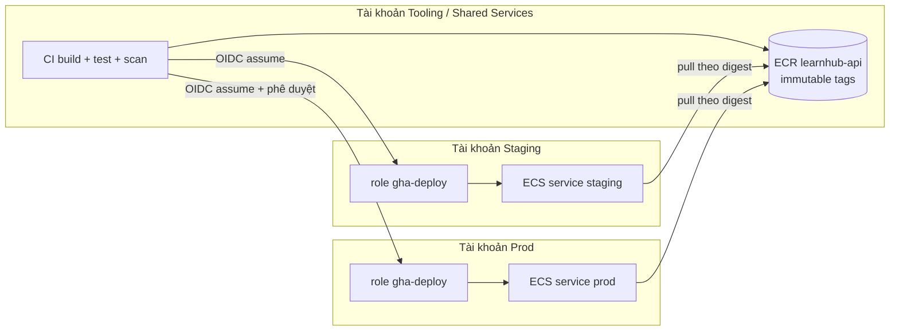

# IaC và CI/CD trên AWS – CloudFormation, CDK, Terraform, OIDC, ECR, chiến lược deploy

**Mục đích:** chọn công cụ IaC, dựng pipeline đưa LearnHub từ commit tới production qua nhiều tài khoản AWS mà không dùng khóa truy cập lâu dài, có cổng phê duyệt và rào chắn bảo mật.
**Liên quan:** [01-tai-khoan-iam-organizations.md](01-tai-khoan-iam-organizations.md) · [03-compute-ec2-ecs-eks-lambda.md](03-compute-ec2-ecs-eks-lambda.md) · [07-bao-mat-aws.md](07-bao-mat-aws.md) · [10-ha-dr-well-architected.md](10-ha-dr-well-architected.md) · [12-kien-truc-learnhub-tren-aws.md](12-kien-truc-learnhub-tren-aws.md) · [13-checklist-review-aws.md](13-checklist-review-aws.md) · [../07-he-thong-server/06-ci-cd-iac.md](../07-he-thong-server/06-ci-cd-iac.md) · [../02-quy-trinh-phan-mem/08-release.md](../02-quy-trinh-phan-mem/08-release.md)

> Khái niệm chung (pipeline, promotion cùng image digest, GitOps, Terraform state) ở [../07-he-thong-server/06-ci-cd-iac.md](../07-he-thong-server/06-ci-cd-iac.md). File này đi vào chi tiết AWS. Tính năng thay đổi theo phiên bản — các chỗ ghi "kiểm tra" cần đối chiếu tài liệu hiện hành.

---

## 1. Chọn công cụ IaC

| Tiêu chí | CloudFormation (YAML/JSON) | AWS CDK (TypeScript/Python…) | Terraform / OpenTofu |
|---|---|---|---|
| Ngôn ngữ | Khai báo thuần | Ngôn ngữ lập trình → sinh CloudFormation | HCL |
| State | AWS quản lý (stack) | AWS quản lý (stack) | **Bạn quản lý** (S3 + khóa) |
| Rollback khi lỗi | Tự động rollback stack | Như CloudFormation | Không tự rollback; apply dừng giữa chừng |
| Hỗ trợ dịch vụ AWS mới | Thường có sớm; có thể chậm với vài tính năng | Như CloudFormation (+ construct cộng đồng) | Provider AWS cập nhật nhanh, đôi khi nhanh hơn CFN |
| Đa nhà cung cấp (Cloudflare, GitHub, Datadog…) | Hạn chế | Hạn chế | **Mạnh** |
| Trừu tượng hóa | Thấp | **Cao** (L2/L3 construct sinh sẵn IAM, SG…) | Module |
| Phát hiện drift | Drift detection có sẵn | Như CFN | `terraform plan` |
| Rủi ro | Template dài, lặp | Construct sinh tài nguyên "ẩn" — phải đọc `cdk diff` | State hỏng/khóa kẹt; secret lọt vào state |

Quy tắc chọn:
- Đội thuần AWS, quen TypeScript, muốn nhanh → **CDK**.
- Hạ tầng đa nhà cung cấp, đội platform đã có kinh nghiệm Terraform, cần module dùng chung giữa nhiều dự án → **Terraform/OpenTofu**.
- Không trộn hai công cụ quản lý **cùng một tài nguyên**. Có thể chia: Terraform cho nền tảng (Organization, VPC, account baseline), CDK cho ứng dụng — nhưng ghi rõ ranh giới trong ADR.

## 2. CDK: stack LearnHub API trên ECS Fargate sau ALB

```ts
// lib/api-stack.ts — CDK v2
import { Stack, StackProps, Duration, RemovalPolicy } from 'aws-cdk-lib';
import { Construct } from 'constructs';
import * as ec2 from 'aws-cdk-lib/aws-ec2';
import * as ecs from 'aws-cdk-lib/aws-ecs';
import * as ecr from 'aws-cdk-lib/aws-ecr';
import * as ecsPatterns from 'aws-cdk-lib/aws-ecs-patterns';
import * as sm from 'aws-cdk-lib/aws-secretsmanager';
import * as logs from 'aws-cdk-lib/aws-logs';
import * as acm from 'aws-cdk-lib/aws-certificatemanager';

interface ApiStackProps extends StackProps {
  vpc: ec2.IVpc;
  imageDigest: string;        // promotion bằng digest, không bằng tag
  certificateArn: string;
  dbSecretArn: string;
}

export class ApiStack extends Stack {
  constructor(scope: Construct, id: string, props: ApiStackProps) {
    super(scope, id, props);

    const cluster = new ecs.Cluster(this, 'Cluster', {
      vpc: props.vpc,
      containerInsightsV2: ecs.ContainerInsights.ENHANCED, // kiểm tra tên thuộc tính theo phiên bản CDK
    });

    const repo = ecr.Repository.fromRepositoryName(this, 'Repo', 'learnhub-api');
    const dbSecret = sm.Secret.fromSecretCompleteArn(this, 'DbSecret', props.dbSecretArn);

    const logGroup = new logs.LogGroup(this, 'ApiLogs', {
      logGroupName: '/learnhub/prod/api',
      retention: logs.RetentionDays.ONE_MONTH,       // không để "never expire"
      removalPolicy: RemovalPolicy.RETAIN,
    });

    const svc = new ecsPatterns.ApplicationLoadBalancedFargateService(this, 'Api', {
      cluster,
      desiredCount: 6,
      cpu: 1024,
      memoryLimitMiB: 2048,
      runtimePlatform: {
        cpuArchitecture: ecs.CpuArchitecture.ARM64,   // Graviton: rẻ hơn — image phải build multi-arch/arm64
        operatingSystemFamily: ecs.OperatingSystemFamily.LINUX,
      },
      taskSubnets: { subnetType: ec2.SubnetType.PRIVATE_WITH_EGRESS },
      publicLoadBalancer: true,
      certificate: acm.Certificate.fromCertificateArn(this, 'Cert', props.certificateArn),
      redirectHTTP: true,
      circuitBreaker: { rollback: true },              // deploy hỏng → tự quay về bản trước
      minHealthyPercent: 100,
      maxHealthyPercent: 200,
      taskImageOptions: {
        image: ecs.ContainerImage.fromEcrRepository(repo, props.imageDigest),
        containerPort: 3000,
        logDriver: ecs.LogDrivers.awsLogs({ streamPrefix: 'api', logGroup }),
        environment: { NODE_ENV: 'production', PORT: '3000' },
        secrets: {
          DB_PASSWORD: ecs.Secret.fromSecretsManager(dbSecret, 'password'),
        },
      },
    });

    svc.targetGroup.configureHealthCheck({
      path: '/readyz',
      healthyThresholdCount: 2,
      interval: Duration.seconds(10),
    });
    svc.targetGroup.setAttribute('deregistration_delay.timeout_seconds', '30');

    const scaling = svc.service.autoScaleTaskCount({ minCapacity: 6, maxCapacity: 120 });
    scaling.scaleOnCpuUtilization('Cpu', { targetUtilizationPercent: 55 });
    scaling.scaleOnRequestCount('Req', {
      requestsPerTarget: 800,
      targetGroup: svc.targetGroup,
    });
  }
}
```

Điều reviewer phải xem trong **`cdk diff`** chứ không chỉ code: construct `ApplicationLoadBalancedFargateService` tự tạo security group, IAM role, listener. Kiểm tra: SG của ALB mở 443 (và 80 để redirect), SG của task chỉ nhận từ SG của ALB; task role không có quyền thừa; không có tài nguyên `Delete`/`Replace` ngoài dự kiến (thay thế ALB = đổi DNS name = sự cố).

`cdk-nag` (bộ rule AWS Solutions) chạy trong `cdk synth` để bắt cấu hình kém an toàn.

## 3. Terraform trên AWS

### 3.1 Remote state

```hcl
terraform {
  required_version = ">= 1.11"
  required_providers {
    aws = { source = "hashicorp/aws", version = "~> 6.0" } # chốt major, cập nhật có kiểm soát
  }
  backend "s3" {
    bucket       = "learnhub-tfstate-<ACCOUNT_ID>"
    key          = "prod/network/terraform.tfstate"
    region       = "ap-southeast-1"
    encrypt      = true
    kms_key_id   = "alias/learnhub-tfstate"
    use_lockfile = true   # khóa state bằng file trong S3 (Terraform 1.10+ thử nghiệm, ổn định từ 1.11 — kiểm tra phiên bản)
  }
}
```

- Trước đây khóa state dùng **bảng DynamoDB** (`dynamodb_table`). Các phiên bản Terraform mới hỗ trợ khóa gốc bằng S3 (`use_lockfile`) và đánh dấu cách dùng DynamoDB là deprecated. OpenTofu có cơ chế tương tự — kiểm tra phiên bản bạn dùng. Khi chuyển, có thể bật cả hai trong giai đoạn chuyển tiếp.
- Bucket state: versioning bật (khôi phục state hỏng), Block Public Access, SSE-KMS, chỉ role CI và nhóm platform đọc được. **State chứa giá trị nhạy cảm** (mật khẩu được sinh, output) — quyền đọc state = quyền đọc bí mật.
- Tách state theo **tầng và môi trường** (`prod/network`, `prod/data`, `prod/app`) để giảm bán kính ảnh hưởng và thời gian plan.

### 3.2 Provider assume role theo tài khoản

```hcl
provider "aws" {
  region = "ap-southeast-1"
  assume_role {
    role_arn     = "arn:aws:iam::<PROD_ACCOUNT_ID>:role/terraform-deploy"
    session_name = "tf-${var.git_sha}"
  }
  default_tags {
    tags = { app = "learnhub", env = "prod", owner = "platform", managed_by = "terraform" }
  }
}
```

`default_tags` đảm bảo mọi tài nguyên có tag phân bổ chi phí ([11-chi-phi-finops.md](11-chi-phi-finops.md)).

### 3.3 Drift

Chạy `terraform plan -detailed-exitcode` theo lịch (hằng đêm) cho từng state: exit code 2 = có thay đổi chưa áp dụng (ai đó sửa tay trên console hoặc code chưa apply) → tạo cảnh báo. Không "sửa nhanh trên console" trên prod; nếu bắt buộc trong sự cố, ghi lại và đưa vào code ngay sau đó.

## 4. GitHub Actions vào AWS bằng OIDC – không có khóa lâu dài

### 4.1 Trust policy

Tạo một lần OIDC identity provider `token.actions.githubusercontent.com` trong tài khoản, audience `sts.amazonaws.com`. Role deploy chỉ tin đúng repo + nhánh/môi trường:

```json
{
  "Version": "2012-10-17",
  "Statement": [
    {
      "Effect": "Allow",
      "Principal": {
        "Federated": "arn:aws:iam::<ACCOUNT_ID>:oidc-provider/token.actions.githubusercontent.com"
      },
      "Action": "sts:AssumeRoleWithWebIdentity",
      "Condition": {
        "StringEquals": {
          "token.actions.githubusercontent.com:aud": "sts.amazonaws.com",
          "token.actions.githubusercontent.com:sub": "repo:<GITHUB_ORG>/learnhub-api:environment:production"
        }
      }
    }
  ]
}
```

Điểm sống còn:
- **Luôn ràng buộc `sub`**. Thiếu điều kiện `sub` (hoặc dùng `StringLike` với `repo:<GITHUB_ORG>/*`) = **mọi repo** của tổ chức (hoặc tệ hơn, của GitHub nếu sai cả org) có thể assume role prod. Đây là lỗi nghiêm trọng hay gặp, kể cả trong code agent sinh ra.
- Dùng `environment:production` thay vì `ref:refs/heads/main` khi có **GitHub Environment** với required reviewers → chỉ job đã được người duyệt mới có credential prod.
- Pull request từ fork không được có quyền assume role deploy.

### 4.2 Workflow

```yaml
name: deploy-api
on:
  push:
    branches: [main]

permissions:
  id-token: write   # cần để xin OIDC token
  contents: read

jobs:
  build:
    runs-on: ubuntu-24.04
    outputs:
      digest: ${{ steps.push.outputs.digest }}
    steps:
      - uses: actions/checkout@<PINNED_SHA>
      - uses: aws-actions/configure-aws-credentials@<PINNED_SHA>
        with:
          role-to-assume: arn:aws:iam::<TOOLING_ACCOUNT_ID>:role/gha-build
          aws-region: ap-southeast-1
      - uses: aws-actions/amazon-ecr-login@<PINNED_SHA>
        id: ecr
      - name: Build và push image arm64
        id: push
        run: |
          IMAGE=${{ steps.ecr.outputs.registry }}/learnhub-api:${GITHUB_SHA}
          docker buildx build --platform linux/arm64 -t "$IMAGE" --push .
          DIGEST=$(docker buildx imagetools inspect "$IMAGE" --format '{{json .Manifest.Digest}}' | tr -d '"')
          echo "digest=$DIGEST" >> "$GITHUB_OUTPUT"

  deploy-staging:
    needs: build
    environment: staging
    runs-on: ubuntu-24.04
    steps:
      - uses: actions/checkout@<PINNED_SHA>
      - uses: aws-actions/configure-aws-credentials@<PINNED_SHA>
        with:
          role-to-assume: arn:aws:iam::<STAGING_ACCOUNT_ID>:role/gha-deploy
          aws-region: ap-southeast-1
      - run: npx cdk deploy ApiStack-staging --require-approval never -c imageDigest=${{ needs.build.outputs.digest }}
      - run: npm run test:smoke -- --base-url https://staging.learnhub.example

  deploy-prod:
    needs: [build, deploy-staging]
    environment: production        # GitHub Environment có required reviewers = cổng phê duyệt
    runs-on: ubuntu-24.04
    steps:
      - uses: actions/checkout@<PINNED_SHA>
      - uses: aws-actions/configure-aws-credentials@<PINNED_SHA>
        with:
          role-to-assume: arn:aws:iam::<PROD_ACCOUNT_ID>:role/gha-deploy
          aws-region: ap-southeast-1
      - run: npx cdk deploy ApiStack-prod --require-approval never -c imageDigest=${{ needs.build.outputs.digest }}
```

Ghi chú:
- **Pin action theo commit SHA**, không theo tag `@v4` (tag có thể bị dời sang code độc hại — tấn công chuỗi cung ứng đã xảy ra thực tế).
- `--require-approval never` chỉ chấp nhận được vì đã có cổng **Environment** của GitHub và `cdk diff` được xem ở PR. Nếu không có hai thứ đó, đây là lỗ hổng quy trình.
- Cùng **digest** đi từ staging lên prod — không build lại.

## 5. Pipeline đa tài khoản



- ECR ở tài khoản Tooling; **repository policy** cho phép task execution role của tài khoản staging/prod `ecr:BatchGetImage`, `ecr:GetDownloadUrlForLayer` (hoặc dùng ECR replication sang từng tài khoản).
- Role `gha-deploy` mỗi tài khoản có quyền **chỉ đủ để deploy** (CloudFormation + `iam:PassRole` cho đúng role của task). Với CDK, dùng bootstrap có `--trust` tài khoản Tooling và `--cloudformation-execution-policies` hẹp thay vì `AdministratorAccess` mặc định.
- Thay đổi IAM/mạng (rủi ro cao) đi pipeline riêng với người duyệt từ nhóm platform/security.

## 6. ECR

| Cấu hình | Khuyến nghị | Lý do |
|---|---|---|
| Tag mutability | **IMMUTABLE** | Không ai ghi đè tag `1.4.2` bằng image khác |
| Scan | Enhanced scanning (Inspector), quét liên tục | CVE mới công bố sau khi build vẫn được phát hiện |
| Lifecycle policy | Giữ N image gần nhất cho tag `sha-*`, xóa untagged sau 7 ngày | Chi phí lưu trữ, giảm rác |
| Mã hóa | KMS (CMK nếu cần chia sẻ có kiểm soát) | Tuân thủ |
| Pull-through cache | Cho image công khai (Docker Hub, ECR Public) | Tránh giới hạn tốc độ, giữ bản sao nội bộ |
| Ký image | Signer/Notation hoặc cosign; xác minh trước deploy | Chống image giả |

```json
{
  "rules": [
    {
      "rulePriority": 1,
      "description": "Xóa image untagged sau 7 ngày",
      "selection": { "tagStatus": "untagged", "countType": "sinceImagePushed", "countUnit": "days", "countNumber": 7 },
      "action": { "type": "expire" }
    },
    {
      "rulePriority": 2,
      "description": "Giữ 200 image sha- gần nhất",
      "selection": { "tagStatus": "tagged", "tagPrefixList": ["sha-"], "countType": "imageCountMoreThan", "countNumber": 200 },
      "action": { "type": "expire" }
    }
  ]
}
```

Cẩn thận: lifecycle xóa image mà bản prod đang chạy hoặc bản cần rollback → rollback thất bại. Giữ đủ lịch sử theo chính sách rollback.

## 7. Chiến lược deploy trên ECS / EKS

| Chiến lược | Cách trên AWS | Ưu | Nhược | Dùng khi |
|---|---|---|---|---|
| **Rolling** | ECS deployment controller mặc định, `minHealthyPercent`/`maxPercent`, **deployment circuit breaker** + rollback | Đơn giản, không tốn gấp đôi | Hai phiên bản chạy song song một lúc; rollback chậm hơn | Mặc định cho phần lớn thay đổi |
| **Blue/green** | ECS + CodeDeploy (hai target group, chuyển listener); ECS cũng đã có blue/green tích hợp sẵn không cần CodeDeploy (ra mắt 2025 — kiểm tra tính năng và giới hạn hiện hành) | Chuyển/quay lại tức thì, có hook kiểm thử trước khi nhận traffic | Tốn tài nguyên gấp đôi khi chuyển; cấu hình phức tạp hơn | Thay đổi rủi ro, trước mùa thi |
| **Canary / linear** | CodeDeploy `ECSCanary10Percent5Minutes`, `ECSLinear10PercentEvery1Minutes`; trên EKS dùng Argo Rollouts / Flagger | Giới hạn bán kính ảnh hưởng | Cần metric tốt để quyết định tự động | Lưu lượng lớn, có metric lỗi đáng tin |
| **Feature flag** | AppConfig feature flags hoặc dịch vụ flag | Tách deploy khỏi release; tắt nhanh | Nợ kỹ thuật nếu không dọn flag | Tính năng mới cho người dùng |

Gắn **CloudWatch alarm** vào deployment (ECS deployment alarms / CodeDeploy alarm) → deploy tự quay lại khi tỉ lệ 5xx tăng.

**Thứ tự với migration DB:** migration theo kiểu expand/contract chạy **trước** khi deploy code mới (bước expand tương thích với code cũ), contract chạy ở lần release sau. Chạy migration bằng một ECS task một lần (`run-task`) trong pipeline, không chạy trong lệnh khởi động container (N task cùng chạy migration = tranh chấp khóa). Chi tiết: [../06-database-chuyen-sau/08-migration-schema-evolution.md](../06-database-chuyen-sau/08-migration-schema-evolution.md).

**Không deploy trong giờ thi.** Dùng cửa sổ đóng băng (freeze) theo lịch thi: pipeline kiểm tra lịch và từ chối deploy prod trong khung giờ đó (trừ hotfix có phê duyệt).

## 8. CodePipeline vs GitHub Actions

| Tiêu chí | CodePipeline + CodeBuild | GitHub Actions |
|---|---|---|
| Chạy trong AWS, không cần credential ra ngoài | **Có** | Cần OIDC |
| Trải nghiệm dev, PR checks | Hạn chế | **Tốt** |
| Hệ sinh thái action | Ít | **Rất lớn** (rủi ro chuỗi cung ứng tương ứng) |
| Runner trong VPC (truy cập DB staging để test) | CodeBuild trong VPC | Self-hosted runner hoặc CodeBuild-hosted runner cho GitHub Actions |
| Phê duyệt | Manual approval action | Environments + required reviewers |
| Yêu cầu tuân thủ "mọi thứ trong tài khoản AWS" | **Phù hợp** | Cần giải trình |

Phổ biến: GitHub Actions cho CI (test, scan, build) + deploy qua OIDC. CodePipeline khi tổ chức yêu cầu pipeline nằm trong AWS.

## 9. Rào chắn trong pipeline

| Công cụ | Kiểm tra | Giai đoạn |
|---|---|---|
| `cfn-lint` | Template CloudFormation hợp lệ | PR |
| `cdk-nag` | Quy tắc bảo mật/best practice trên CDK | `cdk synth` |
| `checkov` / `trivy config` (tfsec đã gộp vào trivy) | Cấu hình sai trong Terraform/CFN/K8s/Dockerfile | PR |
| `cfn-guard` | Chính sách tùy biến dạng rule (ví dụ "mọi RDS phải mã hóa") | PR |
| `terraform plan` + đọc plan | Thay đổi thật sẽ xảy ra | PR (bình luận plan vào PR) |
| IAM Access Analyzer policy checks | Policy mới không mở quyền ngoài ý muốn | PR |
| Inspector / trivy image scan | CVE trong image | Sau build |
| Secret scanning (gitleaks, GitHub push protection) | Không lọt bí mật | Pre-commit + PR |

Plan/diff là **tài liệu phê duyệt chính**: người duyệt phải đọc được danh sách `create / update / replace / destroy`. Bất kỳ `destroy`/`replace` nào trên tài nguyên có dữ liệu (Aurora, S3, ElastiCache, ALB) phải được giải thích.

Bảo vệ thêm: `deletion_protection = true` cho Aurora và ALB; `prevent_destroy` lifecycle trong Terraform; `RemovalPolicy.RETAIN` trong CDK cho tài nguyên có dữ liệu; CloudFormation stack termination protection.

## 10. Sai lầm thường gặp (kể cả của agent AI)

| Sai lầm | Hậu quả | Cách đúng |
|---|---|---|
| Lưu access key AWS trong GitHub Secrets | Khóa lâu dài bị lộ qua log/fork/action độc hại | OIDC |
| Trust policy OIDC không ràng buộc `sub` | Repo khác assume được role prod | Ràng buộc repo + environment |
| `terraform apply -auto-approve` không review plan | Xóa/thay thế tài nguyên dữ liệu | Plan → review → apply đúng plan đã duyệt (`terraform apply plan.out`) |
| State Terraform trong Git hoặc local | Lộ bí mật, xung đột | S3 backend mã hóa + khóa |
| Image tag `latest` trên prod | Không biết đang chạy gì, rollback không xác định | Digest/tag bất biến |
| Build lại image cho mỗi môi trường | Prod chạy thứ chưa từng test | Promote cùng digest |
| CDK bootstrap với `AdministratorAccess` mặc định, ai cũng deploy được | Pipeline là cửa hậu toàn quyền | Execution policy hẹp, trust có kiểm soát |
| Migration chạy trong entrypoint container | Nhiều task chạy migration đồng thời, khóa bảng | Task migration riêng trong pipeline |
| Agent đổi tên logical ID của tài nguyên CDK/CFN để "gọn code" | CloudFormation **xóa và tạo lại** tài nguyên (mất dữ liệu nếu là DB/bucket) | Giữ nguyên logical ID; xem `cdk diff` |
| Action bên thứ ba pin theo tag | Bị thay mã độc | Pin theo SHA, Dependabot cập nhật |

## Checklist review

- [ ] Không có khóa truy cập AWS lâu dài trong CI; OIDC trust policy ràng buộc `aud` và `sub` theo repo + environment.
- [ ] Deploy prod đi qua cổng phê duyệt (GitHub Environment / manual approval) và người duyệt thấy plan/diff.
- [ ] Plan/diff không có `destroy`/`replace` trên tài nguyên có dữ liệu, hoặc đã giải thích và có backup.
- [ ] Tài nguyên có dữ liệu có deletion protection / `prevent_destroy` / `RETAIN`.
- [ ] Terraform state ở S3 mã hóa KMS, versioning, khóa state, quyền đọc hạn chế; tách state theo tầng/môi trường.
- [ ] Image dùng digest/tag bất biến; ECR immutable, scan bật, lifecycle không xóa bản cần rollback.
- [ ] Cùng một digest đi từ staging lên prod.
- [ ] Có circuit breaker/alarm rollback cho deploy; chiến lược deploy phù hợp mức rủi ro.
- [ ] Migration DB chạy như bước riêng, tương thích ngược (expand/contract).
- [ ] Pipeline có lint/scan IaC (cfn-lint, cdk-nag, checkov/trivy), secret scanning, image scan.
- [ ] Action GitHub pin theo SHA; role deploy mỗi tài khoản quyền tối thiểu.
- [ ] Có cửa sổ đóng băng deploy trong giờ thi; có drift detection định kỳ.
