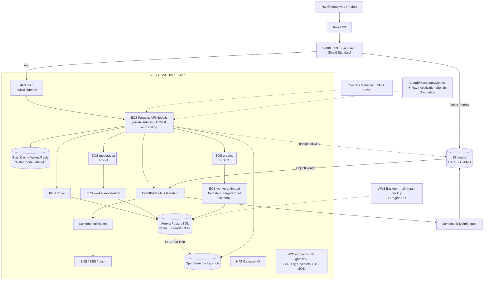
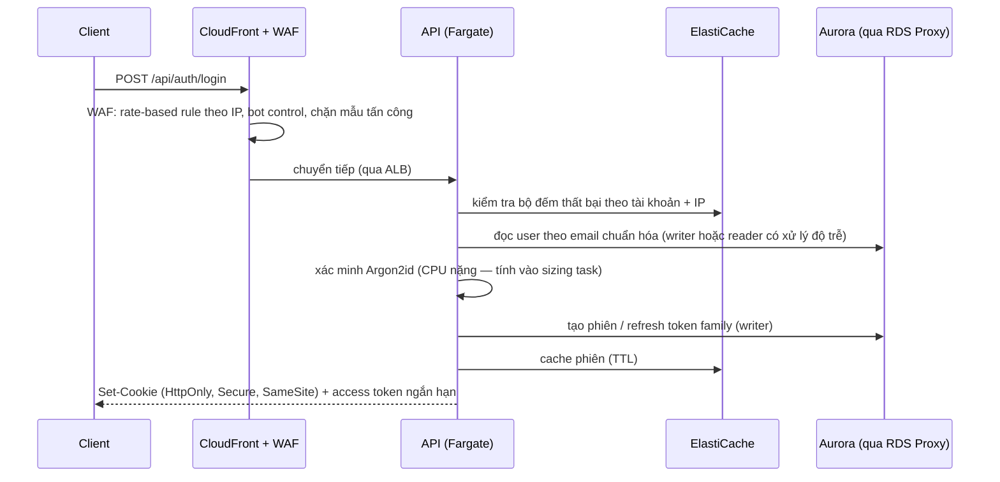
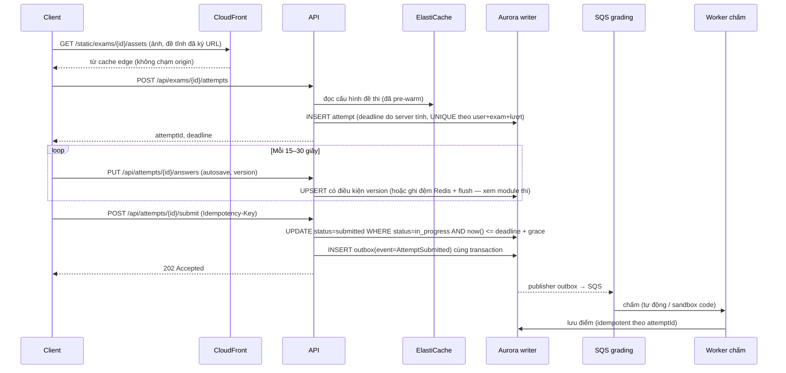

# Kiến trúc tham chiếu LearnHub trên AWS

**Mục đích:** ghép các phần 01–11 thành một kiến trúc hoàn chỉnh cho LearnHub (5 triệu user, 200k đồng thời giờ cao điểm), mô tả luồng request quan trọng, cách chịu đỉnh giờ thi, lộ trình phát triển theo giai đoạn, ước lượng chi phí ở mức độ lớn và danh sách ADR cần viết trước khi triển khai.
**Liên quan:** [01-tai-khoan-iam-organizations.md](01-tai-khoan-iam-organizations.md) · [02-mang-vpc.md](02-mang-vpc.md) · [03-compute-ec2-ecs-eks-lambda.md](03-compute-ec2-ecs-eks-lambda.md) · [04-luu-tru-va-database.md](04-luu-tru-va-database.md) · [05-messaging-integration.md](05-messaging-integration.md) · [06-edge-cloudfront-alb-waf.md](06-edge-cloudfront-alb-waf.md) · [07-bao-mat-aws.md](07-bao-mat-aws.md) · [08-observability-van-hanh.md](08-observability-van-hanh.md) · [09-iac-ci-cd-aws.md](09-iac-ci-cd-aws.md) · [10-ha-dr-well-architected.md](10-ha-dr-well-architected.md) · [11-chi-phi-finops.md](11-chi-phi-finops.md) · [13-checklist-review-aws.md](13-checklist-review-aws.md) · [../05-backend-senior/09-scale-trieu-user.md](../05-backend-senior/09-scale-trieu-user.md) · [../05-backend-senior/06-module-bai-kiem-tra-cham-bai.md](../05-backend-senior/06-module-bai-kiem-tra-cham-bai.md)

> Đây là **một** kiến trúc hợp lý, không phải đáp án duy nhất. Mọi quyết định lớn ở đây phải được ghi thành ADR và được người có thẩm quyền duyệt (xem mục 8).

---

## 1. Sơ đồ tổng thể (Region chính ap-southeast-1)



Ghi chú:
- **CloudFront** đứng trước cả API (không chỉ static): TLS gần người dùng, WAF ở edge, chống DDoS tầng mạng (Shield Standard mặc định), giảm kết nối trực tiếp vào ALB. ALB chỉ nhận traffic từ CloudFront (managed prefix list của CloudFront trong security group + header bí mật kiểm tra ở ALB hoặc dùng tính năng VPC origin nếu phù hợp — kiểm tra [06-edge-cloudfront-alb-waf.md](06-edge-cloudfront-alb-waf.md)).
- **ECS Fargate** thay vì EKS: đội vừa và nhỏ, không cần hệ sinh thái Kubernetes; ít thứ vận hành. Chuyển EKS khi có lý do cụ thể (nhiều team, nhiều service, cần operator K8s) — ghi ADR.
- **Aurora PostgreSQL + RDS Proxy**: hàng trăm task API × pool kết nối có thể vượt giới hạn kết nối DB; Proxy gộp kết nối và giảm thời gian gián đoạn khi failover.
- **SQS** cho moderation và chấm bài (hàng đợi công việc, mỗi message một người xử lý); **EventBridge** cho sự kiện miền (bài đã đăng, bài đã chấm) có nhiều bên nghe. Kafka/MSK **không** cần ở giai đoạn này — xem [05-messaging-integration.md](05-messaging-integration.md) và [../05-backend-senior/10-messaging-kafka.md](../05-backend-senior/10-messaging-kafka.md).
- **OpenSearch** là tùy chọn: bắt đầu bằng PostgreSQL full-text search; chuyển khi cần tìm kiếm tiếng Việt chất lượng cao, faceting, quy mô lớn.

## 2. Bố cục tài khoản (AWS Organizations)

```
Root
├── Security OU
│   ├── log-archive        CloudTrail org trail, Config, VPC Flow Logs (S3, Object Lock)
│   └── security-tooling   GuardDuty/Security Hub/Inspector/Macie admin, Detective, IR role
├── Infrastructure OU
│   ├── network            Transit Gateway / Route 53 hosted zone (nếu tập trung)
│   └── shared-services    ECR, CI runner (CodeBuild nếu dùng), artefact
├── Workloads OU
│   ├── learnhub-dev
│   ├── learnhub-staging
│   └── learnhub-prod
├── Backup OU
│   └── backup             AWS Backup vault nhận bản sao (Vault Lock)
└── Sandbox OU             Thử nghiệm cá nhân, ngân sách giới hạn, SCP chặt
```

- Đăng nhập người qua **IAM Identity Center** (permission set: ReadOnly, Developer cho dev/staging, ProdOperator có giới hạn, BreakGlass).
- SCP: chặn Region không dùng (trừ dịch vụ toàn cầu và Region DR), cấm tắt CloudTrail/GuardDuty/Config, cấm rời Organization, cấm tạo IAM user access key ở Workloads OU. Chi tiết: [01-tai-khoan-iam-organizations.md](01-tai-khoan-iam-organizations.md).

## 3. Luồng request quan trọng

### 3.1 Đăng nhập



Điểm AWS: WAF rate-based rule là lớp ngoài, **không thay thế** rate limit theo tài khoản trong ứng dụng ([../05-backend-senior/01-authentication.md](../05-backend-senior/01-authentication.md)). Băm mật khẩu tốn CPU: đỉnh đăng nhập đầu giờ thi (hàng chục nghìn login/phút) cần tính riêng vào công suất API, hoặc tách auth thành service riêng scale độc lập.

### 3.2 Đăng bài có ảnh

1. Client gọi `POST /api/uploads` → API kiểm tra quyền, loại và kích thước khai báo → trả **presigned PUT URL** cho S3 (khóa object do server sinh, hết hạn vài phút, điều kiện content-type/length).
2. Client tải ảnh **thẳng lên S3** (không đi qua API → API không tốn băng thông/bộ nhớ).
3. S3 `ObjectCreated` → EventBridge → Lambda: kiểm tra định dạng thật (magic bytes), quét mã độc, xóa metadata EXIF (vị trí GPS), tạo bản thu nhỏ/WebP → ghi vào prefix `processed/`.
4. Client gọi `POST /api/posts` (idempotency key) với tham chiếu ảnh → API ghi bài trạng thái `pending_review` + bản ghi outbox trong **cùng transaction** → publisher gửi message vào SQS moderation.
5. Worker moderation: kiểm tra spam/độc hại/PII (có thể gọi dịch vụ AI như Amazon Rekognition/Comprehend hoặc mô hình qua Amazon Bedrock — đánh giá chất lượng với tiếng Việt trước khi dùng) → `published` hoặc đưa vào hàng kiểm duyệt thủ công.
6. Sự kiện `PostPublished` → EventBridge → notification, cập nhật chỉ mục tìm kiếm, vô hiệu cache feed.

Chi tiết nghiệp vụ: [../05-backend-senior/05-module-bai-viet-kiem-duyet.md](../05-backend-senior/05-module-bai-viet-kiem-duyet.md).

### 3.3 Bắt đầu và nộp bài thi



Nguyên tắc: **server là nguồn sự thật về thời gian**; nộp bài **đúng một lần** nhờ điều kiện trạng thái + idempotency key; chấm bài **bất đồng bộ** để đỉnh nộp bài không kéo theo đỉnh CPU chấm. Chi tiết: [../05-backend-senior/06-module-bai-kiem-tra-cham-bai.md](../05-backend-senior/06-module-bai-kiem-tra-cham-bai.md).

## 4. Chịu đỉnh giờ thi

Đặc điểm: lịch thi **biết trước**, tải tăng **dựng đứng** trong 1–3 phút đầu (mọi người cùng đăng nhập và bắt đầu), autosave đều đặn, rồi dồn **nộp bài** ở phút cuối.

| Kỹ thuật | Cách làm trên AWS | Lý do |
|---|---|---|
| **Scheduled scaling** | ECS Application Auto Scaling scheduled action: tăng `minCapacity` của API lên mức đỉnh 30 phút trước giờ thi, hạ sau khi thi xong | Target tracking phản ứng sau vài phút — quá chậm cho tải dựng đứng; khởi động task Fargate cũng mất thời gian |
| **Pre-warm dữ liệu** | Job trước giờ thi nạp cấu hình đề, câu hỏi (đã xáo trộn theo seed) vào ElastiCache; tài sản tĩnh của đề lên CloudFront | Tránh thundering herd vào DB khi cache rỗng |
| **Aurora** | Thêm reader trước mùa thi (hoặc Aurora Auto Scaling cho reader); kiểm tra writer đủ lớn cho đỉnh ghi (autosave + submit); cân nhắc Aurora Serverless v2 cho reader (scale nhanh trong phạm vi đã đặt) | Ghi luôn vào writer — đây là điểm nghẽn thật; giảm ghi bằng autosave giãn cách, gộp ghi |
| **RDS Proxy** | Giới hạn kết nối tới DB khi số task API tăng gấp nhiều lần | Tránh cạn `max_connections` |
| **Worker chấm theo hàng đợi** | Target tracking theo **backlog per task** (`ApproximateNumberOfMessagesVisible` / số task) với metric math; Fargate Spot cho phần mở rộng | Chấm bài chậm vài phút chấp nhận được; nộp bài thì không |
| **ALB** | ALB tự mở rộng nhưng cần thời gian với bước nhảy cực lớn; với sự kiện biết trước có thể dùng **LCU reservation** (kiểm tra tính năng) hoặc liên hệ AWS Support | Tránh 5xx từ chính ALB lúc đầu giờ |
| **WAF / rate limit** | Ngưỡng rate-based rule phải được xem lại cho giờ thi (nhiều học sinh cùng một IP NAT của trường) | Tránh chặn nhầm cả một trường |
| **Quota** | Kiểm tra vCPU Fargate, kết nối, IP subnet trước mùa thi | [10-ha-dr-well-architected.md](10-ha-dr-well-architected.md) mục 5 |
| **Load test** | Mô phỏng kịch bản thật (đăng nhập dồn, bắt đầu, autosave, nộp dồn cuối giờ) ở staging với quy mô gần thật; dùng công cụ như k6/Gatling/Distributed Load Testing on AWS | Số liệu thay cho phỏng đoán |
| **Đóng băng deploy** | Pipeline chặn deploy prod trong khung giờ thi | Tránh tự gây sự cố |

```bash
# Tăng sàn API trước giờ thi 08:00 (giờ Việt Nam = UTC+7 → 00:30 UTC là 07:30)
aws application-autoscaling put-scheduled-action \
  --service-namespace ecs \
  --resource-id service/learnhub-prod/api \
  --scalable-dimension ecs:service:DesiredCount \
  --scheduled-action-name exam-2026-12-15-prewarm \
  --schedule "at(2026-12-15T00:30:00)" \
  --scalable-target-action MinCapacity=80,MaxCapacity=200
```

## 5. Lộ trình phát triển theo giai đoạn

| Giai đoạn | Quy mô | Kiến trúc | Không làm (chưa cần) |
|---|---|---|---|
| **MVP** | < 50k user | 1 tài khoản prod + 1 dev (đã tách), VPC 2–3 AZ, ECS Fargate 2–3 task, Aurora PostgreSQL (hoặc RDS PostgreSQL) Multi-AZ nhỏ, S3 + CloudFront, SQS, CloudWatch cơ bản, AWS Backup | Không ElastiCache cluster, không OpenSearch, không đa Region, không EKS |
| **Tăng trưởng** | ~1 triệu user | Organizations đầy đủ (log-archive, security, staging), ElastiCache, RDS Proxy, reader Aurora, WAF, GuardDuty/Security Hub, Savings Plans tải nền, scheduled scaling mùa thi, OpenTelemetry tracing, backup cross-account | Không đa Region active; DR = backup & restore cross-Region |
| **Quy mô** | ~5 triệu user, 200k đồng thời | Toàn bộ sơ đồ mục 1, Aurora Global Database tới Region DR (pilot light → warm standby), worker trên Fargate Spot, OpenSearch nếu cần tìm kiếm, FIS game day, unit economics hằng tháng | Sharding DB chỉ khi writer Aurora lớn nhất không đủ — trước đó tối ưu truy vấn, cache, tách đọc, partition bảng lớn |

Quy tắc chuyển giai đoạn: có **tín hiệu đo được** (CPU writer > 60% giờ cao điểm, p99 tăng, kết nối DB gần giới hạn, chi phí/MAU tăng), không chuyển vì "sau này sẽ cần".

## 6. Ước lượng chi phí ở mức độ lớn

> **Cảnh báo mạnh:** bảng này chỉ để hình dung **tỉ trọng** và **thứ tự độ lớn**, không dùng để lập ngân sách. Chi phí thực phụ thuộc lưu lượng, kích thước instance, mức cam kết, khối lượng media, log, và giá Region tại thời điểm mua. Hãy dựng ước tính trên AWS Pricing Calculator từ số liệu load test của chính bạn.

Tỉ trọng điển hình ở giai đoạn "Quy mô" cho một ứng dụng dạng LearnHub (định hướng, có thể lệch nhiều):

| Nhóm | Tỉ trọng thường gặp | Yếu tố chính |
|---|---|---|
| Database (Aurora, Proxy, I/O, lưu trữ, backup) | Lớn nhất, thường 25–40% | Kích thước writer, số reader, I/O, Global Database |
| Compute (Fargate API + worker) | 20–35% | Số task nền, đỉnh thi, Savings Plans, Spot |
| Mạng & phân phối (CloudFront, NAT, cross-AZ, egress) | 10–25% | Media, endpoint, kiến trúc gọi chéo AZ |
| Cache & tìm kiếm (ElastiCache, OpenSearch) | 5–15% | Có OpenSearch hay không |
| Observability (Logs, metrics, traces) | 5–15% | Mức log, retention, sampling |
| Bảo mật & quản trị (WAF, GuardDuty, Config, Security Hub, KMS, Secrets) | 3–8% | Số tài khoản, khối lượng log được phân tích |
| Môi trường không sản xuất | Thêm 20–40% trên prod nếu không kiểm soát | Tắt ngoài giờ, cấu hình nhỏ |

Cách tự ước tính: từ [../05-backend-senior/09-scale-trieu-user.md](../05-backend-senior/09-scale-trieu-user.md) lấy QPS đỉnh/trung bình → load test để biết QPS mỗi task → số task nền và đỉnh → giờ-task/tháng; DB theo CPU/IO đo được; egress theo GB media phục vụ/tháng; log theo GB/ngày đo ở staging.

## 7. Rủi ro chính

| Rủi ro | Khả năng | Tác động | Giảm thiểu |
|---|---|---|---|
| Writer Aurora là điểm nghẽn ghi giờ thi | Trung bình | Cao | Load test, autosave giãn cách/gộp, instance lớn hơn trong mùa thi, partition bảng answers, kế hoạch sharding dài hạn |
| Tải dựng đứng đầu giờ thi vượt tốc độ scale | Cao nếu không chuẩn bị | Cao | Scheduled scaling, pre-warm, quota, LCU reservation |
| Lỗi cấu hình IAM/S3 làm lộ dữ liệu học sinh | Trung bình | Rất cao | SCP, data perimeter, Access Analyzer, Macie, review IaC |
| Phụ thuộc một Region | Thấp | Rất cao | Chiến lược DR đã chọn + diễn tập |
| Chi phí NAT/log/egress tăng ngoài dự kiến | Cao | Trung bình | Endpoint, CloudFront, retention, Cost Anomaly Detection |
| Moderation AI kém chính xác với tiếng Việt | Trung bình | Trung bình | Đánh giá trên dữ liệu thật, con người duyệt mẫu, ngưỡng thận trọng |
| Yêu cầu pháp lý về lưu dữ liệu tại Việt Nam | Tùy tổ chức | Cao | Tư vấn pháp chế sớm; phương án dự phòng (xem [07-bao-mat-aws.md](07-bao-mat-aws.md) mục 10) |

## 8. Danh sách ADR cần viết trước khi triển khai

Dùng mẫu [../04-mau/adr-template.md](../04-mau/adr-template.md). Mỗi ADR nêu bối cảnh, phương án, đánh đổi, quyết định, hệ quả.

1. ADR: Region chính ap-southeast-1 và Region DR; đánh giá vị trí dữ liệu theo Nghị định 13/2023.
2. ADR: Bố cục tài khoản và Organization, SCP nền.
3. ADR: ECS Fargate thay vì EKS / EC2.
4. ADR: Aurora PostgreSQL (Standard vs I/O-Optimized) + RDS Proxy thay vì RDS PostgreSQL / DynamoDB.
5. ADR: SQS + EventBridge thay vì MSK (Kafka) ở giai đoạn này; điều kiện xem xét lại.
6. ADR: CloudFront trước API và cách khóa ALB chỉ nhận từ CloudFront.
7. ADR: Chiến lược DR (RPO/RTO cụ thể, pilot light hay warm standby) và lịch diễn tập.
8. ADR: Chiến lược phiên/token và nơi lưu (Redis vs DB) — liên kết [../05-backend-senior/02-session-token.md](../05-backend-senior/02-session-token.md).
9. ADR: Công cụ IaC (CDK hay Terraform) và ranh giới nếu dùng cả hai.
10. ADR: Chiến lược deploy (rolling + circuit breaker; blue/green cho thay đổi rủi ro) và cửa sổ đóng băng giờ thi.
11. ADR: Observability stack (CloudWatch + OpenTelemetry hay Prometheus/Grafana), mức sampling, retention.
12. ADR: Tìm kiếm (PostgreSQL FTS hay OpenSearch) và điều kiện chuyển.
13. ADR: Mô hình mua cam kết (Savings Plans/RI) và chính sách Spot cho worker.

## 9. Sai lầm thường gặp khi agent đề xuất kiến trúc

| Sai lầm | Dấu hiệu | Phản hồi của người duyệt |
|---|---|---|
| Đề xuất microservices + EKS + Kafka ngay từ MVP | Sơ đồ 15 service cho 50k user | "Tín hiệu nào đòi hỏi? Bắt đầu bằng modular monolith trên Fargate" |
| Không có con số | "Hệ thống sẽ scale tốt" | Đòi QPS, kích thước, kết quả load test |
| Bỏ qua chi phí cố định nhân theo AZ × môi trường | Interface endpoint, NAT, OpenSearch ở cả dev | Đòi bảng chi phí theo môi trường |
| Thiết kế đa Region active/active cho PostgreSQL | "Ghi ở cả hai Region" | Hỏi xử lý xung đột ghi, RPO/RTO thật sự cần |
| Không nói tới quota, đỉnh dựng đứng, cửa sổ đóng băng | Chỉ có target tracking | Yêu cầu kế hoạch mùa thi |
| Tên dịch vụ/tính năng không tồn tại hoặc đã đổi | Không có link tài liệu | Đòi link tài liệu AWS chính thức cho mỗi dịch vụ/tính năng ít phổ biến |

## Checklist review

- [ ] Kiến trúc có sơ đồ, bố cục tài khoản, và mọi thành phần trạng thái đều Multi-AZ.
- [ ] Luồng đăng nhập, upload, bắt đầu/nộp bài thi được mô tả và có xử lý idempotency, quyền, giới hạn tốc độ.
- [ ] Upload đi thẳng S3 qua presigned URL; ảnh được kiểm tra, quét, xóa EXIF bất đồng bộ.
- [ ] Ghi DB và phát sự kiện dùng outbox; consumer idempotent; có DLQ.
- [ ] Có kế hoạch mùa thi: scheduled scaling, pre-warm cache, kiểm tra quota, load test, đóng băng deploy.
- [ ] Có lộ trình giai đoạn với tín hiệu chuyển giai đoạn đo được; không thêm thành phần chưa cần.
- [ ] Có ước tính chi phí từ số liệu load test (không dùng bảng tỉ trọng làm ngân sách); có unit cost mục tiêu.
- [ ] Rủi ro chính có biện pháp giảm thiểu và chủ sở hữu.
- [ ] 13 ADR (hoặc tương đương) đã viết và được duyệt trước khi triển khai production.
- [ ] Mọi dịch vụ/tính năng ít phổ biến có link tài liệu AWS chính thức đã kiểm tra.
