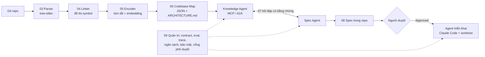

# RAG, agent và hệ thống hiểu codebase – mục lục

**Mục đích:** xây hệ thống agent tự vận hành nhưng **có kiểm soát**: hiểu codebase (tree-sitter → linker → làm giàu semantic), xuất ra bản đồ kiến trúc rõ ràng, cho agent viết spec hỏi đáp agent hiểu code (A2A/MCP), và viết spec ngay trong source code — kèm quản trị toàn hệ thống.
**Ví dụ xuyên suốt:** codebase backend LearnHub (TypeScript/Node, modular monolith; module auth, users, posts, moderation, exams, grading, notifications) + sandbox chấm bài bằng C++.

## Bức tranh tổng thể

## Mục lục

| # | File | Trả lời câu hỏi |
|---|---|---|
| 01 | [01-nen-tang-llm-va-agent.md](01-nen-tang-llm-va-agent.md) | Khi nào dùng một lệnh gọi, workflow hay agent? Pattern nào? Thiết kế tool và I/O contract thế nào? |
| 02 | [02-rag-tu-co-ban-den-nang-cao.md](02-rag-tu-co-ban-den-nang-cao.md) | RAG làm sao cho tốt? Với code nên dùng vector, BM25, đồ thị hay agentic search? |
| 03 | [03-parse-code-voi-tree-sitter.md](03-parse-code-voi-tree-sitter.md) | Trích symbol, chia chunk theo AST bằng tree-sitter thế nào? |
| 04 | [04-linker-do-thi-symbol.md](04-linker-do-thi-symbol.md) | Nối tham chiếu giữa các file thành đồ thị (import, call, route, bảng DB…) ở mức chính xác nào? |
| 05 | [05-encoder-lam-giau-semantic.md](05-encoder-lam-giau-semantic.md) | Làm giàu ngữ nghĩa: tóm tắt phân cấp, embedding, phát hiện module và kiến trúc |
| 06 | [06-dau-ra-ban-do-kien-truc.md](06-dau-ra-ban-do-kien-truc.md) | Đầu ra "Codebase Map" phải có cấu trúc gì để người và agent đều hiểu và kiểm chứng được? |
| 07 | [07-giao-tiep-a2a-va-mcp.md](07-giao-tiep-a2a-va-mcp.md) | MCP vs A2A; giao thức hỏi đáp giữa Spec Agent và Knowledge Agent |
| 08 | [08-spec-trong-source-code.md](08-spec-trong-source-code.md) | Spec sống trong repo, có trích dẫn code, có kiểm tra CI để không lỗi thời |
| 09 | [09-quan-tri-governance.md](09-quan-tri-governance.md) | Quản trị: contract, phiên bản, eval, tracing, ngân sách, bảo mật, cổng phê duyệt |
| 10 | [10-kien-truc-tham-chieu-va-lo-trinh.md](10-kien-truc-tham-chieu-va-lo-trinh.md) | Kiến trúc tham chiếu, build vs buy, lộ trình theo giai đoạn |
| 11 | [11-checklist-review-he-thong-agent.md](11-checklist-review-he-thong-agent.md) | ★ Checklist duyệt thiết kế và đầu ra của hệ thống agent |

## Lộ trình đọc

- **Người quyết định / phê duyệt:** 00 → 01 (mục quyết định) → 06 → 08 → 09 → 11
- **Người xây dựng:** 01 → 02 → 03 → 04 → 05 → 06 → 07 → 10
- **Bắt đầu nhỏ ngay tuần này:** 10 (Phase 0–1)

## 7 nguyên tắc cốt lõi

1. **Bắt đầu đơn giản.** Với một repo, Claude Code + `CLAUDE.md` + subagent tìm kiếm (grep/glob/read) thường đã đủ. Chỉ xây index/đồ thị khi đo được nó tốt hơn.
2. **Mọi ranh giới đều có contract.** Đầu vào/đầu ra giữa các bước và các agent là JSON Schema được validate, không phải văn bản tự do.
3. **Mọi khẳng định đều có bằng chứng.** Mỗi câu về codebase phải trỏ về `file:dòng` hoặc `symbol_id` kiểm chứng được tự động.
4. **Nói rõ điều chưa biết.** Đầu ra có trường `unknowns` và `confidence`; agent không được đoán thay vì hỏi.
5. **Đánh giá trước khi tin.** Có bộ câu hỏi chuẩn (golden set) về codebase và chạy lại mỗi khi đổi prompt, model hoặc index.
6. **Nội dung lấy từ repo là dữ liệu, không phải mệnh lệnh** (chống prompt injection qua comment, tài liệu).
7. **Agent không tự phê duyệt.** Spec và bản đồ kiến trúc qua cổng duyệt của người, theo [../02-quy-trinh-phan-mem/09-checklist-phe-duyet.md](../02-quy-trinh-phan-mem/09-checklist-phe-duyet.md).
