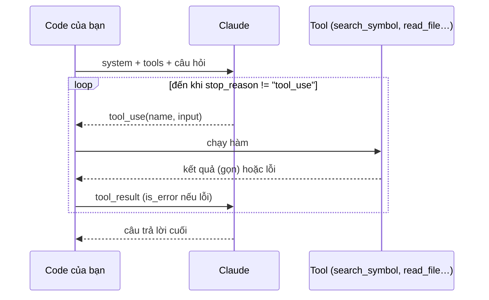
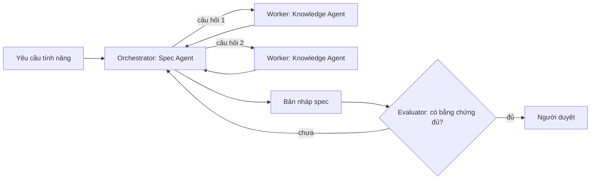

# Nền tảng LLM và agent cho kỹ sư

**Mục đích:** những gì một kỹ sư phải nắm trước khi xây RAG hay agent: token và chi phí, vì sao mô hình bịa, vòng lặp agent, hợp đồng vào/ra bằng structured output, khi nào dùng agent và khi nào không, các pattern điều phối, context engineering, và cách thiết kế tool cho agent.
**Liên quan:** [02-rag-tu-co-ban-den-nang-cao.md](02-rag-tu-co-ban-den-nang-cao.md) · [07-giao-tiep-a2a-va-mcp.md](07-giao-tiep-a2a-va-mcp.md) · [09-quan-tri-governance.md](09-quan-tri-governance.md) · [10-kien-truc-tham-chieu-va-lo-trinh.md](10-kien-truc-tham-chieu-va-lo-trinh.md) · [../01-claude-cli-multi-agent/03-subagent.md](../01-claude-cli-multi-agent/03-subagent.md)

> Ví dụ API dùng Python SDK `anthropic` và các model hiện hành (`claude-opus-5-5`, `claude-sonnet-5-5`, `claude-haiku-5-5`). API thay đổi nhanh: tên tham số, beta header và giá phải đối chiếu tài liệu chính thức trước khi đưa vào code thật.

---

## 1. Token, cửa sổ ngữ cảnh, chi phí

| Khái niệm | Ý nghĩa thực tế |
|---|---|
| **Token** | Đơn vị mô hình đọc/viết. Code có nhiều ký hiệu nên tốn token hơn văn xuôi. Đếm bằng API `count_tokens`, không ước lượng bằng tokenizer của nhà cung cấp khác. |
| **Context window** | Tổng token mô hình "thấy" trong một request: system + tools + lịch sử + kết quả tool + output. Model hiện hành có 1M token, nhưng **to không có nghĩa là nên nhồi đầy**. |
| **Input vs output** | Giá output đắt hơn input khoảng 5 lần. Agent tốn chủ yếu ở input vì mỗi vòng gửi lại toàn bộ lịch sử. |
| **Prompt caching** | Phần đầu request (tools → system → messages) giống hệt lần trước thì được đọc từ cache với giá rẻ hơn nhiều. Chỉ cần đổi **một byte** ở phần đầu (timestamp, JSON không sắp xếp, danh sách tool đổi thứ tự) là mất cache cho mọi thứ phía sau. |
| **Effort / thinking** | Model hiện hành dùng *adaptive thinking*; độ sâu điều khiển bằng `output_config.effort` (`low` … `max`). Effort cao: tốt hơn cho việc khó nhưng tốn token hơn. |

**Ước lượng chi phí cho một agent khám phá codebase LearnHub**

```
Mỗi vòng: system + tools ≈ 8k token (cache được)
          lịch sử tăng dần ≈ 2k → 60k token
          output mỗi vòng ≈ 500 token
30 vòng ⇒ input ≈ Σ(8k + 2k·i) ≈ 1.1M token, output ≈ 15k token
```

Kết luận: chi phí agent tăng theo **bình phương số vòng** nếu không quản lý ngữ cảnh. Vì vậy cần cache, compaction, subagent cô lập ngữ cảnh (mục 6) và tool trả kết quả gọn (mục 8).

## 2. Vì sao LLM "bịa" và grounding sửa thế nào

LLM sinh token có xác suất cao nhất dựa trên dữ liệu huấn luyện. Khi không có dữ kiện, nó vẫn sinh ra câu **nghe hợp lý**: tên hàm không tồn tại, đường dẫn sai, API của phiên bản cũ.

| Nguyên nhân | Ví dụ trong code intelligence | Cách khắc phục (grounding) |
|---|---|---|
| Thiếu dữ kiện trong ngữ cảnh | "Module grading gọi `ScoreService.apply()`" (không có hàm này) | Bắt agent **tra cứu** trước khi khẳng định: tool `search_symbol`, `read_file` |
| Kiến thức huấn luyện cũ | Dùng API Express 4 trong khi repo dùng Express 5 | Đưa `package.json`/lockfile vào ngữ cảnh; ưu tiên dữ kiện từ repo |
| Câu hỏi mơ hồ | "Hệ thống xử lý điểm thế nào?" | Cho phép trả lời "không biết", tách `unknowns` trong output |
| Bị áp lực phải trả lời | Prompt "luôn đưa ra câu trả lời đầy đủ" | Yêu cầu **mỗi khẳng định kèm bằng chứng** (file:line) |

**Grounding = mọi khẳng định phải truy được về nguồn.** Trong hệ thống này, nguồn là code (đường dẫn + dòng + commit SHA) hoặc đồ thị symbol. Khẳng định không có bằng chứng phải được đánh dấu là *suy luận*, kèm độ tin cậy. Sau đó **kiểm chứng máy móc**: file có tồn tại không, dòng đó có chứa symbol được nhắc không (xem [09-quan-tri-governance.md](09-quan-tri-governance.md)).

## 3. Tool use và vòng lặp agent

Tool là hàm do bạn định nghĩa (tên, mô tả, JSON Schema đầu vào). Mô hình **không tự chạy tool**: nó trả về khối `tool_use`, code của bạn chạy hàm, rồi gửi lại `tool_result`.



Vòng lặp tối thiểu (Python, viết tay để thấy cơ chế; production có thể dùng tool runner của SDK):

```python
import json
import anthropic

client = anthropic.Anthropic()

TOOLS = [{
    "name": "search_symbol",
    "description": "Tìm symbol (hàm, class, method) theo tên trong codebase. "
                   "Dùng khi cần biết một symbol được định nghĩa ở đâu.",
    "strict": True,
    "input_schema": {
        "type": "object",
        "properties": {
            "query": {"type": "string", "description": "Tên hoặc một phần tên symbol"},
            "kind": {"type": "string", "enum": ["function", "class", "method", "any"]},
        },
        "required": ["query", "kind"],
        "additionalProperties": False,
    },
}]

def run_tool(name: str, args: dict) -> str:
    if name == "search_symbol":
        return json.dumps(symbol_index.search(args["query"], args["kind"])[:10])  # trả gọn
    raise ValueError(f"tool không tồn tại: {name}")

messages = [{"role": "user", "content": "Module grading được gọi từ đâu?"}]
for _ in range(25):                                  # giới hạn số vòng: bắt buộc
    resp = client.messages.create(
        model="claude-opus-5-5",
        max_tokens=16000,
        thinking={"type": "adaptive"},
        output_config={"effort": "medium"},
        tools=TOOLS,
        messages=messages,
    )
    messages.append({"role": "assistant", "content": resp.content})
    if resp.stop_reason != "tool_use":
        break
    results = []
    for block in resp.content:
        if block.type == "tool_use":
            try:
                out, err = run_tool(block.name, block.input), False
            except Exception as e:                  # lỗi là dữ liệu, không làm sập vòng lặp
                out, err = f"Lỗi: {e}", True
            results.append({"type": "tool_result", "tool_use_id": block.id,
                            "content": out, "is_error": err})
    messages.append({"role": "user", "content": results})   # MỌI kết quả trong MỘT message
```

Những điểm hay sai:

- **Phải gửi lại toàn bộ `resp.content`** (cả khối thinking), không chỉ text.
- Nhiều `tool_use` song song thì trả **tất cả** `tool_result` trong **một** message user.
- `tool_choice` dạng ép (`any`/`tool`) bị từ chối trên các model hiện hành. Muốn mô hình gọi đúng tool thì dùng `auto` + hướng dẫn trong prompt + `strict: true`.
- Kiểm tra `stop_reason` trước khi đọc nội dung (`max_tokens`, `refusal`, `pause_turn`).

## 4. Structured output = hợp đồng vào/ra

Agent tự hoạt động chỉ đáng tin khi **đầu ra có hợp đồng**: một JSON Schema mà code phía sau validate được. Có hai cơ chế:

| Cơ chế | Dùng khi |
|---|---|
| `output_config.format` (JSON Schema cho câu trả lời cuối) | Bước cuối phải ra JSON, ví dụ "bản đồ module" |
| `strict: true` trên tool | Đầu vào tool phải đúng schema |

Ví dụ hợp đồng đầu ra cho câu hỏi về kiến trúc (rút gọn; bản đầy đủ ở [06-dau-ra-ban-do-kien-truc.md](06-dau-ra-ban-do-kien-truc.md)):

```json
{
  "type": "object",
  "properties": {
    "answer":     {"type": "string"},
    "claims": {
      "type": "array",
      "items": {
        "type": "object",
        "properties": {
          "text":       {"type": "string"},
          "evidence":   {"type": "array", "items": {"type": "string", "description": "path:line@sha"}},
          "confidence": {"type": "string", "enum": ["high", "medium", "low"]}
        },
        "required": ["text", "evidence", "confidence"],
        "additionalProperties": false
      }
    },
    "unknowns":   {"type": "array", "items": {"type": "string"}}
  },
  "required": ["answer", "claims", "unknowns"],
  "additionalProperties": false
}
```

```python
# Cách truyền schema trên Messages API (kiểm tra lại cú pháp trong tài liệu SDK hiện hành;
# SDK còn có helper messages.parse() tự validate theo model Pydantic).
resp = client.messages.create(
    model="claude-opus-5-5",
    max_tokens=16000,
    output_config={"format": {"type": "json_schema", "schema": ANSWER_SCHEMA}},
    messages=[{"role": "user", "content": question_with_context}],
)
```

Nguyên tắc hợp đồng:

1. **Schema là API công khai** của agent. Đánh version (`schema_version`), thay đổi theo kiểu tương thích ngược như API REST.
2. **Bắt buộc có trường `unknowns`.** Agent không biết thì nói không biết, không lấp chỗ trống.
3. **Bằng chứng là trường riêng**, không trộn trong văn bản. Nhờ vậy máy kiểm chứng được.
4. Schema hợp lệ **chưa chứng minh nội dung đúng**. Vẫn cần kiểm chứng ngữ nghĩa (mục 9 của file governance).

## 5. Một lần gọi, workflow hay agent?

Bắt đầu từ mức đơn giản nhất. Chỉ lên agent khi trả lời "có" cho cả bốn câu hỏi:

| Tiêu chí | Câu hỏi | Ví dụ "có" | Ví dụ "không" |
|---|---|---|---|
| **Độ phức tạp** | Có nhiều bước và khó đặc tả trước không? | "Hiểu luồng chấm bài từ API tới sandbox C++" | "Tóm tắt file README này" |
| **Giá trị** | Kết quả có đáng chi phí và độ trễ cao hơn không? | Spec cho tính năng mới | Đổi tên biến |
| **Khả thi** | Mô hình có làm tốt loại việc này không? | Đọc code, tra cứu, tổng hợp | Đo hiệu năng thật (cần chạy benchmark) |
| **Chi phí khi sai** | Lỗi có phát hiện và sửa được không? | Spec được người duyệt | Tự động deploy production |

| Mức | Ai quyết định bước tiếp theo | Ví dụ trong hệ thống code intelligence |
|---|---|---|
| **Một lần gọi** | Không có bước tiếp | Sinh tóm tắt cho một hàm (bước làm giàu semantic) |
| **Workflow** (code điều phối) | Code của bạn | Pipeline index: parse → link → tóm tắt từng file → tóm tắt module |
| **Agent** (mô hình điều phối) | Mô hình | Trả lời câu hỏi mở: "thêm nộp bài trễ thì ảnh hưởng những gì?" |

**Quy tắc thực tế:** phần **index** (lặp lại, xác định) nên là workflow; phần **hỏi đáp** (mở, khám phá) mới là agent.

## 6. Các pattern điều phối

| Pattern | Cách làm | Dùng khi | Ví dụ |
|---|---|---|---|
| **Prompt chaining** | Đầu ra bước 1 là đầu vào bước 2, có cổng kiểm tra giữa các bước | Việc tách được thành các bước cố định | Tóm tắt hàm → tóm tắt file → tóm tắt module |
| **Routing** | Phân loại đầu vào rồi chuyển tới prompt/model chuyên biệt | Có nhiều loại yêu cầu khác nhau rõ rệt | Câu hỏi "ở đâu" → tra symbol; "tại sao" → đọc ADR + code |
| **Parallelization** | Chạy song song nhiều phần độc lập (sectioning), hoặc nhiều lần cùng việc rồi biểu quyết (voting) | Phần việc độc lập; cần tự tin hơn | Tóm tắt 7 module song song; 3 lần kiểm chứng một khẳng định |
| **Orchestrator–workers** | Một agent chia việc động, giao worker, tổng hợp | Không biết trước số phần việc | Spec Agent hỏi Knowledge Agent nhiều câu tùy tính năng |
| **Evaluator–optimizer** | Một bên viết, một bên chấm theo tiêu chí, lặp lại | Có tiêu chí chấm rõ ràng | Viết spec → kiểm tra mọi khẳng định có bằng chứng → sửa |



## 7. Context engineering

Chất lượng agent phụ thuộc vào **những gì có trong ngữ cảnh**, không chỉ vào prompt.

| Kỹ thuật | Mục đích | Áp dụng |
|---|---|---|
| **Đưa vào ít mà đúng** | Mô hình bị nhiễu khi ngữ cảnh đầy thứ không liên quan | Đưa bản đồ module (vài nghìn token), không đưa cả repo |
| **Thứ tự ổn định cho cache** | Giảm chi phí và độ trễ | Phần cố định (system, tools, bản đồ kiến trúc) đặt trước; câu hỏi đặt sau |
| **Compaction** | Hội thoại dài vượt ngưỡng | Tóm tắt lịch sử cũ (API có compaction server-side dạng beta) |
| **Context editing** | Xóa kết quả tool cũ không còn cần | Kết quả `read_file` của 20 vòng trước |
| **Memory ngoài** | Ghi nhớ qua nhiều phiên | File ghi chú, DB các câu trả lời đã kiểm chứng |
| **Subagent cô lập ngữ cảnh** | Việc đọc nhiều không làm bẩn ngữ cảnh chính | Subagent đọc 40 file rồi trả về 1 đoạn tóm tắt có bằng chứng |
| **Just-in-time retrieval** | Chỉ nạp khi cần | Giữ đường dẫn/ID trong ngữ cảnh, đọc nội dung khi agent gọi tool |

**Lost in the middle:** thông tin nằm giữa ngữ cảnh rất dài dễ bị bỏ qua hơn thông tin ở đầu hoặc cuối. Đặt chỉ dẫn quan trọng ở system và nhắc lại yêu cầu đầu ra ở cuối message.

## 8. Nền tảng để xây

| Bề mặt | Ai chạy vòng lặp | Ai host | Tool có sẵn | Hợp khi |
|---|---|---|---|---|
| **Messages API, vòng lặp tự viết** | Bạn | Bạn | Chỉ tool bạn định nghĩa | Cần kiểm soát hoàn toàn (ví dụ dịch vụ Knowledge Agent) |
| **Messages API + Tool Runner** (helper beta trong SDK) | SDK | Bạn | Chỉ tool bạn định nghĩa | Như trên nhưng không muốn tự viết vòng lặp |
| **Claude Agent SDK** (sản phẩm riêng, là Claude Code dạng thư viện) | SDK | Bạn | Read/Write/Edit/Bash/Glob/Grep, MCP, subagent | Agent làm việc trên file system, giống Claude Code |
| **Managed Agents** (beta) | Anthropic | Anthropic (sandbox mỗi phiên) | Bash, file, code + MCP + tool của bạn | Không muốn vận hành hạ tầng agent; cần phiên dài, lịch chạy |
| **Claude Code: subagent, workflow, MCP** | Claude Code | Máy người dùng | Đầy đủ | Dùng nội bộ team, cho developer, không cần dịch vụ riêng |

Gợi ý cho hệ thống ở thư mục này:

- **Pipeline index** (tree-sitter, linker, làm giàu semantic): workflow bằng code thường + Messages API (có thể dùng Batches API cho tóm tắt hàng loạt, rẻ hơn khoảng 50%).
- **Knowledge Agent**: Messages API + tool của bạn, đưa ra ngoài qua MCP server (xem [07-giao-tiep-a2a-va-mcp.md](07-giao-tiep-a2a-va-mcp.md)).
- **Spec Agent**: giai đoạn đầu chỉ cần Claude Code + MCP server trên; chỉ tách thành dịch vụ riêng khi nhiều team cần.

## 9. Thiết kế tool cho agent

Tool là **giao diện người dùng của agent**. Tool tệ thì agent tệ, dù model mạnh.

| Nguyên tắc | Tốt | Tệ |
|---|---|---|
| **Ít tool, mỗi tool một việc rõ** | `search_symbol`, `get_module`, `read_span` | 30 tool chồng chéo: `find`, `search`, `lookup`, `query`… |
| **Tên và mô tả nói "dùng khi nào"** | "Dùng khi cần biết symbol định nghĩa ở đâu. Không dùng để tìm chuỗi tự do." | "Search function" |
| **Tham số có ràng buộc** | `enum`, giới hạn độ dài, `additionalProperties: false` | `query: any` |
| **Trả kết quả gọn và có cấu trúc** | 10 kết quả đầu, mỗi cái gồm id, path:line, chữ ký, 1 dòng tóm tắt; kèm `truncated: true` | Đổ nguyên 3.000 dòng file |
| **Phân trang và giới hạn** | `limit`, `cursor` | Trả tất cả |
| **Lỗi là dữ liệu, có hướng dẫn sửa** | `{"error": "symbol_not_found", "hint": "thử search_text hoặc kiểm tra chính tả"}` | Exception làm sập vòng lặp |
| **ID ổn định** | `sym:ts:src/exams/submit.service.ts#SubmitService.submit` | Chỉ số dòng (đổi khi code đổi) |
| **Mặc định chỉ đọc** | Tool ghi tách riêng, cần phê duyệt | Một tool `run_shell` làm mọi thứ |

**Đánh giá tool:** chạy một bộ câu hỏi chuẩn (eval) rồi đọc transcript. Xem agent có gọi sai tool, lặp lại vô ích, hay hiểu nhầm kết quả không. Sửa mô tả tool thường hiệu quả hơn sửa system prompt.

## 10. Lỗi thường gặp

| Lỗi | Hậu quả | Cách tránh |
|---|---|---|
| Dùng agent cho việc xác định | Đắt, chậm, kết quả không lặp lại được | Workflow bằng code |
| Không giới hạn số vòng / ngân sách | Agent chạy mãi, tốn tiền | `max_turns`, task budget, timeout |
| Prompt "luôn trả lời đầy đủ" | Bịa để lấp chỗ trống | Cho phép và yêu cầu `unknowns` |
| Tool trả quá nhiều dữ liệu | Ngữ cảnh đầy nhanh, chi phí tăng vọt | Tóm gọn, phân trang |
| Đưa timestamp hoặc ID request vào system prompt | Mất cache mỗi request | Đặt dữ liệu thay đổi sau breakpoint cache |
| Tin output vì "đúng schema" | Nội dung sai vẫn qua | Kiểm chứng bằng chứng bằng code |
| Trộn chỉ dẫn và dữ liệu không tin cậy | Prompt injection từ nội dung repo | Đánh dấu rõ dữ liệu; tool ghi cần phê duyệt |

## Checklist review

- [ ] Đã giải thích vì sao cần agent (4 tiêu chí ở mục 5), không chọn agent theo mặc định.
- [ ] Phần xác định (index, pipeline) là workflow bằng code; phần mở mới là agent.
- [ ] Mọi đầu ra quan trọng có JSON Schema, có `schema_version`, có `unknowns` và trường bằng chứng riêng.
- [ ] Vòng lặp agent có giới hạn số vòng, ngân sách token/tiền và timeout.
- [ ] Vòng lặp gửi lại toàn bộ `content`, trả mọi `tool_result` trong một message, xử lý `is_error`, kiểm tra `stop_reason`.
- [ ] Không dùng `tool_choice` ép buộc trên model hiện hành; tool quan trọng có `strict: true`.
- [ ] Tool: ít, tên rõ, mô tả nói "dùng khi nào", kết quả gọn có phân trang, lỗi trả về dạng dữ liệu, ID ổn định.
- [ ] Tool mặc định chỉ đọc; tool ghi tách riêng và cần phê duyệt.
- [ ] Prompt sắp xếp phần cố định trước để cache; đã kiểm tra `cache_read_input_tokens` > 0 qua các lần gọi.
- [ ] Có kế hoạch quản lý ngữ cảnh: subagent, compaction hoặc context editing cho phiên dài.
- [ ] Model, effort và chi phí được đo trên bộ eval, không chọn theo cảm tính.
