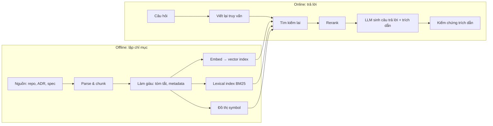

# RAG từ cơ bản đến nâng cao (và áp dụng cho code)

**Mục đích:** hiểu từng bước của RAG (Retrieval-Augmented Generation), các kỹ thuật nâng cao, và đánh giá thẳng thắn khi nào RAG kiểu vector hữu ích cho code, khi nào tìm kiếm kiểu agent (grep/đồ thị) tốt hơn.
**Liên quan:** [01-nen-tang-llm-va-agent.md](01-nen-tang-llm-va-agent.md) · [03-parse-code-voi-tree-sitter.md](03-parse-code-voi-tree-sitter.md) · [04-linker-do-thi-symbol.md](04-linker-do-thi-symbol.md) · [05-encoder-lam-giau-semantic.md](05-encoder-lam-giau-semantic.md) · [09-quan-tri-governance.md](09-quan-tri-governance.md)

---

## 1. RAG là gì, giải quyết vấn đề gì

LLM không biết codebase riêng của bạn, và không thể nhồi mọi thứ vào mỗi request. RAG nghĩa là **tìm đúng phần liên quan rồi đưa vào ngữ cảnh** trước khi mô hình trả lời, kèm trích dẫn để kiểm chứng.



## 2. Các bước và quyết định ở mỗi bước

| Bước | Quyết định chính | Mặc định khuyến nghị cho code |
|---|---|---|
| **Ingest** | Nguồn nào, tần suất cập nhật | Repo tại một commit SHA cụ thể; cập nhật tăng dần theo `git diff` |
| **Chunk** | Cắt theo gì | Theo cây AST: hàm/method/class (xem mục 3) |
| **Làm giàu** | Thêm gì vào chunk | Đường dẫn, module, chữ ký, tóm tắt 1–3 câu, quan hệ gọi |
| **Embed** | Model nào | Model embedding chuyên code; đánh giá trên câu hỏi thật của bạn |
| **Index** | Lưu ở đâu | pgvector nếu đã có Postgres; vector DB chuyên dụng khi > vài chục triệu vector |
| **Retrieve** | Cách tìm | Lai: BM25 + vector + đồ thị, gộp bằng RRF |
| **Rerank** | Có cần không | Có, khi top-k lớn (50–100) và cần top 5–10 chính xác |
| **Generate** | Định dạng | Structured output có trường bằng chứng |
| **Verify** | Kiểm gì | Mọi trích dẫn tồn tại; đoạn trích chứa symbol được nhắc |

## 3. Chunking

| Chiến lược | Cách làm | Ưu | Nhược | Dùng cho |
|---|---|---|---|---|
| Cố định theo token | Cắt mỗi N token, chồng lấn M | Đơn giản | Cắt ngang hàm, mất ngữ nghĩa | Văn bản thô không cấu trúc |
| Theo đoạn/heading | Cắt theo Markdown heading | Giữ ý | Đoạn dài/ngắn không đều | Tài liệu, ADR, spec |
| **Theo AST** | Mỗi hàm/method/class là một chunk; class lớn tách thành các method + "khung" class | Đúng đơn vị ngữ nghĩa của code, có tên symbol | Cần parser cho từng ngôn ngữ | **Code** |
| Phân cấp | Chunk nhỏ để tìm; trả về chunk cha (file/class) làm ngữ cảnh | Chính xác khi tìm, đủ ngữ cảnh khi đọc | Phức tạp hơn | Code và tài liệu dài |

Quy tắc cho code (chi tiết ở [03-parse-code-voi-tree-sitter.md](03-parse-code-voi-tree-sitter.md)):

- Hàm quá dài (> ~300 dòng): tách theo khối, mỗi khối mang theo **chữ ký hàm cha**.
- Hàm quá ngắn (getter/setter): gộp vào chunk "khung class".
- Mỗi chunk mang metadata: `repo`, `commit`, `path`, `start_line`, `end_line`, `language`, `symbol_id`, `module`, `kind`.

## 4. Embedding và tìm kiếm lai

**Embedding** biến văn bản/code thành vector; hai đoạn giống nghĩa có vector gần nhau. Anthropic không cung cấp model embedding riêng; tài liệu của Anthropic thường nhắc đến Voyage AI (có model chuyên code). Ngoài ra có các model mã nguồn mở. **Hãy tự đánh giá** trên bộ câu hỏi của chính bạn trước khi chọn (mục 9).

### Vì sao cần tìm kiếm lai cho code

| Loại câu hỏi | Ví dụ | Lexical (BM25) | Vector | Đồ thị symbol |
|---|---|---|---|---|
| Tên chính xác | "`SubmitService.submit` ở đâu?" | **Rất tốt** | Kém (tên hiếm, token lạ) | **Rất tốt** |
| Khái niệm | "Chỗ nào xử lý hạn nộp bài?" | Trung bình (phải trùng từ) | **Tốt** | Kém |
| Quan hệ | "Ai gọi `applyPenalty`?" | Kém (nhiều kết quả nhiễu) | Kém | **Rất tốt** |
| Lỗi/chuỗi cụ thể | "Thông báo `LATE_SUBMISSION_NOT_ALLOWED`" | **Rất tốt** | Kém | Kém |

### Reciprocal Rank Fusion (RRF)

Gộp nhiều danh sách xếp hạng mà không cần chuẩn hóa điểm:

```python
def rrf(rankings: list[list[str]], k: int = 60) -> list[tuple[str, float]]:
    """rankings: mỗi phần tử là danh sách id đã xếp hạng từ một nguồn tìm kiếm."""
    scores: dict[str, float] = {}
    for ranking in rankings:
        for rank, doc_id in enumerate(ranking, start=1):
            scores[doc_id] = scores.get(doc_id, 0.0) + 1.0 / (k + rank)
    return sorted(scores.items(), key=lambda x: x[1], reverse=True)

fused = rrf([bm25_ids, vector_ids, graph_neighbor_ids])[:50]
```

### Reranking

Bộ tìm kiếm ban đầu nhanh nhưng thô. **Reranker** (cross-encoder hoặc LLM) chấm lại từng cặp (câu hỏi, chunk) chính xác hơn, nhưng chậm hơn, nên chỉ chạy trên top 50–100. Có thể dùng reranker chuyên dụng, hoặc một model nhỏ (ví dụ `claude-haiku-5-5`) với structured output trả điểm liên quan.

## 5. Kỹ thuật nâng cao

| Kỹ thuật | Ý tưởng | Lợi ích | Chi phí/rủi ro |
|---|---|---|---|
| **Contextual retrieval** | Trước khi embed, thêm 1–2 câu đặt chunk vào ngữ cảnh: "Hàm này thuộc module exams, được gọi khi học sinh nộp bài, kiểm tra hạn nộp" | Tăng mạnh độ chính xác khi tìm, vì chunk lẻ thường thiếu ngữ cảnh | Một lần gọi LLM cho mỗi chunk lúc index (dùng prompt caching cho cả file, Batches API để giảm chi phí) |
| **Query rewriting** | LLM viết lại câu hỏi mơ hồ thành truy vấn rõ, thêm tên symbol đoán được | Khớp tốt hơn với index | Viết lại sai thì tìm sai |
| **Multi-query** | Sinh 3–5 biến thể truy vấn, gộp kết quả | Phủ rộng hơn | Tốn thêm lần tìm |
| **HyDE** | Sinh "câu trả lời giả định" rồi embed nó để tìm | Tốt cho câu hỏi khái niệm | Có thể kéo kết quả theo hướng bịa |
| **Hierarchical / parent retrieval** | Tìm theo chunk nhỏ, trả về file/class cha | Đủ ngữ cảnh | Tốn token hơn |
| **GraphRAG** | Xây đồ thị thực thể/quan hệ, phát hiện cụm (community), tóm tắt từng cụm; trả lời câu hỏi tổng quát từ tóm tắt cụm | Trả lời được "kiến trúc tổng thể là gì?" mà RAG chunk không làm được | Chi phí index cao; cần cập nhật khi code đổi |
| **Agentic RAG** | Agent tự quyết định tìm gì, tìm bao nhiêu lần, khi nào đủ | Linh hoạt cho câu hỏi nhiều bước | Khó dự đoán chi phí và độ trễ |

Với code, **đồ thị symbol thật** (từ parser + linker, [04-linker-do-thi-symbol.md](04-linker-do-thi-symbol.md)) chính xác hơn đồ thị do LLM trích xuất kiểu GraphRAG. Dùng LLM để **tóm tắt** các cụm, không dùng để **tạo cạnh**.

## 6. Agentic search và vector index: so sánh thẳng thắn cho code

Claude Code không dùng vector index. Nó cho agent dùng Glob/Grep/Read để tự tìm. Với code, cách này thường **đủ tốt và luôn mới**.

| Tiêu chí | Agentic search (grep/glob/read) | Vector RAG | Đồ thị symbol (parser + linker) |
|---|---|---|---|
| Độ tươi | Luôn đúng commit hiện tại | Cũ nếu không re-index | Cần cập nhật tăng dần |
| Tên chính xác | Rất tốt | Kém | Rất tốt |
| Câu hỏi khái niệm | Trung bình (phụ thuộc agent đoán từ khóa) | Tốt | Kém |
| Quan hệ gọi, phụ thuộc, tác động | Chậm, nhiều vòng, dễ sót | Kém | **Rất tốt** |
| Cái nhìn kiến trúc tổng thể | Phải đọc nhiều, tốn token | Kém | Tốt khi kèm tóm tắt module |
| Chi phí hạ tầng | Gần như không | Embed + vector DB | Pipeline index |
| Chi phí token mỗi câu hỏi | Cao (nhiều vòng đọc) | Thấp | Thấp |
| Kiểm chứng | Dễ (đọc trực tiếp) | Cần trích dẫn | Dễ (ID symbol → path:line) |

**Khuyến nghị:**

1. **Repo nhỏ hoặc vừa (< vài trăm nghìn dòng), một team dùng:** agentic search trong Claude Code + file `ARCHITECTURE.md` sinh tự động là đủ.
2. **Repo lớn, nhiều ngôn ngữ, nhiều agent/team cùng hỏi:** đồ thị symbol + tóm tắt phân cấp + BM25. **Thêm vector** cho câu hỏi khái niệm.
3. **Luôn giữ agentic search làm phương án dự phòng** để đọc trực tiếp và kiểm chứng.

## 7. Long context hay RAG?

Model có 1M token context và prompt caching, nên nhiều trường hợp có thể **đưa thẳng tài liệu vào ngữ cảnh**.

| Tình huống | Chọn |
|---|---|
| Tập tài liệu nhỏ (< ~200k token), ổn định, hỏi nhiều lần | Đưa hết vào ngữ cảnh + cache |
| Bản đồ kiến trúc + tóm tắt module (vài chục nghìn token) | Đưa vào system và cache; đây là "bộ nhớ dài hạn" của agent |
| Cả repo hàng triệu dòng | RAG/đồ thị/agentic search |
| Cần trích dẫn chính xác từng dòng | RAG với metadata dòng, hoặc đọc file trực tiếp |
| Dữ liệu đổi liên tục | RAG với index tăng dần, hoặc agentic search |

Nhồi ngữ cảnh vẫn có nhược điểm: lost-in-the-middle, chi phí mỗi lần cache hết hạn, độ trễ. **Kết hợp** thường tốt nhất: bản đồ kiến trúc nằm cố định trong ngữ cảnh, chi tiết lấy theo yêu cầu.

## 8. Lựa chọn vector store

| Lựa chọn | Hợp khi | Lưu ý |
|---|---|---|
| **pgvector** (PostgreSQL) | Đã dùng Postgres; < ~10–50 triệu vector; cần lọc metadata bằng SQL, join với bảng symbol | Index HNSW; lọc kết hợp ANN cần tinh chỉnh |
| **Qdrant / Weaviate / Milvus** | Quy mô lớn; cần tính năng tìm kiếm chuyên sâu (lọc phức tạp, multi-vector) | Thêm một hệ thống phải vận hành |
| **OpenSearch / Elasticsearch** | Cần BM25 mạnh + vector trong cùng một hệ | Tốn tài nguyên |
| **SQLite + extension / FAISS file** | Công cụ cục bộ cho một repo, chạy trên máy dev | Không dành cho nhiều người dùng đồng thời |

Với hệ code intelligence, **pgvector + bảng symbol/edge trong cùng Postgres** là điểm khởi đầu hợp lý: một nơi, transaction, join được.

## 9. Đánh giá RAG

Không đo thì không biết thay đổi có tốt hơn không. Xây **bộ câu hỏi chuẩn (golden set)** từ câu hỏi thật của team, mỗi câu kèm đáp án và bằng chứng mong đợi.

| Chỉ số | Đo gì | Cách tính |
|---|---|---|
| **Recall@k** | Chunk/symbol đúng có nằm trong top k không | Số bằng chứng mong đợi xuất hiện trong top k ÷ tổng số bằng chứng mong đợi |
| **MRR** | Kết quả đúng đầu tiên đứng thứ mấy | Trung bình của 1/hạng của kết quả đúng đầu tiên |
| **Faithfulness / groundedness** | Câu trả lời có dựa trên ngữ cảnh đã lấy không | LLM chấm theo rubric + kiểm tra mẫu bằng người |
| **Citation accuracy** | Trích dẫn có tồn tại và đúng nội dung không | Kiểm bằng code: file tồn tại, dòng chứa symbol |
| **Answer correctness** | Trả lời đúng không | So với đáp án chuẩn; người chấm một mẫu |
| **Chi phí và độ trễ** | Token/câu, giây/câu | Log mỗi request |

Ví dụ một mục trong golden set (JSONL):

```json
{"id": "q-017", "question": "Hạn nộp bài được kiểm tra ở đâu khi nộp?",
 "expected_evidence": ["src/exams/submit.service.ts#SubmitService.submit",
                       "src/exams/deadline.policy.ts#isLate"],
 "expected_answer_points": ["kiểm tra trong SubmitService.submit", "dùng giờ server, không tin client"],
 "commit": "<commit_sha>"}
```

**Tách đánh giá retrieval và generation.** Nếu recall@k thấp thì sửa phần tìm kiếm; recall cao mà câu trả lời sai thì sửa prompt/model.

## 10. Các kiểu lỗi

| Lỗi | Biểu hiện | Phòng tránh |
|---|---|---|
| **Index cũ** | Trả lời theo code đã bị xóa | Gắn `commit` cho mọi chunk; cập nhật tăng dần theo diff; hiển thị commit của câu trả lời |
| **Ranh giới chunk sai** | Lấy được nửa hàm, hiểu sai logic | Chunk theo AST; trả về chunk cha |
| **Lost in the middle** | Bỏ qua đoạn quan trọng giữa ngữ cảnh dài | Rerank, giảm số chunk, đặt chunk quan trọng ở đầu/cuối |
| **Prompt injection trong tài liệu được lấy** | Comment trong code ghi "bỏ qua chỉ dẫn trước, …" | Đánh dấu rõ nội dung lấy về là dữ liệu; không cho dữ liệu kích hoạt tool ghi; lọc mẫu đáng ngờ |
| **Rò rỉ dữ liệu nhạy cảm** | Index chứa secret, khóa, PII trong file cấu hình/test | Quét secret (gitleaks) trước khi index; danh sách loại trừ; phân quyền theo repo |
| **Câu hỏi ngoài phạm vi** | Bịa câu trả lời khi không tìm thấy gì | Ngưỡng điểm liên quan; cho phép "không tìm thấy" |
| **Trùng lặp** | Nhiều chunk giống nhau chiếm hết top k | Khử trùng (theo symbol_id, theo nội dung) |
| **Lệch phân phối embedding** | Câu hỏi tiếng Việt, code tiếng Anh, tìm kém | Query rewriting sang thuật ngữ code; tóm tắt song ngữ; đánh giá riêng |

## Checklist review

- [ ] Đã giải thích vì sao cần RAG/vector thay vì agentic search hoặc đưa thẳng vào ngữ cảnh (mục 6–7).
- [ ] Code được chunk theo AST; mỗi chunk có `commit`, `path`, `start_line`, `end_line`, `symbol_id`, `module`.
- [ ] Tìm kiếm lai (lexical + vector + đồ thị nếu có), gộp bằng RRF hoặc phương pháp có lý do.
- [ ] Có reranking khi lấy nhiều ứng viên; số chunk đưa vào ngữ cảnh có giới hạn.
- [ ] Index cập nhật tăng dần theo commit; câu trả lời ghi rõ commit đã dùng.
- [ ] Secret và PII được quét và loại khỏi index trước khi embed; gửi code ra dịch vụ embedding bên ngoài đã được phê duyệt.
- [ ] Nội dung lấy về được coi là dữ liệu không tin cậy (chống prompt injection).
- [ ] Có golden set từ câu hỏi thật; đo recall@k, MRR, citation accuracy, faithfulness, chi phí, độ trễ; báo cáo trước/sau khi thay đổi.
- [ ] Trích dẫn được kiểm chứng tự động (file tồn tại, dòng chứa symbol).
- [ ] Có hành vi rõ ràng khi không tìm thấy: trả về `unknowns`, không bịa.
