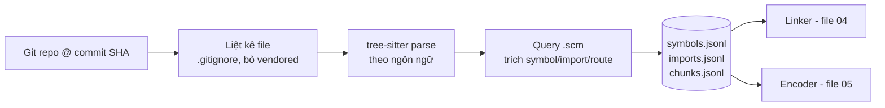

# Parse code với tree-sitter

**Mục đích:** biến mã nguồn nhiều ngôn ngữ thành dữ liệu có cấu trúc (symbol, import, route, chunk) làm nền cho linker, encoder và bản đồ kiến trúc. Đây là tầng "nhìn thấy cú pháp" của hệ thống code intelligence.
**Liên quan:** [01-nen-tang-llm-va-agent.md](01-nen-tang-llm-va-agent.md) · [02-rag-tu-co-ban-den-nang-cao.md](02-rag-tu-co-ban-den-nang-cao.md) · [04-linker-do-thi-symbol.md](04-linker-do-thi-symbol.md) · [05-encoder-lam-giau-semantic.md](05-encoder-lam-giau-semantic.md) · [06-dau-ra-ban-do-kien-truc.md](06-dau-ra-ban-do-kien-truc.md) · [10-kien-truc-tham-chieu-va-lo-trinh.md](10-kien-truc-tham-chieu-va-lo-trinh.md)

---

## 1. Vị trí trong pipeline



Đầu vào: một commit cụ thể. Đầu ra: các bản ghi chuẩn hóa, **không phụ thuộc ngôn ngữ**, để các tầng sau không phải biết TypeScript hay C++.

## 2. tree-sitter là gì, tại sao chọn nó

tree-sitter là thư viện parser:

- **Sinh parser từ grammar** (GLR-based), có grammar cho hàng trăm ngôn ngữ (TypeScript, TSX, JavaScript, Python, C, C++, Go, Java, Rust, C#…).
- Tạo **concrete syntax tree (CST)**: giữ mọi token, mỗi node có kiểu, byte range, vị trí dòng/cột.
- **Chịu lỗi (error-tolerant):** file đang sửa dở, thiếu dấu ngoặc vẫn parse được; phần lỗi thành node `ERROR`/`MISSING`, phần còn lại vẫn dùng được.
- **Incremental:** sửa một đoạn → parse lại nhanh phần thay đổi (quan trọng cho editor; với indexer theo batch, lợi ích chính là tốc độ parse vốn đã nhanh).
- **Không cần build project:** không cần cài dependency, không cần `tsconfig` hợp lệ, không cần compile C++.

### So sánh với các lựa chọn khác

| Công cụ | Hiểu cú pháp | Biết kiểu / resolve cross-file | Cần build/cài project | Đa ngôn ngữ | Tốc độ | Dùng khi |
|---|---|---|---|---|---|---|
| Regex / grep | Không | Không | Không | Có (kém) | Rất nhanh | Tìm nhanh, không dùng làm index |
| ctags (universal-ctags) | Một phần | Không | Không | Có | Nhanh | Index tên định nghĩa đơn giản |
| **tree-sitter** | **Có (CST)** | **Không** | **Không** | **Có** | **Nhanh** | **Tầng nền trích cấu trúc** |
| Compiler AST (tsc API, Clang AST) | Có | Có | Có | Một ngôn ngữ | Chậm hơn | Phân tích chính xác một ngôn ngữ |
| LSP server (tsserver, clangd) | Có | Có | Có | Mỗi ngôn ngữ một server | Chậm khi batch | Go-to-definition chính xác |
| SCIP indexer | Có | Có | Có | Theo indexer | Chậm (chạy 1 lần/commit) | Đồ thị tham chiếu chính xác |

**Nguyên tắc:** tree-sitter cho **độ phủ và tốc độ** (mọi file, mọi ngôn ngữ, kể cả file lỗi); compiler/LSP/SCIP cho **độ chính xác** ở tầng linker (file 04). Không chọn một — xếp tầng.

## 3. Cài đặt và API Python

> **Kiểm tra phiên bản.** API của `py-tree-sitter` đã đổi nhiều lần (cách tạo `Language`/`Parser`, API `Query` và cách lấy captures). Ví dụ dưới viết theo dòng API 0.23+; ghim phiên bản trong `requirements.txt` và đối chiếu tài liệu của đúng phiên bản bạn cài.

```text
# requirements.txt (ví dụ — ghim phiên bản thực tế sau khi kiểm tra)
tree-sitter==0.25.*
tree-sitter-typescript==0.23.*
tree-sitter-cpp==0.23.*
# hoặc gói gộp nhiều grammar:
# tree-sitter-language-pack
```

```python
# parse_basic.py — dòng API py-tree-sitter 0.23+ (kiểm tra phiên bản)
import tree_sitter_typescript as ts_ts
import tree_sitter_cpp as ts_cpp
from tree_sitter import Language, Parser

TS = Language(ts_ts.language_typescript())   # .ts
TSX = Language(ts_ts.language_tsx())         # .tsx — grammar riêng
CPP = Language(ts_cpp.language())

def parse(src: bytes, lang: Language):
    parser = Parser(lang)
    return parser.parse(src)

tree = parse(open("src/posts/posts.controller.ts", "rb").read(), TS)
root = tree.root_node
print(root.type, root.has_error)   # 'program', True/False
```

Với `tree-sitter-language-pack`, có hàm tiện ích kiểu `get_language("typescript")` / `get_parser("typescript")` — kiểm tra tên hàm theo phiên bản gói.

**Lưu ý dễ sai:** `.ts` và `.tsx` dùng **hai grammar khác nhau**; parse TSX bằng grammar TS sẽ ra nhiều node `ERROR`.

## 4. Query tree-sitter (.scm)

Query là pattern S-expression khớp với cây, gắn **capture** (`@name`) cho node cần lấy, có **predicate** (`#eq?`, `#match?`, `#any-of?`) để lọc.

Xem cấu trúc cây thật trước khi viết query (tên node thay đổi theo grammar):

```python
print(str(root))          # S-expression của cả cây (py-tree-sitter cũ)
# Hoặc duyệt: for child in root.children: print(child.type, child.start_point)
```

CLI `tree-sitter parse file.ts` hoặc playground trên trang tree-sitter cũng cho xem cây.

### 4.1 TypeScript

```scheme
; ts-symbols.scm — kiểm tra tên node với grammar đang dùng

; function foo() {}
(function_declaration
  name: (identifier) @def.function.name) @def.function

; const foo = () => {} / const foo = function() {}
(lexical_declaration
  (variable_declarator
    name: (identifier) @def.function.name
    value: [(arrow_function) (function_expression)])) @def.function

; class / abstract class
(class_declaration
  name: (type_identifier) @def.class.name) @def.class
(abstract_class_declaration
  name: (type_identifier) @def.class.name) @def.class

; method trong class
(method_definition
  name: (property_identifier) @def.method.name) @def.method

; interface / type alias
(interface_declaration name: (type_identifier) @def.interface.name) @def.interface
(type_alias_declaration name: (type_identifier) @def.type.name) @def.type

; import { X } from './y'
(import_statement
  source: (string (string_fragment) @import.source)) @import

; export ... from './y' (re-export)
(export_statement
  source: (string (string_fragment) @reexport.source)) @reexport

; lời gọi hàm: foo(...) / obj.foo(...)
(call_expression
  function: [
    (identifier) @ref.call.name
    (member_expression property: (property_identifier) @ref.call.name)
  ]) @ref.call
```

### 4.2 Decorator NestJS → route

Route là **sự kiện kiến trúc quan trọng nhất** của một backend: nó là entrypoint. NestJS khai báo bằng decorator:

```typescript
@Controller('posts')
export class PostsController {
  @Post(':id/publish')
  @UseGuards(AuthGuard)
  publish(@Param('id') id: string) { ... }
}
```

```scheme
; nest-routes.scm
; @Controller('posts') gắn lên class
(class_declaration
  (decorator
    (call_expression
      function: (identifier) @ctrl.decorator
      arguments: (arguments (string (string_fragment) @ctrl.path)?)))
  name: (type_identifier) @ctrl.class
  (#eq? @ctrl.decorator "Controller"))

; @Get/@Post/... gắn lên method
(method_definition
  (decorator
    (call_expression
      function: (identifier) @route.verb
      arguments: (arguments (string (string_fragment) @route.path)?)))
  name: (property_identifier) @route.handler
  (#any-of? @route.verb "Get" "Post" "Put" "Patch" "Delete"))
```

> Vị trí node `decorator` trong cây khác nhau giữa các phiên bản grammar (con của `class_declaration`, hoặc anh em đứng trước trong `export_statement`, hoặc con của `class_body` trước `method_definition`). **Dump cây thật** rồi chỉnh query; viết test với file mẫu.

Express route (`router.get('/x', handler)`) bắt bằng `call_expression` có `member_expression` property ∈ {get, post, put, patch, delete} và tham số đầu là string.

### 4.3 C++ (sandbox chấm bài)

```scheme
; cpp-symbols.scm
(namespace_definition
  name: (namespace_identifier) @def.namespace.name) @def.namespace

(class_specifier  name: (type_identifier) @def.class.name) @def.class
(struct_specifier name: (type_identifier) @def.class.name) @def.class

; void run(...) {} / void Runner::run(...) {}
(function_definition
  declarator: (function_declarator
    declarator: [
      (identifier) @def.function.name
      (qualified_identifier) @def.function.qualified
      (field_identifier) @def.method.name
    ])) @def.function

; #include "x.h" / #include <vector>
(preproc_include
  path: [(string_literal) (system_lib_string)] @import.source) @import
```

Khó khăn riêng của C++: macro (tree-sitter không chạy preprocessor nên code trong `#ifdef` đều được parse, macro phức tạp gây `ERROR`), template, khai báo trong `.h` và định nghĩa trong `.cpp` (cần linker ghép lại).

### 4.4 Quy ước `tags.scm`

Nhiều grammar đi kèm `queries/tags.scm` theo quy ước capture `@definition.function`, `@definition.class`, `@definition.method`, `@reference.call`, `@name`… (GitHub code navigation dùng quy ước này). **Bắt đầu từ `tags.scm` có sẵn** rồi bổ sung query riêng cho framework (route, entity, topic) thay vì viết từ đầu.

### 4.5 Chạy query trong Python

```python
# API Query/QueryCursor đổi giữa các phiên bản — kiểm tra phiên bản.
from tree_sitter import Query, QueryCursor   # QueryCursor có từ dòng 0.25

query = Query(TS, open("queries/ts-symbols.scm").read())
cursor = QueryCursor(query)
for pattern_index, captures in cursor.matches(root):
    # captures: dict[str, list[Node]]
    ...
```

Ở phiên bản cũ hơn: `query = TS.query(src)` và `query.captures(root)` / `query.matches(root)` với định dạng trả về khác. Bọc API này trong **một module adapter** để khi nâng phiên bản chỉ sửa một chỗ.

## 5. Bản ghi symbol chuẩn hóa (output contract của tầng parse)

### 5.1 Lược đồ ID

ID phải **ổn định giữa các commit** khi symbol không đổi, và **duy nhất**:

```
<lang>:<repo-relative-path>#<qualified-name>[:<disambiguator>]
ts:src/posts/posts.controller.ts#PostsController.publish
cpp:sandbox/runner.cpp#grader::Runner::run(int,char**)
```

- Không dùng số dòng trong ID (thêm một dòng phía trên làm đổi ID toàn bộ symbol bên dưới).
- Hàm overload (C++), hoặc trùng tên trong file: thêm disambiguator (chữ ký tham số, hoặc thứ tự xuất hiện `:2`).
- Đổi tên file = ID mới; linker/diff phát hiện rename qua git (`git diff -M`) để chuyển tiếp tóm tắt cũ nếu nội dung không đổi.

### 5.2 JSON Schema

```json
{
  "$schema": "https://json-schema.org/draft/2020-12/schema",
  "$id": "symbol-record.v1",
  "type": "object",
  "required": ["id", "kind", "name", "qualified_name", "language", "file", "range", "content_hash", "commit"],
  "additionalProperties": false,
  "properties": {
    "id":             { "type": "string" },
    "kind":           { "enum": ["function", "method", "class", "interface", "type", "namespace", "variable", "route", "module_decl"] },
    "name":           { "type": "string" },
    "qualified_name": { "type": "string" },
    "language":       { "enum": ["typescript", "tsx", "javascript", "cpp", "c", "python"] },
    "file":           { "type": "string", "description": "đường dẫn tương đối gốc repo, dấu /" },
    "range": {
      "type": "object",
      "required": ["start_line", "end_line", "start_byte", "end_byte"],
      "properties": {
        "start_line": { "type": "integer", "minimum": 1 },
        "end_line":   { "type": "integer", "minimum": 1 },
        "start_byte": { "type": "integer", "minimum": 0 },
        "end_byte":   { "type": "integer", "minimum": 0 }
      }
    },
    "signature":      { "type": ["string", "null"], "description": "dòng khai báo, không gồm thân" },
    "docstring":      { "type": ["string", "null"] },
    "parent_id":      { "type": ["string", "null"] },
    "exported":       { "type": "boolean" },
    "decorators":     { "type": "array", "items": { "type": "string" } },
    "route":          {
      "type": ["object", "null"],
      "properties": { "verb": { "type": "string" }, "path": { "type": "string" } }
    },
    "has_parse_error": { "type": "boolean" },
    "content_hash":   { "type": "string", "description": "sha256 của text symbol đã chuẩn hóa" },
    "commit":         { "type": "string" }
  }
}
```

Lưu ý: tree-sitter đếm dòng từ 0 (`start_point.row`); **chuyển sang 1-based** khi xuất để khớp với editor, `git blame` và bằng chứng (evidence) ở file 06. Ghi rõ quy ước này trong schema.

### 5.3 Code trích xuất (rút gọn)

```python
# extract.py — minh họa; bọc API tree-sitter trong adapter như mục 4.5
import hashlib, json
from dataclasses import dataclass, asdict

def node_text(src: bytes, node) -> str:
    return src[node.start_byte:node.end_byte].decode("utf-8", errors="replace")

def signature_of(src: bytes, node) -> str:
    """Lấy phần khai báo trước thân hàm/class (trước field 'body')."""
    body = node.child_by_field_name("body")
    end = body.start_byte if body else node.end_byte
    return src[node.start_byte:end].decode("utf-8", "replace").strip()

def leading_doc(src: bytes, node) -> str | None:
    """Comment JSDoc/Doxygen ngay trước node (bỏ qua decorator)."""
    prev = node.prev_named_sibling
    while prev is not None and prev.type == "decorator":
        prev = prev.prev_named_sibling
    if prev is not None and prev.type == "comment":
        t = node_text(src, prev)
        if t.startswith("/**") or t.startswith("///"):
            return t
    return None

def sha(text: str) -> str:
    norm = "\n".join(line.rstrip() for line in text.splitlines())
    return hashlib.sha256(norm.encode()).hexdigest()

def make_record(lang, path, kind, name, qname, node, src, parent_id, commit):
    text = node_text(src, node)
    return {
        "id": f"{lang}:{path}#{qname}",
        "kind": kind, "name": name, "qualified_name": qname,
        "language": lang, "file": path,
        "range": {
            "start_line": node.start_point[0] + 1, "end_line": node.end_point[0] + 1,
            "start_byte": node.start_byte, "end_byte": node.end_byte,
        },
        "signature": signature_of(src, node),
        "docstring": leading_doc(src, node),
        "parent_id": parent_id,
        "exported": node.parent is not None and node.parent.type == "export_statement",
        "decorators": [],
        "route": None,
        "has_parse_error": node.has_error,
        "content_hash": sha(text),
        "commit": commit,
    }
```

`qualified_name` được dựng bằng cách đi lên cây qua các node cha là class/namespace (`node.parent`), không bằng cách đoán từ tên file.

Kèm theo `symbols.jsonl`, tầng parse xuất thêm:

| File | Nội dung | Dùng ở |
|---|---|---|
| `files.jsonl` | path, language, size, content_hash, is_generated, is_test, parse_error_count | Lọc, thống kê, freshness |
| `imports.jsonl` | file, source string thô, các tên import, range | Linker (file 04) |
| `refs.jsonl` | file, tên được gọi/tham chiếu, range, symbol bao quanh | Linker (call edges) |
| `routes.jsonl` | verb, path đầy đủ (controller + method), handler symbol id | Bản đồ entrypoint |
| `chunks.jsonl` | xem mục 6 | Encoder, RAG |

## 6. Chunking theo AST cho RAG

Chia theo số ký tự/dòng cố định cắt ngang hàm → chunk vô nghĩa, embedding kém, câu trả lời thiếu ngữ cảnh. Chia theo **ranh giới cú pháp**:

| Quy tắc | Chi tiết |
|---|---|
| Đơn vị chính | Hàm, method, class nhỏ |
| Class lớn | Tách thành: "class header" (khai báo + field + chữ ký method) + từng method |
| Hàm quá dài (> ~200 dòng hoặc vượt giới hạn token của encoder) | Tách theo khối con cấp cao (statement block), mỗi phần lặp lại chữ ký |
| Code cấp file (import, hằng số, cấu hình) | Gộp thành một chunk "file preamble" |
| Phần tử quá nhỏ (getter 1 dòng) | Gộp với anh em cùng class |
| **Header ngữ cảnh** | Mỗi chunk mở đầu bằng: đường dẫn, module, class cha, chữ ký, decorator/route |

Ví dụ chunk thực tế sẽ đi vào encoder:

```text
// file: src/posts/posts.controller.ts
// module: posts   class: PostsController
// route: POST /posts/:id/publish   guards: AuthGuard
publish(@Param('id') id: string) {
  return this.postsService.publish(id, this.currentUser());
}
```

```json
{
  "chunk_id": "ts:src/posts/posts.controller.ts#PostsController.publish@0",
  "symbol_ids": ["ts:src/posts/posts.controller.ts#PostsController.publish"],
  "file": "src/posts/posts.controller.ts",
  "start_line": 41, "end_line": 44,
  "header": "...", "text": "...",
  "token_estimate": 85,
  "content_hash": "<sha256>",
  "commit": "<sha>"
}
```

Kích thước mục tiêu tùy encoder (thường vài trăm đến ~1–2 nghìn token mỗi chunk); đo recall trên bộ câu hỏi thật thay vì đoán (file 02, 09).

## 7. Index tăng dần (incremental)

Reindex cả repo mỗi commit lãng phí; tóm tắt bằng LLM (file 05) càng tốn. Dùng hai lớp phát hiện thay đổi:

```bash
# File đổi giữa commit đã index và HEAD (kèm phát hiện rename)
git diff --name-status -M <indexed_sha> HEAD
```

1. **Cấp file:** chỉ parse lại file có trong diff (A/M/R/D). File bị xóa → xóa symbol của nó.
2. **Cấp symbol:** so `content_hash` mới với cũ. Chỉ symbol đổi hash mới cần re-embed / re-summarize. Đổi một dòng comment trong file 2.000 dòng không được kích hoạt tóm tắt lại 80 hàm.
3. **Lan truyền:** symbol đổi → đánh dấu "bẩn" (dirty) tóm tắt của file và module chứa nó (file 05 mục tóm tắt phân cấp). Không lan truyền vô hạn lên toàn hệ thống cho mọi thay đổi nhỏ — đặt ngưỡng.
4. **Ghi lại** `indexed_sha` sau khi xong toàn bộ, không ghi giữa chừng (tránh index nửa vời được coi là đầy đủ).

## 8. Hiệu năng trên repo lớn

| Biện pháp | Ghi chú |
|---|---|
| Tôn trọng `.gitignore`, dùng `git ls-files` để liệt kê | Tự động bỏ `node_modules`, `dist`, build output |
| Bỏ file sinh tự động / vendored | Heuristic: đường dẫn (`generated/`, `vendor/`, `third_party/`), header "@generated", "DO NOT EDIT", file `.min.js`, lock file |
| Giới hạn kích thước file | File > vài MB thường là dữ liệu/sinh tự động → chỉ ghi metadata |
| Parse song song theo file | `multiprocessing`/`concurrent.futures.ProcessPoolExecutor`; mỗi process tự tạo `Parser` (không chia sẻ object parser giữa process) |
| Ghi kết quả dạng stream (JSONL) | Không giữ cả repo trong RAM |
| Đo | Số file/giây, tỷ lệ file có `ERROR`, thời gian mỗi ngôn ngữ |

Mốc tham khảo: tree-sitter parse rất nhanh; với repo vài trăm nghìn dòng, phần parse + query thường mất cỡ giây đến vài chục giây trên một máy nhiều nhân. Phần đắt là linker chính xác (SCIP/LSP) và tóm tắt bằng LLM, không phải parse. Hãy tự đo trên repo của bạn.

## 9. Giới hạn của tree-sitter (lý do cần tầng linker)

| tree-sitter **không** biết | Ví dụ | Giải quyết ở |
|---|---|---|
| Kiểu dữ liệu | `this.postsService.publish()` — `postsService` là class nào? | Linker: DI của NestJS (constructor param type), SCIP/LSP |
| Tham chiếu cross-file | `import { X } from '@app/posts'` trỏ tới file nào? | Linker: resolve `tsconfig` paths |
| Overload, generic, template | C++ `run(int)` vs `run(string)` | SCIP/clangd |
| Preprocessor | Code trong `#ifdef WIN32` | Chấp nhận / dùng compile_commands.json |
| Code sinh lúc runtime | Route đăng ký động trong vòng lặp | Đánh dấu "unknown", không bịa |
| Ngữ nghĩa nghiệp vụ | "Hàm này kiểm duyệt bài viết" | Encoder/LLM (file 05) |

## 10. Lỗi thường gặp

| Lỗi | Hậu quả | Cách tránh |
|---|---|---|
| Dùng grammar TS cho file `.tsx` | Nhiều `ERROR`, mất symbol | Map extension → grammar rõ ràng |
| Viết query theo trí nhớ, không dump cây thật | Query không khớp, im lặng trả về rỗng | Test query với file mẫu; cảnh báo khi một ngôn ngữ ra 0 symbol |
| ID chứa số dòng | Mọi tóm tắt bị coi là mới sau mỗi sửa đổi | ID theo qualified name |
| Dòng 0-based lẫn 1-based | Bằng chứng chỉ sai dòng | Chuẩn hóa 1-based ở đầu ra, test |
| Bỏ qua file có lỗi parse | Mất cả file đang sửa dở | Vẫn trích phần hợp lệ, ghi `has_parse_error` |
| Index cả `node_modules` / `dist` | Index phình, kết quả tìm toàn code thư viện | `git ls-files` + danh sách loại trừ |
| Agent tự sinh ra API py-tree-sitter cũ/mới lẫn lộn | Code không chạy | Ghim phiên bản, adapter, chạy test |
| Gọi LLM để "parse" code | Đắt, chậm, không ổn định | Parse là việc xác định — để tree-sitter làm |

## Checklist review

- [ ] Có danh sách ngôn ngữ → grammar → extension rõ ràng (kể cả `.ts` vs `.tsx`, `.h` thuộc C hay C++).
- [ ] Phiên bản `tree-sitter` và grammar được ghim; API được bọc trong adapter.
- [ ] Mỗi query `.scm` có test với file mẫu và kết quả mong đợi.
- [ ] Đầu ra tuân theo `symbol-record.v1` (validate bằng JSON Schema trong CI).
- [ ] ID ổn định, không chứa số dòng; có xử lý trùng tên/overload.
- [ ] Dòng xuất ra là 1-based và đã kiểm tra khớp với file thật.
- [ ] Có `content_hash` và `commit` trên mọi bản ghi.
- [ ] Liệt kê file qua `git ls-files`; bỏ vendored/generated; giới hạn kích thước file.
- [ ] Index tăng dần dựa trên `git diff` + `content_hash`; `indexed_sha` chỉ ghi khi hoàn tất.
- [ ] Có số liệu: số file, số symbol mỗi ngôn ngữ, tỷ lệ lỗi parse, thời gian chạy.
- [ ] Chunk có header ngữ cảnh và không cắt ngang hàm.
- [ ] Những gì tree-sitter không biết được (kiểu, cross-file) được để cho linker, không đoán.
