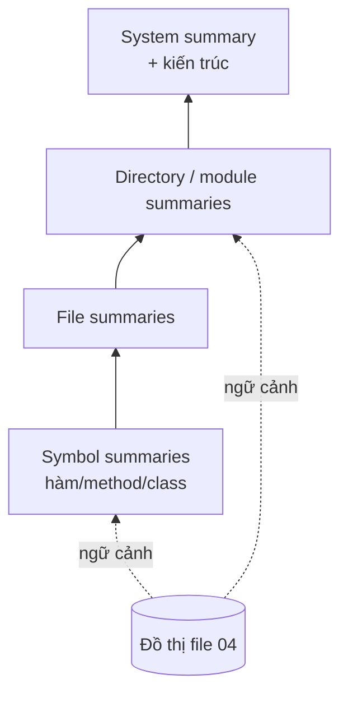

# Encoder và làm giàu ngữ nghĩa (semantic enrichment)

**Mục đích:** biến cấu trúc cú pháp (file 03) và đồ thị quan hệ (file 04) thành **hiểu biết có nghĩa**: mỗi symbol, file, module làm gì; hệ thống chia thành module nào, tầng nào; thuật ngữ nghiệp vụ là gì. Đồng thời tạo embedding để tìm kiếm ngữ nghĩa.
**Liên quan:** [02-rag-tu-co-ban-den-nang-cao.md](02-rag-tu-co-ban-den-nang-cao.md) · [03-parse-code-voi-tree-sitter.md](03-parse-code-voi-tree-sitter.md) · [04-linker-do-thi-symbol.md](04-linker-do-thi-symbol.md) · [06-dau-ra-ban-do-kien-truc.md](06-dau-ra-ban-do-kien-truc.md) · [09-quan-tri-governance.md](09-quan-tri-governance.md) · [10-kien-truc-tham-chieu-va-lo-trinh.md](10-kien-truc-tham-chieu-va-lo-trinh.md)

---

## 1. Hai nghĩa của "encoder" trong hệ thống này

| | Embedding encoder | LLM enrichment |
|---|---|---|
| Làm gì | Biến text/code thành vector để tìm theo độ tương đồng | Sinh mô tả có cấu trúc: mục đích, input/output, side effect, thuật ngữ |
| Mô hình | Mô hình embedding (code-specialized hoặc đa dụng) | LLM (ví dụ Claude) với structured output |
| Chi phí | Rẻ mỗi chunk | Đắt hơn nhiều lần |
| Đầu ra | Vector + metadata | JSON theo schema, có evidence |
| Dùng cho | Truy hồi (retrieval) | Bản đồ kiến trúc, trả lời câu hỏi, và **làm đầu vào tốt hơn cho chính embedding** |

Hai thứ bổ trợ nhau: tóm tắt do LLM viết bằng ngôn ngữ tự nhiên giúp câu hỏi "chỗ nào xử lý kiểm duyệt bài viết?" khớp với code dù trong code không có chữ "kiểm duyệt".

## 2. Embedding cho code

### 2.1 Chọn mô hình

Anthropic **không** cung cấp mô hình embedding riêng; tài liệu của Anthropic giới thiệu Voyage AI. Các lựa chọn phổ biến (tên và phiên bản thay đổi nhanh — **kiểm tra trước khi chọn**):

| Loại | Ví dụ (tham khảo) | Ghi chú |
|---|---|---|
| API chuyên code | Voyage `voyage-code-3` (hoặc bản mới hơn) | Tối ưu cho truy hồi code; có tùy chọn số chiều/kiểu lượng tử hóa — kiểm tra tài liệu |
| API đa dụng | Các mô hình embedding đa dụng của các nhà cung cấp lớn | Ổn với text tóm tắt; với code thô thường kém hơn mô hình chuyên code |
| Mã nguồn mở, tự host | Các mô hình embedding code mã mở (họ Jina code, Nomic embed code, CodeSage, …) | Code không rời hạ tầng nội bộ; cần GPU và vận hành |

**Quyết định theo ràng buộc, không theo bảng xếp hạng:**

1. Code có được phép gửi ra ngoài không? (chính sách công ty, hợp đồng khách hàng) → nếu không: tự host.
2. Đo trên **bộ câu hỏi của chính repo bạn** (recall@k), không dựa vào benchmark chung.
3. Đổi mô hình embedding = **phải embed lại toàn bộ** (vector của hai mô hình không so sánh được). Ghi `embedding_model` + phiên bản vào mỗi vector.

### 2.2 Embed cái gì

Đừng chỉ embed code thô. Một "tài liệu embedding" tốt cho một symbol:

```text
path: src/moderation/moderation.service.ts
module: moderation
symbol: ModerationService.reviewPost (method)
signature: async reviewPost(postId: string, decision: ReviewDecision): Promise<Post>
route: (gọi từ) POST /moderation/posts/:id/review
summary: Áp dụng quyết định của moderator cho bài viết đang chờ duyệt: chuyển trạng thái
  pending_review → published hoặc rejected, ghi audit log, phát sự kiện post.reviewed.
domain_terms: kiểm duyệt, bài viết, moderator, trạng thái bài
code:
  <thân hàm, có thể cắt bớt nếu quá dài>
```

| Thành phần | Tại sao |
|---|---|
| Đường dẫn + module | Câu hỏi thường nhắc tên module |
| Chữ ký | Kiểu tham số/trả về mang nhiều nghĩa |
| Tóm tắt LLM | Cầu nối ngôn ngữ tự nhiên ↔ code |
| Thuật ngữ nghiệp vụ | Khớp từ vựng của người viết spec |
| Code | Khớp các câu hỏi kỹ thuật cụ thể |

Có thể lưu **nhiều vector** cho một symbol (vector code thô, vector tóm tắt) và hợp nhất điểm khi truy hồi.

### 2.3 Hybrid search

Embedding kém với **định danh chính xác** (`ERR_POST_LOCKED`, `reviewPost`, tên bảng). Luôn kết hợp:

- **BM25 / full-text** (Postgres FTS, OpenSearch, Tantivy…) cho định danh và từ khóa.
- **Vector** cho ngữ nghĩa.
- **Đồ thị** (file 04) để mở rộng: tìm thấy handler → kéo theo service, bảng, topic liên quan.
- Hợp nhất bằng Reciprocal Rank Fusion, rồi **rerank** (mô hình reranker hoặc LLM) trên top-k. Chi tiết ở file 02.

### 2.4 Kích thước và chi phí

| Yếu tố | Ước lượng thứ tự độ lớn (tự kiểm tra) |
|---|---|
| Số vector | Cỡ số symbol + chunk: repo 500k dòng thường vài chục nghìn đến ~100k chunk |
| Bộ nhớ | `số_vector × số_chiều × 4 byte` (float32). Ví dụ 100k × 1024 × 4 ≈ 400 MB; lượng tử hóa int8/binary giảm 4–32 lần |
| Lưu trữ | pgvector (đủ cho quy mô này, cùng DB với đồ thị), hoặc vector DB chuyên dụng khi rất lớn |

## 3. Làm giàu bằng LLM: tóm tắt phân cấp từ dưới lên

### 3.1 Tại sao phân cấp

Không thể đưa 500k dòng vào một prompt rồi hỏi "kiến trúc là gì" — kể cả với cửa sổ ngữ cảnh 1M token, kết quả kém tin cậy, đắt, và không kiểm chứng được. Thay vào đó:



Mỗi tầng chỉ đọc **đầu ra đã có cấu trúc** của tầng dưới + dữ kiện từ đồ thị, nên prompt nhỏ, rẻ, và mỗi khẳng định truy ngược được.

### 3.2 Đầu vào của một lần tóm tắt symbol

Đưa **ngữ cảnh từ đồ thị** để tóm tắt bám vào sự thật, không suy đoán:

```json
{
  "symbol": { "id": "ts:src/moderation/moderation.service.ts#ModerationService.reviewPost",
              "signature": "...", "code": "...", "docstring": null },
  "graph_context": {
    "callers": ["route POST /moderation/posts/:id/review"],
    "callees": ["PostsRepository.updateStatus", "AuditService.record", "EventBus.publish"],
    "writes_tables": ["posts", "audit_log"],
    "publishes": ["post.reviewed"],
    "guards": ["RolesGuard(moderator)"]
  },
  "callee_summaries": { "PostsRepository.updateStatus": "Cập nhật cột status của bài viết ..." }
}
```

### 3.3 Đầu ra: structured output

Dùng structured outputs của Claude API (`output_config.format` với JSON Schema; SDK có helper `messages.parse()`) để đảm bảo đầu ra đúng schema. Schema tóm tắt symbol:

```json
{
  "$id": "symbol-summary.v1",
  "type": "object",
  "additionalProperties": false,
  "required": ["symbol_id", "purpose", "inputs", "outputs", "side_effects", "domain_terms", "confidence", "evidence"],
  "properties": {
    "symbol_id":    { "type": "string" },
    "purpose":      { "type": "string", "description": "1-2 câu, ngôn ngữ nghiệp vụ" },
    "inputs":       { "type": "array", "items": { "type": "string" } },
    "outputs":      { "type": "array", "items": { "type": "string" } },
    "side_effects": { "type": "array", "items": { "type": "string" },
                      "description": "ghi DB, gửi sự kiện, gọi dịch vụ ngoài, ghi file" },
    "invariants":   { "type": "array", "items": { "type": "string" },
                      "description": "điều kiện code thực sự kiểm tra (vd: chỉ bài pending_review)" },
    "errors":       { "type": "array", "items": { "type": "string" } },
    "domain_terms": { "type": "array", "items": { "type": "string" } },
    "confidence":   { "enum": ["high", "medium", "low"] },
    "unknowns":     { "type": "array", "items": { "type": "string" } },
    "evidence":     { "type": "array", "items": {
        "type": "object", "required": ["file", "line_start", "line_end"],
        "properties": { "file": {"type": "string"}, "line_start": {"type": "integer"}, "line_end": {"type": "integer"} } } }
  }
}
```

Phác thảo gọi API (Python SDK; **giả mã** về phần prompt và lưu trữ — đối chiếu tài liệu SDK cho chữ ký chính xác):

```python
# Phác thảo — kiểm tra tài liệu Anthropic SDK hiện hành trước khi dùng
import anthropic
client = anthropic.Anthropic()

SYSTEM = (
  "Bạn tóm tắt một symbol trong codebase LearnHub. Chỉ khẳng định điều có trong code "
  "hoặc graph_context được cung cấp. Điều không chắc đưa vào 'unknowns'. "
  "Mọi khẳng định phải có evidence là dòng thật trong file."
)

resp = client.messages.create(
    model="claude-haiku-5-5",          # tầng symbol: số lượng lớn, việc hẹp
    max_tokens=2000,
    system=SYSTEM,
    messages=[{"role": "user", "content": payload_json}],
    output_config={"format": {"type": "json_schema", "schema": SYMBOL_SUMMARY_SCHEMA}},
)
```

Chọn mô hình theo tầng (cân nhắc chi phí; đo chất lượng trên mẫu trước khi chốt):

| Tầng | Số lượng | Gợi ý |
|---|---|---|
| Symbol | Rất nhiều | Mô hình nhỏ/rẻ (Haiku) hoặc chỉ tóm tắt symbol quan trọng (exported, route handler, service public) |
| File | Nhiều | Haiku/Sonnet |
| Module | Vài chục | Sonnet/Opus |
| Hệ thống + kiến trúc | Một | Opus, effort cao |

### 3.4 Batch và cache

- **Message Batches API** cho lần index đầu và các đợt lớn: xử lý bất đồng bộ, giá khoảng 50% so với gọi thường; kết quả trả về không theo thứ tự → ghép theo `custom_id` (dùng chính `symbol_id`/hash).
- **Prompt caching:** đặt phần cố định (system prompt, schema, mô tả quy ước LearnHub) ở đầu; phần thay đổi (symbol) ở sau. Kiểm tra `usage.cache_read_input_tokens` để chắc cache hoạt động.
- **Cache theo nội dung:** khóa = `hash(prompt_version, model, symbol.content_hash, hash(graph_context), hash(callee_summaries))`. Không đổi khóa → không gọi lại LLM.
- **Lan truyền có kiểm soát:** symbol đổi → file chứa nó tóm tắt lại; module chỉ tóm tắt lại khi tỷ lệ thay đổi bên trong vượt ngưỡng hoặc public API/cạnh ra ngoài đổi.

## 4. Khôi phục kiến trúc (architecture recovery)

### 4.1 Module khai báo vs module thực tế

Thư mục và `@Module` là **ý định** của người viết. Đồ thị phụ thuộc là **thực tế**. Hai thứ lệch nhau là thông tin quý cho người viết spec.

```python
# Phát hiện cộng đồng trên đồ thị file (gộp cạnh imports/calls, có trọng số)
import networkx as nx
from networkx.algorithms.community import louvain_communities  # networkx >= 2.8

U = nx.Graph()
for src_file, dst_file, weight in file_edges:     # bỏ cạnh tới external, test
    if U.has_edge(src_file, dst_file):
        U[src_file][dst_file]["weight"] += weight
    else:
        U.add_edge(src_file, dst_file, weight=weight)

communities = louvain_communities(U, weight="weight", seed=42)   # seed để kết quả lặp lại được
```

Leiden (thư viện `leidenalg`/`igraph`) cho cụm có chất lượng tốt hơn Louvain trong nhiều trường hợp; cả hai đều **không ổn định tuyệt đối** — cố định seed và so sánh giữa các lần chạy.

So sánh cụm phát hiện được với module khai báo:

| Tình huống | Ý nghĩa | Ghi vào bản đồ |
|---|---|---|
| Cụm trùng thư mục module | Ranh giới rõ | `boundary_health: good` |
| Một module bị tách thành 2 cụm | Module làm hai việc | Đề xuất tách / ghi rủi ro |
| Hai module gộp thành 1 cụm | Phụ thuộc chặt, ranh giới giả | Rủi ro thay đổi lan rộng |
| File "lạc" cụm khác thư mục | File đặt sai chỗ hoặc phụ thuộc chéo | Liệt kê |

Kết quả phân cụm là **gợi ý cho LLM và người duyệt**, không phải sự thật tự động.

### 4.2 Phát hiện tầng (layer)

Gán vai trò cho symbol theo dấu hiệu, rồi kiểm tra hướng phụ thuộc:

| Vai trò | Dấu hiệu |
|---|---|
| `controller` / entrypoint | `@Controller`, route Express, consumer `@EventPattern`, cron |
| `service` | `@Injectable` có tên `*Service`, được controller gọi |
| `repository` / data access | ghi/đọc bảng, `*Repository`, gọi ORM |
| `infrastructure` | client HTTP, SDK cloud, queue producer |
| `domain` | class/kiểu không phụ thuộc framework |

Quy tắc kỳ vọng: `controller → service → repository`. **Vi phạm tầng** (controller gọi thẳng repository, repository gọi service, module A ghi bảng của module B) được liệt kê kèm evidence.

### 4.3 Entrypoint, cross-cutting, dữ liệu, tích hợp

- **Entrypoint:** mọi route, consumer, job định kỳ, CLI, `main()`.
- **Cross-cutting:** symbol có nhiều cạnh vào từ nhiều module (auth guard, logging, config, error filter) — độ trung tâm (in-degree theo module) cao.
- **Data store:** node `db_table` + module ghi chính; bảng bị ghi bởi > 1 module là cờ đỏ.
- **Tích hợp ngoài:** node `external_service`/`external_package` quan trọng (S3, email, payment, AI moderation).

### 4.4 Từ điển thuật ngữ (glossary)

Gom `domain_terms` từ tóm tắt symbol + tên entity/bảng + enum trạng thái → LLM hợp nhất thành từ điển: thuật ngữ, định nghĩa, nơi xuất hiện (evidence), từ đồng nghĩa trong code (`attempt` = "lượt làm bài"). Người viết spec và agent spec dùng chung từ điển này để không gọi một khái niệm bằng ba tên.

## 5. Đánh giá chất lượng làm giàu

Tóm tắt sai còn tệ hơn không có tóm tắt, vì nó được trích dẫn với vẻ chắc chắn.

| Kiểm tra | Cách làm | Tự động? |
|---|---|---|
| Evidence tồn tại | File có thật, dòng nằm trong phạm vi symbol | Có |
| Side effect khớp đồ thị | `side_effects` nhắc bảng/topic phải có cạnh `writes_table`/`publishes` tương ứng và ngược lại | Có |
| Mâu thuẫn | Tóm tắt file nói "không ghi DB" nhưng symbol con có `writes_table` | Có (rule) hoặc LLM judge |
| Đúng nghĩa | Người có hiểu biết chấm mẫu ngẫu nhiên (ví dụ 30–50 symbol mỗi đợt) | Thủ công |
| Bộ câu hỏi vàng | Câu hỏi về repo có đáp án biết trước; đo độ đúng câu trả lời + trích dẫn | Bán tự động (file 09) |
| Độ ổn định | Chạy lại hai lần cùng đầu vào → khác biệt lớn = prompt mơ hồ | Có |

## 6. Ước lượng chi phí cho repo ~500k dòng (thứ tự độ lớn, tự tính lại)

Giả định minh họa: ~40k symbol, chỉ tóm tắt ~15k symbol quan trọng; mỗi lần gọi ~1,5k token vào, ~300 token ra.

```text
Token vào  ≈ 15.000 × 1.500  ≈ 22,5 triệu
Token ra   ≈ 15.000 × 300    ≈ 4,5 triệu
+ tầng file/module/hệ thống  ≈ thêm 10–30%
```

Nhân với bảng giá hiện hành của mô hình bạn chọn (xem trang giá Anthropic), trừ ~50% nếu dùng Batches, trừ thêm phần cache. Lần index đầu là chi phí lớn nhất; cập nhật tăng dần chỉ tốn một phần nhỏ mỗi commit. **Đo chi phí thật trên 1–2 module trước khi chạy cả repo.**

## 7. Lỗi thường gặp

| Lỗi | Hậu quả | Cách tránh |
|---|---|---|
| Tóm tắt không kèm ngữ cảnh đồ thị | LLM đoán side effect, bịa luồng | Đưa callers/callees/tables/topics vào prompt |
| Không yêu cầu evidence và `unknowns` | Khẳng định không kiểm chứng được | Schema bắt buộc evidence; cho phép nói "không biết" |
| Hỏi LLM "kiến trúc là gì" trên toàn repo | Kết quả chung chung, sai, đắt | Tóm tắt phân cấp + dữ kiện đồ thị |
| Tóm tắt lại toàn bộ mỗi commit | Chi phí phình | Cache theo content hash + prompt version |
| Đổi prompt mà không đổi version trong khóa cache | Trộn tóm tắt cũ/mới không nhất quán | `prompt_version` trong khóa |
| Coi kết quả phân cụm là module thật | Bản đồ sai ranh giới | Phân cụm là gợi ý; người duyệt xác nhận |
| Đổi mô hình embedding mà không embed lại | Truy hồi hỏng âm thầm | Lưu `embedding_model` với vector; reindex toàn bộ |
| Gửi code lên API bên ngoài khi chính sách không cho phép | Vi phạm hợp đồng/bảo mật | Kiểm tra chính sách trước (file 09); tự host khi cần |
| Embed cả secret có trong repo | Secret nằm trong vector DB và log | Quét secret (gitleaks) trước khi index; loại file nhạy cảm |

## Checklist review

- [ ] Mô hình embedding được chọn dựa trên đo recall trên bộ câu hỏi của repo, và đã kiểm tra chính sách cho phép gửi code ra ngoài.
- [ ] Mỗi vector lưu `embedding_model`, phiên bản, `content_hash`, `commit`.
- [ ] Truy hồi là hybrid (BM25 + vector + mở rộng theo đồ thị), có rerank.
- [ ] Tóm tắt dùng structured output theo schema có `evidence`, `confidence`, `unknowns`.
- [ ] Prompt tóm tắt có ngữ cảnh đồ thị; không hỏi LLM về thứ không đưa cho nó.
- [ ] Cache theo `(prompt_version, model, content_hash, context_hash)`; chỉ phần đổi được tóm tắt lại.
- [ ] Lần index lớn dùng Batches API; phần cố định của prompt được cache.
- [ ] Kết quả phân cụm/tầng được trình bày là gợi ý, có so sánh với module khai báo.
- [ ] Có kiểm tra tự động: evidence tồn tại, side effect khớp đồ thị, không mâu thuẫn giữa tầng.
- [ ] Có chấm mẫu thủ công định kỳ và bộ câu hỏi vàng.
- [ ] Có ước lượng chi phí đo thật trên một phần repo trước khi chạy toàn bộ.
- [ ] Repo được quét secret trước khi đưa vào index.
