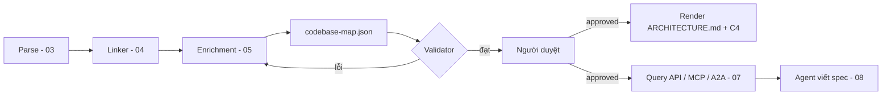
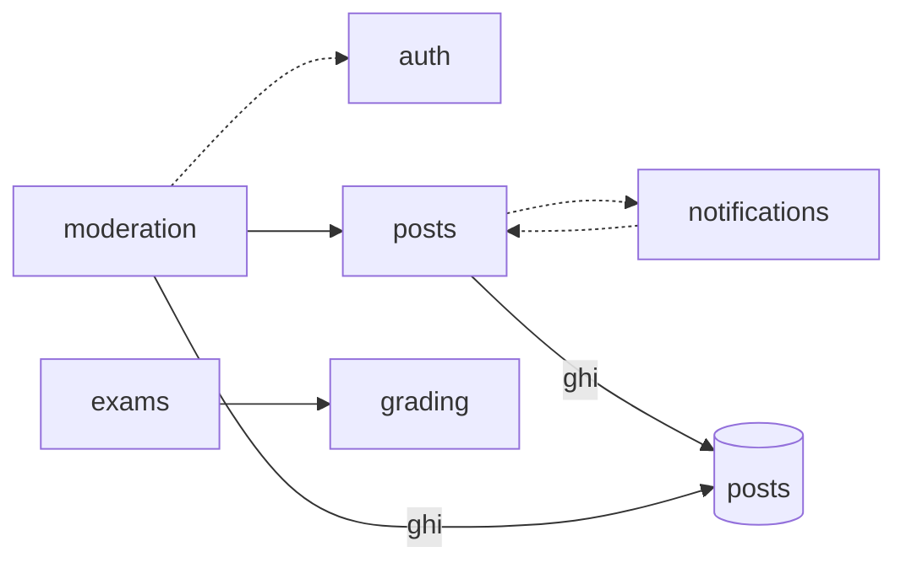

# Đầu ra: bản đồ kiến trúc codebase (Codebase Map)

**Mục đích:** định nghĩa **hợp đồng đầu ra** của hệ thống code intelligence: một bản đồ kiến trúc có cấu trúc, mọi khẳng định có bằng chứng, được kiểm tra tự động, được người duyệt, và được các agent khác (như agent viết spec) truy vấn thay vì đọc lại toàn bộ code.
**Liên quan:** [03-parse-code-voi-tree-sitter.md](03-parse-code-voi-tree-sitter.md) · [04-linker-do-thi-symbol.md](04-linker-do-thi-symbol.md) · [05-encoder-lam-giau-semantic.md](05-encoder-lam-giau-semantic.md) · [07-giao-tiep-a2a-va-mcp.md](07-giao-tiep-a2a-va-mcp.md) · [08-spec-trong-source-code.md](08-spec-trong-source-code.md) · [09-quan-tri-governance.md](09-quan-tri-governance.md) · [../02-quy-trinh-phan-mem/03-thiet-ke.md](../02-quy-trinh-phan-mem/03-thiet-ke.md)

---

## 1. Tại sao cần một hợp đồng đầu ra

Không có hợp đồng, mỗi lần hỏi "codebase này có kiến trúc gì" sẽ ra một đoạn văn khác nhau, không so sánh được giữa các commit, không kiểm chứng được, và agent khác không dùng lại được.

| Yêu cầu | Cách đáp ứng |
|---|---|
| Máy đọc được | JSON theo JSON Schema có version |
| Người đọc được | Render thành `ARCHITECTURE.md`, sơ đồ C4, thẻ module |
| Kiểm chứng được | Mỗi khẳng định có `evidence` (file, dòng, symbol) |
| Biết độ chắc chắn | `confidence` + danh sách `unknowns` |
| Gắn với phiên bản code | `commit` SHA, `generated_at`, version của pipeline |
| Có người chịu trách nhiệm | Trạng thái duyệt (`draft` → `approved`) và người duyệt |



## 2. JSON Schema đầy đủ (`codebase-map.v1`)

```json
{
  "$schema": "https://json-schema.org/draft/2020-12/schema",
  "$id": "codebase-map.v1",
  "type": "object",
  "additionalProperties": false,
  "required": ["schema_version", "repo", "commit", "generated_at", "pipeline", "review",
               "system", "modules", "data_stores", "integrations", "cross_cutting",
               "architecture", "glossary", "unknowns"],
  "$defs": {
    "evidence": {
      "type": "object",
      "additionalProperties": false,
      "required": ["file", "line_start", "line_end"],
      "properties": {
        "file":       { "type": "string", "description": "đường dẫn tương đối gốc repo" },
        "line_start": { "type": "integer", "minimum": 1 },
        "line_end":   { "type": "integer", "minimum": 1 },
        "symbol_id":  { "type": ["string", "null"] },
        "note":       { "type": ["string", "null"] }
      }
    },
    "claim": {
      "type": "object",
      "additionalProperties": false,
      "required": ["text", "confidence", "evidence"],
      "properties": {
        "text":       { "type": "string" },
        "confidence": { "enum": ["high", "medium", "low"] },
        "source":     { "enum": ["graph", "llm", "human"], "description": "graph = dữ kiện từ đồ thị; llm = suy luận; human = người sửa" },
        "evidence":   { "type": "array", "minItems": 1, "items": { "$ref": "#/$defs/evidence" } }
      }
    },
    "module": {
      "type": "object",
      "additionalProperties": false,
      "required": ["id", "name", "paths", "responsibility", "public_api", "depends_on",
                   "owned_data", "entrypoints", "tests", "risks", "boundary_health"],
      "properties": {
        "id":   { "type": "string", "pattern": "^mod:[a-z0-9-]+$" },
        "name": { "type": "string" },
        "kind": { "enum": ["declared", "detected"] },
        "paths": { "type": "array", "items": { "type": "string" } },
        "responsibility": { "$ref": "#/$defs/claim" },
        "public_api": { "type": "array", "items": {
            "type": "object", "required": ["symbol_id", "summary"],
            "properties": { "symbol_id": {"type": "string"}, "summary": {"type": "string"} } } },
        "depends_on": { "type": "array", "items": {
            "type": "object", "required": ["module_id", "edge_count", "kinds"],
            "properties": {
              "module_id":  { "type": "string" },
              "edge_count": { "type": "integer" },
              "kinds":      { "type": "array", "items": { "type": "string" } } } } },
        "owned_data": { "type": "array", "items": {
            "type": "object", "required": ["store_id", "access"],
            "properties": { "store_id": {"type": "string"}, "access": {"enum": ["owner_write", "read", "write_shared"]} } } },
        "entrypoints": { "type": "array", "items": {
            "type": "object", "required": ["kind", "name", "handler_symbol_id"],
            "properties": {
              "kind": { "enum": ["http_route", "queue_consumer", "cron", "cli", "main"] },
              "name": { "type": "string", "description": "vd 'POST /posts/:id/publish'" },
              "handler_symbol_id": { "type": "string" },
              "guards": { "type": "array", "items": { "type": "string" } } } } },
        "tests": { "type": "object", "properties": {
            "test_files": { "type": "integer" }, "untested_public_api": { "type": "array", "items": {"type": "string"} } } },
        "risks": { "type": "array", "items": { "$ref": "#/$defs/claim" } },
        "boundary_health": { "enum": ["good", "leaky", "unclear"] }
      }
    }
  },
  "properties": {
    "schema_version": { "const": "codebase-map.v1" },
    "repo":           { "type": "string" },
    "commit":         { "type": "string", "pattern": "^[0-9a-f]{7,40}$" },
    "generated_at":   { "type": "string", "format": "date-time" },
    "pipeline": { "type": "object", "required": ["parser", "linker", "enricher"],
      "properties": {
        "parser":   { "type": "string", "description": "vd tree-sitter@0.25 + grammars" },
        "linker":   { "type": "string", "description": "vd import+nest_di, scip-typescript@x" },
        "enricher": { "type": "string", "description": "model id + prompt_version" } } },
    "review": { "type": "object", "required": ["status"],
      "properties": {
        "status":      { "enum": ["draft", "in_review", "approved", "rejected", "stale"] },
        "reviewed_by": { "type": ["string", "null"] },
        "reviewed_at": { "type": ["string", "null"] },
        "notes":       { "type": ["string", "null"] } } },
    "system": { "type": "object", "required": ["summary", "languages", "size"],
      "properties": {
        "summary":   { "$ref": "#/$defs/claim" },
        "languages": { "type": "object", "additionalProperties": { "type": "integer" }, "description": "số dòng theo ngôn ngữ" },
        "size":      { "type": "object", "properties": { "files": {"type": "integer"}, "symbols": {"type": "integer"} } } } },
    "modules":      { "type": "array", "items": { "$ref": "#/$defs/module" } },
    "data_stores":  { "type": "array", "items": {
        "type": "object", "required": ["id", "kind", "name", "written_by", "read_by"],
        "properties": {
          "id": { "type": "string", "pattern": "^store:" },
          "kind": { "enum": ["sql_table", "cache", "object_storage", "search_index", "queue_topic"] },
          "name": { "type": "string" },
          "written_by": { "type": "array", "items": { "type": "string" } },
          "read_by":    { "type": "array", "items": { "type": "string" } },
          "evidence":   { "type": "array", "items": { "$ref": "#/$defs/evidence" } } } } },
    "integrations": { "type": "array", "items": {
        "type": "object", "required": ["name", "kind", "used_by", "evidence"],
        "properties": {
          "name": { "type": "string" }, "kind": { "type": "string" },
          "used_by": { "type": "array", "items": { "type": "string" } },
          "evidence": { "type": "array", "items": { "$ref": "#/$defs/evidence" } } } } },
    "cross_cutting": { "type": "array", "items": {
        "type": "object", "required": ["concern", "implemented_by", "claim"],
        "properties": {
          "concern": { "enum": ["authn", "authz", "logging", "config", "error_handling", "validation", "transactions", "caching", "i18n", "other"] },
          "implemented_by": { "type": "array", "items": { "type": "string" } },
          "claim": { "$ref": "#/$defs/claim" } } } },
    "architecture": { "type": "object", "required": ["style", "layers", "layer_violations", "cycles"],
      "properties": {
        "style": { "$ref": "#/$defs/claim", "description": "vd modular monolith, layered" },
        "layers": { "type": "array", "items": { "type": "string" } },
        "layer_violations": { "type": "array", "items": {
            "type": "object", "required": ["from", "to", "rule", "evidence"],
            "properties": { "from": {"type": "string"}, "to": {"type": "string"}, "rule": {"type": "string"},
                            "evidence": { "type": "array", "items": { "$ref": "#/$defs/evidence" } } } } },
        "cycles": { "type": "array", "items": { "type": "array", "items": { "type": "string" } } } } },
    "glossary": { "type": "array", "items": {
        "type": "object", "required": ["term", "definition", "code_names"],
        "properties": {
          "term": { "type": "string" }, "definition": { "type": "string" },
          "code_names": { "type": "array", "items": { "type": "string" } },
          "evidence": { "type": "array", "items": { "$ref": "#/$defs/evidence" } } } } },
    "unknowns": { "type": "array", "items": {
        "type": "object", "required": ["question", "why_unknown"],
        "properties": { "question": {"type": "string"}, "why_unknown": {"type": "string"},
                        "suggested_owner": { "type": ["string", "null"] } } } }
  }
}
```

Hai nguyên tắc thiết kế quan trọng:

1. **`unknowns` là trường bắt buộc.** Một bản đồ không có điều gì "chưa biết" với repo thật gần như chắc chắn đang che giấu suy đoán.
2. **`source` phân biệt `graph` (dữ kiện) và `llm` (suy luận).** Người duyệt tập trung soát phần `llm`.

## 3. Ví dụ rút gọn cho LearnHub

```json
{
  "schema_version": "codebase-map.v1",
  "repo": "learnhub-backend",
  "commit": "3f2a9c1",
  "generated_at": "2026-11-20T09:00:00Z",
  "pipeline": { "parser": "tree-sitter@0.25 (typescript, cpp)",
                "linker": "import_resolution + nest_di; scip-typescript",
                "enricher": "claude-haiku-5-5 (symbol), claude-opus-5-5 (system); prompt v3" },
  "review": { "status": "in_review", "reviewed_by": null, "reviewed_at": null, "notes": null },
  "system": {
    "summary": { "text": "Modular monolith NestJS cho nền tảng học tập: tài khoản, bài viết có kiểm duyệt, bài kiểm tra và chấm bài; chấm code chạy trong sandbox C++ qua hàng đợi.",
                 "confidence": "high", "source": "llm",
                 "evidence": [ { "file": "src/app.module.ts", "line_start": 12, "line_end": 31 } ] },
    "languages": { "typescript": 182000, "cpp": 21000 },
    "size": { "files": 1430, "symbols": 9800 }
  },
  "modules": [
    {
      "id": "mod:moderation", "name": "moderation", "kind": "declared",
      "paths": ["src/moderation/"],
      "responsibility": { "text": "Duyệt bài viết ở trạng thái pending_review: kiểm tra tự động (spam, nội dung độc hại) qua hàng đợi và hàng chờ duyệt thủ công cho moderator.",
                          "confidence": "high", "source": "llm",
                          "evidence": [ { "file": "src/moderation/moderation.service.ts", "line_start": 20, "line_end": 88,
                                          "symbol_id": "ts:src/moderation/moderation.service.ts#ModerationService" } ] },
      "public_api": [ { "symbol_id": "ts:src/moderation/moderation.service.ts#ModerationService.reviewPost",
                        "summary": "Áp dụng quyết định duyệt, chuyển trạng thái bài, ghi audit, phát post.reviewed" } ],
      "depends_on": [ { "module_id": "mod:posts", "edge_count": 14, "kinds": ["calls", "imports"] },
                      { "module_id": "mod:auth",  "edge_count": 3,  "kinds": ["imports"] } ],
      "owned_data": [ { "store_id": "store:moderation_queue", "access": "owner_write" },
                      { "store_id": "store:posts", "access": "write_shared" } ],
      "entrypoints": [ { "kind": "http_route", "name": "POST /moderation/posts/:id/review",
                         "handler_symbol_id": "ts:src/moderation/moderation.controller.ts#ModerationController.review",
                         "guards": ["AuthGuard", "RolesGuard(moderator)"] },
                       { "kind": "queue_consumer", "name": "post.submitted",
                         "handler_symbol_id": "ts:src/moderation/moderation.consumer.ts#ModerationConsumer.onSubmitted" } ],
      "tests": { "test_files": 6, "untested_public_api": [] },
      "risks": [ { "text": "Module moderation ghi trực tiếp bảng posts (thuộc module posts) thay vì gọi PostsService.",
                   "confidence": "high", "source": "graph",
                   "evidence": [ { "file": "src/moderation/moderation.service.ts", "line_start": 61, "line_end": 64 } ] } ],
      "boundary_health": "leaky"
    }
  ],
  "data_stores": [
    { "id": "store:posts", "kind": "sql_table", "name": "posts",
      "written_by": ["mod:posts", "mod:moderation"], "read_by": ["mod:posts", "mod:moderation", "mod:notifications"],
      "evidence": [ { "file": "src/posts/post.entity.ts", "line_start": 8, "line_end": 40 } ] }
  ],
  "integrations": [
    { "name": "Object storage (S3)", "kind": "object_storage", "used_by": ["mod:posts"],
      "evidence": [ { "file": "src/posts/media.service.ts", "line_start": 5, "line_end": 7 } ] }
  ],
  "cross_cutting": [
    { "concern": "authz", "implemented_by": ["ts:src/auth/roles.guard.ts#RolesGuard"],
      "claim": { "text": "Phân quyền theo vai trò bằng RolesGuard + decorator @Roles; kiểm tra quyền sở hữu nằm rải rác trong service.",
                 "confidence": "medium", "source": "llm",
                 "evidence": [ { "file": "src/auth/roles.guard.ts", "line_start": 10, "line_end": 35 } ] } }
  ],
  "architecture": {
    "style": { "text": "Modular monolith, phân tầng controller → service → repository.", "confidence": "high", "source": "graph",
               "evidence": [ { "file": "src/app.module.ts", "line_start": 12, "line_end": 31 } ] },
    "layers": ["controller", "service", "repository", "infrastructure"],
    "layer_violations": [
      { "from": "ts:src/exams/exams.controller.ts#ExamsController.list", "to": "ts:src/exams/exam.repository.ts#ExamRepository.findAll",
        "rule": "controller không gọi thẳng repository",
        "evidence": [ { "file": "src/exams/exams.controller.ts", "line_start": 33, "line_end": 35 } ] } ],
    "cycles": [ ["mod:posts", "mod:notifications", "mod:posts"] ]
  },
  "glossary": [
    { "term": "Lượt làm bài", "definition": "Một lần học viên bắt đầu và nộp một bài kiểm tra; có hạn giờ do server quyết định.",
      "code_names": ["ExamAttempt", "exam_attempts", "attemptId"],
      "evidence": [ { "file": "src/exams/exam-attempt.entity.ts", "line_start": 6, "line_end": 30 } ] }
  ],
  "unknowns": [
    { "question": "Topic 'grading.requested' được publish từ đâu khi giáo viên chấm lại?",
      "why_unknown": "Tên topic lấy từ biến cấu hình, linker không resolve được.",
      "suggested_owner": "nhóm grading" }
  ]
}
```

## 4. Bản dành cho người đọc (render từ JSON)

Không viết tay `ARCHITECTURE.md` song song — **render từ map** để hai thứ không bao giờ lệch nhau.

### 4.1 Mẫu `ARCHITECTURE.md`

```markdown
# Kiến trúc learnhub-backend
> Sinh từ codebase-map.v1 @ commit 3f2a9c1 · trạng thái: approved bởi <người duyệt> ngày <ngày>
> Không sửa tay — sửa map hoặc pipeline rồi render lại.

## Tóm tắt hệ thống
<system.summary.text>  [bằng chứng](src/app.module.ts#L12-L31)

## Sơ đồ
<C4 context + container (mermaid)>

## Module
| Module | Trách nhiệm | Phụ thuộc | Dữ liệu sở hữu | Entrypoint | Sức khỏe ranh giới |
|---|---|---|---|---|---|

## Dữ liệu và tích hợp ngoài
## Mối quan tâm xuyên suốt (auth, logging, lỗi, cấu hình)
## Vi phạm tầng và vòng phụ thuộc
## Thuật ngữ
## Điều chưa biết (cần người trả lời)
```

### 4.2 Sơ đồ C4 sinh tự động

```python
# render_c4.py — sinh mermaid component diagram từ map (rút gọn)
def c4_components(cmap: dict) -> str:
    lines = ["flowchart LR"]
    for m in cmap["modules"]:
        label = f'{m["name"]}<br/><small>{len(m["entrypoints"])} entrypoint</small>'
        lines.append(f'    {m["id"].replace(":", "_")}["{label}"]')
    for m in cmap["modules"]:
        for d in m["depends_on"]:
            style = "-->" if d["edge_count"] >= 5 else "-.->"
            lines.append(f'    {m["id"].replace(":", "_")} {style} {d["module_id"].replace(":", "_")}')
    for s in cmap["data_stores"]:
        sid = s["id"].replace(":", "_")
        lines.append(f'    {sid}[("{s["name"]}")]')
        for w in s["written_by"]:
            lines.append(f'    {w.replace(":", "_")} -- ghi --> {sid}')
    return "\n".join(lines)
```

Ví dụ kết quả (rút gọn):



Cấp **context** (hệ thống + người dùng + hệ thống ngoài) lấy từ `integrations`; cấp **container** (API, worker, sandbox C++, DB, Redis, queue) lấy từ entrypoint kind + data_stores; cấp **component** là sơ đồ module ở trên. Xem thêm C4 ở [../02-quy-trinh-phan-mem/03-thiet-ke.md](../02-quy-trinh-phan-mem/03-thiet-ke.md).

### 4.3 Thẻ module (module card)

Mỗi module một trang ngắn: trách nhiệm, public API, entrypoint + guard, dữ liệu, phụ thuộc vào/ra, rủi ro, điều chưa biết, link bằng chứng. Đây là thứ người viết spec đọc nhiều nhất.

## 5. Quy tắc kiểm tra (validator)

Chạy trong pipeline **trước** khi map được đưa cho người duyệt. Map không đạt validator không được dùng.

| # | Quy tắc | Mức |
|---|---|---|
| V1 | JSON hợp lệ theo `codebase-map.v1` | Chặn |
| V2 | `commit` tồn tại trong repo | Chặn |
| V3 | Mọi `evidence.file` tồn tại tại `commit` | Chặn |
| V4 | `1 ≤ line_start ≤ line_end ≤ số dòng file` | Chặn |
| V5 | Mọi `symbol_id` (evidence, public_api, entrypoint, implemented_by) có trong index symbol | Chặn |
| V6 | Mọi `module_id`/`store_id` được tham chiếu đều được định nghĩa | Chặn |
| V7 | Module nào cũng có `responsibility` với ≥ 1 evidence | Chặn |
| V8 | Khẳng định `source: graph` khớp với đồ thị (vd `written_by` = các module có cạnh `writes_table`) | Chặn |
| V9 | Tỷ lệ claim `confidence: low` > ngưỡng (vd 20%) | Cảnh báo |
| V10 | `unknowns` rỗng trên repo > N file | Cảnh báo |
| V11 | Entrypoint `http_route` không có guard nào | Cảnh báo (có thể là route công khai hợp lệ — người duyệt xác nhận) |
| V12 | `commit` lệch HEAD nhánh chính quá X commit | Đánh dấu `stale` |

```python
# validate_map.py — phác thảo
import json, subprocess
from jsonschema import Draft202012Validator

def file_at(commit: str, path: str) -> list[str] | None:
    r = subprocess.run(["git", "show", f"{commit}:{path}"], capture_output=True, text=True)
    return r.stdout.splitlines() if r.returncode == 0 else None

def iter_evidence(obj):
    if isinstance(obj, dict):
        if {"file", "line_start", "line_end"} <= obj.keys():
            yield obj
        for v in obj.values():
            yield from iter_evidence(v)
    elif isinstance(obj, list):
        for v in obj:
            yield from iter_evidence(v)

def validate(cmap: dict, schema: dict, symbol_ids: set[str]) -> list[str]:
    errors = [f"schema: {e.message}" for e in Draft202012Validator(schema).iter_errors(cmap)]
    commit, cache = cmap["commit"], {}
    for ev in iter_evidence(cmap):
        lines = cache.setdefault(ev["file"], file_at(commit, ev["file"]))
        if lines is None:
            errors.append(f"V3 file không tồn tại: {ev['file']}")
        elif not (1 <= ev["line_start"] <= ev["line_end"] <= len(lines)):
            errors.append(f"V4 dòng sai: {ev['file']}:{ev['line_start']}-{ev['line_end']}")
        sid = ev.get("symbol_id")
        if sid and sid not in symbol_ids:
            errors.append(f"V5 symbol không tồn tại: {sid}")
    module_ids = {m["id"] for m in cmap["modules"]}
    for m in cmap["modules"]:
        for d in m["depends_on"]:
            if d["module_id"] not in module_ids:
                errors.append(f"V6 module không định nghĩa: {d['module_id']}")
    return errors
```

Khi validator báo lỗi ở phần do LLM sinh, pipeline có thể **gửi lỗi ngược lại cho bước enrichment** để sửa (tối đa N lần), rồi mới trình người duyệt.

## 6. Version và vòng đời

- Lưu map trong repo, ví dụ `docs/architecture/codebase-map.json` + `ARCHITECTURE.md` render, **hoặc** trong kho artifact của pipeline kèm commit SHA. Lưu trong repo có lợi: diff được qua PR, người duyệt dùng quy trình review sẵn có.
- Mỗi lần sinh mới: so sánh với map đã `approved` gần nhất → **diff kiến trúc** (module mới, cạnh phụ thuộc mới, bảng bị module mới ghi, vi phạm tầng mới). Người duyệt chỉ cần đọc diff.
- Map `approved` cho commit cũ + có thay đổi lớn → trạng thái `stale`; agent tiêu thụ phải thấy cờ này.
- Đổi `schema_version` (v1 → v2) cần ADR và bộ chuyển đổi.

## 7. Người duyệt phê duyệt map như thế nào

Dùng cùng tinh thần cổng phê duyệt ở [../02-quy-trinh-phan-mem/09-checklist-phe-duyet.md](../02-quy-trinh-phan-mem/09-checklist-phe-duyet.md):

1. Validator đạt (không có lỗi chặn).
2. Đọc **diff kiến trúc** so với bản duyệt trước, không đọc lại toàn bộ.
3. Với mỗi module: trách nhiệm có đúng với hiểu biết của nhóm sở hữu không? Mở ngẫu nhiên 2–3 evidence xem có thật sự chứng minh khẳng định.
4. Soát tất cả claim `source: llm` có `confidence: low/medium` ở các module quan trọng (auth, thanh toán, chấm điểm).
5. Trả lời hoặc phân công các `unknowns` (câu trả lời của người được ghi lại với `source: human`).
6. Đặt `review.status = approved`, ghi người duyệt và ngày. Đây là bước của người — agent không tự đặt `approved`.

## 8. Agent khác tiêu thụ map như thế nào

**Không** nhét cả map (có thể hàng trăm KB) vào ngữ cảnh của agent viết spec. Cung cấp **truy vấn** qua MCP tool hoặc kỹ năng A2A (chi tiết ở file 07):

| Công cụ / kỹ năng | Đầu vào | Đầu ra |
|---|---|---|
| `get_system_overview` | – | system summary, danh sách module (tên + 1 câu), commit, trạng thái duyệt |
| `get_module` | `module_id` | thẻ module đầy đủ |
| `find_modules_for_feature` | mô tả tính năng (ngôn ngữ tự nhiên) | module liên quan + lý do + evidence (dùng hybrid search file 05) |
| `get_entrypoints` | `module_id` hoặc filter | route/consumer + guard |
| `impact_of_change` | `symbol_id` hoặc `store_id` | module, route, test bị ảnh hưởng (đồ thị file 04) |
| `get_glossary` | term? | định nghĩa + tên trong code |
| `list_unknowns` | `module_id`? | điều chưa biết liên quan |

Mọi câu trả lời kèm `commit`, `review.status` và evidence, để agent spec trích dẫn lại được trong spec (file 08) và người duyệt spec kiểm tra được.

## 9. Lỗi thường gặp

| Lỗi | Hậu quả | Cách tránh |
|---|---|---|
| Đầu ra là đoạn văn tự do | Không so sánh, không kiểm chứng, không truy vấn được | Schema bắt buộc + render |
| Evidence trỏ tới file/dòng không tồn tại | Mất niềm tin; spec trích dẫn sai | Validator V3–V5 chặn |
| Viết tay `ARCHITECTURE.md` song song | Lệch với map | Chỉ render từ map |
| Không có `unknowns` | Suy đoán được trình bày như sự thật | Bắt buộc trường; cảnh báo nếu rỗng |
| Agent tự đặt `approved` | Không có người chịu trách nhiệm | Chỉ người (hoặc quy trình có người ký) đổi trạng thái |
| Không gắn commit | Không biết map mô tả phiên bản nào | `commit` bắt buộc, cờ `stale` |
| Dồn toàn bộ map vào prompt agent khác | Tốn token, agent bỏ sót chi tiết | Query API theo nhu cầu |
| Gộp dữ kiện đồ thị và suy luận LLM làm một | Người duyệt không biết soát chỗ nào | Trường `source` |

## Checklist review

- [ ] Map hợp lệ theo `codebase-map.v1`; schema được version và lưu trong repo.
- [ ] Mọi claim có `confidence`, `source`, và ≥ 1 evidence; validator V1–V8 đạt.
- [ ] Đã mở thử ngẫu nhiên evidence của các module quan trọng và xác nhận đúng.
- [ ] Phân biệt rõ dữ kiện từ đồ thị (`graph`) và suy luận (`llm`).
- [ ] `unknowns` không rỗng (hoặc có giải thích), đã được trả lời/phân công.
- [ ] Vi phạm tầng, vòng phụ thuộc, bảng bị nhiều module ghi đều được liệt kê với evidence.
- [ ] Entrypoint có thông tin guard; route không có guard đã được xác nhận là công khai hợp lệ.
- [ ] `ARCHITECTURE.md` và sơ đồ C4 được render từ map, không sửa tay.
- [ ] Có diff kiến trúc so với bản duyệt trước.
- [ ] `review.status = approved` do người đặt, có tên và ngày.
- [ ] Agent tiêu thụ map qua query API, câu trả lời kèm commit và evidence.
