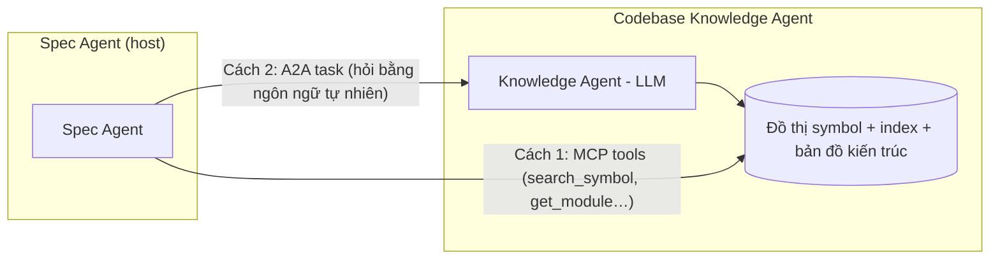
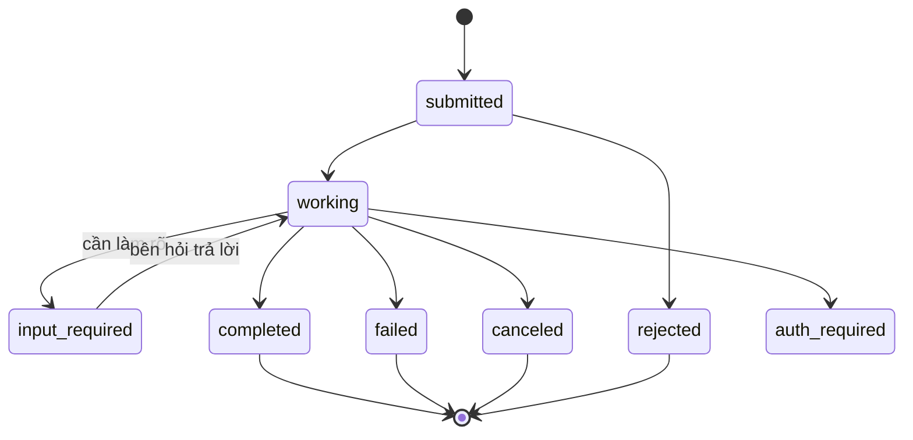
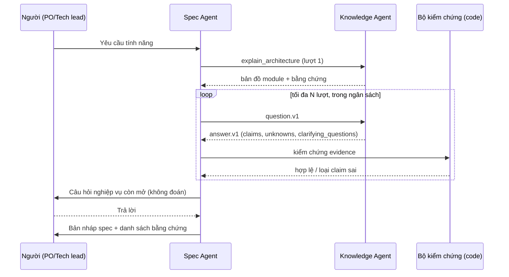

# Giao tiếp giữa agent: MCP và A2A

**Mục đích:** hiểu MCP (nối agent với tool/dữ liệu) và A2A (agent nói chuyện với agent). Thiết kế "Codebase Knowledge Agent" theo cả hai cách, và giao thức hỏi đáp giữa Spec Agent và Knowledge Agent: schema câu hỏi/câu trả lời có bằng chứng, giới hạn vòng, chống lặp, bảo mật. Phần cuối nói khi nào A2A là thừa.
**Liên quan:** [01-nen-tang-llm-va-agent.md](01-nen-tang-llm-va-agent.md) · [06-dau-ra-ban-do-kien-truc.md](06-dau-ra-ban-do-kien-truc.md) · [08-spec-trong-source-code.md](08-spec-trong-source-code.md) · [09-quan-tri-governance.md](09-quan-tri-governance.md) · [10-kien-truc-tham-chieu-va-lo-trinh.md](10-kien-truc-tham-chieu-va-lo-trinh.md)

> MCP và A2A đều là giao thức còn đang phát triển, có nhiều bản sửa đổi. Tên method, trường JSON và đường dẫn discovery trong file này dựa trên các bản spec gần đây. **Kiểm tra spec hiện hành** (modelcontextprotocol.io, a2a-protocol.org) trước khi cài đặt.

---

## 1. MCP và A2A khác nhau thế nào

| | **MCP** (Model Context Protocol) | **A2A** (Agent2Agent) |
|---|---|---|
| Kết nối | Ứng dụng AI (host) ↔ **tool/dữ liệu** (server) | **Agent ↔ agent**, có thể khác tổ chức, khác framework |
| Đối tác bên kia | Không có "trí tuệ" riêng: hàm, tài nguyên, prompt mẫu | Có trí tuệ riêng: tự suy luận, có thể chạy lâu, hỏi lại |
| Đơn vị tương tác | Gọi tool (đồng bộ, kết quả ngay) | **Task** có vòng đời (đang làm, cần thêm thông tin, xong, lỗi) |
| Bên gọi thấy gì | Định nghĩa từng tool (schema) | **Agent Card**: mô tả kỹ năng, không lộ chi tiết bên trong |
| Truyền tải | stdio (cục bộ) hoặc Streamable HTTP | JSON-RPC 2.0 qua HTTP(S), stream bằng SSE, push notification qua webhook |
| Hợp khi | Cho agent **khả năng** tra cứu/hành động | Giao **việc** cho một agent chuyên môn khác |

Ví von: MCP là **công cụ trong hộp đồ nghề** của một người thợ. A2A là **hai người thợ trao đổi** với nhau.



- **Cách 1 (MCP):** Spec Agent tự tra cứu bằng tool. Rẻ, minh bạch, Spec Agent tự suy luận.
- **Cách 2 (A2A):** Spec Agent hỏi, Knowledge Agent tự tra cứu và tổng hợp rồi trả lời có bằng chứng. Hợp khi Knowledge Agent do team khác sở hữu, hoặc câu hỏi cần nhiều bước chuyên sâu.

## 2. MCP – những gì cần biết

**Thành phần:**

| Vai trò | Ý nghĩa | Ví dụ |
|---|---|---|
| **Host** | Ứng dụng AI người dùng chạy | Claude Code, Claude Desktop, ứng dụng của bạn |
| **Client** | Kết nối 1-1 từ host tới một server | Một client cho mỗi MCP server |
| **Server** | Cung cấp khả năng | `codebase-knowledge` MCP server |

**Ba loại "primitive" phía server:**

| Primitive | Ai điều khiển | Dùng cho |
|---|---|---|
| **Tools** | Mô hình quyết định gọi | `search_symbol`, `impact_of_change` |
| **Resources** | Ứng dụng/người dùng chọn đưa vào ngữ cảnh | `arch://learnhub/map` (bản đồ kiến trúc), `module://exams` |
| **Prompts** | Người dùng chọn (như lệnh slash) | Mẫu "phân tích tác động của tính năng" |

Phía client có thể cung cấp thêm cho server: *sampling* (server nhờ host gọi LLM), *roots* (thư mục được phép), *elicitation* (server hỏi người dùng thêm thông tin).

**Transport:**

| Transport | Khi nào |
|---|---|
| **stdio** | Server chạy như tiến trình con trên cùng máy (công cụ cục bộ của developer) |
| **Streamable HTTP** | Server từ xa, nhiều người dùng; xác thực bằng OAuth 2.1 theo spec MCP cho HTTP |

Gắn MCP server vào Claude Code (cục bộ):

```powershell
claude mcp add codebase-knowledge -- python -m codeintel.mcp_server --repo D:\src\learnhub
claude mcp list
```

Messages API cũng có MCP connector (beta): khai báo `mcp_servers` **và** một mục `mcp_toolset` trong `tools`. Thiếu một trong hai sẽ bị từ chối. Kiểm tra beta header hiện hành trong tài liệu.

## 3. A2A – những gì cần biết

| Khái niệm | Ý nghĩa |
|---|---|
| **Agent Card** | File JSON công bố danh tính, endpoint, kỹ năng, cách xác thực. Thường đặt ở `/.well-known/agent-card.json` (các bản cũ dùng `agent.json`, nên kiểm tra spec hiện hành) |
| **Task** | Một đơn vị công việc có ID và trạng thái |
| **Message** | Lượt trao đổi (`role`: `user` hoặc `agent`), gồm nhiều **Part** |
| **Part** | `text` (văn bản), `file` (tệp), `data` (JSON có cấu trúc). **Dùng `data` cho hợp đồng có schema** |
| **Artifact** | Kết quả đầu ra của task (ví dụ bản trả lời có bằng chứng) |
| **Streaming / push** | Theo dõi task dài qua SSE, hoặc webhook khi client không giữ kết nối |

**Vòng đời task** (tên trạng thái theo spec gần đây; kiểm tra spec hiện hành):



Các method JSON-RPC chính: `message/send` (gửi và nhận kết quả hoặc task), `message/stream` (nhận cập nhật qua SSE), `tasks/get`, `tasks/cancel`, cùng nhóm method cấu hình push notification.

## 4. Thiết kế Codebase Knowledge Agent

### 4.1 Mặt MCP: bộ tool

| Tool | Đầu vào | Đầu ra (gọn) | Dùng khi |
|---|---|---|---|
| `search_symbol` | `query`, `kind`, `module?`, `limit` | Danh sách `{symbol_id, path, line, signature, summary}` | Biết (một phần) tên |
| `get_module` | `module` | Trách nhiệm, API công khai, phụ thuộc vào/ra, bảng dữ liệu, file chính | Hiểu một module |
| `explain_architecture` | `level`: `system` hoặc `module` | Bản đồ kiến trúc (xem [06-dau-ra-ban-do-kien-truc.md](06-dau-ra-ban-do-kien-truc.md)) | Bắt đầu phiên, cần bức tranh tổng |
| `impact_of_change` | `symbol_ids[]` hoặc `description` | Người gọi trực tiếp/gián tiếp, module bị ảnh hưởng, test liên quan, bảng DB, sự kiện | Đánh giá phạm vi thay đổi |
| `find_tests` | `symbol_id` | Test bao phủ symbol và mức độ | Lập kế hoạch kiểm thử |
| `cite` | `symbol_id` hoặc `path`, `start`, `end` | Đoạn code chính xác + commit | Lấy bằng chứng nguyên văn |

Mọi kết quả kèm `commit` và `truncated`. Mọi tool **chỉ đọc**.

### 4.2 Mặt A2A: Agent Card

```json
{
  "name": "LearnHub Codebase Knowledge Agent",
  "description": "Trả lời câu hỏi về kiến trúc, module, luồng xử lý và tác động thay đổi của codebase LearnHub. Mọi khẳng định kèm bằng chứng path:line@commit.",
  "url": "https://codeintel.internal.example/a2a",
  "version": "1.2.0",
  "protocolVersion": "<kiểm tra spec hiện hành>",
  "capabilities": { "streaming": true, "pushNotifications": false },
  "defaultInputModes": ["application/json", "text/plain"],
  "defaultOutputModes": ["application/json"],
  "securitySchemes": {
    "oauth": { "type": "oauth2", "flows": { "clientCredentials": { "tokenUrl": "https://auth.internal.example/token", "scopes": { "codeintel.read": "Đọc tri thức codebase" } } } }
  },
  "security": [{ "oauth": ["codeintel.read"] }],
  "skills": [
    {
      "id": "answer_codebase_question",
      "name": "Trả lời câu hỏi về codebase",
      "description": "Câu hỏi về vị trí, luồng xử lý, trách nhiệm module. Đầu vào/đầu ra theo schema question.v1 / answer.v1.",
      "tags": ["architecture", "code-search"],
      "examples": ["Luồng nộp bài từ API tới chấm điểm đi qua những module nào?"]
    },
    {
      "id": "impact_analysis",
      "name": "Phân tích tác động thay đổi",
      "description": "Cho mô tả thay đổi, trả về module, symbol, test, bảng dữ liệu bị ảnh hưởng kèm bằng chứng.",
      "tags": ["impact", "scope"]
    }
  ]
}
```

> Domain trong ví dụ là giả định. Kiểm tra tên trường chính xác của Agent Card theo spec hiện hành.

## 5. Giao thức hỏi đáp Spec Agent ↔ Knowledge Agent

Giao thức đi kèm (MCP hay A2A) chỉ là đường truyền. **Hợp đồng nội dung** mới quyết định chất lượng. Đặt hợp đồng trong `data` part (A2A) hoặc trong input/output schema của tool (MCP).

### 5.1 Schema câu hỏi (`question.v1`)

```json
{
  "$id": "question.v1",
  "type": "object",
  "properties": {
    "schema_version": {"const": "question.v1"},
    "conversation_id": {"type": "string"},
    "turn": {"type": "integer", "minimum": 1},
    "repo": {"type": "string"},
    "commit": {"type": "string", "description": "SHA cố định cho cả cuộc hội thoại"},
    "intent": {"type": "string", "enum": ["locate", "explain_flow", "module_overview", "impact", "constraints", "tests"]},
    "question": {"type": "string", "maxLength": 2000},
    "context": {
      "type": "object",
      "properties": {
        "feature": {"type": "string"},
        "known_facts": {"type": "array", "items": {"type": "string"}},
        "symbols_of_interest": {"type": "array", "items": {"type": "string"}}
      },
      "additionalProperties": false
    },
    "budget": {
      "type": "object",
      "properties": {
        "max_tool_calls": {"type": "integer", "maximum": 40},
        "deadline_seconds": {"type": "integer", "maximum": 300}
      },
      "required": ["max_tool_calls", "deadline_seconds"],
      "additionalProperties": false
    }
  },
  "required": ["schema_version", "conversation_id", "turn", "repo", "commit", "intent", "question", "budget"],
  "additionalProperties": false
}
```

### 5.2 Schema câu trả lời (`answer.v1`)

```json
{
  "$id": "answer.v1",
  "type": "object",
  "properties": {
    "schema_version": {"const": "answer.v1"},
    "conversation_id": {"type": "string"},
    "turn": {"type": "integer"},
    "commit": {"type": "string"},
    "status": {"type": "string", "enum": ["answered", "partial", "needs_clarification", "out_of_scope"]},
    "summary": {"type": "string", "maxLength": 1500},
    "claims": {
      "type": "array",
      "items": {
        "type": "object",
        "properties": {
          "id": {"type": "string"},
          "text": {"type": "string"},
          "kind": {"type": "string", "enum": ["fact", "inference"]},
          "confidence": {"type": "string", "enum": ["high", "medium", "low"]},
          "evidence": {
            "type": "array",
            "items": {
              "type": "object",
              "properties": {
                "symbol_id": {"type": "string"},
                "path": {"type": "string"},
                "start_line": {"type": "integer"},
                "end_line": {"type": "integer"}
              },
              "required": ["path", "start_line", "end_line"],
              "additionalProperties": false
            }
          }
        },
        "required": ["id", "text", "kind", "confidence", "evidence"],
        "additionalProperties": false
      }
    },
    "unknowns": {"type": "array", "items": {"type": "string"}},
    "clarifying_questions": {"type": "array", "items": {"type": "string"}, "maxItems": 3},
    "usage": {
      "type": "object",
      "properties": {"tool_calls": {"type": "integer"}, "input_tokens": {"type": "integer"}, "output_tokens": {"type": "integer"}},
      "additionalProperties": false
    }
  },
  "required": ["schema_version", "conversation_id", "turn", "commit", "status", "summary", "claims", "unknowns"],
  "additionalProperties": false
}
```

Quy tắc: `kind: "fact"` **bắt buộc** có ít nhất một `evidence`. `inference` được phép không có bằng chứng trực tiếp, nhưng phải có `confidence` và không được dùng làm cơ sở duy nhất cho yêu cầu trong spec.

### 5.3 Quy tắc hội thoại

| Quy tắc | Giá trị đề xuất | Lý do |
|---|---|---|
| Cố định `commit` cho cả hội thoại | Bắt buộc | Câu trả lời giữa các lượt nhất quán |
| Số lượt tối đa mỗi hội thoại | 8–12 | Chặn vòng lặp vô tận |
| Ngân sách mỗi câu hỏi | ≤ 40 tool call, ≤ 300 giây | Kiểm soát chi phí |
| Câu hỏi làm rõ ngược lại | Tối đa 3 mỗi lượt; Spec Agent trả lời hoặc chuyển cho người | Tránh hai agent hỏi qua hỏi lại |
| Phát hiện lặp | Băm câu hỏi đã chuẩn hóa; câu trùng lần 2 thì trả lại câu trả lời cũ, lần 3 thì dừng và báo người | Agent hay hỏi lại cùng một ý |
| Cache câu trả lời | Khóa `(repo, commit, intent, câu hỏi chuẩn hóa)` | Nhiều spec hỏi cùng câu |
| Hết ngân sách | Trả `status: "partial"` kèm `unknowns`, không im lặng | Bên hỏi biết phần nào chưa chắc |
| Bên hỏi kiểm chứng | Spec Agent kiểm tra máy móc mọi `evidence` trước khi dùng | Không tin mù đầu ra của agent khác |



## 6. Ví dụ hội thoại: "Thêm tính năng nộp bài trễ có trừ điểm"

**Lượt 1: Spec Agent → Knowledge Agent** (intent `module_overview`)

```json
{"schema_version": "question.v1", "conversation_id": "c-42", "turn": 1,
 "repo": "learnhub", "commit": "<commit_sha>", "intent": "module_overview",
 "question": "Tóm tắt các module liên quan tới làm bài, nộp bài và chấm điểm.",
 "context": {"feature": "Nộp bài trễ có trừ điểm"},
 "budget": {"max_tool_calls": 20, "deadline_seconds": 120}}
```

**Trả lời** (rút gọn):

```json
{"schema_version": "answer.v1", "conversation_id": "c-42", "turn": 1, "commit": "<commit_sha>",
 "status": "answered",
 "summary": "Luồng gồm exams (cấu hình đề, attempt, nộp bài), grading (chấm tự động, chấm tay, sandbox C++ cho bài code) và notifications. Nộp bài đi qua SubmitService.submit, sau đó phát sự kiện để grading xử lý bất đồng bộ.",
 "claims": [
   {"id": "k1", "text": "Nộp bài được xử lý tại SubmitService.submit.", "kind": "fact", "confidence": "high",
    "evidence": [{"symbol_id": "sym:ts:src/exams/submit.service.ts#SubmitService.submit", "path": "src/exams/submit.service.ts", "start_line": 41, "end_line": 97}]},
   {"id": "k2", "text": "Hiện tại nộp sau deadline bị từ chối với mã LATE_SUBMISSION_NOT_ALLOWED.", "kind": "fact", "confidence": "high",
    "evidence": [{"path": "src/exams/submit.service.ts", "start_line": 58, "end_line": 63}]},
   {"id": "k3", "text": "Điểm cuối cùng được tính trong grading, không ở exams.", "kind": "fact", "confidence": "medium",
    "evidence": [{"symbol_id": "sym:ts:src/grading/score.service.ts#ScoreService.finalize", "path": "src/grading/score.service.ts", "start_line": 12, "end_line": 55}]}
 ],
 "unknowns": ["Không tìm thấy cấu hình chính sách trễ theo từng đề thi."],
 "clarifying_questions": []}
```

**Lượt 2: Spec Agent hỏi tác động** (intent `impact`)

> "Nếu cho phép nộp trễ trong một khoảng ân hạn và trừ điểm theo phút trễ, những symbol, bảng dữ liệu, sự kiện và test nào bị ảnh hưởng?"

**Trả lời** (ý chính):

- `fact` (high): bảng `exam_configs` chưa có cột chính sách trễ (bằng chứng: file migration, path:line).
- `fact` (high): `SubmitService.submit` cần đổi nhánh từ chối thành ghi nhận `late_by_seconds`.
- `fact` (medium): `ScoreService.finalize` là chỗ áp dụng hệ số trừ hợp lý vì đã là nơi tính điểm cuối.
- `fact` (high): sự kiện `submission.created` được consumer grading xử lý; payload cần thêm `late_by_seconds` (bằng chứng: định nghĩa schema sự kiện).
- `fact` (high): test bị ảnh hưởng: `submit.service.spec.ts` (ca "từ chối khi trễ" sẽ đổi kỳ vọng), `score.service.spec.ts`.
- `inference` (low): sandbox C++ không bị ảnh hưởng vì chỉ nhận mã nguồn và trả kết quả chạy.
- `unknowns`: "Chưa rõ trừ điểm áp dụng trước hay sau khi giáo viên chấm tay."
- `clarifying_questions`: "Áp dụng cho mọi loại đề hay chỉ bài tập về nhà?"

**Lượt 3: Spec Agent không đoán câu hỏi nghiệp vụ.** Nó chuyển hai câu hỏi mở cho PO. Đây là điểm quan trọng: **câu hỏi nghiệp vụ thuộc về người**, câu hỏi kỹ thuật thuộc về Knowledge Agent.

**Kết quả cho spec** (xem [08-spec-trong-source-code.md](08-spec-trong-source-code.md)): mỗi yêu cầu kỹ thuật trong spec dẫn tới claim `k1`… và bằng chứng `path:line@commit`. Claim `inference` được đánh dấu "cần xác nhận".

## 7. Bảo mật giữa các agent

| Rủi ro | Biện pháp |
|---|---|
| Agent giả mạo gọi vào | Xác thực hai chiều: OAuth client credentials hoặc mTLS; chỉ chấp nhận danh tính đã đăng ký |
| Quyền quá rộng | Scope chỉ đọc (`codeintel.read`); phân quyền theo repo (team A không hỏi được repo team B) |
| Đầu ra của agent khác chứa chỉ dẫn độc hại | **Coi output của agent khác là dữ liệu không tin cậy**: chỉ đọc các trường theo schema, không thực thi chỉ dẫn trong văn bản, kiểm chứng `evidence` bằng code |
| Prompt injection từ code (comment) đi qua Knowledge Agent | Knowledge Agent không có tool ghi; bên hỏi không cho output kích hoạt hành động ghi khi chưa có người duyệt |
| Lộ code ra ngoài | Knowledge Agent trả trích đoạn có giới hạn độ dài; log truy cập; giữ trong mạng nội bộ |
| Tấn công từ chối dịch vụ / chi phí | Rate limit theo client; ngân sách mỗi task; hủy task quá hạn |
| Không truy vết được | Log mọi task: ai hỏi, câu hỏi, commit, tool đã gọi, token, kết quả kiểm chứng |

## 8. Khi nào A2A là thừa

| Tình huống | Chọn |
|---|---|
| Một team, dùng Claude Code, repo cục bộ | **Subagent + MCP server cục bộ** (stdio). Không cần A2A |
| Nhiều team cùng dùng tri thức một codebase, cùng công ty | **MCP server từ xa** (Streamable HTTP + OAuth). Spec Agent tự gọi tool |
| Knowledge Agent do team/tổ chức khác sở hữu, chạy framework khác, cần giao việc dài hạn có trạng thái | **A2A** |
| Cần "chuyên gia" tự suy luận nhiều bước, bên hỏi không nên biết chi tiết tool bên trong | **A2A** (hoặc gói thành một tool MCP cấp cao `ask_codebase`) |

**Khuyến nghị lộ trình:** bắt đầu bằng MCP server (tool chỉ đọc + resource bản đồ kiến trúc) dùng trong Claude Code. Thêm tool cấp cao `ask_codebase` (bên trong là Knowledge Agent) khi câu hỏi phức tạp. Chỉ triển khai A2A khi có nhu cầu liên team/liên hệ thống thật. **Hợp đồng `question.v1`/`answer.v1` dùng chung cho cả ba giai đoạn**, nên chuyển đổi không phải viết lại.

## 9. Lỗi thường gặp

| Lỗi | Hậu quả |
|---|---|
| Dùng A2A cho việc một tool MCP làm được | Thêm độ trễ, chi phí, điểm hỏng |
| Trả lời bằng văn bản tự do, không schema | Bên hỏi không kiểm chứng được, spec chứa khẳng định bịa |
| Không cố định commit | Hai lượt trả lời theo hai phiên bản code khác nhau |
| Hai agent hỏi qua hỏi lại vô hạn | Tốn tiền, không ra kết quả |
| Knowledge Agent tự trả lời câu hỏi nghiệp vụ | Spec chứa quyết định kinh doanh không ai phê duyệt |
| Tin output của agent khác như chỉ dẫn | Prompt injection lan truyền giữa các agent |
| Cấp tool ghi cho Knowledge Agent "cho tiện" | Một prompt injection có thể sửa code |

## Checklist review

- [ ] Đã giải thích vì sao chọn MCP, A2A hay subagent (mục 8); không dùng A2A khi MCP đủ.
- [ ] Tool MCP chỉ đọc, ít, mô tả rõ, kết quả gọn có `commit` và `truncated`.
- [ ] Hợp đồng `question`/`answer` có version, `additionalProperties: false`, `unknowns`, `evidence` bắt buộc cho `fact`.
- [ ] Hội thoại cố định `commit`; có giới hạn lượt, ngân sách mỗi câu, deadline, phát hiện lặp, trạng thái `partial` khi hết ngân sách.
- [ ] Bên hỏi kiểm chứng máy móc mọi `evidence` trước khi dùng; claim `inference` được đánh dấu cần xác nhận.
- [ ] Câu hỏi nghiệp vụ được chuyển cho người, không để agent tự quyết.
- [ ] Xác thực giữa các agent (OAuth/mTLS), scope tối thiểu, phân quyền theo repo, rate limit.
- [ ] Output của agent khác được xử lý như dữ liệu không tin cậy; không kích hoạt hành động ghi khi chưa có người duyệt.
- [ ] Log đầy đủ cho mỗi task/câu hỏi: người gọi, commit, tool, token, kết quả kiểm chứng.
- [ ] Tên method/trường A2A và MCP đã đối chiếu với spec hiện hành.
