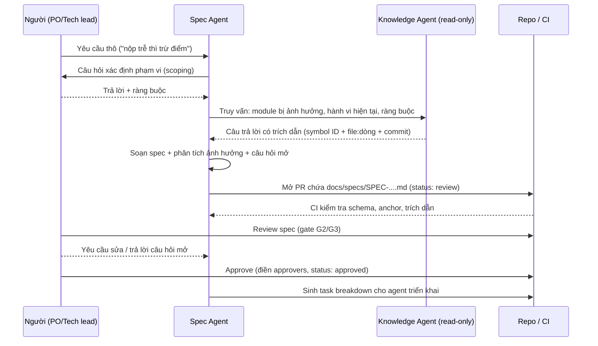

# Spec trong source code (spec-as-code) và pipeline của Spec Agent

**Mục đích:** đặt spec ngay trong repo, gắn với code bằng "code anchor" bền vững. Tài liệu mô tả Spec Agent từ lúc nhận yêu cầu đến lúc có spec đã duyệt và danh sách task cho agent triển khai. Spec Agent hỏi Knowledge Agent (qua A2A/MCP) để mọi khẳng định về hệ thống hiện tại đều có trích dẫn code.

**Liên quan:** [06-dau-ra-ban-do-kien-truc.md](06-dau-ra-ban-do-kien-truc.md) · [07-giao-tiep-a2a-va-mcp.md](07-giao-tiep-a2a-va-mcp.md) · [09-quan-tri-governance.md](09-quan-tri-governance.md) · [10-kien-truc-tham-chieu-va-lo-trinh.md](10-kien-truc-tham-chieu-va-lo-trinh.md) · [11-checklist-review-he-thong-agent.md](11-checklist-review-he-thong-agent.md) · [../02-quy-trinh-phan-mem/02-yeu-cau-srs-prd.md](../02-quy-trinh-phan-mem/02-yeu-cau-srs-prd.md) · [../02-quy-trinh-phan-mem/09-checklist-phe-duyet.md](../02-quy-trinh-phan-mem/09-checklist-phe-duyet.md) · [../04-mau/srs-template.md](../04-mau/srs-template.md)

---

## 1. Tại sao đặt spec trong source code

| Spec ở ngoài (Confluence, Google Docs) | Spec trong repo (spec-as-code) |
|---|---|
| Lệch với code sau vài sprint, không ai biết | CI phát hiện được khi code anchor không còn tồn tại |
| Agent triển khai không đọc được, hoặc đọc bản cũ | Agent đọc cùng commit với code nó sửa |
| Review spec tách khỏi review code | Spec và code cùng đi qua PR, cùng lịch sử Git |
| Không truy vết được spec → commit → test | `git log`, front-matter và bảng truy vết nối mọi thứ |

Spec trong repo **không thay thế** BRD cho stakeholder kinh doanh. BRD có thể vẫn nằm ngoài. Thứ nằm trong repo là spec kỹ thuật (SRS/feature spec), ADR và kế hoạch triển khai — những thứ agent cần đọc để làm đúng.

## 2. Spec nằm ở đâu trong repo

| Vị trí | Dùng cho | Ghi chú |
|---|---|---|
| `docs/specs/<SPEC-ID>-<slug>.md` | Spec tính năng xuyên module | Mặc định đơn giản nhất |
| `docs/okf/` (skill `aiic-astec:okf-docs` của repo này) | Spec, plan, ADR, verify, review có ID ổn định, `INDEX.md`, bản ghi bằng chứng, **chữ ký chỉ do người** | Nên dùng nếu dự án đã cài plugin `aiic-astec` — có sẵn validator |
| `src/modules/<module>/SPEC.md` | Hợp đồng nội bộ một module (bất biến, API công khai của module) | Ngắn, sống lâu, cập nhật cùng code module |
| `docs/adr/ADR-<n>-<slug>.md` | Quyết định kiến trúc | Spec tham chiếu ADR, không lặp nội dung |
| `ARCHITECTURE.md` / `docs/codebase-map.json` | Bản đồ kiến trúc do Knowledge Agent sinh | Xem [06-dau-ra-ban-do-kien-truc.md](06-dau-ra-ban-do-kien-truc.md); spec ghi rõ SHA của bản đồ đã dùng |

Quy tắc: **một spec = một file = một ID không đổi**. Đổi tên file được, đổi ID thì không. Spec bị thay thế thì giữ lại với `status: superseded` và trường `superseded_by`.

## 3. Front-matter của spec

```yaml
---
id: SPEC-EXAM-014                 # ổn định, không tái sử dụng
title: Nộp bài trễ có trừ điểm
status: review                    # draft | review | approved | implemented | superseded
version: 3                        # tăng khi nội dung đổi sau review
owners:
  product: <po-handle>
  tech: <tech-lead-handle>
approvers: []                     # CHỈ người điền, agent không được ghi vào đây
related:
  br: [BR-EXAM-07]
  fr: [FR-EXAM-21, FR-EXAM-22]
  adr: [ADR-012]
code_anchors:                     # symbol ID, không phải số dòng (xem mục 6)
  - "ts:src/modules/exams/attempt.service.ts#AttemptService.submit"
  - "ts:src/modules/grading/score.ts#computeFinalScore"
  - "sql:migrations/0042_exam_attempts.sql#table:exam_attempts"
grounding:
  codebase_map_sha: 9f3c2e1       # commit mà Knowledge Agent đã index
  knowledge_agent_version: ka-1.4.0
  generated_by: spec-agent-0.7.2 / claude-opus-5-5
open_questions: 2                 # > 0 thì không được chuyển sang approved
---
```

Tại sao cần `grounding`: khi spec được duyệt ở commit A nhưng triển khai ở commit B, reviewer cần biết các trích dẫn được lấy từ trạng thái code nào. Thiếu thông tin này thì không tái lập được lập luận của agent (xem [09-quan-tri-governance.md](09-quan-tri-governance.md) mục 3).

## 4. Pipeline Spec Agent từ đầu đến cuối



### 4.1. Intake — chuẩn hóa yêu cầu

Đầu vào là một câu, một ticket, hoặc một đoạn BRD. Spec Agent chuyển nó thành bản ghi có cấu trúc:

```json
{
  "request_id": "REQ-2026-0193",
  "raw_text": "Học sinh nộp bài sau hạn thì bị trừ điểm theo số phút trễ",
  "source": "ticket",
  "requester_role": "product_owner",
  "linked_ids": ["BR-EXAM-07"]
}
```

### 4.2. Câu hỏi xác định phạm vi (cho người)

Agent **không đoán** các quyết định nghiệp vụ. Nó hỏi trước khi truy vấn code để tránh tốn công phân tích sai hướng. Ví dụ:

1. Áp dụng cho mọi loại bài (trắc nghiệm, tự luận, bài code) hay chỉ một loại?
2. Công thức trừ: theo phút, theo bậc (0–10 phút −10%), hay do giáo viên cấu hình?
3. Có mức trễ tối đa mà sau đó không nhận bài không?
4. Bài đã chấm trước khi tính năng ra mắt có bị tính lại không?

Câu nào người chưa trả lời thì ghi vào `open_questions`. Spec còn câu hỏi mở thì không được duyệt.

### 4.3. Truy vấn Knowledge Agent

Spec Agent gửi các câu hỏi **hẹp và kiểm chứng được**, không gửi "giải thích toàn bộ hệ thống". Hợp đồng đầu ra mong đợi (chi tiết giao thức ở [07-giao-tiep-a2a-va-mcp.md](07-giao-tiep-a2a-va-mcp.md)):

```json
{
  "$schema": "https://json-schema.org/draft/2020-12/schema",
  "title": "KnowledgeAnswer",
  "type": "object",
  "additionalProperties": false,
  "required": ["question_id", "answer", "claims", "confidence", "index_commit"],
  "properties": {
    "question_id": {"type": "string"},
    "answer": {"type": "string"},
    "claims": {
      "type": "array",
      "items": {
        "type": "object",
        "additionalProperties": false,
        "required": ["statement", "evidence"],
        "properties": {
          "statement": {"type": "string"},
          "evidence": {
            "type": "array", "minItems": 1,
            "items": {
              "type": "object",
              "additionalProperties": false,
              "required": ["symbol_id", "path", "start_line", "end_line"],
              "properties": {
                "symbol_id": {"type": "string"},
                "path": {"type": "string"},
                "start_line": {"type": "integer"},
                "end_line": {"type": "integer"}
              }
            }
          }
        }
      }
    },
    "confidence": {"enum": ["high", "medium", "low"]},
    "unknowns": {"type": "array", "items": {"type": "string"}},
    "index_commit": {"type": "string"}
  }
}
```

Các câu hỏi điển hình cho một tính năng:

| Loại câu hỏi | Ví dụ |
|---|---|
| Module bị ảnh hưởng | "Những module nào đọc hoặc ghi `exam_attempts.submitted_at`?" |
| Hành vi hiện tại | "Khi nộp sau `deadline_at`, `AttemptService.submit` làm gì?" |
| Ràng buộc | "Điểm cuối cùng được tính ở đâu và có được cache không?" |
| Hợp đồng ra ngoài | "API nào trả điểm cho client, schema response là gì?" |
| Test hiện có | "Test nào bao phủ `computeFinalScore`?" |
| Sự kiện bất đồng bộ | "Sự kiện nào được phát sau khi nộp bài, ai tiêu thụ?" |

### 4.4. Soạn spec có trích dẫn

Mọi câu trong mục "Hành vi hiện tại" phải có ít nhất một trích dẫn. Một câu không có trích dẫn thì phải đánh dấu `[GIẢ ĐỊNH]`, hoặc chuyển thành câu hỏi mở.

### 4.5. Phân tích ảnh hưởng (impact analysis)

Spec Agent dùng đồ thị symbol (xem [04-linker-do-thi-symbol.md](04-linker-do-thi-symbol.md)) để liệt kê:

| Loại | Cách tìm |
|---|---|
| File/symbol | Caller và callee bắc cầu từ anchor, giới hạn độ sâu (ví dụ 2) |
| Bảng/cột DB | Cạnh `reads`/`writes` từ symbol đến bảng trong đồ thị |
| API | Route handler có đường gọi tới anchor |
| Test | Cạnh `tests` từ file test tới symbol |
| Sự kiện/hàng đợi | Producer/consumer theo tên topic |

Kết quả là một bảng trong spec. Reviewer đối chiếu bảng này với diff khi PR triển khai đến: diff đụng file **ngoài** bảng là dấu hiệu lệch phạm vi.

### 4.6. Gate duyệt của người

Spec đi qua PR như code. Agent mở PR với `status: review`. **Chỉ người** chuyển sang `approved` và điền `approvers`. CI chặn PR nếu `approvers` thay đổi trong commit có trailer của agent. Đây là cùng nguyên tắc với sign-off chỉ do người của `okf-docs` (xem mục 9).

### 4.7. Chia task cho agent triển khai

Từ spec đã duyệt, Spec Agent sinh danh sách task. Mỗi task phải nhỏ, độc lập, kiểm chứng được (xem [../02-quy-trinh-phan-mem/04-lap-ke-hoach.md](../02-quy-trinh-phan-mem/04-lap-ke-hoach.md)):

```json
{
  "spec_id": "SPEC-EXAM-014",
  "spec_version": 3,
  "tasks": [
    {
      "id": "T1",
      "title": "Thêm cột late_penalty_policy vào exams (expand)",
      "allowed_paths": ["migrations/", "src/modules/exams/exam.entity.ts"],
      "acceptance": ["AC-5"],
      "verify": ["npm run migrate:check", "npm test -- exams/exam.entity"],
      "depends_on": []
    },
    {
      "id": "T2",
      "title": "computeLatePenalty thuần (pure function) + unit test",
      "allowed_paths": ["src/modules/grading/"],
      "acceptance": ["AC-1", "AC-2", "AC-3"],
      "verify": ["npm test -- grading/late-penalty"],
      "depends_on": []
    }
  ]
}
```

`allowed_paths` trở thành phạm vi trong brief giao cho Claude Code chạy trong worktree riêng (xem [../01-claude-cli-multi-agent/02-worktree.md](../01-claude-cli-multi-agent/02-worktree.md)).

## 5. Mẫu spec tối ưu cho agent đọc

Khác với SRS cho người (xem [../04-mau/srs-template.md](../04-mau/srs-template.md)), spec cho agent cần: mục cố định, câu ngắn, mỗi khẳng định có bằng chứng, và phân biệt rõ "hiện tại" với "đề xuất".

```markdown
# <ID>: <Tiêu đề>

## 1. Bối cảnh
<2–4 câu: vấn đề nghiệp vụ, liên kết BR/FR.>

## 2. Mục tiêu
- G1: ...

## 3. Ngoài phạm vi (non-goals)
- NG1: ...   ← agent triển khai KHÔNG được làm những điều này

## 4. Hành vi hiện tại (có bằng chứng)
| # | Khẳng định | Bằng chứng (symbol @ commit) |
|---|---|---|

## 5. Hành vi đề xuất
<Mô tả + sơ đồ nếu cần.>

## 6. Thay đổi API
<Endpoint, request/response trước/sau, tương thích ngược.>

## 7. Thay đổi dữ liệu
<DDL, migration theo expand/contract, backfill.>

## 8. Tiêu chí chấp nhận (Given/When/Then)
- AC-1: Given ... When ... Then ...

## 9. Kế hoạch test
<Unit/integration/E2E, test nào mới, test nào sửa.>

## 10. Phân tích ảnh hưởng
| Loại | Mục | Thay đổi? |

## 11. Rủi ro và cách giảm
## 12. Triển khai (rollout) và rollback
## 13. Câu hỏi mở
## 14. Truy vết
| BR | FR | AC | Task | Test |
```

## 6. Code anchor: trỏ vào code sao cho không gãy khi code đổi

Số dòng thay đổi sau mỗi lần sửa. Spec chỉ trỏ bằng `file:dòng` thì sẽ sai sau một tuần. Anchor nên là **symbol ID** do bộ index sinh ra; số dòng chỉ là thông tin phụ, gắn với commit.

| Dạng anchor | Ví dụ | Bền? | Ghi chú |
|---|---|---|---|
| `file:dòng` | `attempt.service.ts:88` | Kém | Chỉ dùng kèm SHA commit |
| Đường dẫn + tên symbol | `ts:src/modules/exams/attempt.service.ts#AttemptService.submit` | Tốt | Gãy khi đổi tên/di chuyển — đúng lúc cần review lại |
| Symbol SCIP | `scip-typescript npm learnhub 1.0.0 src/modules/exams/attempt.service.ts/AttemptService#submit().` (minh họa, cú pháp chính xác xem đặc tả SCIP) | Rất tốt | Cần index SCIP (xem [04-linker-do-thi-symbol.md](04-linker-do-thi-symbol.md)) |
| Đối tượng DB | `sql:...#table:exam_attempts.column:submitted_at` | Tốt | Lấy từ migration/schema dump |
| API | `http:POST /v1/exams/{id}/attempts/{attemptId}/submit` | Tốt | Lấy từ OpenAPI |

### CI kiểm tra anchor và độ cũ của spec

Trên mỗi PR, chạy một script (bản phác thảo, không phải code chạy ngay):

```python
# pseudo-code: tools/spec_check.py
for spec in load_specs("docs/specs/**/*.md"):
    validate_front_matter(spec, schema="schemas/spec.schema.json")
    for anchor in spec.code_anchors:
        if not symbol_index.resolve(anchor, at="HEAD"):
            fail(f"{spec.id}: anchor không còn tồn tại: {anchor}")
    if spec.status in ("approved", "implemented"):
        changed = git_changed_symbols(since=spec.grounding.codebase_map_sha)
        touched = set(spec.code_anchors) & changed
        if touched and not spec_updated_in_this_pr(spec):
            warn(f"{spec.id}: code của {sorted(touched)} đã đổi từ khi spec được viết — cần xem lại")
    if spec.status == "approved" and spec.open_questions > 0:
        fail(f"{spec.id}: approved nhưng còn câu hỏi mở")
```

Mức xử lý: anchor gãy → **fail**. Code dưới anchor thay đổi → **cảnh báo** và gắn nhãn PR `spec-may-be-stale`. Đừng fail cứng ở trường hợp thứ hai vì refactor nhỏ rất thường gặp.

## 7. Ví dụ hoàn chỉnh: SPEC-EXAM-014 "Nộp bài trễ có trừ điểm"

> Các đường dẫn, số dòng và commit dưới đây là **minh họa** cho codebase LearnHub giả định.

```markdown
---
id: SPEC-EXAM-014
title: Nộp bài trễ có trừ điểm
status: review
version: 3
related: { br: [BR-EXAM-07], fr: [FR-EXAM-21, FR-EXAM-22], adr: [ADR-012] }
code_anchors:
  - "ts:src/modules/exams/attempt.service.ts#AttemptService.submit"
  - "ts:src/modules/grading/score.ts#computeFinalScore"
  - "ts:src/modules/exams/exam.entity.ts#Exam"
  - "sql:migrations/0042_exam_attempts.sql#table:exam_attempts"
grounding: { codebase_map_sha: 9f3c2e1, knowledge_agent_version: ka-1.4.0 }
open_questions: 0
---

# SPEC-EXAM-014: Nộp bài trễ có trừ điểm

## 1. Bối cảnh
Giáo viên muốn nhận bài nộp trễ nhưng trừ điểm theo mức trễ (BR-EXAM-07). Hiện hệ thống từ chối
mọi bài nộp sau hạn, nên học sinh mất trắng điểm vì sự cố mạng ngắn.

## 2. Mục tiêu
- G1: Bài kiểm tra có thể bật "nhận nộp trễ" với chính sách trừ điểm theo bậc.
- G2: Điểm hiển thị cho học sinh ghi rõ điểm gốc, mức trừ, điểm cuối.

## 3. Ngoài phạm vi
- NG1: Không áp dụng cho bài code (grading sandbox C++) trong phiên bản này.
- NG2: Không tính lại điểm cho bài đã chấm trước ngày phát hành.
- NG3: Không thay đổi cơ chế hẹn giờ phía client.

## 4. Hành vi hiện tại
| # | Khẳng định | Bằng chứng |
|---|---|---|
| C1 | Server so `now()` với `attempt.deadline_at` và ném `AttemptExpiredError` nếu trễ | `AttemptService.submit` @9f3c2e1, attempt.service.ts:88-97 |
| C2 | `deadline_at` được tính một lần lúc bắt đầu làm bài = `started_at + exam.duration` (cắt ở `exam.window_end`) | `AttemptService.start` @9f3c2e1, attempt.service.ts:41-55 |
| C3 | Job `auto-submit-expired` tự nộp bài hết giờ, gọi `submit` với `force=true`, bỏ qua kiểm tra hạn | `AutoSubmitJob.run` @9f3c2e1, auto-submit.job.ts:20-38 |
| C4 | Điểm cuối = tổng điểm câu × trọng số, lưu vào `exam_attempts.final_score` | `computeFinalScore` @9f3c2e1, score.ts:12-30 |
| C5 | Sau khi nộp, phát sự kiện `exam.attempt.submitted`; module notifications tiêu thụ | `AttemptService.submit` attempt.service.ts:110; `SubmittedHandler` notifications/handlers.ts:15 |

## 5. Hành vi đề xuất
- Thêm vào `exams` cột `late_policy JSONB NULL`. NULL nghĩa là giữ nguyên hành vi cũ (từ chối).
- Ví dụ `late_policy`: `{"max_late_minutes": 60, "tiers": [{"up_to_min": 10, "penalty_pct": 10}, {"up_to_min": 60, "penalty_pct": 30}]}`.
- `submit`: nếu trễ và có `late_policy` và số phút trễ ≤ `max_late_minutes` → nhận bài, ghi `late_minutes`.
  Ngoài ra → giữ `AttemptExpiredError`.
- `computeFinalScore` → gọi hàm thuần mới `computeLatePenalty(rawScore, lateMinutes, policy)`.
- Số phút trễ tính bằng thời gian server, làm tròn lên đến phút: `ceil((submitted_at - deadline_at)/60s)`.
- Auto-submit (C3) KHÔNG bị tính trễ: bài tự nộp tại `deadline_at` có `late_minutes = 0`.

## 6. Thay đổi API
- `GET /v1/exams/{id}/attempts/{attemptId}/result` thêm trường (tương thích ngược, chỉ thêm):
  `raw_score`, `late_minutes`, `late_penalty_pct`. `final_score` giữ nguyên ý nghĩa "điểm cuối".
- `PATCH /v1/exams/{id}` nhận `late_policy` (chỉ vai trò teacher sở hữu exam hoặc admin).

## 7. Thay đổi dữ liệu
- Migration 0058 (expand): `ALTER TABLE exams ADD COLUMN late_policy JSONB NULL;`
  `ALTER TABLE exam_attempts ADD COLUMN late_minutes INT NOT NULL DEFAULT 0, ADD COLUMN raw_score NUMERIC(6,2) NULL;`
- Không cần backfill (NG2). `ADD COLUMN ... DEFAULT` hằng số không ghi lại bảng trên PostgreSQL ≥ 11.

## 8. Tiêu chí chấp nhận
- AC-1: Given exam có policy bậc 10 phút/10% và 60 phút/30%, When nộp trễ 7 phút với điểm gốc 8.0,
  Then final_score = 7.2, late_minutes = 7, late_penalty_pct = 10.
- AC-2: Given policy như trên, When nộp trễ 61 phút, Then trả 409 `ATTEMPT_EXPIRED`, không lưu bài.
- AC-3: Given exam không có late_policy, When nộp trễ 1 phút, Then hành vi như hiện tại (409).
- AC-4: Given bài được auto-submit, Then late_minutes = 0 và không bị trừ.
- AC-5: Given migration đã chạy, When code phiên bản cũ đọc/ghi exams, Then không lỗi.
- AC-6: Given học sinh A, When gọi PATCH late_policy cho exam của giáo viên B, Then 403.

## 9. Kế hoạch test
- Unit: `computeLatePenalty` theo bảng (biên 0, 10, 11, 60, 61 phút; điểm 0; policy rỗng).
- Integration: `AttemptService.submit` với DB thật (Testcontainers), đồng hồ giả lập.
- Hồi quy: toàn bộ test `exams/` và `grading/` hiện có phải pass không sửa.

## 10. Phân tích ảnh hưởng
| Loại | Mục | Thay đổi? |
|---|---|---|
| Symbol | AttemptService.submit | Có |
| Symbol | computeFinalScore | Có (gọi hàm mới) |
| Symbol | AutoSubmitJob.run | Không (chỉ xác nhận AC-4) |
| Bảng | exams, exam_attempts | Thêm cột |
| API | GET .../result, PATCH /exams/{id} | Thêm trường |
| Sự kiện | exam.attempt.submitted | Thêm `late_minutes` vào payload (tùy chọn, tương thích) |
| Test | tests/exams/attempt.service.spec.ts, tests/grading/score.spec.ts | Thêm case |

## 11. Rủi ro
- R1: Lệch đồng hồ giữa các instance → luôn dùng `now()` của DB trong transaction nộp bài.
- R2: Giáo viên đổi policy khi bài thi đang diễn ra → chụp policy vào attempt lúc bắt đầu (snapshot).

## 12. Triển khai
Feature flag `exam.late_policy` tắt mặc định → bật cho 1 trường thử nghiệm → toàn bộ.
Rollback: tắt flag; cột mới để nguyên (contract ở release sau nếu bỏ tính năng).

## 13. Câu hỏi mở
(không còn — đã chốt Q1–Q4 với PO ngày 2026-11-18)

## 14. Truy vết
| BR | FR | AC | Task | Test |
|---|---|---|---|---|
| BR-EXAM-07 | FR-EXAM-21 | AC-1, AC-2, AC-3 | T2, T3 | late-penalty.spec, attempt.service.spec |
| BR-EXAM-07 | FR-EXAM-22 | AC-4, AC-5, AC-6 | T1, T4 | auto-submit.spec, exams.policy.spec |
```

Ví dụ này cho thấy hai điểm quan trọng. C3 (auto-submit) được phát hiện **nhờ hỏi Knowledge Agent**. Một spec viết tay nhanh dễ bỏ sót nó và vô tình trừ điểm bài tự nộp. R2 (snapshot policy) là một quyết định thiết kế người duyệt phải xác nhận.

## 8. Những lỗi thường gặp

| Lỗi | Hậu quả | Cách phòng |
|---|---|---|
| Spec mô tả "hành vi hiện tại" theo trí nhớ của mô hình, không trích dẫn | Spec sai về hệ thống thật | Schema bắt buộc `evidence` cho mỗi claim; CI kiểm tra trích dẫn |
| Agent tự trả lời câu hỏi nghiệp vụ | Quyết định sai chủ | Bắt buộc mục câu hỏi mở; `open_questions > 0` thì không được duyệt |
| Anchor bằng số dòng | Gãy sau vài commit | Symbol ID + SHA |
| Spec quá dài, trộn hiện tại và đề xuất | Agent triển khai làm cả phần "hiện tại" | Mẫu cố định, tách mục 4 và 5 |
| Không có non-goals | Agent triển khai mở rộng phạm vi | Mục 3 bắt buộc, đưa vào brief triển khai |
| Agent tự sửa `status: approved` | Mất cổng duyệt | CI chặn; chỉ người được điền `approvers` |
| Không ghi commit của index | Không tái lập được lập luận | Trường `grounding` bắt buộc |

## 9. Liên hệ với repo này

Skill `aiic-astec:okf-docs` đã hiện thực phần lớn các ý trên cho tài liệu OKF trong `docs/okf/`: ID ổn định, `INDEX.md`, bản ghi bằng chứng, validator, và **sign-off chỉ do người**. Một Spec Agent có thể ghi spec dạng OKF thay vì tự định nghĩa định dạng mới. Khi đó validator của OKF làm một phần việc của CI ở mục 6.

## Checklist review

Người duyệt spec do agent soạn (gate G2/G3, xem [../02-quy-trinh-phan-mem/09-checklist-phe-duyet.md](../02-quy-trinh-phan-mem/09-checklist-phe-duyet.md)):

- [ ] Front-matter hợp lệ: ID ổn định, có `related` BR/FR, có `grounding.codebase_map_sha`.
- [ ] Mỗi khẳng định ở "Hành vi hiện tại" có bằng chứng. Tôi đã tự mở ít nhất 2 trích dẫn quan trọng và thấy đúng.
- [ ] Không có quyết định nghiệp vụ nào do agent tự chốt; câu hỏi mở đã được người trả lời và ghi lại.
- [ ] Non-goals rõ ràng và đủ chặn mở rộng phạm vi.
- [ ] AC dạng Given/When/Then, kiểm chứng được, có cả trường hợp bị từ chối/lỗi.
- [ ] Bảng ảnh hưởng hợp lý với hiểu biết của tôi về hệ thống; không thiếu module rõ ràng liên quan.
- [ ] Thay đổi DB theo expand/contract; API chỉ thêm hoặc có kế hoạch versioning.
- [ ] Rủi ro có cách giảm; có feature flag/rollback.
- [ ] Bảng truy vết BR → FR → AC → Task → Test đầy đủ.
- [ ] CI kiểm tra anchor và schema đã pass; agent không sửa `approvers`/`status: approved`.
