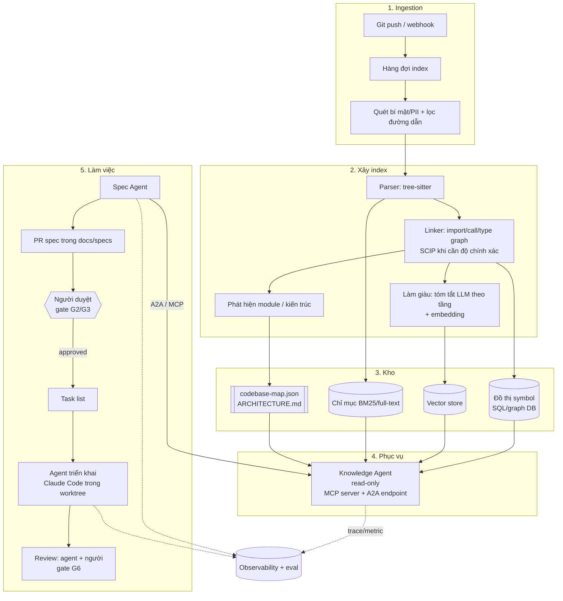

# Kiến trúc tham chiếu và lộ trình xây dựng hệ thống code intelligence

**Mục đích:** ghép mọi phần trong thư mục này thành một kiến trúc end-to-end: từ commit mới, qua parse/link/làm giàu semantic, tới Knowledge Agent, Spec Agent, cổng duyệt của người và agent triển khai. Kèm lộ trình theo giai đoạn có tiêu chí hoàn thành, quyết định tự xây hay dùng sẵn, khung dự án Python, ước lượng chi phí/độ trễ và các anti-pattern.

**Liên quan:** [03-parse-code-voi-tree-sitter.md](03-parse-code-voi-tree-sitter.md) · [04-linker-do-thi-symbol.md](04-linker-do-thi-symbol.md) · [05-encoder-lam-giau-semantic.md](05-encoder-lam-giau-semantic.md) · [06-dau-ra-ban-do-kien-truc.md](06-dau-ra-ban-do-kien-truc.md) · [07-giao-tiep-a2a-va-mcp.md](07-giao-tiep-a2a-va-mcp.md) · [08-spec-trong-source-code.md](08-spec-trong-source-code.md) · [09-quan-tri-governance.md](09-quan-tri-governance.md) · [11-checklist-review-he-thong-agent.md](11-checklist-review-he-thong-agent.md) · [../01-claude-cli-multi-agent/06-mo-hinh-phoi-hop.md](../01-claude-cli-multi-agent/06-mo-hinh-phoi-hop.md)

---

## 1. Kiến trúc tổng thể



## 2. Trách nhiệm và I/O của từng thành phần

| Thành phần | Trách nhiệm | Đầu vào | Đầu ra | Ghi chú lỗi thường gặp |
|---|---|---|---|---|
| Ingestion | Nhận commit, xếp hàng, chống index trùng | Webhook (repo, commit SHA) | Job `{repo, sha, changed_files}` | Index song song 2 commit → kết quả lẫn lộn; dùng khóa theo repo |
| Quét bí mật/PII | Loại file/đoạn nhạy cảm | Danh sách file | Danh sách file sạch + báo cáo loại trừ | Chỉ che mà vẫn index phần còn lại → rò rỉ ngữ cảnh |
| Parser (tree-sitter) | CST → symbol (hàm, lớp, method, route), chunk theo AST | File + ngôn ngữ | `Symbol[]` (id, kind, range, signature, docstring) | Grammar lệch phiên bản; macro C++ khó parse |
| Linker | Nối tham chiếu: import, gọi, kế thừa, đọc/ghi bảng, test ↔ code | `Symbol[]`, cấu hình build (tsconfig, compile_commands.json) | Cạnh `Edge[]` có độ tin cậy | Heuristic theo tên nối nhầm overload; ghi rõ `confidence` |
| Làm giàu | Tóm tắt symbol → file → module (từ dưới lên), embedding | Symbol + cạnh + code | Tóm tắt có trích dẫn, vector | Tóm tắt lan truyền lỗi lên tầng trên; kiểm tra mẫu |
| Phát hiện kiến trúc | Gom module, xác định tầng, điểm vào, phụ thuộc ngoài | Đồ thị + cấu trúc thư mục | `codebase-map.json`, `ARCHITECTURE.md` | Tin hoàn toàn thuật toán cộng đồng mà bỏ qua thư mục có chủ ý |
| Kho | Lưu và truy vấn | Các đầu ra trên | API truy vấn | Không lưu `index_commit` → không biết dữ liệu cũ hay mới |
| Knowledge Agent | Trả lời câu hỏi về code, có trích dẫn | `KnowledgeQuery` | `KnowledgeAnswer` (xem [08](08-spec-trong-source-code.md) mục 4.3) | Trả lời không trích dẫn; tràn ngữ cảnh |
| Spec Agent | Từ yêu cầu → spec có căn cứ → task list | Yêu cầu + trả lời của người | PR spec, `TaskList` | Tự chốt quyết định nghiệp vụ |
| Agent triển khai | Sửa code trong phạm vi task | Task + spec | Diff + báo cáo test | Sửa ngoài `allowed_paths` |
| Observability/Eval | Trace, chi phí, eval hồi quy | Span, kết quả eval | Dashboard, cổng CI | Không ai xem dashboard |

## 3. Tự xây hay dùng sẵn

Câu hỏi đầu tiên: **có cần index không?** Với một repo cỡ vừa, Claude Code đã tìm kiếm theo kiểu agentic (Glob/Grep/Read, subagent Explore) mà không cần vector index. Nó thường đủ tốt và luôn đọc code mới nhất. Chỉ xây index khi có tín hiệu rõ ràng.

| Tín hiệu | Gợi ý |
|---|---|
| Một repo, vài đội, câu hỏi ad-hoc | **Không xây.** Claude Code + `CLAUDE.md` + subagent Explore |
| Câu hỏi kiến trúc lặp lại, onboarding liên tục | Sinh `ARCHITECTURE.md` định kỳ (giai đoạn 1) |
| Nhiều repo, hàng triệu dòng, câu hỏi xuyên repo | Index có đồ thị + tìm kiếm lai (giai đoạn 2) |
| Cần agent khác (Spec Agent, bot review) hỏi tự động | Đóng gói thành MCP server / A2A (giai đoạn 1–3) |
| Ràng buộc dữ liệu không cho gửi code ra ngoài | Cân nhắc model/embedding tự host cho phần index; quyết định ở [09](09-quan-tri-governance.md) mục 7.4 |

Các nhóm giải pháp có sẵn trên thị trường (mô tả theo loại; tính năng và giá thay đổi nhanh, cần tự đánh giá):

| Nhóm | Ví dụ | Mạnh | Hạn chế |
|---|---|---|---|
| Agent lập trình tìm kiếm agentic | Claude Code | Không cần index, luôn đúng commit hiện tại | Câu hỏi toàn cục tốn nhiều lượt đọc |
| Nền tảng tìm kiếm/điều hướng code cấp doanh nghiệp | Sourcegraph (precise code intel dựa trên SCIP) | Đồ thị chính xác, nhiều repo | Vận hành/chi phí nền tảng |
| Ý tưởng "repo map" gọn cho LLM | Repo map của Aider (tree-sitter + xếp hạng symbol) | Rẻ, đơn giản, đáng học hỏi | Không phải dịch vụ hỏi đáp |
| Dịch vụ hỏi đáp/review codebase bằng AI | Greptile và tương tự | Có sẵn, nhanh triển khai | Gửi code ra bên thứ ba; ít tùy biến hợp đồng I/O |

Khuyến nghị: **dùng sẵn cho phần "tìm và đọc code", tự xây phần "hợp đồng và quản trị"** — schema, spec-as-code, eval, cổng duyệt — vì đó là chỗ đặc thù quy trình của bạn.

## 4. Lộ trình theo giai đoạn

### Giai đoạn 0 — Không index (1–2 tuần)

- Claude Code + `CLAUDE.md` chuẩn cho từng repo (quy ước, lệnh test, module chính).
- Subagent tùy chỉnh `codebase-explainer` (chỉ đọc) và mẫu spec ([08](08-spec-trong-source-code.md) mục 5).
- Spec viết bởi Claude Code theo mẫu, có trích dẫn `file:dòng@sha`, người duyệt qua PR.
- Bắt đầu bộ golden 30 câu.

**Tiêu chí hoàn thành:** 5 spec thật được duyệt; đo được tỉ lệ trích dẫn đúng khi người duyệt kiểm tra mẫu; có danh sách câu hỏi mà Claude Code trả lời chậm hoặc sai (đó là lý do để sang giai đoạn 1).
**Rủi ro:** người duyệt tin trích dẫn mà không mở ra xem.

### Giai đoạn 1 — Index symbol + import graph + bản đồ kiến trúc (3–6 tuần)

- Parser tree-sitter cho các ngôn ngữ chính (TypeScript, C++).
- Đồ thị import cấp file/module; symbol table; chỉ mục full-text.
- Sinh `codebase-map.json` + `ARCHITECTURE.md` mỗi lần merge vào main (xem [06](06-dau-ra-ban-do-kien-truc.md)).
- MCP server read-only với vài tool: `find_symbol`, `get_module`, `who_imports`, `read_range`.
- CI kiểm tra code anchor của spec.

**Tiêu chí hoàn thành:** golden ≥ 50 câu, recall@10 symbol đúng ≥ 0,8; bản đồ kiến trúc được tech lead xác nhận đúng ≥ 90% module; index một commit dưới ngưỡng thời gian đã chốt.
**Rủi ro:** ngôn ngữ có macro/codegen (C++, ORM sinh code) làm đồ thị thiếu cạnh.

### Giai đoạn 2 — Đồ thị chính xác + tóm tắt phân tầng + tìm kiếm lai + eval (6–10 tuần)

- Index SCIP (ví dụ scip-typescript; scip-clang cho C++ với `compile_commands.json`) cho cạnh gọi/tham chiếu chính xác. Giữ heuristic tree-sitter làm dự phòng, gắn `confidence`.
- Tóm tắt LLM từ dưới lên (symbol → file → module), có trích dẫn, cập nhật **gia tăng** theo symbol thay đổi.
- Tìm kiếm lai: BM25 + vector + mở rộng theo đồ thị + rerank.
- Eval hồi quy trong CI, dashboard groundedness/chi phí.

**Tiêu chí hoàn thành:** groundedness ≥ 95% trên golden; chi phí trung bình mỗi câu hỏi dưới ngân sách; đổi model có báo cáo eval trước/sau.
**Rủi ro:** chi phí tóm tắt lại toàn repo khi đổi prompt tóm tắt; cần ngân sách và chiến lược cập nhật từng phần.

### Giai đoạn 3 — Pipeline spec đa agent, nhiều repo, dashboard quản trị (8–12 tuần)

- Knowledge Agent mở endpoint A2A (và vẫn giữ MCP); Spec Agent gọi qua A2A với giới hạn độ sâu.
- Pipeline đầy đủ ở [08](08-spec-trong-source-code.md) mục 4, task list → Claude Code chạy nền trong worktree (`claude --bg -w`).
- Nhiều repo, ACL theo repo trong index.
- Dashboard quản trị: chi phí theo spec, tỉ lệ spec bị trả về, sự cố do agent.

**Tiêu chí hoàn thành:** ≥ 70% spec qua review trong ≤ 2 vòng; không sự cố bảo mật dữ liệu; mọi output có provenance đầy đủ.
**Rủi ro:** độ phức tạp vận hành; chuẩn A2A còn phát triển — giữ lớp adapter để đổi giao thức.

| Giai đoạn | Công sức (ước lượng thô, 2–3 kỹ sư) | Giá trị chính |
|---|---|---|
| 0 | 1–2 tuần | Quy trình spec có trích dẫn, bộ golden đầu tiên |
| 1 | 3–6 tuần | Bản đồ kiến trúc tự động, MCP tool |
| 2 | 6–10 tuần | Độ chính xác, đo lường, cổng CI |
| 3 | 8–12 tuần | Tự động hóa đa agent ở quy mô tổ chức |

## 5. Khung dự án Python tối thiểu

```
code-intel/
├── pyproject.toml
├── schemas/                      # JSON Schema có phiên bản — nguồn sự thật cho I/O
│   ├── symbol.schema.json
│   ├── edge.schema.json
│   ├── codebase-map.schema.json
│   ├── knowledge-query.schema.json
│   ├── knowledge-answer.schema.json
│   └── spec.schema.json
├── codeintel/
│   ├── ingest/
│   │   ├── webhook.py            # nhận push, tạo job
│   │   └── scrub.py              # gitleaks + luật đường dẫn
│   ├── parse/
│   │   ├── treesitter.py         # parse file → Symbol[]
│   │   └── queries/              # *.scm cho từng ngôn ngữ
│   ├── link/
│   │   ├── imports.py            # import graph
│   │   ├── heuristics.py         # nối gọi theo tên (confidence thấp)
│   │   └── scip_loader.py        # nạp index SCIP (confidence cao)
│   ├── enrich/
│   │   ├── summarize.py          # tóm tắt phân tầng, có trích dẫn
│   │   └── embed.py
│   ├── architecture/
│   │   ├── modules.py            # gom module
│   │   └── render.py             # codebase-map.json → ARCHITECTURE.md
│   ├── store/
│   │   ├── graph.py              # SQL (Postgres) hoặc graph DB
│   │   ├── vectors.py
│   │   └── fulltext.py
│   ├── retrieve/
│   │   └── hybrid.py             # BM25 + vector + graph expand + rerank
│   ├── agents/
│   │   ├── knowledge/
│   │   │   ├── mcp_server.py     # tool read-only
│   │   │   ├── a2a_endpoint.py
│   │   │   └── prompts/system.md
│   │   └── spec/
│   │       ├── pipeline.py
│   │       └── prompts/system.md
│   ├── governance/
│   │   ├── validate.py           # schema + kiểm tra trích dẫn
│   │   ├── budget.py             # giới hạn lượt/token/thời gian, circuit breaker
│   │   └── provenance.py
│   └── obs/
│       └── tracing.py            # OpenTelemetry
├── evals/
│   ├── golden/*.yaml
│   └── run_evals.py
└── tests/
```

Giao diện chính (Python, phác thảo — kiểu dữ liệu là ví dụ, không phải thư viện có sẵn):

```python
from dataclasses import dataclass
from typing import Literal, Protocol

@dataclass(frozen=True)
class Symbol:
    id: str            # "ts:src/modules/exams/attempt.service.ts#AttemptService.submit"
    kind: Literal["function", "method", "class", "route", "table", "test"]
    path: str
    start_line: int
    end_line: int
    signature: str
    doc: str | None

@dataclass(frozen=True)
class Edge:
    src: str
    dst: str
    kind: Literal["imports", "calls", "extends", "reads", "writes", "tests", "publishes", "consumes"]
    confidence: float  # 1.0 từ SCIP, < 1.0 từ heuristic

class Parser(Protocol):
    def parse(self, path: str, source: bytes) -> list[Symbol]: ...

class Linker(Protocol):
    def link(self, symbols: list[Symbol], repo_root: str) -> list[Edge]: ...

class Retriever(Protocol):
    def search(self, query: str, repo_ids: list[str], k: int = 20) -> list[Symbol]: ...

class KnowledgeService(Protocol):
    def ask(self, query: dict) -> dict: ...   # KnowledgeQuery -> KnowledgeAnswer (đã validate)
```

Với phần gọi Claude trong `KnowledgeService.ask`: dùng SDK chính thức `anthropic`, model mặc định `claude-opus-5-5`; ép đầu ra theo `knowledge-answer.schema.json` bằng structured outputs (`output_config.format`). Đặt system prompt và định nghĩa tool cố định ở đầu request để tận dụng prompt caching. Phần chạy hàng loạt (tóm tắt toàn repo, chạy golden) dùng Message Batches. Xem tài liệu SDK chính thức để lấy đúng cú pháp; đoạn trên chỉ là khung.

## 6. Ước lượng chi phí và độ trễ

Con số dưới đây là **thứ tự độ lớn để lập kế hoạch**, phải đo lại trên repo thật. Giá model thay đổi; kiểm tra bảng giá hiện hành.

| Công việc | Tần suất | Yếu tố quyết định chi phí | Độ trễ mục tiêu |
|---|---|---|---|
| Parse + link một commit (gia tăng) | Mỗi merge | CPU, không tốn token | Vài giây đến vài phút |
| Tóm tắt lại toàn repo | Hiếm (đổi prompt/model) | Số symbol × token mỗi tóm tắt; dùng Batches để giảm giá | Hàng giờ, chạy nền |
| Tóm tắt gia tăng | Mỗi merge | Số symbol thay đổi + tóm tắt file/module cha | Vài phút |
| Một câu hỏi Knowledge Agent | Theo nhu cầu | Ngữ cảnh truy xuất (thường 5–30k token), tỉ lệ cache hit | p95 vài chục giây |
| Một spec đầy đủ | Theo tính năng | 5–20 câu hỏi Knowledge + soạn thảo | Vài phút, không cần realtime |
| Golden eval trong CI | Mỗi PR liên quan | Số câu × số lần chạy | Dưới 15–30 phút |

Đòn bẩy giảm chi phí theo thứ tự: prompt caching (phần cố định đặt đầu) → truy xuất gọn hơn (ít chunk, đúng chunk) → effort thấp hơn cho bước đơn giản → model nhỏ hơn cho bước cơ học (đo bằng eval trước khi đổi) → Batches cho việc không gấp.

## 7. Anti-pattern

| Anti-pattern | Vì sao hại | Thay bằng |
|---|---|---|
| Embed mọi thứ, không có đồ thị | Tìm được đoạn "giống" nhưng không biết ai gọi ai; câu hỏi kiến trúc trả lời sai | Đồ thị symbol là xương sống; vector là một tín hiệu truy xuất |
| Chunk theo số ký tự | Cắt đôi hàm, mất ngữ cảnh | Chunk theo AST (hàm/lớp) + ngữ cảnh cha |
| Không có eval | Mọi thay đổi là đoán; chất lượng trôi âm thầm | Bộ golden + cổng CI |
| Một agent khổng lồ làm mọi thứ | Ngữ cảnh phình, quyền quá rộng, khó debug | Agent nhỏ, quyền hẹp, hợp đồng rõ |
| Agent tự duyệt spec của mình | Mất cổng kiểm soát; injection thành quyết định | Chỉ người ký; CI chặn agent sửa trường duyệt |
| Index không ghi commit | Trả lời theo code cũ mà không ai biết | `index_commit` trong mọi output |
| Xây hạ tầng giai đoạn 3 khi chưa qua giai đoạn 0 | Tốn công cho vấn đề chưa chứng minh | Bắt đầu không index, đo, rồi mới mở rộng |
| Index bí mật rồi "xóa vector" | Bí mật vẫn coi là lộ | Quét trước khi index; xoay vòng bí mật nếu lỡ |

## Checklist review

Khi duyệt kiến trúc hoặc kế hoạch xây hệ thống code intelligence:

- [ ] Có lý do rõ (tín hiệu đo được) cho việc xây index, thay vì dùng tìm kiếm agentic sẵn có.
- [ ] Mỗi thành phần có trách nhiệm và hợp đồng I/O (schema) rõ ràng; không thành phần nào "làm mọi thứ".
- [ ] Đồ thị symbol là nền; vector chỉ là một tín hiệu; chunk theo AST.
- [ ] Mọi dữ liệu trong kho gắn `repo_id` và `index_commit`; cập nhật gia tăng theo thay đổi.
- [ ] Knowledge Agent chỉ đọc; Spec Agent không sửa code và không ghi trường duyệt.
- [ ] Lộ trình có tiêu chí hoàn thành đo được cho từng giai đoạn; không nhảy giai đoạn.
- [ ] Quyết định tự xây/dùng sẵn có so sánh và đã tính ràng buộc dữ liệu.
- [ ] Có ước lượng chi phí/độ trễ và ngân sách; có kế hoạch dùng caching/Batches.
- [ ] Có kế hoạch eval và observability ngay từ giai đoạn 0–1, không để cuối.
- [ ] Đã rà các anti-pattern ở mục 7.
