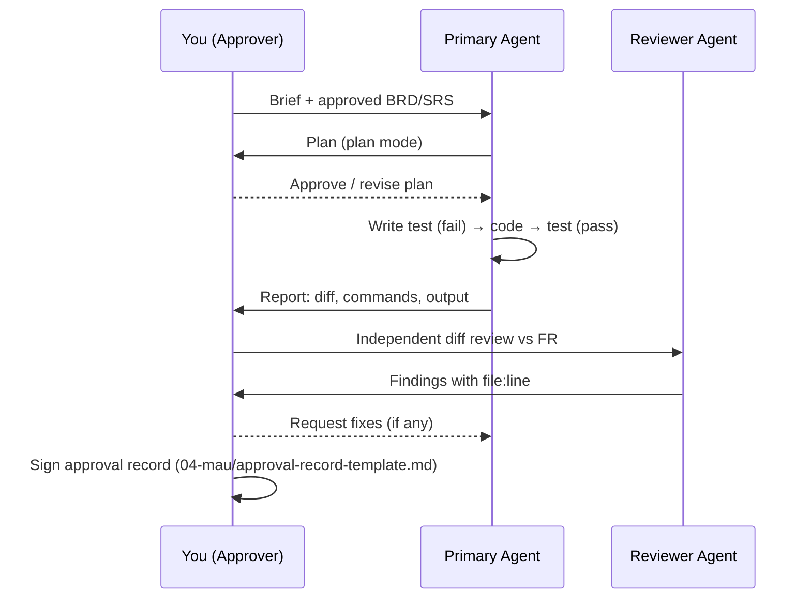

# Applying Agents Across Each Stage: BRD → Release

**Purpose:** Bridge Part 1 (tooling) and Part 2 (process): at each stage, what the agent does, how you delegate work, and what you approve before moving forward.
**Related:** [../02-quy-trinh-phan-mem/00-tong-quan.md](../02-quy-trinh-phan-mem/00-tong-quan.md) · [../02-quy-trinh-phan-mem/09-checklist-phe-duyet.md](../02-quy-trinh-phan-mem/09-checklist-phe-duyet.md) · [../01-claude-cli-multi-agent/05-prompt.md](../01-claude-cli-multi-agent/05-prompt.md)

---

## 1. Role Separation Principles

| What the Agent does | What You (the Approver) do |
|---|---|
| Drafts documents, analyzes options, proposes approaches | Chooses the approach and accepts risks |
| Writes code, tests, and documentation | Reviews against checklists and demands evidence |
| Runs verification commands and reports output | Verifies the output is real and sufficient |
| Flags ambiguities with `[NEEDS CONFIRMATION]` | Answers with stakeholders |
| — | **Signs off approval and owns accountability** |

An agent **never** approves its own output. This repo enforces that principle: the `aiic-astec:okf-docs` skill keeps human sign-off strictly separate.

## 2. Stage-by-Stage Table

| Gate | Stage | Agent support | Starter prompt | Coordination model | What you approve |
|---|---|---|---|---|---|
| G0 | Idea / raw request | Clarifying interview, summary | "Ask me one question at a time to clarify requirement <X>, then summarize problem, goals, and scope" | 1 session | Whether the problem is worth solving |
| G1 | BRD | Drafts BRD from template | "Write BRD using @knowledge/04-mau/brd-template.md from @notes.md. Do not invent numbers; mark missing info as [NEEDS CONFIRMATION]" | 1 session + 1 devil's advocate subagent | [01-brd.md](../02-quy-trinh-phan-mem/01-brd.md) checklist |
| G2 | SRS/PRD | Splits BR → FR/NFR, writes AC | "From the approved BRD, write SRS; trace every FR to a BR-ID; write AC in Given/When/Then format" | 1 session; subagent checks traceability | [02-yeu-cau-srs-prd.md](../02-quy-trinh-phan-mem/02-yeu-cau-srs-prd.md) |
| G3 | Design | Proposes options, writes ADR | "Use workflow: 3 independent architecture options, score against NFRs, write ADR" | Judge panel (workflow) | [03-thiet-ke.md](../02-quy-trinh-phan-mem/03-thiet-ke.md) |
| G4 | Planning | WBS, splits tasks for agents | "Break SRS into ≤ 1-day tasks, each with file scope, AC, verification command, and dependencies" | Plan mode | [04-lap-ke-hoach.md](../02-quy-trinh-phan-mem/04-lap-ke-hoach.md) |
| G5 | Development | Code + unit tests | Brief following [05-prompt.md](../01-claude-cli-multi-agent/05-prompt.md) | `claude --bg -w` per task; Tester first, Dev second | [05-phat-trien.md](../02-quy-trinh-phan-mem/05-phat-trien.md) |
| G6 | Code review | Independent review | `/code-review high`; fresh-context reviewer session | Writer/Reviewer | [06-code-review.md](../02-quy-trinh-phan-mem/06-code-review.md) |
| G7 | Testing | Writes test plan, test cases, runs & reports | "From AC in SRS, write test plan + test cases; run them; report pass/fail with output" | Subagent per test level | [07-kiem-thu.md](../02-quy-trinh-phan-mem/07-kiem-thu.md) |
| G8 | Release | Changelog, release notes, go/no-go checklist | "From git log <tag>..HEAD write CHANGELOG and release notes; fill @knowledge/04-mau/release-checklist-template.md" | 1 session | [08-release.md](../02-quy-trinh-phan-mem/08-release.md) |

## 3. Sample Workflow for a Feature

## 4. Tools Available in This Repo

| Tool | Stage used |
|---|---|
| `/aiic-astec:okf-docs` | Author and validate docs with stable IDs: plan, spec, ADR, unittest, verify, review, changelog — human sign-off |
| `prepare-pr` (`aiic-astec` plugin) | Prepare PR, validate commit trailers |
| `/code-review`, `/security-review` | G6 |
| `aiic-astec` gitleaks + PII git hooks | Every commit/push — blocks secret leaks |

## 5. Five Questions Before Clicking "Approve"

1. Does this deliverable match the **original requirements** (BR/FR-ID) — have I verified it myself?
2. Is the evidence (commands + output, tests, citations) real and have I inspected it?
3. Was anything **out of scope** modified?
4. Did the agent flag any uncertainties, and have I resolved them?
5. If this goes wrong, what is the blast radius and do we have a rollback path?

If any question cannot be answered → do not approve yet, or approve with explicit conditions recorded in the approval record.
